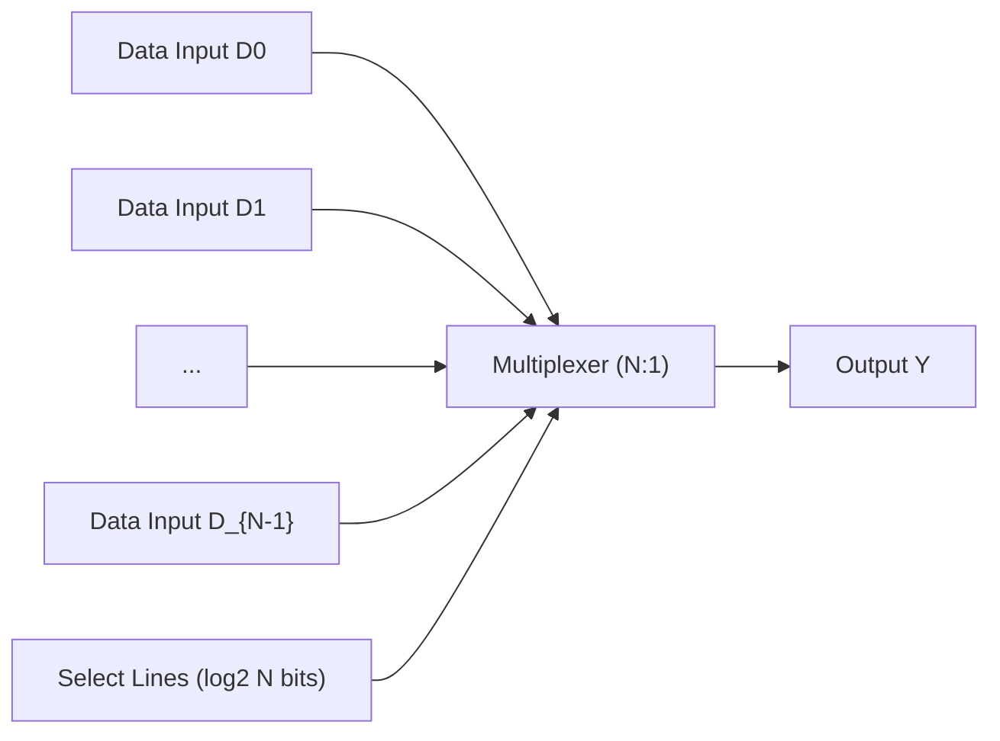
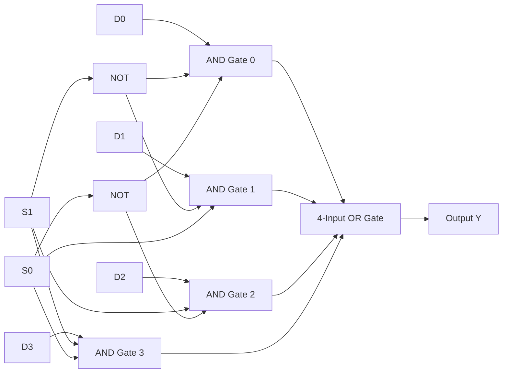
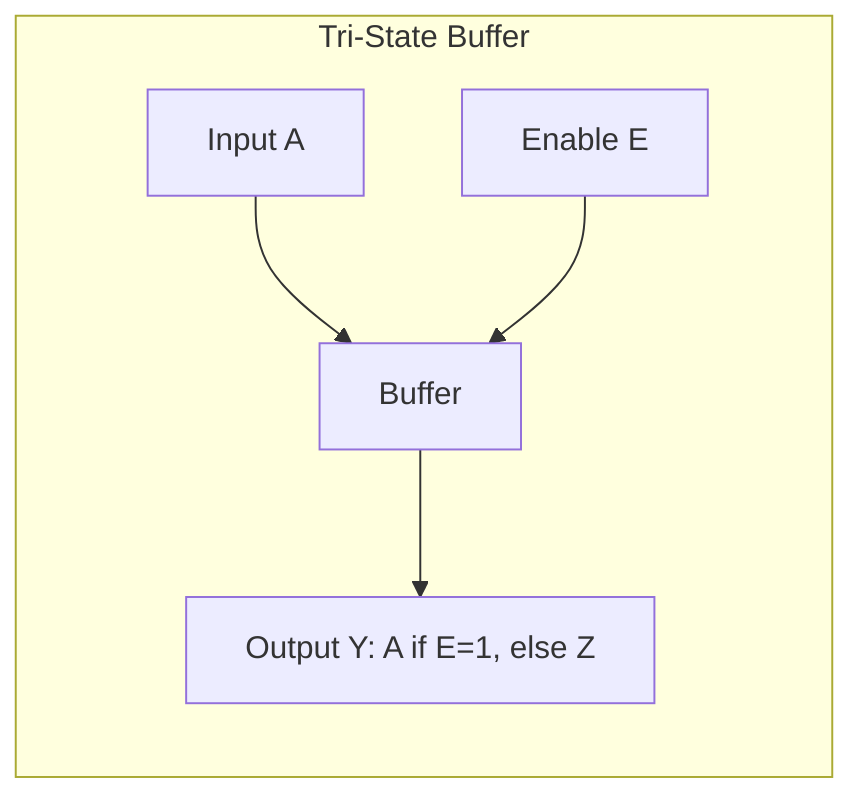
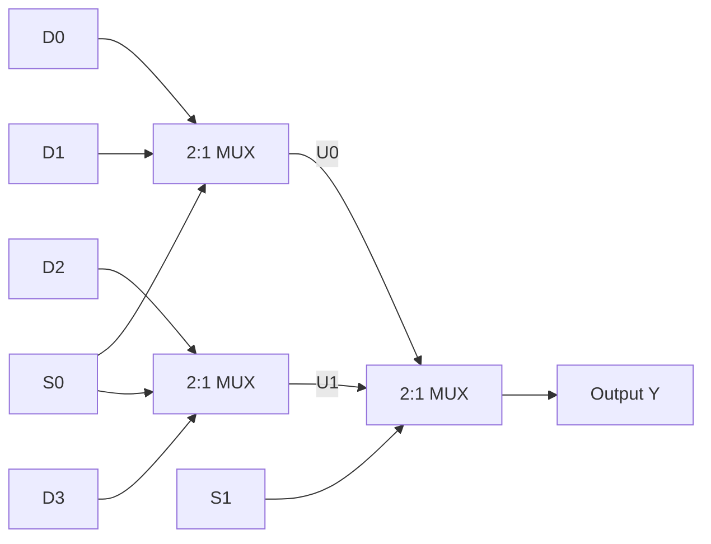
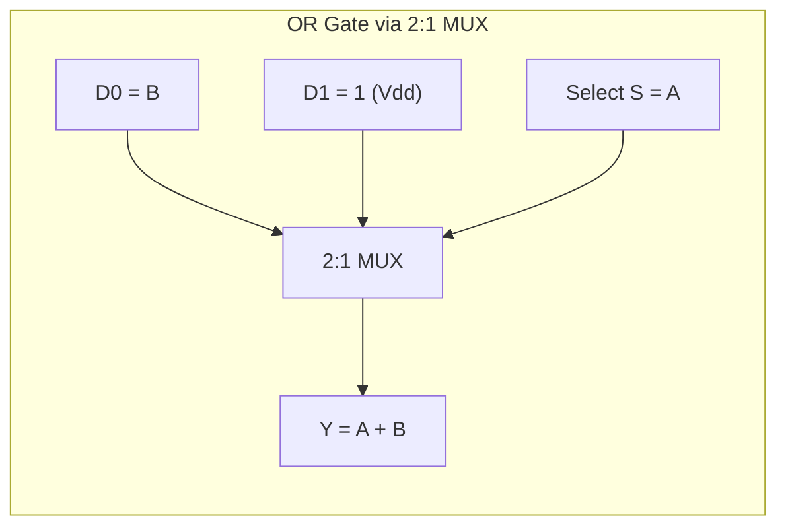
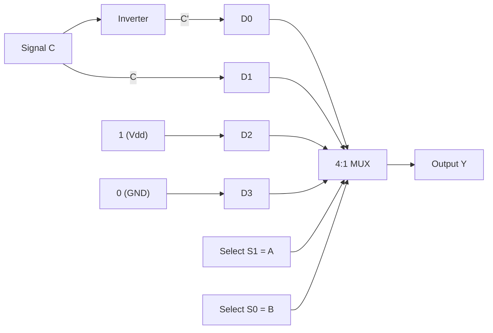
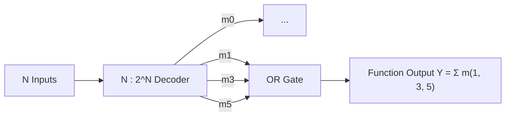
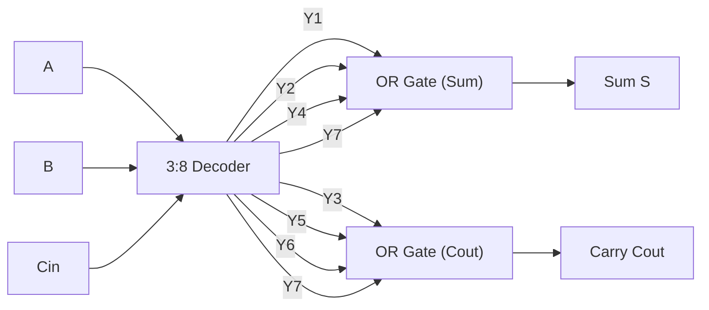

[DLCD Index](../README.md) / [Unit 1: Combinational and Sequential Logic Design](Introduction.md)

# L04 - Combinational Building Blocks - Multiplexers and Decoders

When designing complex digital systems like microprocessors, wiring individual NAND, NOR, and NOT gates quickly becomes unmanageable. Just as software engineering uses modular functions and libraries to hide low-level details, digital hardware engineering relies on modular **combinational building blocks**.

By grouping gates into standardized, higher-level components, we raise the level of abstraction. In this lecture, we examine two of the most ubiquitous building blocks in computer architecture: **multiplexers** (data selectors and universal function generators) and **decoders** (minterm generators and addressing circuits), alongside the tri-state buses that interconnect them.

---

## Multiplexers (MUX): The Digital Switch

A **multiplexer** (abbreviated as **MUX** and often called a data selector) connects one of $N$ data inputs to a single output line based on the value of control select lines.

To choose among $N$ data inputs, we need enough binary patterns to uniquely identify each input. Therefore, the number of select lines $S$ is given by:

$$S = \lceil \log_2 N \rceil$$

A multiplexer acts like a digitally controlled multi-position rotary switch.

---

## 2:1 and 4:1 Multiplexer Architectures

Let's dissect the operation and internal circuitry of the fundamental 2:1 and 4:1 multiplexers.

### The 2:1 Multiplexer
A 2:1 MUX has two data inputs ($D_0, D_1$), one select line ($S$), and one output ($Y$):
- When $S = 0$, input $D_0$ is routed to output $Y$.
- When $S = 1$, input $D_1$ is routed to output $Y$.

| Select ($S$) | Output ($Y$) |
|:---:|:---:|
| 0 | $D_0$ |
| 1 | $D_1$ |

From the truth table, we can write the Boolean equation directly in Sum-of-Products form:

$$Y = \overline{S} D_0 + S D_1$$

### The 4:1 Multiplexer
A 4:1 MUX has four data inputs ($D_0, D_1, D_2, D_3$), two select lines ($S_1, S_0$), and one output ($Y$):

| $S_1$ | $S_0$ | Output ($Y$) | Selected Data Input |
|:---:|:---:|:---:|:---:|
| 0 | 0 | $D_0$ | Input 0 |
| 0 | 1 | $D_1$ | Input 1 |
| 1 | 0 | $D_2$ | Input 2 |
| 1 | 1 | $D_3$ | Input 3 |

The SOP equation for a 4:1 MUX is:

$$Y = \overline{S_1}\ \overline{S_0} D_0 + \overline{S_1} S_0 D_1 + S_1 \overline{S_0} D_2 + S_1 S_0 D_3$$

---

## Three Ways to Build a Multiplexer

Digital designers have three distinct circuit topologies to synthesize a multiplexer depending on speed, area, and silicon technology constraints.

### 1. Two-Level AND-OR Logic
The most direct implementation synthesizes the SOP equation using a bank of AND gates feeding an OR gate. For an $N$-input multiplexer, each AND gate decodes one unique select state and gates through one data input.

### 2. Tri-State Buffers and Shared Buses
A **tri-state buffer** is a non-inverting driver with an enable pin ($E$). Unlike standard logic gates that output only $0$ or $1$, a tri-state buffer has three possible output states:
- When $E = 1$ (Enabled): The buffer drives the output to $0$ or $1$ matching input $A$.
- When $E = 0$ (Disabled): The output enters a **High-Impedance state ($Z$)**, electrically disconnecting itself from the wire (behaving like an open switch).

To build a 2:1 MUX using tri-state buffers:
- Connect data input $D_0$ through a tri-state buffer enabled by $\overline{S}$.
- Connect data input $D_1$ through a tri-state buffer enabled by $S$.
- Tie both buffer outputs directly together onto a shared wire $Y$.

Because $S$ can only be $0$ or $1$, exactly one buffer is active at any instant. When $S = 0$, buffer 0 drives the wire with $D_0$ while buffer 1 is in state $Z$ (disconnected). When $S = 1$, buffer 1 drives $D_1$ while buffer 0 floats. Contention is completely avoided!

### 3. Hierarchical Multiplexer Trees
Larger multiplexers can be synthesized recursively from smaller ones. For example, a 4:1 MUX can be built using three 2:1 MUXes arranged in a two-stage tree:
- Stage 1 uses two 2:1 MUXes controlled by select bit $S_0$: one selects between $D_0$ and $D_1$, while the second selects between $D_2$ and $D_3$.
- Stage 2 uses a single 2:1 MUX controlled by select bit $S_1$ to choose between the two Stage 1 results.

---

## Logic Synthesis Using Multiplexers

A multiplexer is functionally complete: it can implement **any** arbitrary Boolean function without requiring separate AND or OR gates. This makes multiplexers the foundational building block in Field-Programmable Gate Arrays (FPGAs), where programmable Look-Up Tables (LUTs) are fundamentally multiplexer arrays.

### Method 1: Brute-Force Look-Up Table ($2^N:1$ MUX)
Any $N$-input Boolean function can be implemented using a $2^N:1$ multiplexer:
1. Connect all $N$ input variables directly to the multiplexer select lines.
2. For each data input $D_i$, tie it directly to logic $1$ ($V_{DD}$) if truth table row $i$ outputs $1$, or to logic $0$ (GND) if truth table row $i$ outputs $0$.

For example, to implement a 2-input AND function ($Y = AB$):
- Connect variables $A$ and $B$ to select inputs $S_1$ and $S_0$.
- Truth table values for rows $00, 01, 10, 11$ are $0, 0, 0, 1$.
- Wire $D_0 = 0$, $D_1 = 0$, $D_2 = 0$, $D_3 = 1$.

### Method 2: Size-Reduced Implementation ($2^{N-1}:1$ MUX)
We can cut the multiplexer hardware cost in half! Any $N$-input Boolean function can be implemented using only a **$2^{N-1}:1$ multiplexer**.

The strategy is:
1. Connect $N-1$ of the input variables to the multiplexer select lines.
2. Let the single remaining variable (say, $C$) feed the data inputs in one of four simple forms: $0$, $1$, $C$, or $\overline{C}$.

Let's test this strategy on fundamental gates before tackling a complex function.

#### Synthesizing an XOR Gate using a 2:1 MUX
The XOR truth table has 2 inputs ($A, B$):

| $A$ | $B$ | $Y = A \oplus B$ | Relation to $B$ |
|:---:|:---:|:---:|:---:|
| 0 | 0 | 0 | When $A = 0$, $Y = B$ |
| 0 | 1 | 1 | |
| 1 | 0 | 1 | When $A = 1$, $Y = \overline{B}$ |
| 1 | 1 | 0 | |

If we assign $A$ to select line $S$:
- When $S = A = 0$, the output must equal $B$. Hence, connect data input $D_0 = B$.
- When $S = A = 1$, the output must equal $\overline{B}$. Hence, connect data input $D_1 = \overline{B}$.

We have synthesized a 2-input XOR gate using a single 2:1 MUX and one inverter!

#### Synthesizing an OR Gate using a 2:1 MUX
The OR truth table ($Y = A + B$):
- When $A = 0$: if $B = 0 \to Y = 0$; if $B = 1 \to Y = 1$. Thus, $Y = B$. Connect $D_0 = B$.
- When $A = 1$: whether $B$ is $0$ or $1$, $Y = 1$. Connect $D_1 = 1$.

---

## Detailed Case Study: Alyssa P. Hacker's Senior Project

Let's walk through the classic textbook problem from Harris & Harris to master MUX-based logic synthesis.

Alyssa P. Hacker needs to implement the Boolean function:

$$Y = AB' + B'C' + A'BC$$

### Part A: Implementation with an 8:1 Multiplexer
First, let's construct the complete 3-variable truth table:

| Row ($i$) | $A$ | $B$ | $C$ | $AB'$ | $B'C'$ | $A'BC$ | Output ($Y$) |
|:---:|:---:|:---:|:---:|:---:|:---:|:---:|:---:|
| 0 | 0 | 0 | 0 | 0 | 1 | 0 | **1** |
| 1 | 0 | 0 | 1 | 0 | 0 | 0 | **0** |
| 2 | 0 | 1 | 0 | 0 | 0 | 0 | **0** |
| 3 | 0 | 1 | 1 | 0 | 0 | 1 | **1** |
| 4 | 1 | 0 | 0 | 1 | 1 | 0 | **1** |
| 5 | 1 | 0 | 1 | 1 | 0 | 0 | **1** |
| 6 | 1 | 1 | 0 | 0 | 0 | 0 | **0** |
| 7 | 1 | 1 | 1 | 0 | 0 | 0 | **0** |

The function in canonical minterm form is:

$$Y = \sum m(0, 3, 4, 5)$$

To implement this with an 8:1 MUX:
- Connect select lines $S_2 = A, S_1 = B, S_0 = C$.
- Connect data inputs matching minterms: $D_0 = 1, D_1 = 0, D_2 = 0, D_3 = 1, D_4 = 1, D_5 = 1, D_6 = 0, D_7 = 0$.

### Part B: The 20-Volt Accident and 4:1 MUX Recovery
The night before her presentation, Alyssa accidentally connects 20 V to her 8:1 MUX, destroying it. Her lab partner can only provide a **4:1 MUX** and an **inverter**. Can she still implement $Y$?

Yes! We use the size-reduction technique:
- Choose variables $A$ and $B$ to drive select lines $S_1$ and $S_0$.
- Determine what data input $D_i$ must receive as a function of the remaining variable $C$:

1. **For $AB = 00$ (Rows 0 and 1)**:
   - When $C = 0 \to Y = 1$.
   - When $C = 1 \to Y = 0$.
   - Notice $Y = \overline{C}$. Therefore, connect **$D_0 = \overline{C}$**!

2. **For $AB = 01$ (Rows 2 and 3)**:
   - When $C = 0 \to Y = 0$.
   - When $C = 1 \to Y = 1$.
   - Notice $Y = C$. Therefore, connect **$D_1 = C$**!

3. **For $AB = 10$ (Rows 4 and 5)**:
   - When $C = 0 \to Y = 1$.
   - When $C = 1 \to Y = 1$.
   - The output is permanently high. Therefore, connect **$D_2 = 1$ ($V_{DD}$)**!

4. **For $AB = 11$ (Rows 6 and 7)**:
   - When $C = 0 \to Y = 0$.
   - When $C = 1 \to Y = 0$.
   - The output is permanently low. Therefore, connect **$D_3 = 0$ (GND)**!

Alyssa successfully completes her circuit using only the 4:1 MUX and one single inverter.

---

## Decoders: Minterm Generators

A **decoder** has $N$ input lines and $2^N$ output lines. It decodes the binary value on its inputs and asserts **exactly one** of its outputs HIGH ($1$) while keeping all other outputs LOW ($0$).

Because only one output is active at any time, decoder outputs are described as **one-hot**.

### 2:4 Decoder Operation and Circuit
A 2:4 decoder takes inputs $A_1, A_0$ and generates four outputs $Y_0, Y_1, Y_2, Y_3$:

| $A_1$ | $A_0$ | $Y_3$ | $Y_2$ | $Y_1$ | $Y_0$ | Equivalent Minterm |
|:---:|:---:|:---:|:---:|:---:|:---:|:---:|
| 0 | 0 | 0 | 0 | 0 | **1** | $m_0 = \overline{A_1}\ \overline{A_0}$ |
| 0 | 1 | 0 | 0 | **1** | 0 | $m_1 = \overline{A_1} A_0$ |
| 1 | 0 | 0 | **1** | 0 | 0 | $m_2 = A_1 \overline{A_0}$ |
| 1 | 1 | **1** | 0 | 0 | 0 | $m_3 = A_1 A_0$ |

Each output equation corresponds directly to a canonical minterm:

$$Y_0 = \overline{A_1}\ \overline{A_0}, \quad Y_1 = \overline{A_1} A_0, \quad Y_2 = A_1 \overline{A_0}, \quad Y_3 = A_1 A_0$$

Internally, an $N:2^N$ decoder is simply a bank of $2^N$ AND gates, with inverters supplying true and complemented inputs to generate every possible minterm in silicon.

---

## Implementing Logic Using Decoders and OR Gates

Because an $N:2^N$ decoder generates all $2^N$ minterms of its input variables, we can implement **any arbitrary Boolean function** by connecting the appropriate minterm outputs to an OR gate!

### General Architecture
1. Feed the $N$ input variables into an $N:2^N$ decoder.
2. For each output function, identify its active minterms in canonical SOP form ($\sum m$).
3. Connect those specific decoder output pins into an OR gate.

### Example: Full Adder Implementation
A 1-bit full adder takes three inputs: $A, B, C_{\text{in}}$. Its functional outputs are:
- $\text{Sum } S = \sum m(1, 2, 4, 7)$
- $\text{Carry Out } C_{\text{out}} = \sum m(3, 5, 6, 7)$

We can implement the entire full adder using:
- One **3:8 Decoder** (inputs $A, B, C_{\text{in}}$).
- One 4-input OR gate for $\text{Sum}$, connected to decoder pins $Y_1, Y_2, Y_4, Y_7$.
- One 4-input OR gate for $C_{\text{out}}$, connected to decoder pins $Y_3, Y_5, Y_6, Y_7$.

---

## Encoders and Priority Encoders

An **encoder** performs the inverse operation of a decoder: it takes $2^N$ input lines (assuming exactly one is asserted) and produces an $N$-bit binary code identifying which line is active.

However, in real systems, multiple input lines might become active simultaneously (e.g., multiple peripheral devices requesting an interrupt from a CPU). A basic encoder produces invalid gibberish under multiple active inputs.

A **priority encoder** resolves this contention by establishing a strict priority hierarchy:
- If multiple inputs are asserted, it generates the binary code for the input with the **highest priority** index.
- It provides an extra **Valid ($V$)** flag output that indicates whether at least one input is currently active, distinguishing "Input 0 is active" from "No input is active".

---

## Key Takeaways

- Multiplexers (MUX) select one of $N$ data inputs using $\lceil \log_2 N \rceil$ select lines.
- MUXes can be synthesized using two-level AND-OR logic, tri-state buffers connected to a shared bus, or hierarchical trees of smaller MUXes.
- A tri-state buffer has three states: $0, 1$, and High Impedance ($Z$). In tri-state MUXes, exactly one driver is enabled while all others float in state $Z$.
- Multiplexers are universal logic generators: any $N$-variable function can be implemented using a $2^N:1$ MUX (brute force) or a $2^{N-1}:1$ MUX with one variable tied to the data inputs.
- Decoders take $N$ inputs and activate exactly one of $2^N$ one-hot outputs, generating all canonical minterms simultaneously.
- Any combinational function can be implemented using an $N:2^N$ decoder combined with OR gates for each output.
- Priority encoders resolve multiple simultaneous active requests by outputting the binary code of the highest-priority input and asserting an active Valid flag.

---

Up to this point, all circuits we have studied are strictly combinational: as soon as the inputs change, the outputs change, leaving no record of previous history. How do digital systems remember information? In the next lecture, [L05 - Storage Elements - Latches and Flip-Flops](L05%20-%20Storage%20Elements%20-%20Latches%20and%20Flip-Flops.md), we introduce feedback loops to build bistable storage elements: latches, flip-flops, and registers.
