[DLCD Index](../README.md) / [Unit 1: Combinational Logic](Introduction.md)

# Logic Gate Implementation with Universal Gates: NAND, NOR, and Bubble Logic

In the preceding lectures, our logic circuits relied on three separate gate types: AND gates, OR gates, and NOT inverters. While this makes conceptual sense on paper, modern semiconductor fabrication plants almost never manufacture separate AND and OR gates.

In CMOS transistor physics, creating an inverting gate is fundamentally simpler than creating a non-inverting gate:
- A CMOS **NAND gate** requires only **4 transistors**.
- A CMOS **NOR gate** requires only **4 transistors**.
- To build a standard **AND gate**, silicon foundries must first build a 4-transistor NAND gate and then append a 2-transistor Inverter to flip the output! An AND gate requires **6 transistors**, consumes more silicon area, and adds an extra gate delay.

Because inverting logic is physically faster, cheaper, and more compact, digital designers build entire computer architectures using **Universal Gates**: logic gates capable of implementing all fundamental Boolean operations without requiring any other component.

In this lecture, we examine the universal properties of **NAND and NOR gates**, master **two-level NAND-NAND and NOR-NOR synthesis**, learn the visual technique of **Bubble Logic**, and explore **Exclusive-OR (XOR) and Exclusive-NOR (XNOR)** parity circuits.

---

## What Makes a Gate Universal?

A logic gate is defined as **universal** if it can reproduce the three elementary Boolean operations: **NOT**, **AND**, and **OR**. If a gate can synthesize these three primitives, it can synthesize any combinational or sequential circuit on Earth.

Both the **NAND** gate and the **NOR** gate are independently universal.

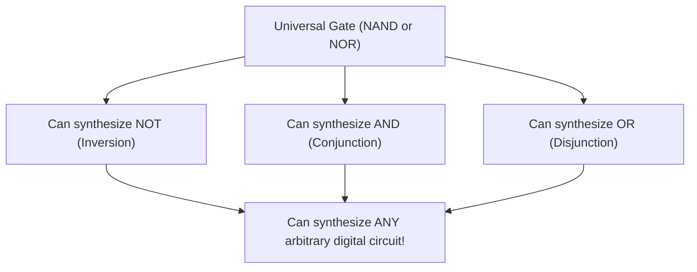

---

## The NAND Gate as a Universal Building Block

The NAND (NOT-AND) gate produces an output that is the exact inverse of an AND gate:

$$Y = (AB)' = \overline{A \cdot B}$$

| $A$ | $B$ | Output $Y = (AB)'$ |
| :---: | :---: | :---: |
| $0$ | $0$ | $1$ |
| $0$ | $1$ | $1$ |
| $1$ | $0$ | $1$ |
| $1$ | $1$ | $0$ |

The output is `0` if and only if **all** inputs are `1`.

### 1. Synthesizing NOT from NAND
By connecting the inputs of a 2-input NAND gate together:
$$Y = (A \cdot A)' = A'$$

Alternatively, tie one input to logical `1` ($V_{DD}$):
$$Y = (A \cdot 1)' = A'$$

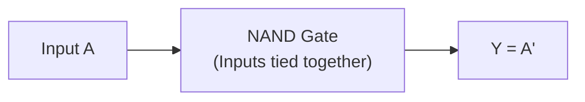

### 2. Synthesizing AND from NAND
An AND gate is simply an inverted NAND. Pass the output of a NAND gate through a NAND-inverter:
$$Y = ((AB)')' = AB$$

Requires **2 NAND gates**:

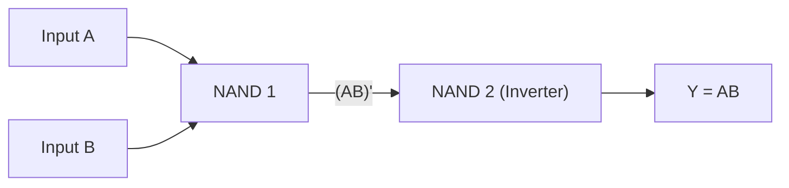

### 3. Synthesizing OR from NAND
Recall DeMorgan's Theorem: $A + B = (A' \cdot B')'$. 

If we invert inputs $A$ and $B$ first, and then pass them into a NAND gate:
$$Y = (A' \cdot B')' = (A')' + (B')' = A + B$$

Requires **3 NAND gates**:

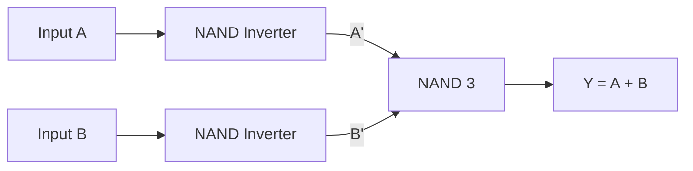

---

## The NOR Gate as a Universal Building Block

The NOR (NOT-OR) gate produces an output that is the exact inverse of an OR gate:

$$Y = (A + B)' = \overline{A + B}$$

| $A$ | $B$ | Output $Y = (A + B)'$ |
| :---: | :---: | :---: |
| $0$ | $0$ | $1$ |
| $0$ | $1$ | $0$ |
| $1$ | $0$ | $0$ |
| $1$ | $1$ | $0$ |

The output is `1` if and only if **all** inputs are `0`.

### 1. Synthesizing NOT from NOR
Tie both inputs together:
$$Y = (A + A)' = A'$$

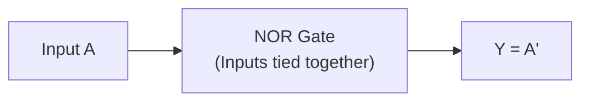

### 2. Synthesizing OR from NOR
Pass the output of a NOR gate through a NOR-inverter:
$$Y = ((A + B)')' = A + B$$

Requires **2 NOR gates**:

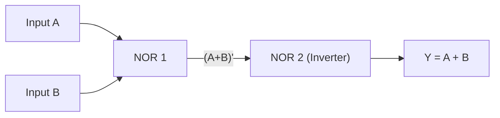

### 3. Synthesizing AND from NOR
Recall the dual DeMorgan's Theorem: $AB = (A' + B')'$. 

Invert both inputs using NOR-inverters, then pass them into a NOR gate:
$$Y = (A' + B')' = (A')' \cdot (B')' = AB$$

Requires **3 NOR gates**:

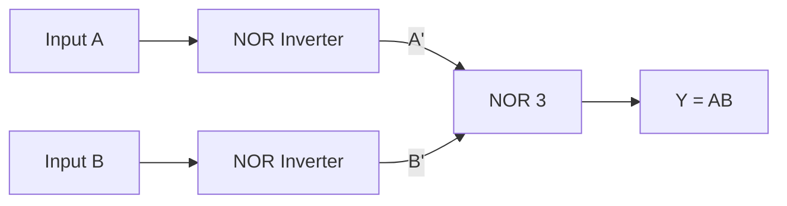

---

## Two-Level NAND-NAND Implementation of SOP Expressions

Digital designers minimize equations into standard Sum of Products (SOP) form because it maps directly to a two-level AND-OR structure. 

Now, consider what happens when you implement an SOP expression using NAND gates. Take a standard SOP function:

$$F = AB + CD$$

Let's apply **double negation** to the entire function:

$$F = ((F)')' = ((AB + CD)')'$$

Now apply DeMorgan's Theorem to the inner term:

$$F = ((AB)' \cdot (CD)')'$$

Look at this equation very carefully:
- $(AB)'$ is a NAND operation between $A$ and $B$.
- $(CD)'$ is a NAND operation between $C$ and $D$.
- The outer expression is a NAND operation between the outputs of the first two gates!

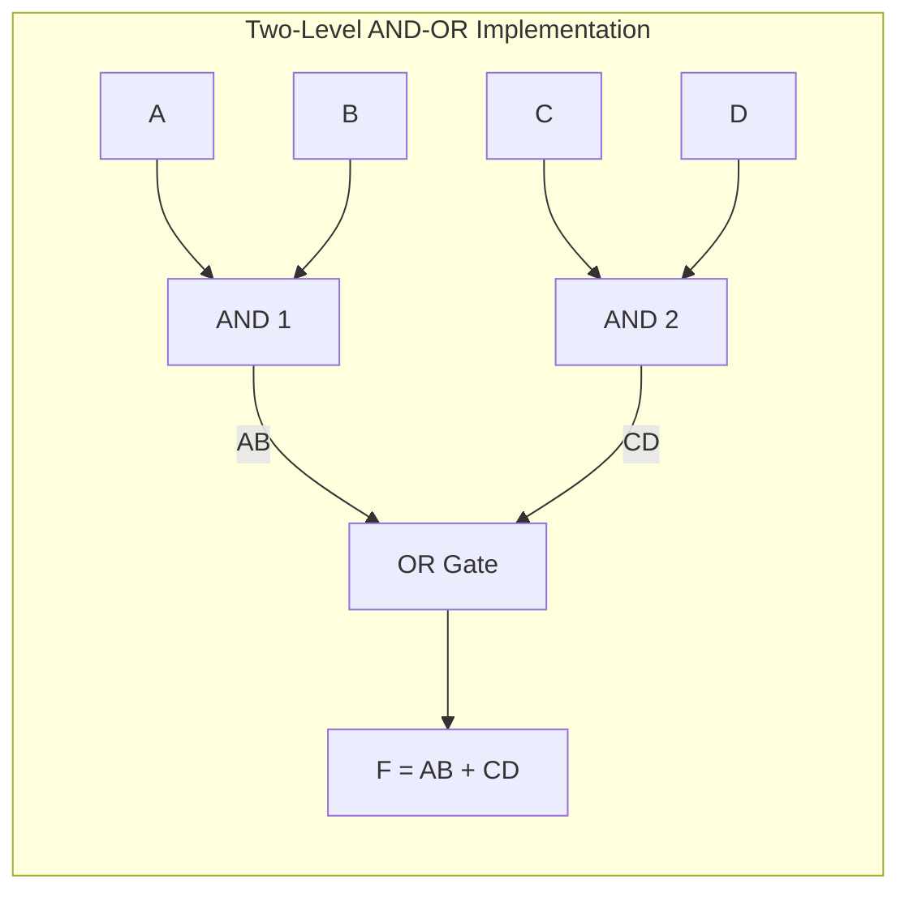

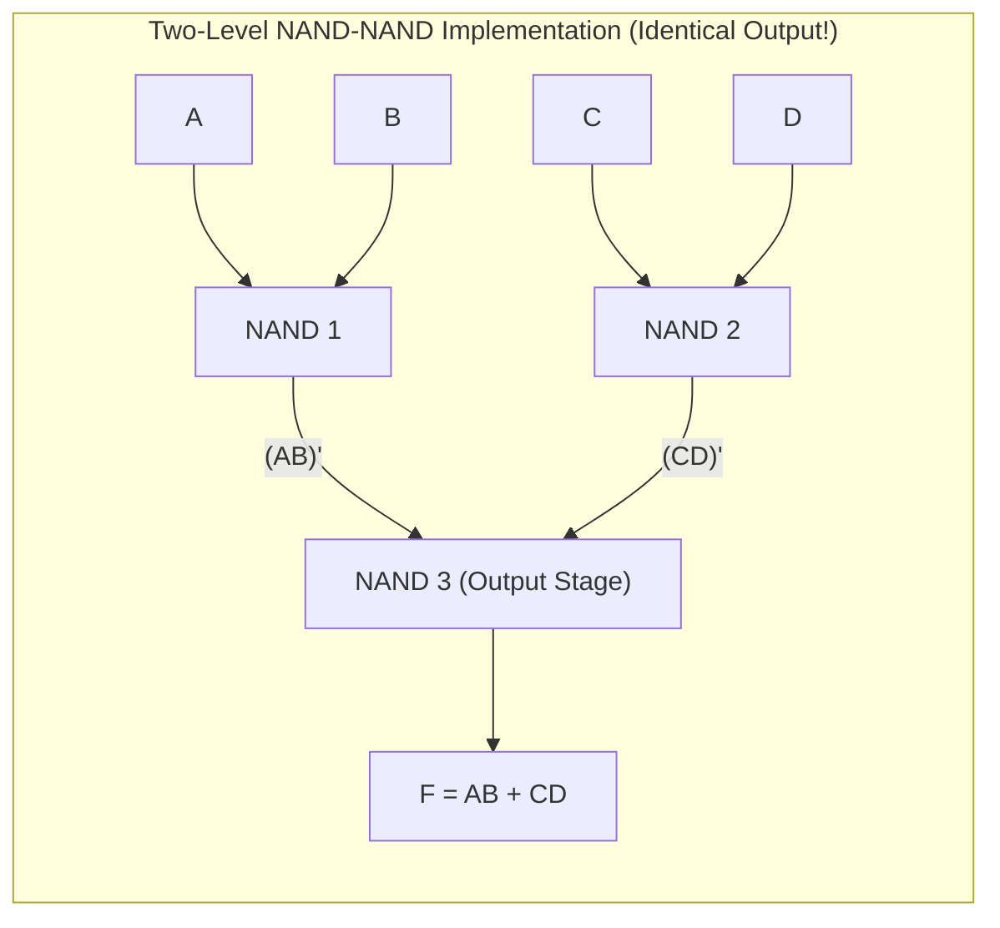

> **The Fundamental NAND-NAND Theorem**:
> Any minimal Sum of Products (SOP) expression can be implemented directly as a **two-level NAND-NAND circuit** by replacing every first-level AND gate with a NAND gate, and replacing the second-level OR gate with a NAND gate. 
> 
> *There is zero algebraic rewriting required!*

---

## Graphic Symbols and Bubble Logic

To make schematic diagrams readable, engineers use two equivalent graphic symbols for every inverting gate, derived directly from DeMorgan's laws.

### The Graphic Symbols for NAND

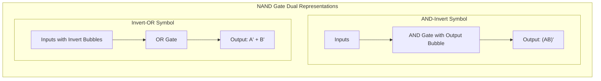

1. **AND-Invert**: An AND symbol with an inversion bubble at the output. Represents $(AB)'$.
2. **Invert-OR**: An OR symbol with inversion bubbles on each input. Represents $A' + B'$.

By DeMorgan's theorem, $(AB)' = A' + B'$. Both symbols represent the exact same physical gate!

### The Graphic Symbols for NOR

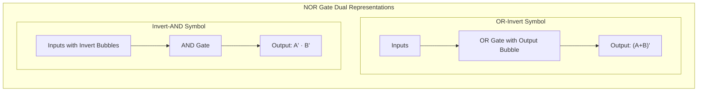

1. **OR-Invert**: An OR symbol with an inversion bubble at the output. Represents $(A + B)'$.
2. **Invert-AND**: An AND symbol with inversion bubbles on each input. Represents $A' \cdot B'$.

### The Bubble Pushing Rule

When drawing multi-level circuits:
- An output bubble represents a logical inversion ($0$ to $1$ or $1$ to $0$).
- An input bubble also represents a logical inversion.
- If an **output bubble connects directly to an input bubble on the next gate**, the two bubbles **cancel each other out** ($x'' = x$). The signal passes through with zero phase shift!

Using the Invert-OR symbol for the second stage of a NAND-NAND circuit makes the cancellation visually obvious: the output bubble of the first-stage NAND cancels the input bubble of the second-stage Invert-OR gate, leaving a clean AND-OR operation.

---

## Two-Level NOR-NOR Implementation of POS Expressions

The dual relationship holds for Product of Sums (POS) expressions implemented with NOR gates:

Consider a standard POS function:

$$F = (A + B)(C + D)$$

Applying double negation and DeMorgan's:

$$F = (((A + B)(C + D))')' = ((A + B)' + (C + D)')'$$

- $(A + B)'$ is a NOR gate.
- $(C + D)'$ is a NOR gate.
- The outer combination is a NOR gate combining the two outputs.

> **The Fundamental NOR-NOR Theorem**:
> Any minimal Product of Sums (POS) expression can be implemented directly as a **two-level NOR-NOR circuit** by replacing every first-level OR gate with a NOR gate, and replacing the second-level AND gate with a NOR gate.

---

## Exclusive-OR (XOR) and Exclusive-NOR (XNOR) Gates

The Exclusive-OR (XOR) and its complement, the Exclusive-NOR (XNOR), are compound operations of paramount importance in arithmetic adders, comparators, and error-detection circuits.

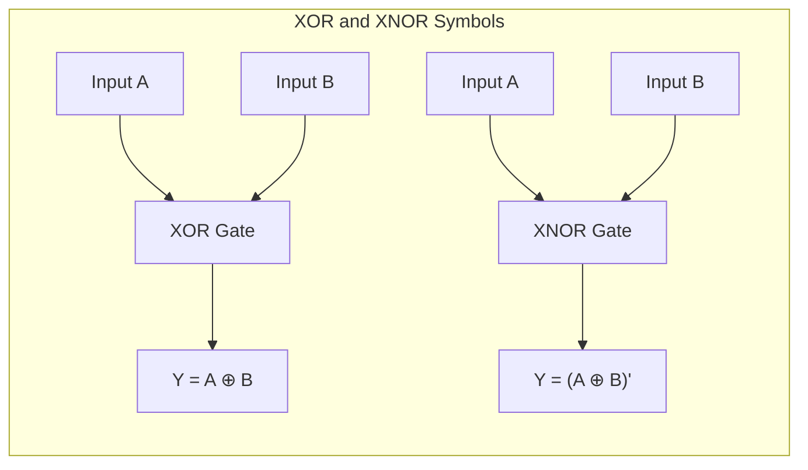

### 1. The XOR Gate (Odd Function)
The output of an XOR gate is `1` if and only if **one input is `1` and the other is `0`**. If both inputs are identical, the output is `0`.

$$Y = A \oplus B = A'B + AB'$$

| $A$ | $B$ | $A \oplus B$ |
| :---: | :---: | :---: |
| $0$ | $0$ | $0$ |
| $0$ | $1$ | $1$ |
| $1$ | $0$ | $1$ |
| $1$ | $1$ | $0$ |

### 2. The XNOR Gate (Equivalence Gate)
The XNOR gate is the complement of XOR. Its output is `1` if and only if **both inputs are equal** ($00$ or $11$). Because it detects whether two inputs match, it is called the **Equivalence Gate**:

$$Y = (A \oplus B)' = AB + A'B'$$

| $A$ | $B$ | $(A \oplus B)'$ |
| :---: | :---: | :---: |
| $0$ | $0$ | $1$ |
| $0$ | $1$ | $0$ |
| $1$ | $0$ | $0$ |
| $1$ | $1$ | $1$ |

### Fundamental Algebraic Properties of XOR
The XOR operator obeys several identities:

1. **Self and Identity**:
   - $x \oplus 0 = x$
   - $x \oplus 1 = x'$ (acts as a programmable inverter!)
   - $x \oplus x = 0$
   - $x \oplus x' = 1$
2. **Commutativity and Associativity**:
   - $x \oplus y = y \oplus x$
   - $(x \oplus y) \oplus z = x \oplus (y \oplus z) = x \oplus y \oplus z$
3. **The Odd Function Property**:
   For any number of variables, $x_1 \oplus x_2 \oplus \dots \oplus x_n$ evaluates to **`1` if and only if an ODD number of variables are equal to `1`**.

---

## Parity Generation and Checking Using XOR Trees

Because an XOR chain evaluates to `1` whenever an odd number of inputs are high, it forms the mathematical basis for **Parity Bit Generation** (used in transmission lines, memory ECC, and link frames).

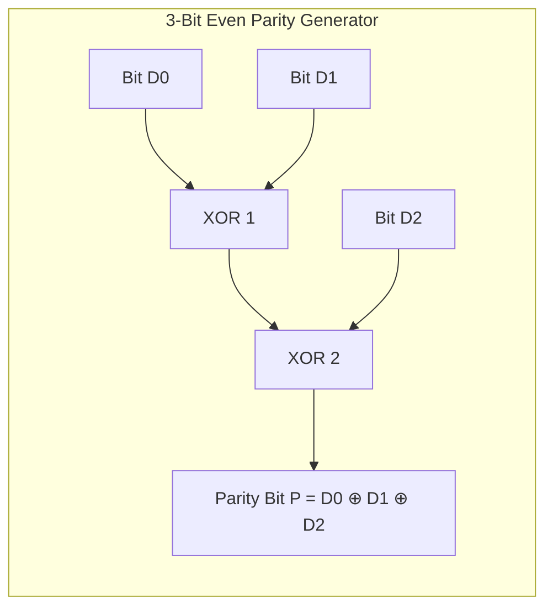

In an **Even Parity** scheme, a parity bit $P$ is appended to a 3-bit data message $D_2 D_1 D_0$ such that the total number of 1s in the transmitted 4-bit word ($D_2 D_1 D_0 P$) is always even:

$$P = D_2 \oplus D_1 \oplus D_0$$

At the receiver, a **Parity Checker** computes:

$$C = D_2 \oplus D_1 \oplus D_0 \oplus P$$

- If $C = 0$: The total number of 1s is even; no single-bit transmission error occurred.
- If $C = 1$: The total number of 1s is odd; a single-bit error corrupted the data during transit!

---

## Key Takeaways

- CMOS inverting gates (NAND and NOR) require fewer transistors (4) and have lower propagation delay than non-inverting AND and OR gates (6).
- A **Universal Gate** can synthesize NOT, AND, and OR operations independently without requiring any other gate type.
- Any minimal Sum of Products (SOP) expression can be implemented directly as a **two-level NAND-NAND circuit** by replacing all first-level AND gates and the second-level OR gate with NAND gates.
- Any minimal Product of Sums (POS) expression can be implemented directly as a **two-level NOR-NOR circuit**.
- **Bubble Logic** uses DeMorgan dual symbols (AND-Invert $\equiv$ Invert-OR; OR-Invert $\equiv$ Invert-AND). Matching an output bubble with an input bubble indicates that inversions cancel each other out.
- The **Exclusive-OR (XOR)** gate ($A \oplus B = A'B + AB'$) is an **odd function**, evaluating to `1` when an odd number of inputs are `1`.
- The **Exclusive-NOR (XNOR)** gate ($AB + A'B'$) is an **equivalence gate**, evaluating to `1` when both inputs are equal. XOR/XNOR trees form the foundation of parity generators and error checkers.

---

Up to this point, our logic circuits have been abstract algebraic equations: simplifying variables and mapping them onto NAND gates. But how does an engineer solve a real-world computing problem from scratch? If a client asks for a circuit that converts 4-bit decimal numbers into binary codes, or detects whether an elevator door should open, what is the exact engineering methodology to turn English specifications into silicon? In the next lecture, we master [**Combinational Logic Analysis and Design Procedures**](L05%20-%20Combinational%20Logic%20Analysis%20and%20Design%20Procedures.md).
