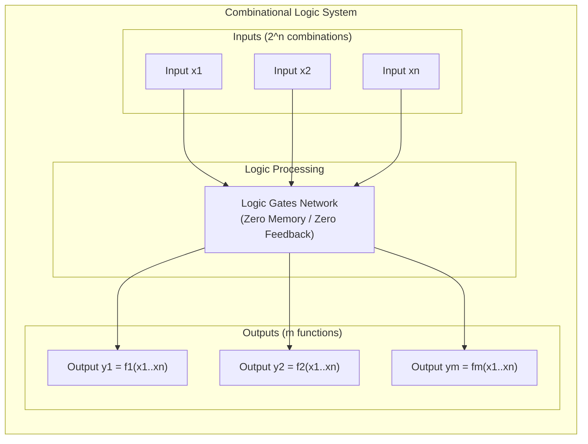
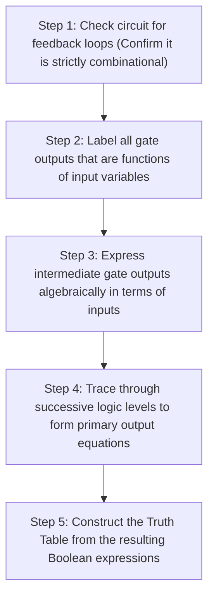
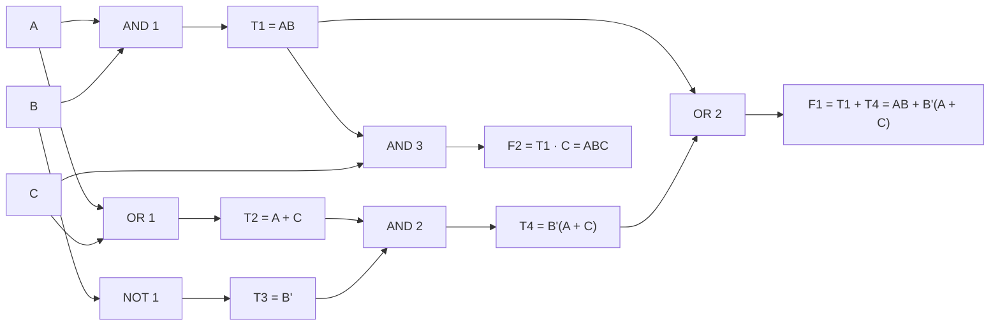
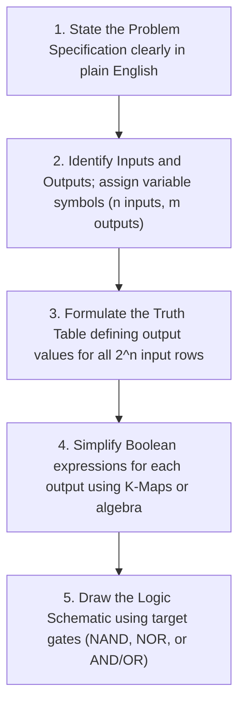
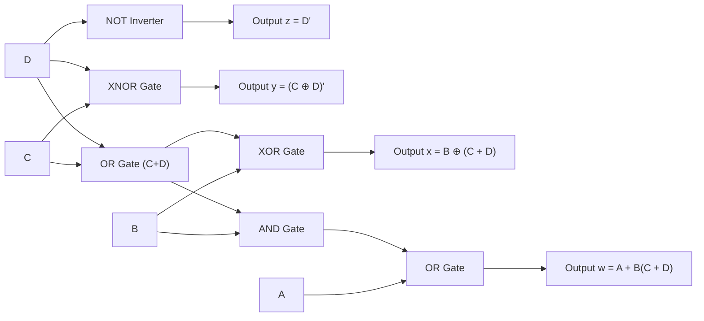
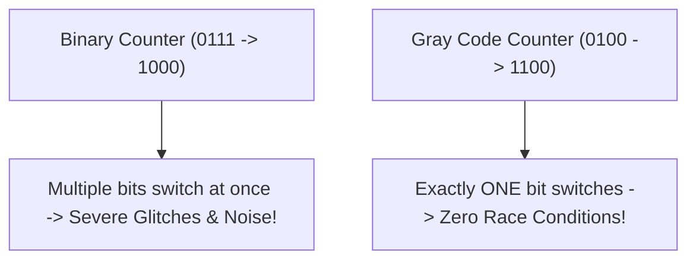
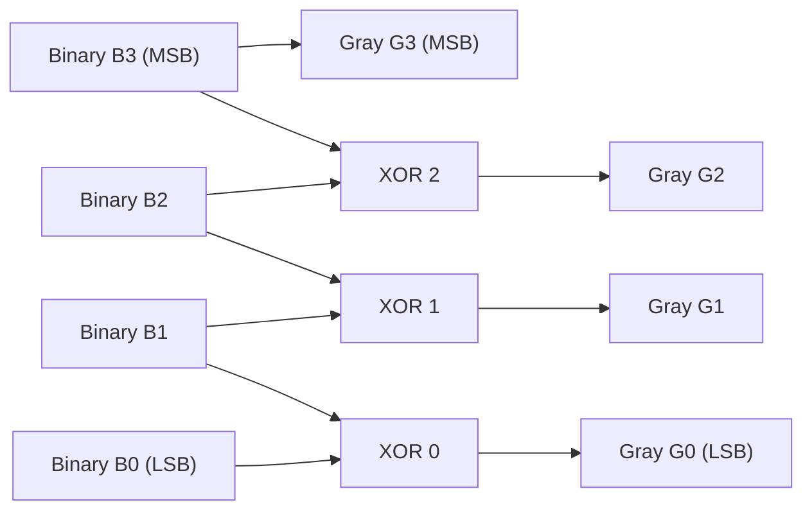

[DLCD Index](../README.md) / [Unit 1: Combinational Logic](Introduction.md)

# Combinational Logic: Analysis and Design Procedures

Up to this point, we have studied the mathematical foundations of digital circuits: Boolean algebra, canonical representations, K-map minimization, and universal gate implementations. But a digital computer is not merely an abstract collection of gates—it is a functional machine built to solve real-world tasks, such as converting sensor inputs, routing data paths, and executing mathematical operations.

Logic circuits fall into two broad architectural categories:
1. **Combinational Circuits**: A connected network of logic gates whose output values at any given instant depend **solely on the current combination of inputs**. The circuit contains **no memory elements** and **no feedback loops**.
2. **Sequential Circuits**: Circuits containing storage elements (latches or flip-flops) alongside logic gates, where outputs depend on both current inputs and past history (internal state).

In this lecture, we master the systematic engineering methodologies for **Combinational Logic**: how to **analyze** an existing gate schematic to determine its exact mathematical behavior, and how to **design** a physical circuit from a verbal word problem through truth tables, K-maps, and gate synthesis. We anchor these procedures in two canonical real-world designs: the **BCD to Excess-3 Code Converter** and the **Binary to Gray Code Converter**.

---

## Block Diagram and Properties of Combinational Circuits

A combinational logic system can be viewed as an interconnected black box containing $n$ binary input variables and $m$ binary output variables:

Key physical characteristics of combinational circuits include:
- **No Memory**: The circuit does not "remember" previous inputs or states. The moment inputs change, the outputs change.
- **Propagation Delay ($t_{pd}$)**: While we model combinational logic as instantaneous, real physical silicon transistors take a finite amount of time (typically picoseconds to nanoseconds) for electrons to charge output capacitances. When inputs switch, the outputs stabilize only after the signal has propagated through the critical path of gates.

---

## The Combinational Analysis Procedure

Analysis is the process of reverse engineering: given a circuit schematic, determine what Boolean function the circuit performs and construct its truth table.

### Step-by-Step Analysis Walkthrough

Consider a combinational circuit with inputs $A, B, C$ and outputs $F_1, F_2$:

1. **Intermediate Nodes**:
   - $T_1 = AB$
   - $T_2 = A + C$
   - $T_3 = B'$
   - $T_4 = T_3 \cdot T_2 = B'(A + C) = AB' + B'C$
2. **Primary Outputs**:
   - $F_1 = T_1 + T_4 = AB + AB' + B'C = A(B + B') + B'C = A + B'C$
   - $F_2 = T_1 \cdot C = ABC$
3. **Truth Table Construction**:
   By substituting binary values for $A, B, C$, we verify that $F_1 = 1$ whenever $A = 1$ or whenever $B = 0$ and $C = 1$.

---

## The Combinational Design Procedure

Design (synthesis) is the forward engineering process: starting from a verbal description of a problem, derive an optimal gate-level circuit.

Let's apply this rigorous methodology to design two essential digital components: **Code Converters**.

---

## Canonical Design 1: BCD to Excess-3 Code Converter

### 1. Problem Specification
In computing and digital communications, decimal digits $0$ through $9$ are often encoded in **Binary Coded Decimal (BCD / 8421 code)**, where each decimal digit is represented by 4 binary bits. 

However, performing arithmetic on pure BCD is complicated because the 9's complement of a BCD digit does not equal its bitwise 1's complement. To make decimal arithmetic easier, designers use the **Excess-3 Code**: an unweighted self-complementing code formed by adding $3$ ($0011_2$) to each BCD digit.

We must design a combinational circuit that takes a 4-bit BCD digit as input and outputs its corresponding 4-bit Excess-3 representation.

### 2. Identifying Inputs and Outputs
- Inputs: 4 bits representing the BCD digit: $A, B, C, D$ (where $A$ is MSB).
- Outputs: 4 bits representing the Excess-3 digit: $w, x, y, z$ (where $w$ is MSB).

### 3. Truth Table Formulation
BCD digits only span $0$ through $9$ ($0000_2$ to $1001_2$). 

The remaining 6 combinations ($1010_2$ to $1111_2$, representing 10 through 15) are invalid in BCD and can never physically occur at the input. Therefore, we assign **Don't Care ($X$)** values to all four outputs for rows 10 through 15!

| Decimal | BCD Input ($A B C D$) | Excess-3 Output ($w x y z$) | Arithmetic ($BCD + 3$) |
| :---: | :---: | :---: | :---: |
| $0$ | $0 \ 0 \ 0 \ 0$ | $0 \ 0 \ 1 \ 1$ | $0 + 3 = 3$ |
| $1$ | $0 \ 0 \ 0 \ 1$ | $0 \ 1 \ 0 \ 0$ | $1 + 3 = 4$ |
| $2$ | $0 \ 0 \ 1 \ 0$ | $0 \ 1 \ 0 \ 1$ | $2 + 3 = 5$ |
| $3$ | $0 \ 0 \ 1 \ 1$ | $0 \ 1 \ 1 \ 0$ | $3 + 3 = 6$ |
| $4$ | $0 \ 1 \ 0 \ 0$ | $0 \ 1 \ 1 \ 1$ | $4 + 3 = 7$ |
| $5$ | $0 \ 1 \ 0 \ 1$ | $1 \ 0 \ 0 \ 0$ | $5 + 3 = 8$ |
| $6$ | $0 \ 1 \ 1 \ 0$ | $1 \ 0 \ 0 \ 1$ | $6 + 3 = 9$ |
| $7$ | $0 \ 1 \ 1 \ 1$ | $1 \ 0 \ 1 \ 0$ | $7 + 3 = 10$ |
| $8$ | $1 \ 0 \ 0 \ 0$ | $1 \ 0 \ 1 \ 1$ | $8 + 3 = 11$ |
| $9$ | $1 \ 0 \ 0 \ 1$ | $1 \ 1 \ 0 \ 0$ | $9 + 3 = 12$ |
| $10-15$ | $1010 \dots 1111$ | $X \ X \ X \ X$ | Invalid BCD (Don't Care) |

### 4. K-Map Minimization for Each Output

#### Minimizing Output $z$:
$z = \sum m(0, 2, 4, 6, 8) + \sum d(10, 11, 12, 13, 14, 15)$

Notice that in every valid row, $z$ is the exact opposite of $D$: when $D=0, z=1$; when $D=1, z=0$.
On the K-map, grouping columns with $D=0$ using the Don't Cares yields:
$$\mathbf{z = D'}$$

#### Minimizing Output $y$:
$y = \sum m(0, 3, 4, 7, 8) + \sum d(10, 11, 12, 13, 14, 15)$

Plotting on the 4-variable map and grouping with Don't Cares:
- A group of two cells gives $C'D'$.
- Another group gives $CD$.
- Combining both:
  $$y = CD + C'D' = \mathbf{(C \oplus D)'}$$

$y$ is simply the Exclusive-NOR of $C$ and $D$!

#### Minimizing Output $x$:
$x = \sum m(1, 2, 3, 4, 9) + \sum d(10, 11, 12, 13, 14, 15)$

Grouping on the K-map:
$$x = B'C + B'D + BC'D' = B'(C + D) + B(C + D)'$$

Notice the structure: let $T = C + D$. Then $x = B'T + BT' = \mathbf{B \oplus (C + D)}$.

#### Minimizing Output $w$:
$w = \sum m(5, 6, 7, 8, 9) + \sum d(10, 11, 12, 13, 14, 15)$

Grouping rows 2 and 3 along with columns containing $C$ and $D$:
$$\mathbf{w = A + BC + BD = A + B(C + D)}$$

Notice how the term $(C + D)$ appears in both the equation for $x$ and the equation for $w$! In physical hardware, we can compute $(C + D)$ once with a single OR gate and share it between both outputs, saving silicon area.

### 5. Logic Circuit Implementation

---

## Canonical Design 2: Binary to Gray Code Converter

### Why Gray Code Matters
In standard binary counting, transitioning from $7$ ($0111_2$) to $8$ ($1000_2$) requires all 4 bits to flip simultaneously.

In physical mechanical sensors (like optical rotary encoders measuring robot joint angles), real-world switches cannot flip at the exact same picosecond. If bit 3 flips slightly before the others, the sensor will momentarily output $1111_2$ ($15$) instead of $8$, causing catastrophic glitches in control systems.

In **Gray Code** (reflected binary code), **only one bit changes between any two consecutive values**, completely eliminating transition race conditions.

### 1. Conversion Rules and Logic Equations
For a 4-bit Binary word $B_3 B_2 B_1 B_0$ converted to Gray code $G_3 G_2 G_1 G_0$:

1. The Most Significant Bit (MSB) remains identical:
   $$\mathbf{G_3 = B_3}$$
2. Every subsequent Gray bit is the Exclusive-OR of that binary bit with the preceding binary bit to its left:
   $$\mathbf{G_2 = B_3 \oplus B_2}$$
   $$\mathbf{G_1 = B_2 \oplus B_1}$$
   $$\mathbf{G_0 = B_1 \oplus B_0}$$

### 2. Logic Circuit Implementation
The entire 4-bit converter requires only three XOR gates:

### The Inverse: Gray Code to Binary Converter
To convert Gray code back into standard Binary:
$$\mathbf{B_3 = G_3}$$
$$\mathbf{B_2 = B_3 \oplus G_2}$$
$$\mathbf{B_1 = B_2 \oplus G_1}$$
$$\mathbf{B_0 = B_1 \oplus G_0}$$

Notice the difference: in Gray-to-Binary, each XOR gate takes the *previously generated binary bit* as an input, creating a sequential ripple of XOR gates.

---

## Key Takeaways

- A **combinational circuit** is a feedback-free network of gates whose outputs at any time depend strictly on the current input values, with no internal memory.
- **Analysis** reverses an existing schematic to derive intermediate terms, output equations, and truth tables.
- **Design** is the forward engineering sequence: Problem Statement $\to$ Truth Table Formulation $\to$ K-Map Simplification $\to$ Logic Schematic.
- **Don't Care ($X$)** states are critical in real-world converters (e.g., BCD states 10–15) to minimize output equations by enlarging K-map groupings.
- The **BCD to Excess-3 Converter** adds $3$ ($0011_2$) to decimal digits, using Don't Cares to yield compact logic sharing the common sub-expression $(C + D)$.
- **Gray Code** changes exactly one bit between consecutive values, preventing race conditions in mechanical sensors and high-speed asynchronous clock domains.
- Binary to Gray conversion is implemented with simple adjacent XOR gates: $G_i = B_{i+1} \oplus B_i$.

---

Now that we know how to design combinational logic systematically, think about the most essential task a digital computer must perform: **Arithmetic**. How does an ALU add two numbers together? How does carry propagate across 32 or 64 bits without choking processor speed? And how can a single circuit perform both addition and subtraction seamlessly? In the next lecture, we analyze [**Binary Adders and Subtractors**](L06%20-%20Binary%20Adders%20and%20Subtractors.md).
