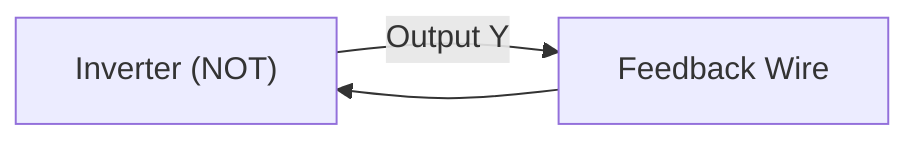
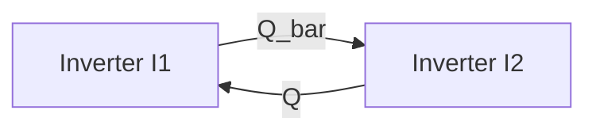
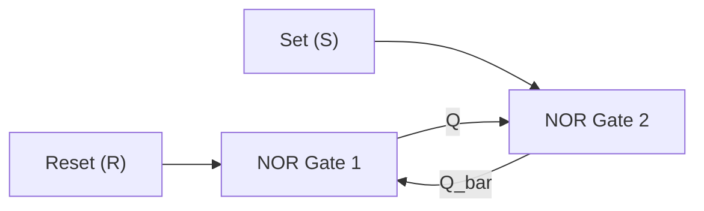
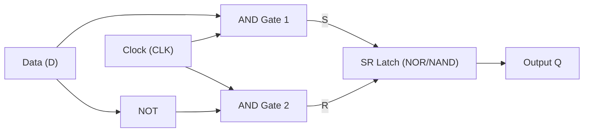
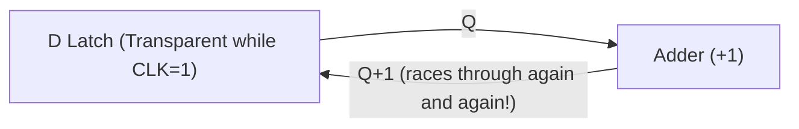
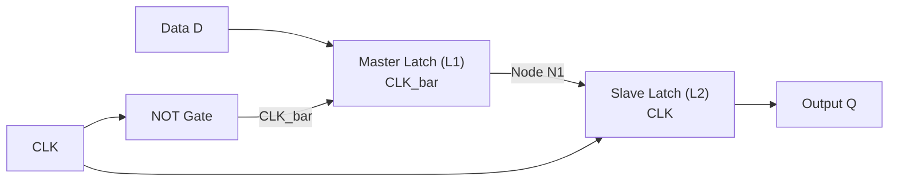
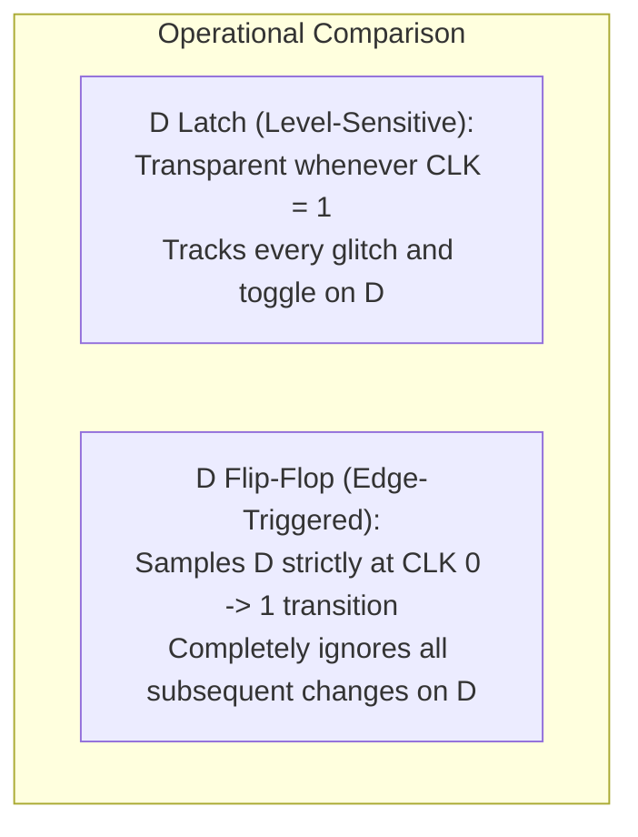
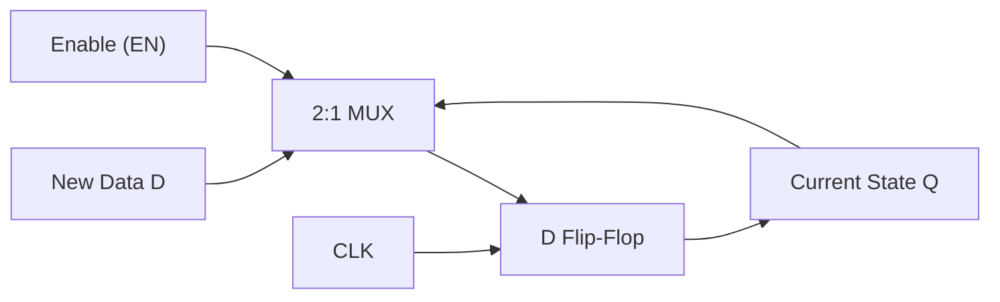

[DLCD Index](../README.md) / [Unit 1: Combinational and Sequential Logic Design](Introduction.md)

# L05 - Storage Elements - Latches and Flip-Flops

Up to this point, our digital circuits have been strictly memoryless. In a combinational circuit, the output depends exclusively on the inputs applied right now; the moment the inputs change, the previous output is lost forever. But computers cannot function without memory. A CPU must keep track of instruction addresses, store temporary calculation results in registers, and remember system states.

To create memory, we must violate the third rule of combinational composition: we must introduce **feedback**, connecting an output wire back to an earlier input. In this lecture, we examine how cross-coupled feedback gives birth to bistable storage elements, trace the progression from raw cross-coupled inverters to SR latches and gated D latches, and discover how the **master-slave D flip-flop** solves the dangerous problem of latch transparency.

---

## The Birth of Memory: The Bistable Element

What is the simplest way to store a binary bit? Let us experiment by feeding the output of a basic logic gate back to its input.

### A Single Inverter in a Loop
Suppose we connect the output of a single NOT gate back to its own input.
- If we assume the input is $0$, the inverter produces a $1$ at the output.
- That $1$ immediately feeds back to the input, forcing the output to switch to $0$.
- That $0$ feeds back, forcing the output to switch back to $1$.

The circuit has no stable state. It oscillates continuously between $0$ and $1$ at a frequency determined by its physical propagation delay. This is an **astable ring oscillator**, not a memory element!

### Two Cross-Coupled Inverters
Now, what happens if we connect **two** inverters in a closed loop?
- Let the input of Inverter 1 ($I_1$) be driven by the output of Inverter 2 ($I_2$), labeled $Q$.
- Let the input of Inverter 2 ($I_2$) be driven by the output of Inverter 1 ($I_1$), labeled $\overline{Q}$.

Let's analyze the two possible operational cases:
1. **Case 1 ($Q = 0$)**:
   - Inverter $I_1$ receives input $Q = 0$ and produces $\overline{Q} = 1$.
   - Inverter $I_2$ receives input $\overline{Q} = 1$ and produces $Q = 0$.
   - This output ($Q = 0$) matches our initial assumption. The circuit is stable!
2. **Case 2 ($Q = 1$)**:
   - Inverter $I_1$ receives input $Q = 1$ and produces $\overline{Q} = 0$.
   - Inverter $I_2$ receives input $\overline{Q} = 0$ and produces $Q = 1$.
   - This output ($Q = 1$) matches our initial assumption. The circuit is also stable!

Because the circuit can rest indefinitely in either of two stable operational points ($Q = 0$ or $Q = 1$), it is called a **bistable element**. It stores exactly **one bit** of information.

The moment we celebrate, however, we encounter a fatal practical flaw: the two inverters are trapped in a self-reinforcing loop with no external inputs. We have created a vault that can remember a bit forever, but we have no key to change the bit!

---

## The SR Latch: Adding Control Inputs

To make the bistable loop useful, we must replace the simple inverters with gates that accept external control signals. By replacing the inverters with **NOR gates**, we obtain the **SR (Set-Reset) Latch**.

Recall the NOR gate truth table: if *any* input is $1$, the output is forced to $0$. An input of $0$ acts as a pass-through (inverting the other input).

### NOR-Based SR Latch Truth Table

| $S$ | $R$ | $Q$ | $\overline{Q}$ | Operating Mode / Action |
|:---:|:---:|:---:|:---:|:---|
| 0 | 0 | $Q_{\text{prev}}$ | $\overline{Q}_{\text{prev}}$ | **Hold (Memory)**: Retains previous state |
| 0 | 1 | 0 | 1 | **Reset**: Forces $Q = 0$ |
| 1 | 0 | 1 | 0 | **Set**: Forces $Q = 1$ |
| 1 | 1 | 0 | 0 | **Invalid (Forbidden)**: Breaks complementarity |

### Circuit Operation Step-by-Step
1. **Set ($S = 1, R = 0$)**:
   - Since $S = 1$, NOR 2 is forced to output $\overline{Q} = 0$.
   - This $\overline{Q} = 0$ feeds into NOR 1 alongside $R = 0$.
   - NOR 1 evaluates $\overline{0 + 0} = 1$, setting $Q = 1$.
2. **Hold ($S = 0, R = 0$)**:
   - When $S$ returns to $0$, NOR 2 receives $S = 0$ and $Q = 1$, maintaining $\overline{Q} = 0$.
   - NOR 1 receives $R = 0$ and $\overline{Q} = 0$, maintaining $Q = 1$.
   - The latch safely remembers the set bit!
3. **Reset ($S = 0, R = 1$)**:
   - Since $R = 1$, NOR 1 is forced to output $Q = 0$.
   - This $Q = 0$ feeds into NOR 2 alongside $S = 0$.
   - NOR 2 evaluates $\overline{0 + 0} = 1$, producing $\overline{Q} = 1$.
4. **The Forbidden State ($S = 1, R = 1$)**:
   - If both inputs are asserted simultaneously, both NOR gates are forced to output $0$.
   - This produces $Q = 0$ and $\overline{Q} = 0$, directly violating the fundamental definition that $Q$ and $\overline{Q}$ must be mathematical complements!
   - Worse still: if both $S$ and $R$ drop back to $0$ simultaneously, the two gates race each other to invert $0$. Depending on microscopic wire delays, the latch enters an unpredictable, metastable oscillation. Hence, $S = 1, R = 1$ is strictly forbidden.

### The NAND-Based SR Latch ($\overline{S}\ \overline{R}$ Latch)
An SR latch can also be constructed using two cross-coupled **NAND gates**. Because NAND gates produce $1$ whenever any input is $0$, the control inputs are **active-low**:
- $\overline{S} = 0, \overline{R} = 1 \implies \text{Set } (Q = 1)$.
- $\overline{S} = 1, \overline{R} = 0 \implies \text{Reset } (Q = 0)$.
- $\overline{S} = 1, \overline{R} = 1 \implies \text{Hold previous state}$.
- $\overline{S} = 0, \overline{R} = 0 \implies \text{Forbidden state } (Q = 1, \overline{Q} = 1)$.

---

## The Gated D Latch: Separating "What" from "When"

The SR latch has two severe engineering limitations:
1. It has a forbidden input condition ($S = 1, R = 1$).
2. The $S$ and $R$ inputs conflate two independent questions: **what** value should be stored, and **when** should it be stored?

The **D Latch (Data Latch)** cleanly decouples these concerns:
- The **Data input ($D$)** specifies **what** the next state should be ($0$ or $1$).
- The **Clock input ($\text{CLK}$)** specifies **when** the state is allowed to change.

Because the inputs to the internal SR latch are $S = D \cdot \text{CLK}$ and $R = \overline{D} \cdot \text{CLK}$:
- When $\text{CLK} = 1$, $S$ and $R$ are always exact complements ($S = D, R = \overline{D}$). The forbidden state $S = 1, R = 1$ is physically impossible!
- When $\text{CLK} = 0$, both $S = 0$ and $R = 0$, placing the latch into Hold mode.

### Transparency vs. Opacity
The behavior of the D latch is divided into two distinct operational phases:
- **Transparent Phase ($\text{CLK} = 1$)**: The latch is completely "open" (transparent). Any change at input $D$ immediately ripples through to output $Q$, behaving just like a simple buffer.
- **Opaque Phase ($\text{CLK} = 0$)**: The latch is completely "closed" (opaque). It blocks input $D$ from reaching the output, and $Q$ stubbornly retains whatever value $D$ held at the exact moment $\text{CLK}$ dropped from $1$ to $0$.

Because the latch responds to the continuous **voltage level** of the clock, it is called a **level-sensitive latch**.

---

## The Transparency Hazard and the Need for Flip-Flops

Level sensitivity creates a critical problem in synchronous digital design: **the race-around hazard**.

Imagine a counter circuit where the output of a register is incremented by an adder and fed directly back to the register's input:

$$\text{Output } Q \longrightarrow \text{Adder (+1)} \longrightarrow \text{Input } D$$

If we build this register out of D latches, look at what happens when $\text{CLK} = 1$:
1. The latch becomes transparent.
2. The adder computes $Q + 1$, which passes through the latch to update $Q$.
3. But $\text{CLK}$ is still $1$! So the adder immediately computes $(Q + 1) + 1$, and passes that through.
4. The circuit increments uncontrollably multiple times in a chaotic loop until $\text{CLK}$ drops to $0$.

We need a storage element that does not stay transparent for an entire clock level. We need an element that captures data at **one single instant in time**—the edge transition of the clock.

That element is the **Flip-Flop**.

---

## The D Flip-Flop: Master-Slave Architecture

A **D Flip-Flop (DFF)** is an **edge-triggered** storage element. It copies input $D$ to output $Q$ only at the precise moment the clock transitions (typically on the rising edge from $0$ to $1$). At all other times, the flip-flop is completely opaque.

How do we build an edge-triggered device using level-sensitive latches? We connect two D latches in series, controlled by **complementary clock signals**. This is the classic **Master-Slave D Flip-Flop**.

- **Latch 1 (Master, $L_1$)**: Enabled by the inverted clock ($\overline{\text{CLK}}$).
- **Latch 2 (Slave, $L_2$)**: Enabled by the true clock ($\text{CLK}$).

Let's trace its step-by-step operation across a full clock cycle:

### Phase 1: Clock is LOW ($\text{CLK} = 0$)
- Inverted clock $\overline{\text{CLK}} = 1$: Master latch $L_1$ is **transparent**. Node $N_1$ tracks whatever happens to input $D$.
- True clock $\text{CLK} = 0$: Slave latch $L_2$ is **opaque**. It isolates output $Q$ from $N_1$, holding the old system state.
- Even if $D$ changes or glitches, it cannot reach output $Q$ because the slave door is shut.

### Phase 2: The Rising Clock Edge ($0 \longrightarrow 1$)
- At the exact instant $\text{CLK}$ rises from $0$ to $1$:
  - $\overline{\text{CLK}}$ drops to $0$, causing Master latch $L_1$ to snap shut (**opaque**). It traps and freezes the value of $D$ present right at the edge transition onto node $N_1$.
  - Simultaneously, $\text{CLK}$ rises to $1$, opening Slave latch $L_2$ (**transparent**). The frozen value on $N_1$ passes immediately through $L_2$ to output $Q$.

### Phase 3: Clock is HIGH ($\text{CLK} = 1$)
- Master latch $L_1$ remains opaque. Any further changes at input $D$ while the clock is high are completely ignored by $L_1$.
- Slave latch $L_2$ continues to hold the value frozen by the master.
- Output $Q$ remains stable and immune to input noise.

The master and slave are never transparent at the same time. Like an airlock chamber where one door always closes before the other opens, data can never race continuously through the device. The circuit samples input $D$ strictly on the rising clock edge!

---

## Comparing Latches and Flip-Flops: Ben Bitdiddle's Experiment

To cement the physical distinction between level-sensitive latches and edge-triggered flip-flops, consider Ben Bitdiddle's waveform experiment:

| Parameter | D Latch | D Flip-Flop |
|:---|:---|:---|
| **Trigger Mechanism** | Level-sensitive (clock level) | Edge-triggered (clock transition) |
| **Active Period** | Transparent during entire $\text{CLK} = 1$ interval | Samples momentarily on $0 \to 1$ rising edge |
| **Feedback Susceptibility** | Highly prone to race-around hazards | Eliminates race-around hazards entirely |
| **Circuit Symbol** | Square box with $D, \text{CLK}, Q$ | Box with a dynamic indicator triangle ($\triangleright$) at $\text{CLK}$ |
| **Hardware Complexity** | 1 Latch (~4–6 gates / 8–10 transistors) | 2 Latches + Inverter (~9–12 gates / 16–20 transistors) |

---

## Advanced Flip-Flop Variants: Enabled and Resettable Registers

In practical microprocessors, flip-flops are augmented with auxiliary control features to build sophisticated registers.

### 1. The $N$-Bit Register
An **$N$-bit register** is simply a bank of $N$ flip-flops sharing a single common clock line. When the clock rises, all $N$ bits are updated simultaneously in parallel (e.g., a 32-bit MIPS program counter or ALU register).

### 2. The Enabled Flip-Flop
Often, a register should update only under specific conditions (e.g., when a write-enable signal is asserted). An **Enabled Flip-Flop** adds an `EN` control line:
- If $\text{EN} = 1$: The flip-flop loads new data from $D$ on the clock edge.
- If $\text{EN} = 0$: The flip-flop ignores $D$ and retains its current state $Q$.

There are two ways to implement this:
1. **Input Multiplexer (Recommended)**: Place a 2:1 MUX at input $D$. If $\text{EN} = 1$, the MUX selects new data $D$; if $\text{EN} = 0$, the MUX selects old output $Q$ to recirculate. The clock runs clean and unhindered.
2. **Clock Gating (Dangerous)**: AND the clock with $\text{EN}$ ($\text{CLK}_{\text{gated}} = \text{CLK} \cdot \text{EN}$). While this saves dynamic power, glitches on $\text{EN}$ create false clock pulses, and the AND gate introduces clock skew. Modern synchronous design strictly favors MUX recirculation.

### 3. Resettable Flip-Flops: Synchronous vs. Asynchronous
When a digital system first powers on, flip-flop nodes settle to random, indeterminate voltages. A reset mechanism forces all registers to a known initial state (typically $0$).

- **Synchronously Resettable Flip-Flop**: Resets to $0$ only on the rising clock edge when $\text{RESET} = 1$. It is implemented simply by placing an AND gate before input $D$: $D_{\text{in}} = D \cdot \overline{\text{RESET}}$.
- **Asynchronously Resettable Flip-Flop**: Forces the internal state to $0$ immediately whenever $\text{RESET} = 1$, completely overriding and ignoring the clock. This requires modifying the internal transistor pull-down paths inside the master and slave latches.

---

## Key Takeaways

- A loop of one inverter is an astable ring oscillator; a loop of two cross-coupled inverters forms a bistable element capable of storing one bit of information.
- An SR latch replaces inverters with NOR (or NAND) gates to provide Set and Reset control inputs. Asserting $S = 1, R = 1$ in a NOR latch produces an invalid non-complementary output and causes unpredictable race hazards.
- A Gated D latch separates "what" (data $D$) from "when" (clock $\text{CLK}$). It is transparent when $\text{CLK} = 1$ and opaque when $\text{CLK} = 0$.
- Because latches are level-sensitive, combinational feedback loops cause uncontrollable race-around oscillations while the clock is high.
- A D Flip-Flop is edge-triggered. The Master-Slave topology uses two latches controlled by complementary clocks to sample input $D$ strictly on the rising clock edge, eliminating race conditions.
- Enabled flip-flops use MUX recirculation to hold state selectively without gating the clock. Resettable flip-flops force the state to $0$ either synchronously on the clock edge or asynchronously at any moment.

---

Now that we have edge-triggered flip-flops to anchor our state, how do we combine combinational logic and sequential registers to build complete, rock-solid synchronous systems? In the next lecture, [L06 - Synchronous Logic Design and Timing](L06%20-%20Synchronous%20Logic%20Design%20and%20Timing.md), we explore the rules of synchronous composition, setup and hold time constraints, and maximum clock frequency calculations.
