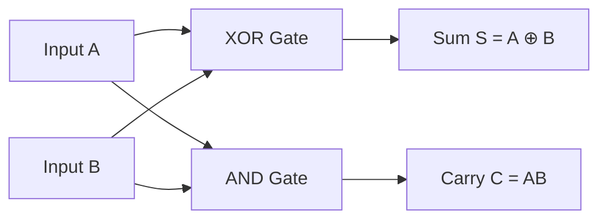
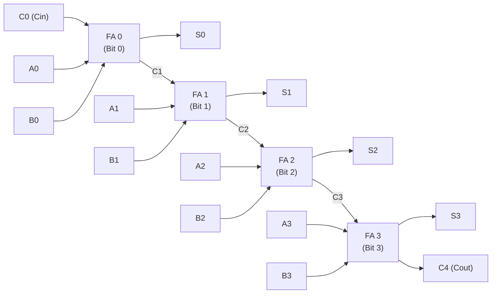
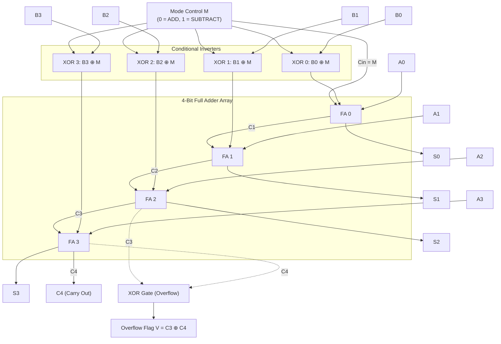

[DLCD Index](../README.md) / [Unit 1: Combinational Logic](Introduction.md)

# Binary Adders and Subtractors: Half Adders, Full Adders, RCA, and 2's Complement Circuits

In modern computing, the **Arithmetic Logic Unit (ALU)** is the computational engine of the central processing unit. Whether a microprocessor is executing machine code, calculating memory offsets, or running graphical transformations, everything ultimately boils down to one fundamental operation: **addition**.

Multiplication is repeated addition; division is repeated subtraction; and subtraction itself, through the mathematical magic of 2's complement representation, is simply addition of a negative number. If you can build an adder that is fast, compact, and scalable, you have built the core of the computer.

In this lecture, we build arithmetic circuits from the ground up: starting with the elementary **Half Adder**, synthesizing the 3-input **Full Adder**, cascading them into a **Ripple Carry Adder (RCA)**, analyzing the physical propagation bottleneck that motivates **Carry Lookahead Adders (CLA)**, and uniting addition and subtraction into a single unified **4-bit Adder-Subtractor circuit with signed overflow detection**.

---

## The Half Adder (HA)

The most basic arithmetic operation in binary logic is adding two single binary bits, $A$ and $B$.

In binary arithmetic:
- $0 + 0 = 0$
- $0 + 1 = 1$
- $1 + 0 = 1$
- $1 + 1 = 10_2$ ($0$ with a carry of $1$ into the next higher significant position)

This operation requires two outputs: a **Sum bit ($S$)** and a **Carry bit ($C$)**.

| Input $A$ | Input $B$ | Sum ($S$) | Carry ($C$) |
| :---: | :---: | :---: | :---: |
| $0$ | $0$ | $0$ | $0$ |
| $0$ | $1$ | $1$ | $0$ |
| $1$ | $0$ | $1$ | $0$ |
| $1$ | $1$ | $0$ | $1$ |

### Boolean Equations and Circuit
Look at the truth table columns:
- The Sum column $S$ is `1` when inputs are different ($01$ or $10$). This is an **XOR** gate:
  $$\mathbf{S = A'B + AB' = A \oplus B}$$
- The Carry column $C$ is `1` only when both inputs are `1`. This is an **AND** gate:
  $$\mathbf{C = AB}$$



### The Limitation of the Half Adder
The Half Adder can add two 1-bit operands, but it has **no provision for an incoming carry bit** from a previous lower-significant stage. 

If you attempt to add two 4-bit numbers (say, $0111_2 + 0001_2$), bit position 1 generates a carry that must be added to bit position 2 alongside inputs $A_2$ and $B_2$. The Half Adder cannot perform this 3-bit addition. For multi-bit arithmetic, we require a **Full Adder**.

---

## The Full Adder (FA)

A **Full Adder** adds three 1-bit binary inputs: two data operands ($A$ and $B$) and an incoming carry bit ($C_{\text{in}}$) from the adjacent lower-order stage. It produces two outputs: a **Sum ($S$)** and a **Carry-out ($C_{\text{out}}$)**.

### Full Adder Truth Table

| Row | $A$ | $B$ | $C_{\text{in}}$ | Sum ($S$) | Carry Out ($C_{\text{out}}$) |
| :---: | :---: | :---: | :---: | :---: | :---: |
| $0$ | $0$ | $0$ | $0$ | $0$ | $0$ |
| $1$ | $0$ | $0$ | $1$ | $1$ | $0$ |
| $2$ | $0$ | $1$ | $0$ | $1$ | $0$ |
| $3$ | $0$ | $1$ | $1$ | $0$ | $1$ |
| $4$ | $1$ | $0$ | $0$ | $1$ | $0$ |
| $5$ | $1$ | $0$ | $1$ | $0$ | $1$ |
| $6$ | $1$ | $1$ | $0$ | $0$ | $1$ |
| $7$ | $1$ | $1$ | $1$ | $1$ | $1$ |

### K-Map Derivation and Boolean Equations

1. **Sum Output ($S$)**:
   $S = \sum m(1, 2, 4, 7)$
   Notice that $S$ is `1` whenever an **odd number of inputs are `1`** (one `1` or three `1`s). This is the canonical 3-variable odd function:
   $$\mathbf{S = A \oplus B \oplus C_{\text{in}}}$$

2. **Carry-Out Output ($C_{\text{out}}$)**:
   $C_{\text{out}} = \sum m(3, 5, 6, 7)$
   Grouping on a 3-variable K-map gives three overlapping pairs:
   $$\mathbf{C_{\text{out}} = AB + BC_{\text{in}} + AC_{\text{in}}}$$

Factor out $C_{\text{in}}$ from the last two terms:
$$C_{\text{out}} = AB + C_{\text{in}}(A + B)$$

Since $A + B = A \oplus B$ whenever $AB = 0$, we can express $C_{\text{out}}$ using the already computed $(A \oplus B)$ term:
$$\mathbf{C_{\text{out}} = AB + C_{\text{in}}(A \oplus B)}$$

---

## Constructing a Full Adder from Two Half Adders and an OR Gate

A Full Adder can be constructed from two Half Adders and a single OR gate:

```mermaid
flowchart LR
    A["A"] --> HA1["Half Adder 1"]
    B["B"] --> HA1
    HA1 -->|S1 = A ⊕ B| HA2["Half Adder 2"]
    Cin["Cin"] --> HA2
    HA2 --> S["Sum S = A ⊕ B ⊕ Cin"]
    
    HA1 -->|C1 = AB| OR1["OR Gate"]
    HA2 -->|C2 = (A ⊕ B)Cin| OR1 --> Cout["Cout = C1 + C2"]
```

1. **Half Adder 1**: Adds $A$ and $B$:
   - $S_1 = A \oplus B$
   - $C_1 = AB$
2. **Half Adder 2**: Adds the intermediate sum $S_1$ and $C_{\text{in}}$:
   - $S = S_1 \oplus C_{\text{in}} = (A \oplus B) \oplus C_{\text{in}}$
   - $C_2 = S_1 \cdot C_{\text{in}} = (A \oplus B)C_{\text{in}}$
3. **OR Gate**: Combines the carries:
   - $C_{\text{out}} = C_1 + C_2 = AB + (A \oplus B)C_{\text{in}}$

*(Why can we use an OR gate instead of an XOR gate to combine $C_1$ and $C_2$? Because $C_1$ and $C_2$ can NEVER both be `1` simultaneously! If $C_1 = AB = 1$, then $A=1$ and $B=1$, which makes $A \oplus B = 0$, forcing $C_2 = 0$. Since they are mutually exclusive, $C_1 + C_2 = C_1 \oplus C_2$).*

---

## 4-Bit Ripple Carry Adder (RCA)

To add two $n$-bit binary numbers $A = A_3 A_2 A_1 A_0$ and $B = B_3 B_2 B_1 B_0$, we cascade $n$ Full Adders in series, connecting the carry-out of each stage to the carry-in of the next higher stage:



### The Critical Path Bottleneck: Carry Propagation Delay

Look at the dependency chain in the Ripple Carry Adder:
- $FA_0$ receives $C_0$ immediately and calculates $S_0$ and $C_1$.
- But $FA_1$ **cannot compute its correct sum $S_1$ and carry $C_2$ until $C_1$ arrives from $FA_0$**!
- Similarly, $FA_3$ must wait for $C_3$, which depends on $C_2$, which depends on $C_1$.

The carry bit must **ripple** sequentially through all $n$ stages from the Least Significant Bit (LSB) to the Most Significant Bit (MSB).

If each full adder has a carry propagation delay of $t_{\text{FA}}$ (typically two gate delays: one AND, one OR), an $n$-bit adder requires:

$$t_{\text{total}} = n \times t_{\text{FA}}$$

For a 64-bit adder, the signal must cross $64 \times 2 = 128$ consecutive gate levels before the MSB sum bit is valid! This carry propagation delay is the critical path that limits CPU clock frequency in simple adders.

---

## Carry Lookahead Adder (CLA): Fast Parallel Carry Generation

To break the ripple carry bottleneck, the **Carry Lookahead Adder (CLA)** eliminates sequential dependencies by calculating all carry bits **in parallel** using two-level logic.

For any bit stage $i$, define two terms:
- **Carry Generate ($G_i$)**: A carry is generated internally if both inputs are `1`, independent of incoming carry:
  $$\mathbf{G_i = A_i B_i}$$
- **Carry Propagate ($P_i$)**: An incoming carry will propagate through this stage if at least one input is `1` (or $A_i \oplus B_i$):
  $$\mathbf{P_i = A_i \oplus B_i}$$

Now, express the carry-out of stage $i$ as:
$$C_{i+1} = G_i + P_i C_i$$

Let's expand this recurrence relation for all 4 stages of an adder:

1. Stage 0:
   $$\mathbf{C_1 = G_0 + P_0 C_0}$$
2. Stage 1:
   $$C_2 = G_1 + P_1 C_1 = G_1 + P_1(G_0 + P_0 C_0) = \mathbf{G_1 + P_1 G_0 + P_1 P_0 C_0}$$
3. Stage 2:
   $$C_3 = G_2 + P_2 C_2 = \mathbf{G_2 + P_2 G_1 + P_2 P_1 G_0 + P_2 P_1 P_0 C_0}$$
4. Stage 3:
   $$C_4 = G_3 + P_3 C_3 = \mathbf{G_3 + P_3 G_2 + P_3 P_2 G_1 + P_3 P_2 P_1 G_0 + P_3 P_2 P_1 P_0 C_0}$$

Look at the equations for $C_1, C_2, C_3, C_4$:
- Every single carry bit depends **only on the input operands ($A_i, B_i$) and the original carry-in $C_0$**!
- $C_4$ does not wait for $C_3$; it is computed directly from the primary inputs in parallel.
- All carries are ready in **just 2 gate delays** (one level of ANDs, one level of ORs), regardless of word length!

*(The trade-off: As $n$ grows beyond 4 bits, the gate fan-in and fan-out become too large for physical silicon. Designers solve this by hierarchically combining 4-bit CLA blocks into 16-bit and 64-bit multi-level CLA structures).*

---

## Binary Subtractors and 2's Complement Arithmetic

We could design a dedicated **Full Subtractor** with inputs $A, B, B_{\text{in}}$ to compute Difference $D = A \oplus B \oplus B_{\text{in}}$ and Borrow $B_{\text{out}} = A'B + B_{\text{in}}(A \oplus B)'$.

However, building a separate subtractor circuit inside an ALU wastes silicon. In computer hardware, subtraction is performed using **2's complement addition**:

$$A - B = A + (-B) = A + (B' + 1)$$

To subtract $B$ from $A$:
1. Invert every bit of $B$ (bitwise 1's complement, $B'$).
2. Add $1$ to the result.
3. Add the resulting 2's complement value to $A$ using an ordinary adder.

---

## The Unified 4-Bit 2's Complement Adder-Subtractor Circuit

We can build a single circuit that performs **both addition and subtraction** using a 4-bit Ripple Carry Adder and four **XOR gates** controlled by a single Mode line, $M$:



### How the Mode Line $M$ Controls the Circuit:

Recall the property of XOR: $B_i \oplus 0 = B_i$, and $B_i \oplus 1 = B_i'$.

1. **When $M = 0$ (Addition Mode)**:
   - For every bit: $B_i \oplus 0 = B_i$. The $B$ inputs pass through the XOR gates unchanged.
   - The initial carry-in to $FA_0$ is $C_0 = M = 0$.
   - The circuit computes: $\mathbf{A + B + 0 = A + B}$.

2. **When $M = 1$ (Subtraction Mode)**:
   - For every bit: $B_i \oplus 1 = B_i'$. The $B$ inputs are inverted into their 1's complement!
   - The initial carry-in to $FA_0$ is $C_0 = M = 1$.
   - The circuit computes: $\mathbf{A + B' + 1 = A + (-B) = A - B}$.

The exact same circuit executes addition and subtraction by toggling a single control wire.

---

## Signed Overflow Detection

In signed 2's complement arithmetic, an $n$-bit register can only represent numbers within a fixed range:

$$\text{Range: } -2^{n-1} \quad \text{to} \quad +(2^{n-1} - 1)$$

For a 4-bit signed number ($n=4$), the valid range is $-8$ to $+7$.

If the mathematical result of an addition or subtraction falls outside this range, **Arithmetic Overflow** occurs, and the calculated result is garbage:
- Adding two positive numbers yields a negative number (e.g., $+5 + +4 = +9 \to$ overflows to $-7$).
- Adding two negative numbers yields a positive number (e.g., $-6 + -5 = -11 \to$ overflows to $+5$).
- *(Note: Adding a positive and a negative number can NEVER cause an overflow).*

### The Hardware Overflow Rule

How does the processor hardware detect an overflow instantly in silicon?

By monitoring the carry-in and carry-out of the **Most Significant Bit (Sign Bit) stage**:

$$\mathbf{V = C_n \oplus C_{n-1}}$$

For our 4-bit adder:

$$\mathbf{V = C_4 \oplus C_3}$$

- If $C_4 = C_3$ ($00$ or $11$), $V = 0 \implies$ **No Overflow**. The result is mathematically valid.
- If $C_4 \neq C_3$ ($01$ or $10$), $V = 1 \implies$ **Overflow Occurred!** The processor sets the Overflow Flag ($V$) in its condition code register, triggering an arithmetic trap or exception.

---

## Key Takeaways

- The **Half Adder** adds two 1-bit inputs: $S = A \oplus B$, $C = AB$. It lacks a carry-in input.
- The **Full Adder** adds three 1-bit inputs ($A, B, C_{\text{in}}$): $S = A \oplus B \oplus C_{\text{in}}$, and $C_{\text{out}} = AB + C_{\text{in}}(A \oplus B)$. It can be constructed from two Half Adders and an OR gate.
- The **Ripple Carry Adder (RCA)** cascades $n$ Full Adders. Its critical path propagation delay scales linearly: $O(n)$.
- The **Carry Lookahead Adder (CLA)** eliminates sequential ripple delay by calculating carry bits in parallel using Generate ($G_i = A_i B_i$) and Propagate ($P_i = A_i \oplus B_i$) logic in $O(1)$ gate delays.
- A **4-bit Adder-Subtractor** uses XOR gates on the $B$ inputs controlled by Mode line $M$. When $M=1$, it inverts $B$ and injects $C_{\text{in}} = 1$ to compute $A + B' + 1 = A - B$.
- **Overflow** in signed arithmetic occurs when the result exceeds the representation range; hardware detects it via $V = C_n \oplus C_{n-1}$.

---

We have now conquered binary arithmetic for base-2 numbers. But humans do not naturally think in binary—we conduct business, accounting, and calculations in decimal (base-10). When a pocket calculator, digital scale, or financial transaction processor performs arithmetic directly on decimal digits, binary adders produce incorrect results whenever a sum exceeds 9. In the next lecture, we analyze [**Decimal and BCD Adders**](L07%20-%20Decimal%20and%20BCD%20Adders.md), exploring BCD detection logic and the $+6$ correction hardware.
