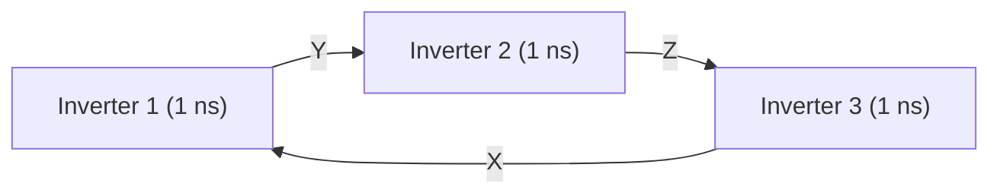
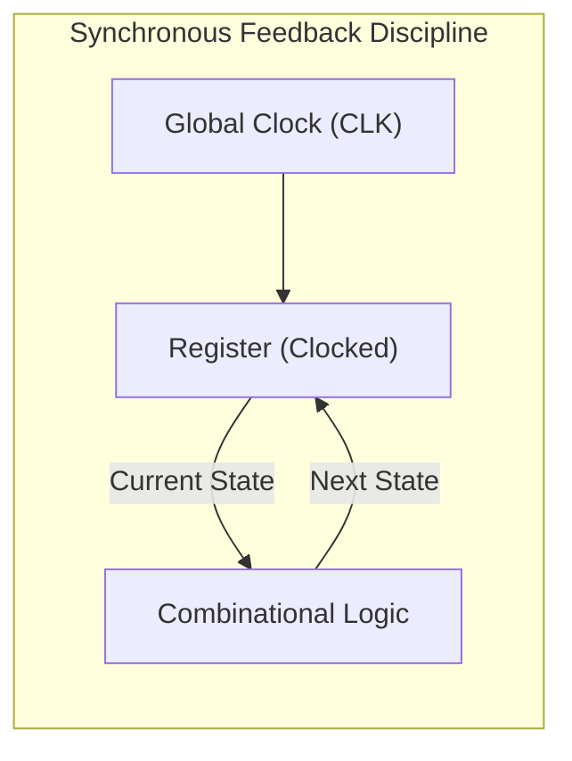
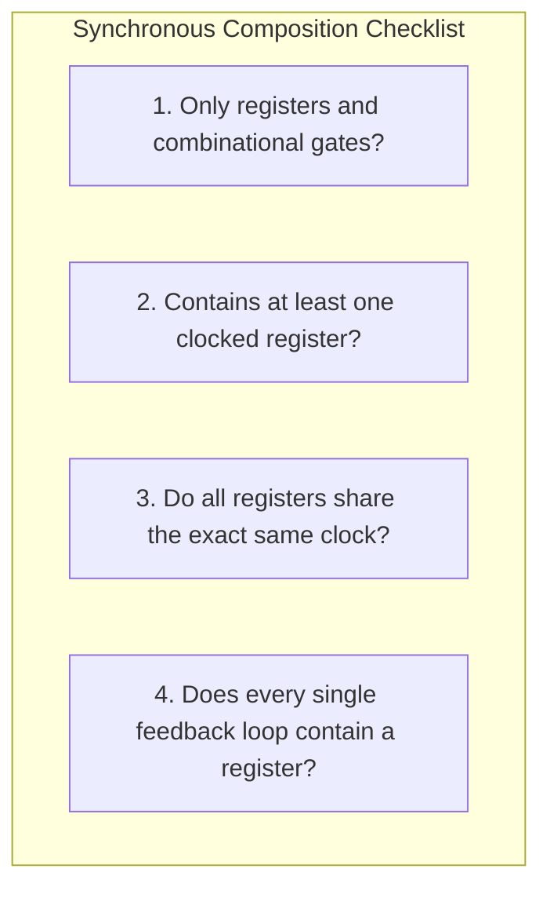
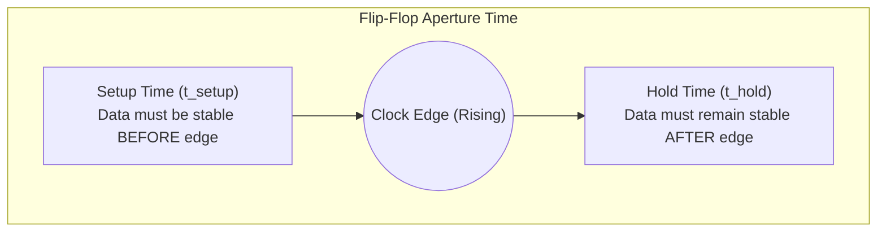
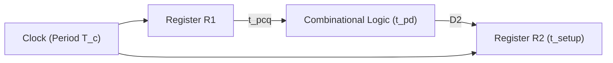
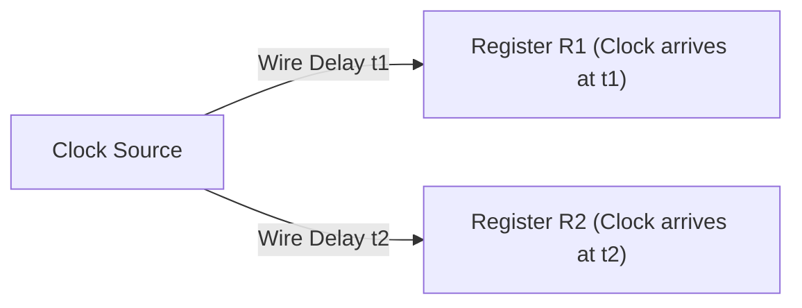

[DLCD Index](../README.md) / [Unit 1: Combinational and Sequential Logic Design](Introduction.md)

# L06 - Synchronous Logic Design and Timing

In the previous lecture, we discovered that inserting feedback loops transforms memoryless combinational logic into stateful storage elements. But introducing feedback is playing with fire: if unconstrained, feedback paths can cause digital circuits to oscillate wildly or produce outputs that depend on picosecond variations in wire delays.

To engineer complex microprocessors containing hundreds of millions of transistors without falling into chaos, digital systems obey a strict architectural discipline: **synchronous sequential circuit design**. In this lecture, we explore the hazards of asynchronous feedback, the four iron rules of synchronous composition, and the dynamic timing constraints—setup time, hold time, and clock skew—that dictate the maximum clock frequency of modern computing hardware.

---

## The Perils of Unconstrained Feedback: Asynchronous Hazards

Before we can appreciate the discipline of synchronous design, we must see what goes wrong when feedback is left unconstrained.

### 1. Astable Oscillations: Alyssa P. Hacker's Ring Oscillator
Suppose Alyssa P. Hacker connects three inverters together in a closed ring, where the output of the third inverter feeds back to the input of the first. Each inverter has a propagation delay of $t_{\text{pd}} = 1\text{ ns}$.

Let us trace node $X$:
- Suppose $X = 0$ initially.
- After $1\text{ ns}$, Inverter 1 drives $Y = 1$.
- After another $1\text{ ns}$ ($t = 2\text{ ns}$), Inverter 2 drives $Z = 0$.
- After another $1\text{ ns}$ ($t = 3\text{ ns}$), Inverter 3 drives $X = 1$.
- But $X = 1$ contradicts our initial assumption that $X = 0$!
- Now $X = 1$ causes $Y$ to fall at $t = 4\text{ ns}$, $Z$ to rise at $t = 5\text{ ns}$, and $X$ to fall back to $0$ at $t = 6\text{ ns}$.

The circuit has no stable state. It oscillates continuously with a period of:

$$T = 2 \times N \times t_{\text{pd}} = 2 \times 3 \times 1\text{ ns} = 6\text{ ns}$$

This is an **astable circuit (ring oscillator)**. It is useful for generating high-frequency clock pulses, but fatal if our goal was to store static digital data.

### 2. Race Conditions: Ben Bitdiddle's Flawed Latch
Now consider an asynchronous design where combinational outputs loop directly back into inputs without clock synchronization. Ben Bitdiddle attempts to build a compact latch by taking an equation derived from a truth table and routing the output $Q$ straight back to an input labeled $Q_{\text{prev}}$.

The moment he powers the circuit, it malfunctions. Why? Because the circuit suffers from a **race condition**: two signals traveling along different physical paths are racing to reach a gate. If Path A arrives first, the circuit latches a $0$; if Path B arrives first due to thermal drift or power supply fluctuation, the circuit latches a $1$. The circuit behavior is non-deterministic and physically unreliable.

---

## The Synchronous Paradigm: Disciplining Feedback

How do we eliminate race conditions and astable oscillations permanently?

The solution is deceptively simple: **break every feedback loop by inserting an edge-triggered register synchronized to a global clock**.

In a synchronous sequential circuit:
1. The combinational logic evaluates the "Next State" based on the "Current State" and external inputs.
2. The intermediate transient glitches, hazards, and races settle completely while the clock is stable.
3. On the rising edge of the global clock, the registers capture the settled Next State simultaneously, updating the Current State in one synchronized step.

As long as the clock period is long enough to let the combinational logic settle, race conditions are completely banished!

---

## Rules of Synchronous Sequential Circuit Composition

Just as we established composition rules for combinational circuits in L01, Harris & Harris define the **Rules of Synchronous Sequential Circuit Composition**:

A circuit is a valid **synchronous sequential circuit** if and only if it satisfies four rules:
1. **Every circuit element is either a register or a combinational logic circuit.**
2. **At least one circuit element is a register.**
3. **All registers share the exact same global clock signal.**
4. **Every cyclic (feedback) path contains at least one register.**

Any sequential circuit that violates one or more of these rules is classified as an **asynchronous sequential circuit**.

---

## Classifying Circuit Topologies

Let's test these four rules against classic architectural topologies:

- **Topology A (Combinational Cascade)**: A network consisting strictly of AND, OR, and NOT gates with no registers.
  - *Classification*: Combinational, not sequential (violates Rule 2).
- **Topology B (Feed-Forward Register Path)**: A register whose output passes through combinational logic to another register, with no feedback loops.
  - *Classification*: Synchronous sequential (satisfies all 4 rules; feedback is permitted but not required).
- **Topology C (Latch-Based Loop)**: A feedback loop containing combinational logic and a level-sensitive D latch.
  - *Classification*: Neither combinational nor synchronous sequential (violates Rule 1, as a latch is not an edge-triggered register and causes transparency races).
- **Topology D (Unclocked Gate Feedback)**: An AND gate whose output loops directly back to one of its inputs.
  - *Classification*: Asynchronous sequential (violates Rule 4: cyclic path lacks a register).
- **Topology E (Pipelined Data Path)**: Multiple stages of combinational logic separated by registers all driven by clock $\text{CLK}$.
  - *Classification*: Valid synchronous sequential circuit (pipelined processor datapath).
- **Topology F (Gated / Delayed Clock)**: Register 1 is clocked by $\text{CLK}$, but Register 2 is clocked by $\text{CLK}$ passed through two inverters.
  - *Classification*: Not synchronous sequential (violates Rule 3: registers do not share the exact same clock; inverter delay introduces severe clock skew).

---

## Dynamic Timing Parameters: Setup and Hold Times

A flip-flop cannot sample data instantaneously. Because physical transistors require a finite time to charge internal capacitances, input $D$ must obey strict timing windows relative to the clock edge.

Every synchronous storage element is governed by four foundational timing parameters:
- **Setup Time ($t_{\text{setup}}$)**: The minimum time that data input $D$ must remain stable **before** the rising edge of the clock.
- **Hold Time ($t_{\text{hold}}$)**: The minimum time that data input $D$ must remain stable **after** the rising edge of the clock.
- The interval $t_{\text{setup}} + t_{\text{hold}}$ is called the **aperture time**. If data changes inside this window, the flip-flop can enter a catastrophic state of **metastability**, hovering between $0$ and $1$ for an indeterminate duration.
- **Propagation Delay ($t_{\text{pcq}}$)**: The maximum time from the rising clock edge until output $Q$ settles to its final valid value.
- **Contamination Delay ($t_{\text{ccq}}$)**: The minimum time after the rising clock edge before output $Q$ first begins to change.

Similarly, combinational logic blocks between registers have:
- **Propagation Delay ($t_{\text{pd}}$)**: Maximum delay through the combinational path (slowest critical path).
- **Contamination Delay ($t_{\text{cd}}$)**: Minimum delay through the combinational path (fastest shortcut path).

---

## The Setup Time Constraint: Calculating Maximum Clock Frequency

Consider a synchronous path where Register $R_1$ feeds combinational logic that drives Register $R_2$, both clocked by a periodic clock with cycle time $T_c$.

Let's trace a signal launched at clock edge $t = 0$:
1. At $t = 0$, the clock rises. Register $R_1$ begins releasing its stored data, which becomes valid at output $Q_1$ after delay $t_{\text{pcq}}$.
2. The data propagates through the combinational logic, taking up to $t_{\text{pd}}$ to reach input $D_2$ of Register $R_2$.
3. The signal arrives at $D_2$ at time $t = t_{\text{pcq}} + t_{\text{pd}}$.
4. To be reliably captured by Register $R_2$ on the next clock edge at $t = T_c$, the signal must arrive and stabilize at least $t_{\text{setup}}$ before the next edge.

Therefore, the clock period $T_c$ must be long enough to accommodate all three delays:

$$T_c \ge t_{\text{pcq}} + t_{\text{pd}} + t_{\text{setup}}$$

This is the **Setup Time Constraint** (or Max-Delay Constraint). The maximum frequency at which the digital system can reliably operate is:

$$f_{\max} = \frac{1}{T_c} = \frac{1}{t_{\text{pcq}} + t_{\text{pd}} + t_{\text{setup}}}$$

Notice something fundamental: if our circuit violates the setup time constraint, we can fix it simply by **slowing down the clock** (increasing $T_c$).

---

## The Hold Time Constraint: The Unforgiving Race

Now, consider a different hazard: what if new data racing out of Register $R_1$ travels through the combinational logic so quickly that it corrupts the input of Register $R_2$ before $R_2$ has finished holding the old data?

Let's trace the fastest possible path:
1. At $t = 0$, the clock rises. Register $R_2$ begins sampling its input $D_2$ and requires $D_2$ to remain completely stable for at least $t_{\text{hold}}$.
2. Simultaneously, Register $R_1$ begins updating. Its output changes after its contamination delay $t_{\text{ccq}}$.
3. That new change races through the fastest path of the combinational logic in time $t_{\text{cd}}$.
4. The earliest time the new data can reach input $D_2$ is $t = t_{\text{ccq}} + t_{\text{cd}}$.

For Register $R_2$ to safely capture the *previous* data without being corrupted by the incoming *new* data, the earliest arrival must occur *after* the hold time has elapsed:

$$t_{\text{ccq}} + t_{\text{cd}} \ge t_{\text{hold}}$$

Rearranging for the minimum required combinational delay:

$$t_{\text{cd}} \ge t_{\text{hold}} - t_{\text{ccq}}$$

This is the **Hold Time Constraint** (or Min-Delay Constraint).

Notice an alarming fact: **the clock period $T_c$ does not appear anywhere in the hold time formula!** If a circuit violates the hold time constraint, slowing down the clock does not fix the bug. The circuit will fail whether it runs at 3 GHz or 1 Hz. The only remedy is to physically insert delay buffers into the fast path to increase $t_{\text{cd}}$.

---

## Clock Skew: Real-World Clock Distribution

In large microprocessors, the clock signal cannot reach all millions of flip-flops at the exact same physical instant. Because wires have resistance and capacitance, the clock arrives at different registers at slightly different times. This timing disparity is called **clock skew ($t_{\text{skew}}$)**.

Clock skew reduces both timing margins:
- **Setup Time with Skew**: In the worst-case scenario where Register $R_2$ receives the clock early relative to $R_1$, the available cycle time shrinks:
  $$T_c \ge t_{\text{pcq}} + t_{\text{pd}} + t_{\text{setup}} + t_{\text{skew}}$$
- **Hold Time with Skew**: In the worst-case scenario where Register $R_2$ receives the clock late relative to $R_1$, the new data must arrive even later:
  $$t_{\text{ccq}} + t_{\text{cd}} \ge t_{\text{hold}} + t_{\text{skew}}$$

Modern high-performance CPUs devote massive resources—such as balanced $H$-tree clock distribution networks—to keep clock skew under a few picoseconds.

---

## Key Takeaways

- Unconstrained feedback in sequential circuits causes astable oscillations (like 3-inverter ring oscillators) and unpredictable race conditions.
- The synchronous paradigm breaks feedback loops by inserting edge-triggered registers synchronized to a common clock.
- The four Rules of Synchronous Composition ensure reliable operation: (1) only registers and combinational gates, (2) at least one register, (3) a shared common clock, and (4) every feedback loop contains at least one register.
- Flip-flops require an aperture window around the rising clock edge: data must be stable for $t_{\text{setup}}$ before the edge and $t_{\text{hold}}$ after the edge to prevent metastability.
- The Setup Time Constraint ($T_c \ge t_{\text{pcq}} + t_{\text{pd}} + t_{\text{setup}}$) dictates the maximum clock frequency $f_{\max} = 1/T_c$. Violations can be resolved by slowing down the clock.
- The Hold Time Constraint ($t_{\text{ccq}} + t_{\text{cd}} \ge t_{\text{hold}}$) is independent of clock speed. Violations cause permanent hardware failure and require adding buffers to delay fast paths.
- Clock skew ($t_{\text{skew}}$) represents arrival time differences across registers and degrades both setup and hold margins.

---

With synchronous design rules and timing constraints mastered, we have completed the foundational principles of combinational and sequential logic! How do we now use these building blocks to design controllers that step through complex state sequences? In the next unit, starting with [Unit 2 / L01 - Finite State Machines - Mealy and Moore Models](../Unit%202/L01%20-%20Finite%20State%20Machines%20-%20Mealy%20and%20Moore%20Models.md), we build Finite State Machines, arithmetic ALUs, and high-precision number representations.
