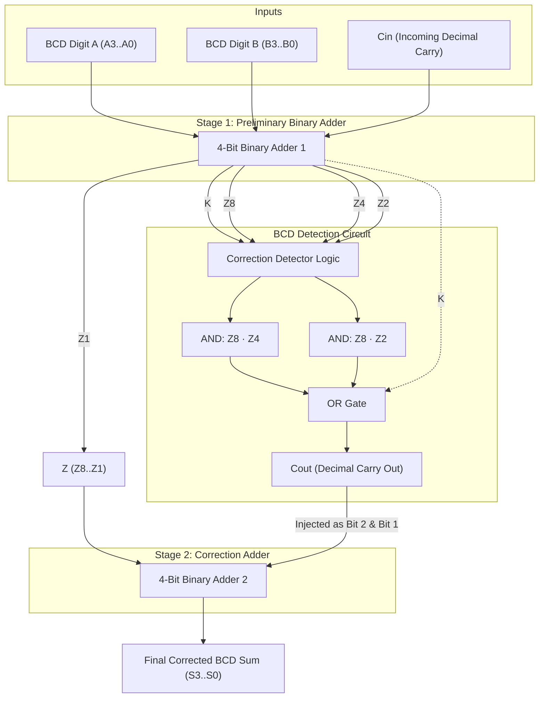
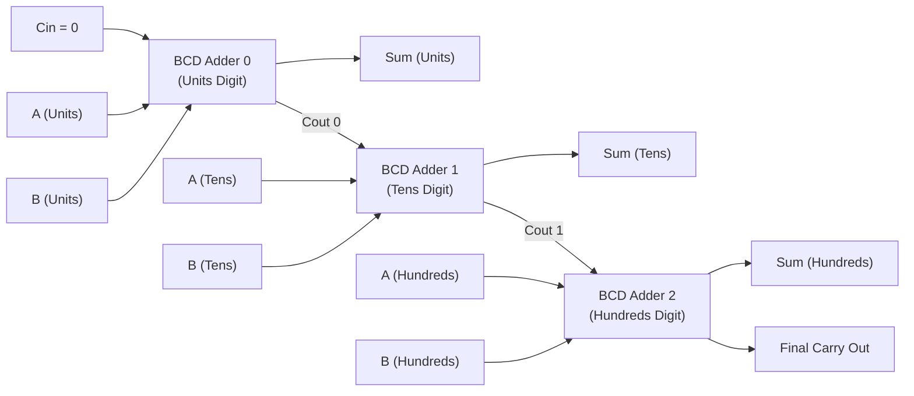

[DLCD Index](../README.md) / [Unit 1: Combinational Logic](Introduction.md)

# Decimal and BCD Adders: BCD Code, Detection Logic, and Correction Hardware

In the previous lecture, we built binary adders that manipulate pure base-2 representations. In binary, numbers increment naturally through powers of two: $1, 2, 4, 8, 16, 32 \dots$

However, human civilization operates in base-10. Accounting spreadsheets, digital bank transfers, retail cash registers, and electronic medical equipment all demand exact decimal arithmetic. If you convert decimal fractions like $0.1$ into pure binary, you get an infinitely repeating binary fraction ($0.000110011\dots_2$), introducing tiny floating-point rounding errors that can compound catastrophically in financial ledgers.

To eliminate conversion rounding errors, digital systems store numbers in **Binary Coded Decimal (BCD / 8421 code)**, where each individual decimal digit ($0$ through $9$) is encoded as an independent 4-bit binary nibble.

But using binary hardware to add decimal digits creates an immediate physical dilemma: standard binary adders wrap around at $16$, whereas decimal digits must wrap around at $10$. In this lecture, we analyze the arithmetic flaws of raw binary addition on BCD numbers, derive the **$+6$ correction factor**, synthesize the **BCD detection logic function**, and examine the hardware architecture of a **two-stage BCD Adder**.

---

## The Binary Coded Decimal (BCD) Representation

In the standard BCD (8421) code, each decimal digit $0$ to $9$ is assigned its straight 4-bit binary equivalent:

| Decimal Digit | BCD Code ($b_3 b_2 b_1 b_0$) | Status |
| :---: | :---: | :---: |
| $0$ | $0000$ | Valid BCD |
| $1$ | $0001$ | Valid BCD |
| $2$ | $0010$ | Valid BCD |
| $3$ | $0011$ | Valid BCD |
| $4$ | $0100$ | Valid BCD |
| $5$ | $0101$ | Valid BCD |
| $6$ | $0110$ | Valid BCD |
| $7$ | $0111$ | Valid BCD |
| $8$ | $1000$ | Valid BCD |
| $9$ | $1001$ | Valid BCD |
| $10$ | $1010$ | **INVALID BCD** (Unassigned) |
| $11$ | $1011$ | **INVALID BCD** (Unassigned) |
| $12$ | $1100$ | **INVALID BCD** (Unassigned) |
| $13$ | $1101$ | **INVALID BCD** (Unassigned) |
| $14$ | $1110$ | **INVALID BCD** (Unassigned) |
| $15$ | $1111$ | **INVALID BCD** (Unassigned) |

Notice something critical here: a 4-bit binary nibble has $2^4 = 16$ possible combinations. BCD uses only the first 10 combinations ($0$ to $9$). The six combinations from $1010_2$ to $1111_2$ ($10$ through $15$) are **illegal, invalid BCD states**.

To represent a multi-digit decimal number like $395_{10}$ in BCD, each digit is written separately:

$$395_{10} = \underbrace{0011}_{3} \ \underbrace{1001}_{9} \ \underbrace{0101}_{5}$$

---

## The BCD Arithmetic Dilemma: What Happens in a Binary Adder?

Suppose we feed two 4-bit BCD digits ($A$ and $B$) plus an incoming carry ($C_{\text{in}}$) into a standard 4-bit binary adder.

The maximum possible sum of two BCD digits is:

$$\text{Max Sum} = 9 + 9 + 1 (\text{carry-in}) = \mathbf{19}$$

The binary adder produces a 4-bit binary sum $Z = Z_8 Z_4 Z_2 Z_1$ and an output carry bit $K \in \{0, 1\}$. 

Depending on the sum, three distinct arithmetic cases emerge:

### Case 1: Sum is between $0$ and $9$ ($0000_2$ to $1001_2$, with $K = 0$)
- Example: $4 + 3 = 7 \implies 0100_2 + 0011_2 = \mathbf{0111_2}$.
- The result ($7$) is a valid BCD digit. The carry-out is $0$.
- **Conclusion**: The binary adder output is already mathematically correct. **No correction needed.**

### Case 2: Sum is between $10$ and $15$ ($1010_2$ to $1111_2$, with $K = 0$)
- Example: $7 + 5 = 12 \implies 0111_2 + 0101_2 = \mathbf{1100_2}$.
- The binary output is $1100_2$ (hexadecimal `C`). But $1100_2$ is an **invalid BCD state**!
- In decimal, $12$ should be represented by a tens digit of $1$ and a units digit of $2$: $0001 \ 0010_{\text{BCD}}$.
- The binary adder produced a single invalid nibble with zero carry!

### Case 3: Sum is between $16$ and $19$ ($10000_2$ to $10011_2$, with $K = 1$)
- Example: $8 + 9 = 17 \implies 1000_2 + 1001_2 = \mathbf{1 \ 0001_2}$ ($K=1, Z = 0001_2$).
- Here, a binary carry occurred ($K=1$), but look at the units nibble: $Z = 0001_2$ ($1$).
- In decimal, $8 + 9 = 17$. The tens digit should be $1$ and the units digit should be $\mathbf{7}$, not $1$!
- Why? Because the 4-bit adder rolled over modulo 16 ($17 - 16 = 1$), rather than modulo 10 ($17 - 10 = 7$).

---

## The Mathematical Correction Factor: Why We Add $6$ ($0110_2$)

Why did the binary adder fail in Cases 2 and 3?

Because the radix of a 4-bit binary counter is **$16$**, but the radix of decimal arithmetic is **$10$**. The binary adder skips past the boundary between decimal and hexadecimal, creating an offset equal to the six unassigned states:

$$\text{Correction Offset} = 16 - 10 = \mathbf{6} \quad (\mathbf{0110_2})$$

Whenever the binary sum exceeds $9$, we must add **$+6$ ($0110_2$)** to the preliminary sum!

```mermaid
flowchart TD
    SUM["Preliminary Binary Sum Z"] --> CHECK{"Does Sum exceed 9?<br/>(Sum = 10 to 19)"}
    CHECK -->|No (0 to 9)| OK["Valid BCD!<br/>Final Sum = Z<br/>Cout = 0"]
    CHECK -->|Yes (10 to 19)| CORR["Add +6 (0110_2) to Z<br/>Forces rollover to correct units digit<br/>Cout = 1 (Decimal Tens Carry)"]
```

### Numerical Verifications of the $+6$ Correction

Let's trace our earlier failing examples through the $+6$ correction rule:

#### Trace 1: $7 + 5 = 12$
1. Preliminary binary addition:
   $$0111_2 + 0101_2 = 1100_2 \quad (\text{Value: } 12_{10}, \ K=0)$$
2. Since $12 > 9$, we add $+6$ ($0110_2$):
   $$\begin{array}{r@{\quad}l}
   1100_2 & (12) \\
   +\ 0110_2 & (+6) \\
   \hline
   \mathbf{1 \ 0010_2} & (\text{Carry } = 1, \text{ Sum } = 0010_2 = 2)
   \end{array}$$
3. The decimal carry is $1$ and the units nibble is $0010_2$ ($2$). 
   Result: **$0001 \ 0010_{\text{BCD}} = 12_{10}$** (Perfect!).

#### Trace 2: $8 + 9 = 17$
1. Preliminary binary addition:
   $$1000_2 + 1001_2 = 1 \ 0001_2 \quad (K=1, \ Z = 0001_2)$$
2. Since the sum is $17 > 9$, we add $+6$ ($0110_2$) to the 4-bit nibble $Z$:
   $$\begin{array}{r@{\quad}l}
   0001_2 & (1) \\
   +\ 0110_2 & (+6) \\
   \hline
   \mathbf{0111_2} & (\text{Sum } = 0111_2 = 7)
   \end{array}$$
3. Combining the carry $K=1$ with corrected sum $0111_2$:
   Result: **$0001 \ 0111_{\text{BCD}} = 17_{10}$** (Perfect!).

---

## Derivation of the BCD Detection Logic Function

To automate this in hardware, we need a combinational detection circuit that monitors the outputs of the first 4-bit binary adder ($K, Z_8, Z_4, Z_2, Z_1$) and asserts a correction signal ($C_{\text{out}} = 1$) whenever the preliminary sum is between $10$ and $19$.

Let's examine when correction is required:

1. **Condition A (Sums 16 to 19)**:
   The binary adder generates a carry:
   $$\mathbf{K = 1}$$

2. **Condition B (Sums 10 to 15)**:
   Here, $K = 0$. Look at the binary values of $10$ through $15$:
   - $10 = 1010_2$ ($Z_8 = 1, Z_2 = 1$)
   - $11 = 1011_2$ ($Z_8 = 1, Z_2 = 1$)
   - $12 = 1100_2$ ($Z_8 = 1, Z_4 = 1$)
   - $13 = 1101_2$ ($Z_8 = 1, Z_4 = 1$)
   - $14 = 1110_2$ ($Z_8 = 1, Z_4 = 1, Z_2 = 1$)
   - $15 = 1111_2$ ($Z_8 = 1, Z_4 = 1, Z_2 = 1$)

Notice the pattern:
- In all numbers from $10$ to $15$, **$Z_8$ is ALWAYS $1$**.
- In numbers $12, 13, 14, 15$, **$Z_4$ is also $1$** $\implies$ Detected by term **$Z_8 Z_4$**.
- In numbers $10, 11, 14, 15$, **$Z_2$ is also $1$** $\implies$ Detected by term **$Z_8 Z_2$**.
- What about $8$ ($1000_2$) and $9$ ($1001_2$)? For $8$ and $9$, $Z_8 = 1$, but *neither* $Z_4$ nor $Z_2$ is $1$. So neither term fires for $8$ or $9$!

Combining all conditions yields the Boolean equation for BCD error detection:

$$\mathbf{C_{\text{out}} = K + Z_8 Z_4 + Z_8 Z_2}$$

Whenever $C_{\text{out}} = 1$:
1. A decimal carry of $1$ is sent to the next higher decimal digit stage.
2. The number $+6$ ($0110_2$) must be added to $Z_8 Z_4 Z_2 Z_1$.

Whenever $C_{\text{out}} = 0$:
1. Decimal carry is $0$.
2. The number $+0$ ($0000_2$) is added (meaning the sum passes through unchanged).

---

## The Hardware Architecture of a 4-Bit BCD Adder

To build a complete BCD adder in silicon, we use a **two-stage architecture** containing two 4-bit binary adders and the detection logic:



### Trace of Operation Through the Circuit:

1. **Stage 1 (Adder 1)**:
   - Takes BCD inputs $A_3 A_2 A_1 A_0$, $B_3 B_2 B_1 B_0$, and $C_{\text{in}}$.
   - Computes the uncorrected binary sum $Z_8 Z_4 Z_2 Z_1$ and binary carry $K$.
2. **Correction Detection Logic**:
   - Computes $C_{\text{out}} = K + Z_8 Z_4 + Z_8 Z_2$ using two AND gates and one OR gate.
   - The output $C_{\text{out}}$ serves directly as the **carry-out to the next higher decimal decade**.
3. **Stage 2 (Adder 2)**:
   - Takes preliminary sum $Z_8 Z_4 Z_2 Z_1$ as its first 4-bit operand.
   - The second 4-bit operand is wired to:
     - Bit 3: Ground (`0`)
     - Bit 2: Connected to $C_{\text{out}}$
     - Bit 1: Connected to $C_{\text{out}}$
     - Bit 0: Ground (`0`)
   - Notice this wiring:
     - If $C_{\text{out}} = 0$, the second operand is $0000_2$ (adds $0$).
     - If $C_{\text{out}} = 1$, the second operand is $0110_2$ (adds $+6$).
   - The output of Adder 2 produces the final, valid BCD sum $S_3 S_2 S_1 S_0$!

---

## Cascading Multi-Digit BCD Adders

To add multi-digit decimal numbers (such as adding two 3-digit decimal numbers $478_{10} + 265_{10}$), we cascade BCD adders in series:



The carry ripples from the units BCD stage to the tens BCD stage, and from the tens to the hundreds stage, allowing arbitrary decimal arithmetic with zero representation errors.

---

## Key Takeaways

- Binary Coded Decimal (BCD 8421) encodes each decimal digit $0$ to $9$ into 4 bits. Codes $1010_2$ through $1111_2$ are invalid unassigned states.
- When two BCD digits are added in a standard binary adder, sums between $10$ and $19$ cause errors because binary rolls over at $16$ instead of $10$.
- The correction factor is **$+6$ ($0110_2$)**, representing the difference between binary radix 16 and decimal radix 10 ($16 - 10 = 6$). Adding $6$ skips past the 6 invalid states and forces rollover into the decimal tens digit.
- The condition requiring correction is detected by the Boolean logic function:
  $$\mathbf{C_{\text{out}} = K + Z_8 Z_4 + Z_8 Z_2}$$
- A hardware **BCD Adder** uses two 4-bit binary adders: the first calculates the raw binary sum, and the second conditionally adds $0110_2$ if $C_{\text{out}} = 1$.
- Multi-digit decimal arithmetic is achieved by cascading BCD adder blocks, routing each stage's $C_{\text{out}}$ to the next decade's $C_{\text{in}}$.

---

Addition is now complete for both binary and decimal representations. But arithmetic units must also compare numbers to determine branching conditions ($A > B, A < B, A = B$) and multiply multi-bit factors. In the next lecture, we analyze [**Binary Multipliers and Magnitude Comparators**](L08%20-%20Binary%20Multipliers%20and%20Magnitude%20Comparators.md), exploring partial-product adder arrays and cascaded magnitude comparator circuits.
