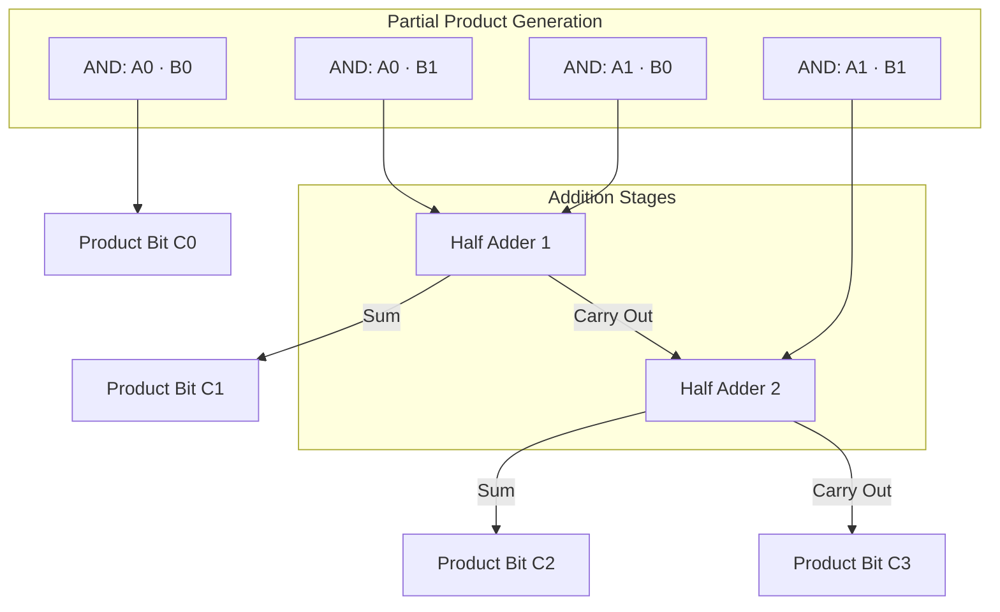
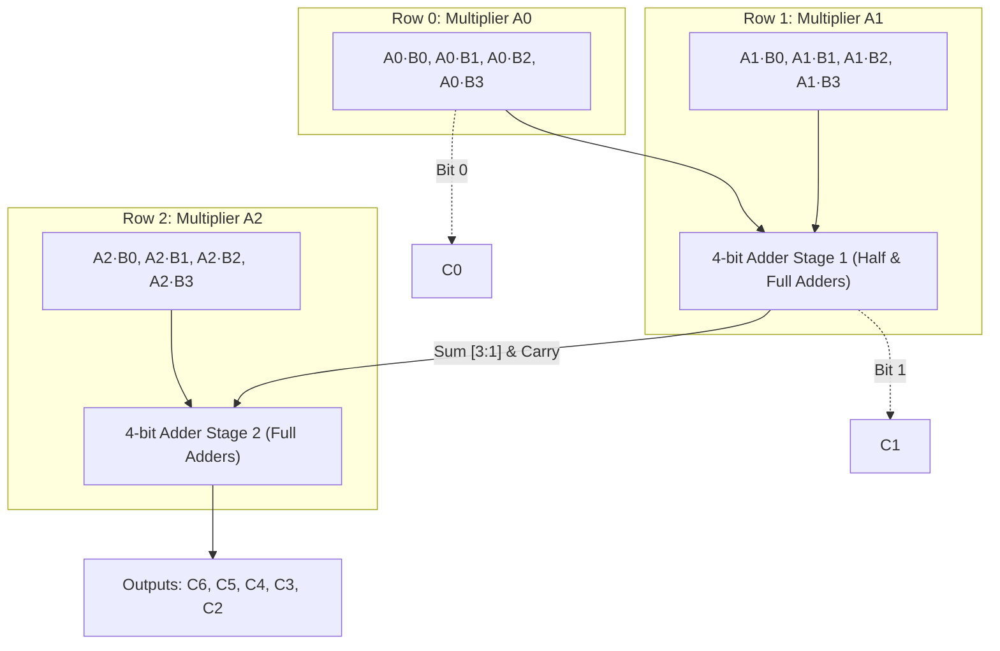
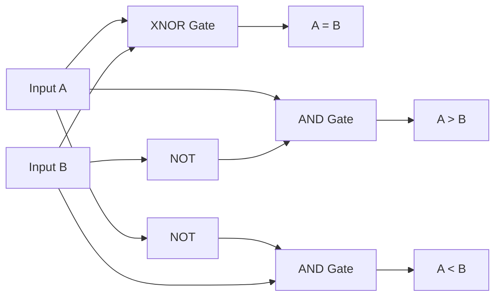
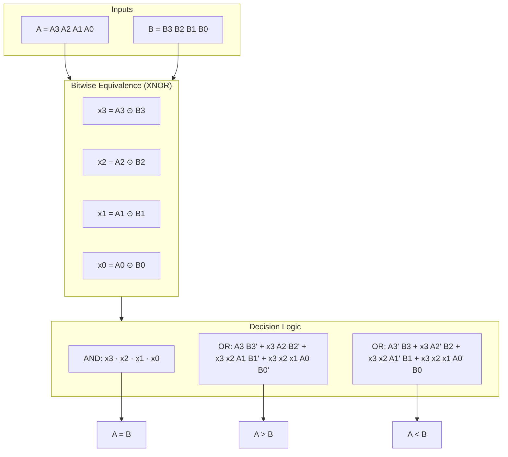
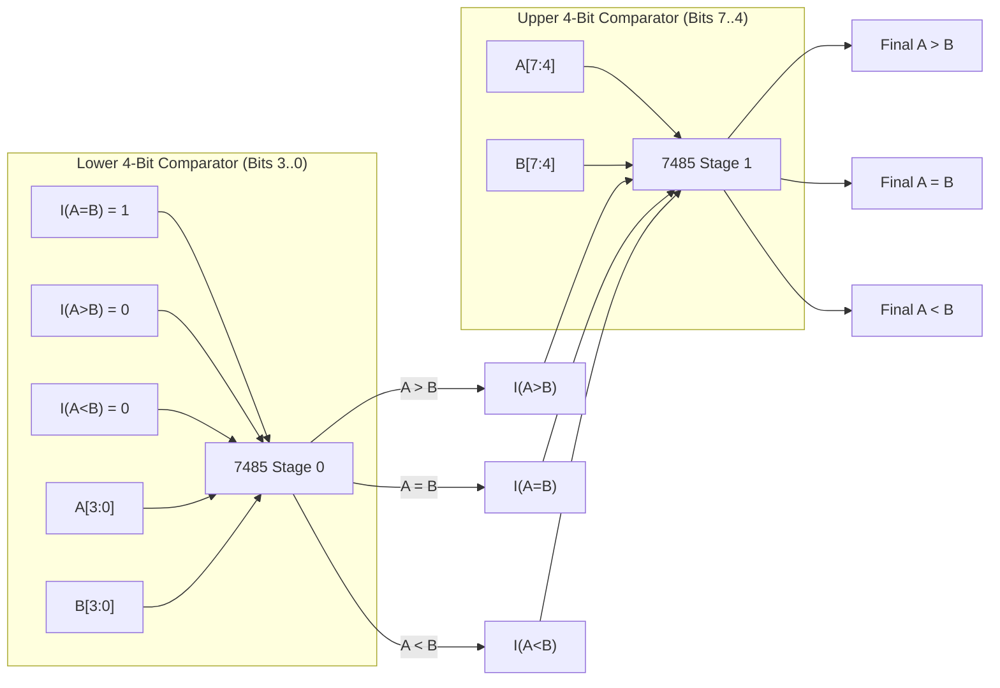

[DLCD Index](../README.md) / [Unit 1: Combinational Logic Design](Introduction.md)

# L08 - Binary Multipliers and Magnitude Comparators

In the previous two lectures, we built adders and subtractors for both binary numbers and decimal digits. But general-purpose computing requires two other fundamental operations: scaling numbers through multiplication and making decisions based on numerical comparisons.

When you write an `if (A > B)` statement in code, or when a graphics pipeline computes coordinate transforms, the underlying silicon relies directly on combinational multipliers and magnitude comparators. Let's look at how these circuits are constructed from basic gates, adders, and bitwise equivalence checks.

---

## The Principle of Binary Multiplication

Think about how you learned long multiplication in grade school. You take the multiplicand, multiply it by the least significant digit of the multiplier to produce the first partial product, shift the next partial product left by one digit, and continue until all multiplier digits are processed. Finally, you sum all the aligned partial products.

Binary multiplication works exactly the same way, but it is vastly simpler. Because binary digits are only `0` or `1`, each single-bit multiplication is trivial:
- $0 \times 0 = 0$
- $0 \times 1 = 0$
- $1 \times 0 = 0$
- $1 \times 1 = 1$

Notice something here — this is the exact truth table of a 2-input **AND gate**. 

In binary hardware, generating a partial product bit does not require an arithmetic multiplier; it requires a single AND gate. Multiplying an $n$-bit multiplicand $B$ by a single multiplier bit $A_k$ means broadcasting $A_k$ to $n$ AND gates. If $A_k = 0$, the partial product is all zeros; if $A_k = 1$, the partial product is an exact copy of $B$.

The challenge of hardware multiplication is therefore not generating the partial products, but **adding the shifted rows together rapidly**.

---

## 2-Bit by 2-Bit Binary Multiplier

To see the mechanics clearly, let's construct a circuit that multiplies a 2-bit multiplicand $B_1 B_0$ by a 2-bit multiplier $A_1 A_0$.

Let's write out the pencil-and-paper multiplication:

```
            B1    B0
      ×     A1    A0
      ---------------
         A0B1  A0B0    <- Partial Product 0
+  A1B1  A1B0          <- Partial Product 1 (shifted left by 1)
---------------------
    C3    C2    C1    C0
```

Let's trace each output product bit:
1. **$C_0$**: This is simply $A_0 B_0$. No addition is required. A single AND gate produces $C_0$.
2. **$C_1$**: This is the sum of $A_0 B_1$ and $A_1 B_0$. Adding two single bits requires a **Half Adder (HA)**. The sum output of the HA becomes $C_1$, and its carry output rolls over to the next column.
3. **$C_2$**: This column must add $A_1 B_1$ and the carry generated from the $C_1$ column. Since there are only two bits to sum, another **Half Adder** suffices. Its sum output gives $C_2$.
4. **$C_3$**: The carry output of the second Half Adder becomes the most significant bit, $C_3$.

The entire circuit requires exactly 4 AND gates and 2 Half Adders:



When two 2-bit numbers are multiplied (maximum value $3 \times 3 = 9$), the result fits into 4 bits ($9_{10} = 1001_2$). In general, multiplying an $M$-bit number by an $N$-bit number produces an **$(M + N)$-bit product**.

---

## 4-Bit by 3-Bit Array Multiplier

Now let's scale this concept up. Suppose we need to multiply a 4-bit multiplicand $B = B_3 B_2 B_1 B_0$ by a 3-bit multiplier $A = A_2 A_1 A_0$. The product will have $4 + 3 = 7$ bits ($C_6 C_5 C_4 C_3 C_2 C_1 C_0$).

Writing out the partial products:
- Row 0: $A_0 B_3,\; A_0 B_2,\; A_0 B_1,\; A_0 B_0$
- Row 1: $A_1 B_3,\; A_1 B_2,\; A_1 B_1,\; A_1 B_0$ (shifted 1 position left)
- Row 2: $A_2 B_3,\; A_2 B_2,\; A_2 B_1,\; A_2 B_0$ (shifted 2 positions left)

For $M = 4$ and $N = 3$, we have:
- $4 \times 3 = 12$ partial product terms, requiring 12 AND gates.
- $(N - 1) = 2$ rows of multi-bit adders to accumulate the partial products.

Let's visualize the array data path:



In an array multiplier:
- The first adder row takes Row 0 (shifted) and Row 1 as inputs. The least significant bit drops straight through to output $C_1$, while the remaining sum and carry bits feed the next stage.
- The second adder row takes the accumulated results from the first stage and adds Row 2. The outputs form bits $C_2$ through $C_6$.

For an arbitrary $J \times K$ array multiplier:
- Total AND gates required = $J \times K$.
- Total adders required = $(J - 1)$ adder rows, each typically consisting of $(K - 1)$ Full Adders and $1$ Half Adder (or $K$ Full Adders depending on layout).

While array multipliers are fully combinational and straightforward, the propagation delay grows linearly with the number of multiplier bits because carries must ripple across each row and down through successive rows. In Unit 4, we will examine high-speed techniques like Carry-Save Addition (CSA) and Wallace Trees that dramatically reduce this latency.

---

## Magnitude Comparators

Now let's examine comparison. A **Magnitude Comparator** is a combinational circuit that compares two binary numbers, $A$ and $B$, and determines their relative magnitudes.

It produces three mutually exclusive outputs:
1. $A > B$ (A is greater than B)
2. $A = B$ (A is equal to B)
3. $A < B$ (A is less than B)

At any given instant, exactly one of these three outputs must be logic `1`, and the other two must be `0`.

---

## 1-Bit Magnitude Comparator

Let's begin by comparing two single-bit binary inputs, $A$ and $B$.

Let's write out the truth table:

| $A$ | $B$ | $A > B$ | $A = B$ | $A < B$ |
| :---: | :---: | :---: | :---: | :---: |
| 0 | 0 | 0 | 1 | 0 |
| 0 | 1 | 0 | 0 | 1 |
| 1 | 0 | 1 | 0 | 0 |
| 1 | 1 | 0 | 1 | 0 |

From this table, we can immediately write down the Boolean equations:
- $A = B$: The output is 1 when both bits are 0 or both bits are 1. This is the **XNOR** (Exclusive-NOR) function:
  $$x = A \odot B = A B + \overline{A}\;\overline{B} = \overline{A \oplus B}$$
- $A > B$: The output is 1 only when $A = 1$ and $B = 0$:
  $$(A > B) = A \overline{B}$$
- $A < B$: The output is 1 only when $A = 0$ and $B = 1$:
  $$(A < B) = \overline{A} B$$

The XNOR gate is the heart of binary comparison. Whenever two bits match, their XNOR output is `1`. Whenever they differ, it is `0`.



---

## 4-Bit Magnitude Comparator Architecture

Now consider comparing two 4-bit unsigned numbers:
$$A = A_3 A_2 A_1 A_0$$
$$B = B_3 B_2 B_1 B_0$$

How do humans compare two multi-digit numbers? We do not start at the units digit. We look at the **most significant digit**. If the most significant digit of $A$ is greater than that of $B$, $A$ is immediately greater, regardless of what the lower digits are. If they are equal, we move to the next digit to the right. Only if all digits are identical do we declare them equal.

The hardware implementation follows this exact logic.

### 1. The Equality Condition ($A = B$)

For $A$ to equal $B$, bit 3 must match bit 3, bit 2 must match bit 2, bit 1 must match bit 1, and bit 0 must match bit 0.

Let's define equivalence variables $x_i$ for each bit position using the XNOR function:
$$x_3 = A_3 B_3 + \overline{A_3}\;\overline{B_3}$$
$$x_2 = A_2 B_2 + \overline{A_2}\;\overline{B_2}$$
$$x_1 = A_1 B_1 + \overline{A_1}\;\overline{B_1}$$
$$x_0 = A_0 B_0 + \overline{A_0}\;\overline{B_0}$$

Each $x_i = 1$ if and only if $A_i = B_i$.

Therefore, the equality output $(A = B)$ is true if and only if all four bit pairs are equal:
$$(A = B) = x_3 \, x_2 \, x_1 \, x_0$$

This is implemented with four XNOR gates feeding a single 4-input AND gate.

---

### 2. The Greater-Than Condition ($A > B$)

Under what circumstances is $A$ strictly greater than $B$?

1. If the MSBs differ and $A_3 = 1$ while $B_3 = 0$, then $A > B$ immediately:
   $$\text{Term } 1 = A_3 \overline{B_3}$$
2. If the MSBs are equal ($x_3 = 1$), but $A_2 = 1$ and $B_2 = 0$:
   $$\text{Term } 2 = x_3 A_2 \overline{B_2}$$
3. If both bit 3 and bit 2 are equal ($x_3 = 1$ and $x_2 = 1$), but $A_1 = 1$ and $B_1 = 0$:
   $$\text{Term } 3 = x_3 x_2 A_1 \overline{B_1}$$
4. If bits 3, 2, and 1 are all equal ($x_3 = 1, x_2 = 1, x_1 = 1$), but $A_0 = 1$ and $B_0 = 0$:
   $$\text{Term } 4 = x_3 x_2 x_1 A_0 \overline{B_0}$$

Combining these mutually exclusive priority conditions with an OR gate gives the complete Boolean equation:
$$(A > B) = A_3 \overline{B_3} + x_3 A_2 \overline{B_2} + x_3 x_2 A_1 \overline{B_1} + x_3 x_2 x_1 A_0 \overline{B_0}$$

---

### 3. The Less-Than Condition ($A < B$)

By identical reasoning, $A < B$ occurs if $B$ has a 1 where $A$ has a 0 at the highest differing bit position:
$$(A < B) = \overline{A_3} B_3 + x_3 \overline{A_2} B_2 + x_3 x_2 \overline{A_1} B_1 + x_3 x_2 x_1 \overline{A_0} B_0$$

Notice the elegant structure of these equations:
- The equivalence signals $x_3, x_2, x_1$ act as **enable conditions**.
- Lower-order bits are only allowed to influence the decision if all higher-order bits are equal.
- As soon as any higher bit differs, $x_k = 0$, which disables all subsequent terms to the right!



---

## Cascading Magnitude Comparators (The 7485 Architecture)

In practical digital design, we often need to compare 8-bit, 16-bit, or 32-bit values. We do not design massive custom 32-bit K-maps; we cascade standard 4-bit comparator integrated circuits (such as the classic **TTL 7485**).

To allow cascading, a 4-bit comparator chip includes three **cascading inputs**:
- $I_{A > B}$ (Input indicating $A > B$ from the lower-order stage)
- $I_{A = B}$ (Input indicating $A = B$ from the lower-order stage)
- $I_{A < B}$ (Input indicating $A < B$ from the lower-order stage)

How do these inputs interact with the chip's internal logic?
- If the current 4-bit stage detects a difference ($A > B$ or $A < B$), its local bits decide the outcome immediately. The cascading inputs from the lower stage are completely ignored.
- However, if the current 4-bit stage finds that its own bits are equal ($A = B$), it cannot make the final decision alone. It looks at the cascading inputs and passes them directly to its outputs!

For an 8-bit comparator using two 4-bit blocks:
1. Stage 0 (Lower 4 bits, $A_{3..0}$ and $B_{3..0}$) has its cascading inputs tied to fixed values:
   $$I_{A = B} = 1, \quad I_{A > B} = 0, \quad I_{A < B} = 0$$
   (Assuming equality if no lower bits exist).
2. The outputs of Stage 0 connect directly to the cascading inputs of Stage 1 (Upper 4 bits, $A_{7..4}$ and $B_{7..4}$).
3. The outputs of Stage 1 provide the final comparison for the entire 8-bit word.



Notice the critical orientation: the **most significant stage produces the final outputs**. If bits 7 through 4 differ, Stage 1 immediately decides the final result without waiting for Stage 0. If bits 7 through 4 are identical, Stage 1 defers to whatever decision was reached by Stage 0.

---

## Key Takeaways

- Binary multiplication of single bits is physically realized using **AND gates** ($A_k \cdot B_j$) because the multiplication truth table is identical to the logical AND operation.
- An array multiplier scales by generating an $M \times N$ matrix of partial product bits using AND gates and summing them with rows of Half and Full Adders. An $M$-bit by $N$-bit multiplication produces an **$(M + N)$-bit result**.
- A **Magnitude Comparator** determines whether $A > B$, $A = B$, or $A < B$. Exactly one output is asserted at any time.
- The fundamental building block of digital equality is the **XNOR gate** ($x_i = A_i \odot B_i$). Two numbers are equal if and only if all bitwise XNOR outputs are `1`:
  $$(A = B) = x_3 x_2 x_1 x_0$$
- Inequality testing evaluates bits from MSB to LSB. A bit position can only decide the comparison if all higher-order bits are identical ($x_k = 1$).
- Larger comparators are built by cascading 4-bit blocks. The higher-order block evaluates its own bits first; if they are identical, it forwards the decision made by the lower-order block.

---

With arithmetic and relational blocks understood, we turn to the circuits that control the flow and routing of information within digital systems. In the next lecture, we investigate [**Decoders and Circuit Implementation**](L09%20-%20Decoders%20and%20Circuit%20Implementation.md), showing how $n$ coded input lines expand into $2^n$ unique outputs to select memory locations, decode processor instructions, and synthesize arbitrary logic functions.
