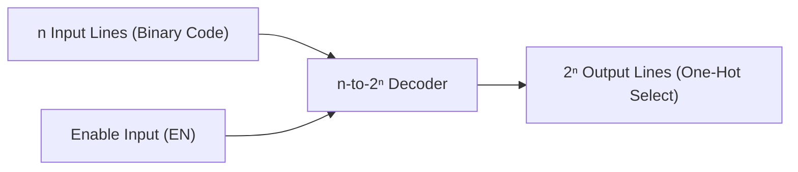
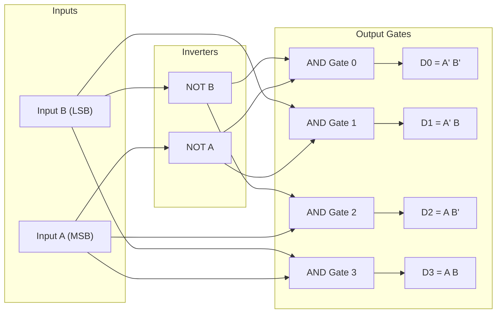
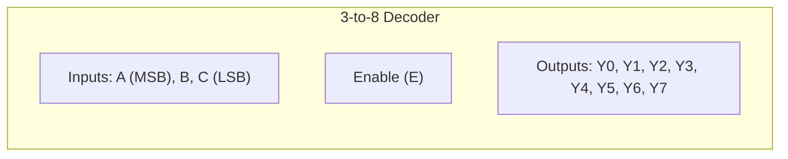
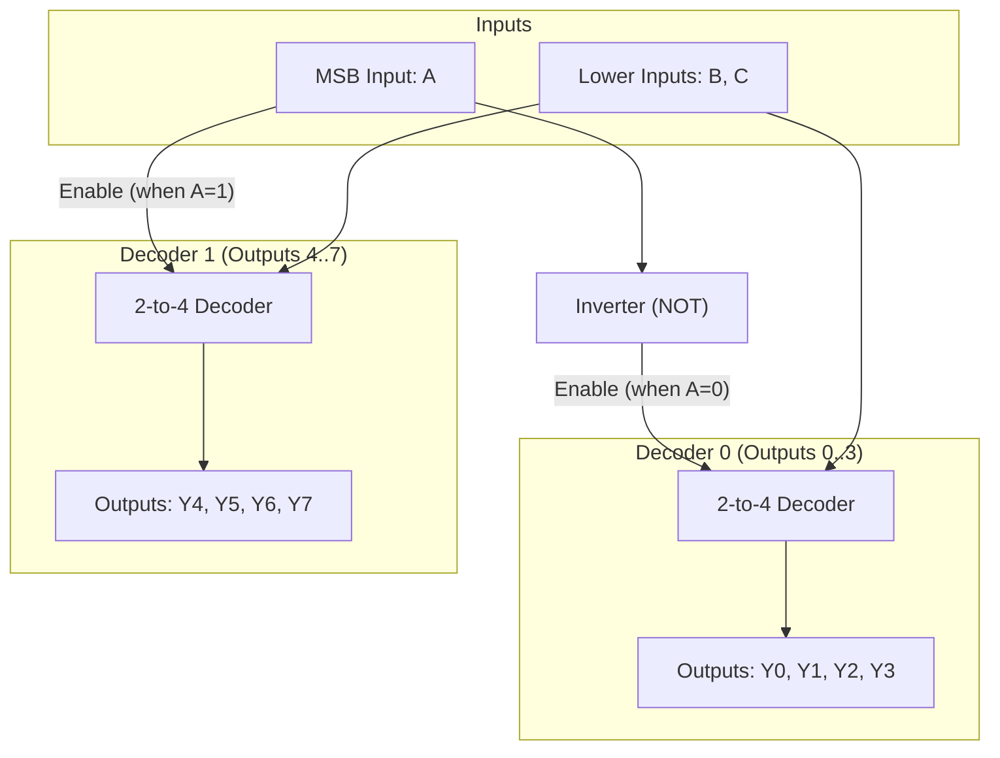
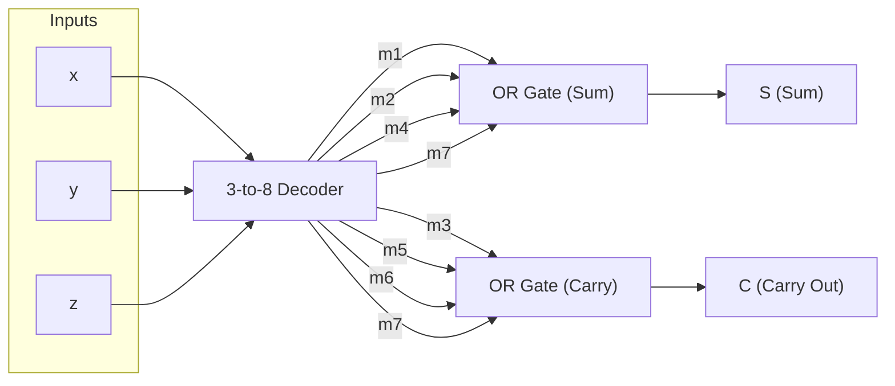

[DLCD Index](../README.md) / [Unit 1: Combinational Logic Design](Introduction.md)

# L09 - Decoders and Circuit Implementation

In digital computing, data is stored and manipulated in compact binary formats. For example, a 3-bit register can hold any of $2^3 = 8$ distinct binary patterns. But when a processor executes an instruction, accesses a specific memory chip, or selects a register to read, it cannot activate all 8 devices at once. It must activate exactly *one* specific hardware line corresponding to that 3-bit code.

This translation—from a compact $n$-bit binary code to $2^n$ individual selection lines—is the job of a **Decoder**.

---

## What is a Decoder?

A **Decoder** is a combinational circuit that converts binary information from $n$ input lines to a maximum of $2^n$ unique output lines. 

Because each output line corresponds to exactly one minterm of the input variables, for any given input combination, **exactly one output is asserted (active)** while all other outputs remain inactive. This representation is known as a **one-hot code**.

If an $n$-bit code has unused bit combinations, the decoder may have fewer than $2^n$ outputs (such as a BCD-to-Decimal decoder, which converts 4 input bits into only 10 outputs, $0$ through $9$).

---

## 2-to-4 Line Decoder

Let's start with the smallest non-trivial decoder: a 2-to-4 line decoder with inputs $A$ and $B$ (where $A$ is the MSB and $B$ is the LSB) and outputs $D_0, D_1, D_2, D_3$.

Let's write out its truth table:

| $A$ | $B$ | $D_0$ | $D_1$ | $D_2$ | $D_3$ | Selected Minterm |
| :---: | :---: | :---: | :---: | :---: | :---: | :---: |
| 0 | 0 | 1 | 0 | 0 | 0 | $m_0 = \overline{A}\,\overline{B}$ |
| 0 | 1 | 0 | 1 | 0 | 0 | $m_1 = \overline{A}\,B$ |
| 1 | 0 | 0 | 0 | 1 | 0 | $m_2 = A\,\overline{B}$ |
| 1 | 1 | 0 | 0 | 0 | 1 | $m_3 = A B$ |

Notice something here — each output is simply the product term of one minterm:
$$D_0 = \overline{A}\;\overline{B}$$
$$D_1 = \overline{A}\,B$$
$$D_2 = A\,\overline{B}$$
$$D_3 = A B$$

To build this circuit, we only need 2 inverters (to generate $\overline{A}$ and $\overline{B}$) and 4 two-input AND gates.

When $AB = 00$, only $G_0$ receives high inputs on both pins, forcing $D_0 = 1$ while $D_1 = D_2 = D_3 = 0$.

---

## Decoders with an Enable Input

In practical computer architectures, we rarely want a decoder running continuously. We need a way to turn the decoder on or off. This is accomplished with an **Enable ($E$ or $EN$)** input.

### Active-High Enable

When an active-high Enable input is added:
- If $E = 0$, the decoder is **disabled**. All outputs are forced to `0`, regardless of what inputs $A$ and $B$ are doing.
- If $E = 1$, the decoder is **enabled** and behaves normally.

The Boolean equations incorporate $E$ directly:
$$D_i = m_i \cdot E$$

### Active-Low Logic and the 74LS138

In commercial MSI chips (such as the industry-standard **74LS138 3-to-8 decoder**), decoders are almost always designed with **active-low outputs** and **active-low enable lines** ($\overline{E}$).

Why active-low?
1. **NAND gates are faster**: In silicon technologies like CMOS and TTL, an inverting gate (NAND/NOR) is physically faster and requires fewer transistors than a non-inverting gate (AND/OR).
2. **Bus line driving**: Memory chip select inputs ($\overline{\text{CS}}$) and output enable lines ($\overline{\text{OE}}$) are historically active-low to provide superior noise immunity and pull-down current capability.

In an active-low 2-to-4 decoder built with NAND gates:
- The selected output is driven to **`0` (Low)**.
- All unselected outputs remain at **`1` (High)**.

| $E$ | $A$ | $B$ | $\overline{D_0}$ | $\overline{D_1}$ | $\overline{D_2}$ | $\overline{D_3}$ |
| :---: | :---: | :---: | :---: | :---: | :---: | :---: |
| 1 | X | X | 1 | 1 | 1 | 1 (Disabled) |
| 0 | 0 | 0 | **0** | 1 | 1 | 1 |
| 0 | 0 | 1 | 1 | **0** | 1 | 1 |
| 0 | 1 | 0 | 1 | 1 | **0** | 1 |
| 0 | 1 | 1 | 1 | 1 | 1 | **0** |

---

## 3-to-8 Line Decoder

A 3-to-8 line decoder takes three binary inputs $A, B, C$ (representing values $0$ to $7$) and decodes them into eight individual outputs $Y_0$ through $Y_7$.

The logic expressions for the active-high outputs are:
$$Y_0 = \overline{A}\;\overline{B}\;\overline{C} \cdot E$$
$$Y_1 = \overline{A}\;\overline{B}\,C \cdot E$$
$$Y_2 = \overline{A}\,B\,\overline{C} \cdot E$$
$$Y_3 = \overline{A}\,B\,C \cdot E$$
$$Y_4 = A\,\overline{B}\;\overline{C} \cdot E$$
$$Y_5 = A\,\overline{B}\,C \cdot E$$
$$Y_6 = A\,B\,\overline{C} \cdot E$$
$$Y_7 = A\,B\,C \cdot E$$

Each output corresponds to an individual minterm $m_0$ through $m_7$. If $E = 1$ and $ABC = 101_2$ ($5_{10}$), output $Y_5$ switches to `1`, while all other seven outputs stay at `0`.

---

## Decoder Expansion (Building Larger Decoders)

What happens when we need a 4-to-16 line decoder, but our parts bin only contains 3-to-8 decoders? Or when we need a 3-to-8 decoder and only have 2-to-4 decoders?

We use **hierarchical decoder expansion**, using the higher-order address bit as an enable switch.

### Constructing a 3-to-8 Decoder Using Two 2-to-4 Decoders

Suppose we have two 2-to-4 line decoders with Enable inputs, and we want to build a 3-to-8 decoder with inputs $A, B, C$ (where $A$ is MSB).

Notice how the minterms divide based on the MSB $A$:
- For $A = 0$, the minterms are $m_0$ to $m_3$ ($000_2$ to $011_2$).
- For $A = 1$, the minterms are $m_4$ to $m_7$ ($100_2$ to $111_2$).

Both groups share the exact same lower address bits $B$ and $C$!

So the design strategy is immediate:
1. Connect inputs $B$ and $C$ in parallel to the address lines of **both** 2-to-4 decoders.
2. Connect input $A$ to the Enable pins:
   - Invert $A$ ($\overline{A}$) and feed it to the Enable of Decoder 0 (handling outputs $Y_0$ to $Y_3$).
   - Feed $A$ directly to the Enable of Decoder 1 (handling outputs $Y_4$ to $Y_7$).

Let's trace the operation:
- When $A = 0$: Decoder 0 is enabled, while Decoder 1 is disabled (all its outputs are 0). The lower bits $BC$ select one output among $Y_0, Y_1, Y_2, Y_3$.
- When $A = 1$: Decoder 0 is disabled, while Decoder 1 is enabled. The lower bits $BC$ select one output among $Y_4, Y_5, Y_6, Y_7$.

By the exact same principle, a **4-to-16 line decoder** is built from two 3-to-8 decoders using input $A$ (the 4th bit) to enable one chip or the other.

---

## Implementing Combinational Logic Using Decoders

Now comes one of the most powerful insights in digital design:

> **An $n$-to-$2^n$ decoder generates every single minterm of its $n$ input variables.**

Recall from Lecture 2 that **any Boolean function can be expressed uniquely as a canonical Sum of Minterms (SOP)**:
$$F(A, B, C) = \sum m(i)$$

Since the decoder's outputs are literally those minterms, how do you implement *any* arbitrary Boolean function?

You simply connect the decoder outputs corresponding to the function's minterms to the inputs of an **OR gate**!

---

### Example: Full Adder Implementation Using a 3-to-8 Decoder

Let's design a 1-bit Full Adder with inputs $x, y, z$ (where $z = C_{\text{in}}$) and outputs $S$ (Sum) and $C$ (Carry Out) using a decoder.

The canonical minterm expansions for a Full Adder are:
$$S(x, y, z) = \sum m(1, 2, 4, 7)$$
$$C(x, y, z) = \sum m(3, 5, 6, 7)$$

Instead of simplifying with K-maps and wiring up individual XOR, AND, and OR gates, we can implement both outputs using:
- One standard 3-to-8 decoder.
- One 4-input OR gate for $S$.
- One 4-input OR gate for $C$.

Look at how clean this is. If the function has $k$ outputs sharing the same $n$ input variables, a single decoder generates the terms for all of them. Each output function requires only one OR gate.

### What if the Decoder has Active-Low Outputs?

If the decoder outputs are active-low ($\overline{m_i}$), commercial designs do not place an inverter on every output. Instead, they use DeMorgan's law:
$$\overline{\sum m_i} \implies F = \left(\prod \overline{m_i}\right)'$$

By connecting the active-low minterm outputs to a **NAND gate**, the NAND gate performs an active-low OR function:
$$\overline{\overline{m_1} \cdot \overline{m_2} \cdot \overline{m_4} \cdot \overline{m_7}} = m_1 + m_2 + m_4 + m_7 = S$$

Thus, with active-low decoders, **NAND gates replace the OR gates directly**, with zero additional inverter overhead!

---

## Key Takeaways

- An $n$-to-$2^n$ **Decoder** translates an $n$-bit binary input into $2^n$ unique outputs, asserting exactly one output line corresponding to the active minterm.
- Decoders often include an **Enable ($E$)** input that controls overall operation. If disabled, all outputs are inactive.
- Commercial decoders frequently use **active-low outputs** and active-low enable lines because inverting logic (NAND) is physically faster and better suited for driving bus and chip-select lines.
- Larger decoders are synthesized hierarchically by using the most significant address bit(s) to drive the Enable inputs of smaller decoders.
- Any combinational Boolean function can be implemented using an $n$-to-$2^n$ decoder and an OR gate (for active-high decoders) or a NAND gate (for active-low decoders) by summing the required minterms.

---

A decoder expands $n$ bits into $2^n$ lines. But what if we have multiple signal lines and need to compress them back into a compact binary address? In the next lecture, we reverse this process and examine [**Encoders and Priority Encoders**](L10%20-%20Encoders%20and%20Priority%20Encoders.md), solving the fundamental problem of resolving simultaneous inputs using priority arbitration.
