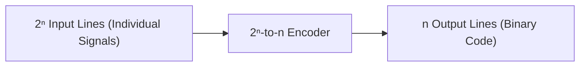
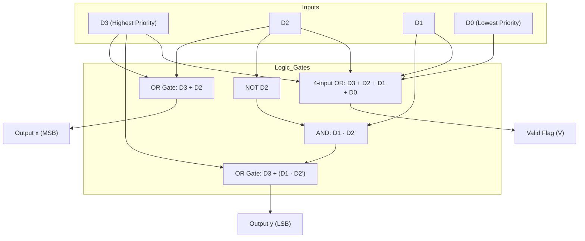

[DLCD Index](../README.md) / [Unit 1: Combinational Logic Design](Introduction.md)

# L10 - Encoders and Priority Encoders

In the previous lecture, we saw how a decoder takes a compact binary code and expands it into individual one-hot selection signals. But in real computer hardware, we frequently face the exact opposite requirement.

Suppose you have 8 interrupt lines connected to different hardware peripherals (a keyboard, a hard drive, a timer, a network card). When one of these devices requests attention, the CPU does not want to route 8 separate wires into its execution core. It wants an encoded 3-bit binary identifier indicating which device fired.

This reverse translation—from multiple individual active lines back into a compact binary code—is the purpose of an **Encoder**.

---

## What is an Encoder?

An **Encoder** is a combinational circuit that performs the inverse operation of a decoder. It has up to $2^n$ input lines and generates an $n$-bit binary output code corresponding to the active input line.



---

## Conventional Encoders: Octal-to-Binary (8-to-3)

Let's examine a standard 8-to-3 line encoder. It accepts 8 input lines ($D_0$ through $D_7$) and generates a 3-bit binary output $A_2 A_1 A_0$.

Under the strict assumption that **only one input line is active (`1`) at any time**, we can construct the truth table:

| $D_7$ | $D_6$ | $D_5$ | $D_4$ | $D_3$ | $D_2$ | $D_1$ | $D_0$ | $A_2$ | $A_1$ | $A_0$ |
| :---: | :---: | :---: | :---: | :---: | :---: | :---: | :---: | :---: | :---: | :---: |
| 0 | 0 | 0 | 0 | 0 | 0 | 0 | 1 | 0 | 0 | 0 |
| 0 | 0 | 0 | 0 | 0 | 0 | 1 | 0 | 0 | 0 | 1 |
| 0 | 0 | 0 | 0 | 0 | 1 | 0 | 0 | 0 | 1 | 0 |
| 0 | 0 | 0 | 0 | 1 | 0 | 0 | 0 | 0 | 1 | 1 |
| 0 | 0 | 0 | 1 | 0 | 0 | 0 | 0 | 1 | 0 | 0 |
| 0 | 0 | 1 | 0 | 0 | 0 | 0 | 0 | 1 | 0 | 1 |
| 0 | 1 | 0 | 0 | 0 | 0 | 0 | 0 | 1 | 1 | 0 |
| 1 | 0 | 0 | 0 | 0 | 0 | 0 | 0 | 1 | 1 | 1 |

Notice how each output bit behaves:
- $A_0$ is `1` whenever an odd-numbered input is active: $D_1, D_3, D_5, D_7$.
- $A_1$ is `1` whenever inputs $D_2, D_3, D_6, D_7$ are active.
- $A_2$ is `1` whenever inputs $D_4, D_5, D_6, D_7$ are active.

Because only one input is active at any time, we can write the output equations directly as simple OR gates:
$$A_0 = D_1 + D_3 + D_5 + D_7$$
$$A_1 = D_2 + D_3 + D_6 + D_7$$
$$A_2 = D_4 + D_5 + D_6 + D_7$$

Notice that input $D_0$ does not appear in any of the equations. When $D_0 = 1$, all other inputs are $0$, so $A_2 A_1 A_0 = 000_2$, which is mathematically correct.

---

## The Fatal Flaws of Simple Encoders

While the circuit above looks clean and simple, it has **two critical design flaws** that make it unusable in realistic computing environments:

### Flaw 1: The Ambiguity of All-Zeros

What happens if *no* input line is active ($D_7..D_0 = 00000000_2$)? 
All OR gates output `0`, yielding $A_2 A_1 A_0 = 000$.

Now ask yourself: how can downstream hardware distinguish between:
1. Input $D_0$ being actively asserted ($A_2 A_1 A_0 = 000$)?
2. No input being asserted at all ($A_2 A_1 A_0 = 000$)?

It cannot. The circuit creates an irreconcilable ambiguity.

### Flaw 2: The Multi-Signal Collision Problem

What happens if two or more inputs are accidentally asserted at the same instant?
Suppose a network packet and a timer interrupt arrive simultaneously, causing both $D_2 = 1$ and $D_4 = 1$.

Let's evaluate the output equations:
- $A_0 = 0$
- $A_1 = D_2 = 1$
- $A_2 = D_4 = 1$

The encoder produces $A_2 A_1 A_0 = 110_2 = 6_{10}$! The system thinks device 6 requested service, when in reality device 6 was completely silent. The collision produces an invalid phantom code.

To solve both flaws, digital systems use a **Priority Encoder**.

---

## The Priority Encoder Architecture

A **Priority Encoder** establishes two fundamental rules:
1. **Priority Arbitration**: If two or more inputs arrive simultaneously, the input with the highest designated priority takes precedence. Its binary code is generated, and all lower-priority active inputs are ignored.
2. **Valid Flag ($V$)**: An additional output pin, $V$ (Valid), is asserted (`1`) if and only if at least one input line is active. If all inputs are zero, $V = 0$, signaling to downstream hardware that the data outputs are invalid and should be ignored.

By convention, the higher-numbered input has the highest priority:
$$D_3 > D_2 > D_1 > D_0$$

---

## Designing a 4-Input Priority Encoder

Let's design a 4-input priority encoder with inputs $D_3, D_2, D_1, D_0$, data outputs $x, y$, and valid indicator $V$.

- $D_3$ has the highest priority. If $D_3 = 1$, it does not matter what $D_2, D_1, D_0$ are—they are Don't Cares ($X$). The output must be $11_2$.
- $D_2$ is next. If $D_3 = 0$ and $D_2 = 1$, lower inputs are Don't Cares. The output must be $10_2$.
- $D_1$ is next. If $D_3 = 0, D_2 = 0$, and $D_1 = 1$, output is $01_2$.
- $D_0$ has lowest priority. If only $D_0 = 1$, output is $00_2$.
- If all four inputs are $0$, $x$ and $y$ are Don't Cares ($X$), but $V = 0$.

Let's write out the condensed truth table using Don't Cares:

| $D_3$ | $D_2$ | $D_1$ | $D_0$ | $x$ | $y$ | $V$ | Active Condition |
| :---: | :---: | :---: | :---: | :---: | :---: | :---: | :---: |
| 0 | 0 | 0 | 0 | X | X | **0** | No valid input |
| 0 | 0 | 0 | 1 | 0 | 0 | **1** | $D_0$ active |
| 0 | 0 | 1 | X | 0 | 1 | **1** | $D_1$ active |
| 0 | 1 | X | X | 1 | 0 | **1** | $D_2$ active |
| 1 | X | X | X | 1 | 1 | **1** | $D_3$ active |

---

## Algebraic Derivation and K-Map Simplification

Let's expand the Don't Care conditions into 4-variable K-maps to synthesize the minimal gate equations.

### Output $x$:

$x$ is `1` whenever $D_3 = 1$ (8 minterms) or whenever $D_2 = 1$ while $D_3 = 0$ (4 minterms):
- When $D_3 = 1$, $x = 1$ regardless of $D_2, D_1, D_0$.
- When $D_2 = 1$ and $D_3 = 0$, $x = 1$.
- For $D_3 D_2 D_1 D_0 = 0000$, $x$ is a Don't Care ($X$).

Plotting $x$ on a 4-variable K-map:

```
        D1 D0
D3 D2   00   01   11   10
 00     X    0    0    0
 01     1    1    1    1   <- Group 1 (size 4: D2)
 11     1    1    1    1 \
 10     1    1    1    1 - Group 2 (size 8: D3)
```

Combining the groups yields:
$$x = D_3 + D_2$$

Look at how intuitive that is: $x$ is the MSB of the 2-bit code. The binary codes for $D_2$ ($10_2$) and $D_3$ ($11_2$) both have an MSB of `1`. So $x$ must be high whenever either $D_2$ or $D_3$ is active!

---

### Output $y$:

$y$ is `1` for $D_3$ ($11_2$) and for $D_1$ ($01_2$):
- When $D_3 = 1$, $y = 1$ (all 8 minterms where $D_3 = 1$).
- When $D_3 = 0$, $D_2 = 0$, and $D_1 = 1$, $y = 1$ (minterms 2 and 3).
- For $D_3 D_2 D_1 D_0 = 0000$, $y = X$.

Plotting $y$ on a 4-variable K-map:

```
        D1 D0
D3 D2   00   01   11   10
 00     X    0    1    1   <- Group 1 (minterms 2, 3: D3' D2' D1)
 01     0    0    0    0
 11     1    1    1    1 \
 10     1    1    1    1 - Group 2 (size 8: D3)
```

Grouping the 8 ones where $D_3 = 1$ gives term $D_3$.
Grouping minterms 2 and 3 with the don't-care (or directly) under $D_3 = 0, D_2 = 0$ gives $\overline{D_2} D_1$.

Thus:
$$y = D_3 + \overline{D_2}\,D_1$$

Notice the condition $\overline{D_2} D_1$: $y$ responds to $D_1$ only if $D_2$ is NOT asserted. If $D_2$ is asserted, it overrides $D_1$!

---

### Valid Output $V$:

The valid output $V$ must be `1` if ANY input is active, and `0` only if all four inputs are `0`:
$$V = D_3 + D_2 + D_1 + D_0$$

This is a single 4-input OR gate.

---

## Logic Circuit Implementation

The complete circuit requires only two OR gates, one AND gate, and one inverter:



---

## Real-World Applications

Priority encoders are foundational across computer engineering:

1. **Vectored Interrupt Controllers (PIC)**: In modern processors, peripheral devices request CPU execution time via interrupt request (IRQ) lines. If a high-priority system clock interrupt and a low-priority mouse click arrive simultaneously, the priority encoder forces the CPU to service the clock first.
2. **Flash Analog-to-Digital Converters (Flash ADC)**: High-speed ADCs compare an analog input voltage against a ladder of reference voltages using a bank of comparators. As the input voltage rises, all comparators up to that voltage level turn on simultaneously. A priority encoder translates this thermometer-coded ladder into a clean binary number at gigahertz speeds.
3. **Bus Arbitration**: When multiple processor cores or DMA controllers request access to a shared memory bus, a priority arbiter uses encoder logic to grant bus ownership to the highest-priority master.

---

## Key Takeaways

- An **Encoder** converts up to $2^n$ distinct input lines into an $n$-bit binary output code, performing the reverse operation of a decoder.
- Simple encoders fail when no inputs are active (generating an ambiguous `000` output) or when multiple inputs are active simultaneously (producing an invalid combined code).
- A **Priority Encoder** resolves multiple simultaneous inputs by asserting the binary code of the input with the **highest priority**.
- The **Valid ($V$)** bit indicates whether any valid input is present ($V = 1$) or whether the bus is idle ($V = 0$).
- For a 4-input priority encoder with $D_3$ having highest priority:
  $$x = D_3 + D_2$$
  $$y = D_3 + \overline{D_2}\,D_1$$
  $$V = D_3 + D_2 + D_1 + D_0$$

---

We have now seen how to decode binary addresses to select lines, and how to arbitrate multiple lines back into binary addresses. But how does a processor actually route data between multiple registers and functional units along a shared bus? In our final combinational lecture, we examine [**Multiplexers and Demultiplexers**](L11%20-%20Multiplexers%20and%20Demultiplexers.md), the universal data selectors of digital systems.
