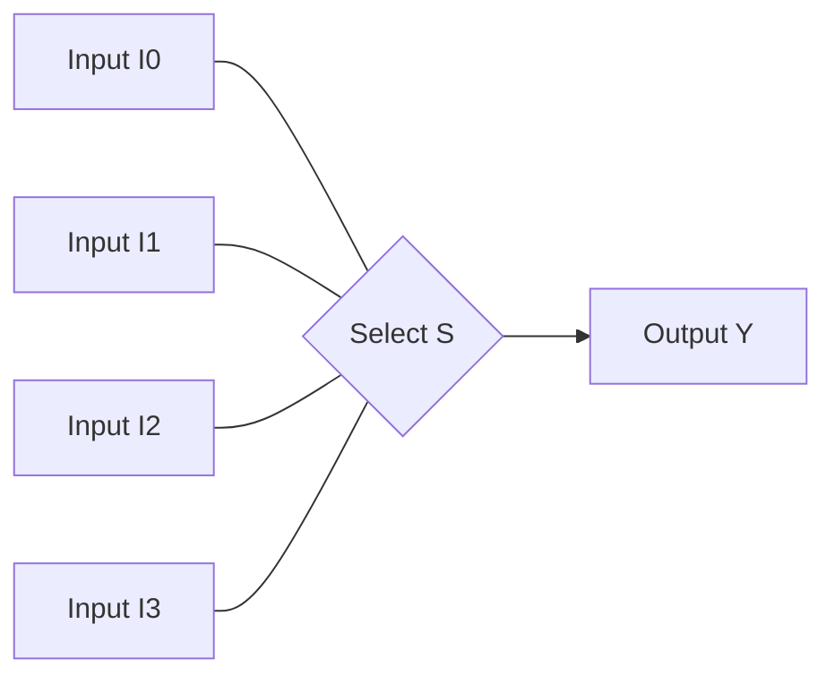
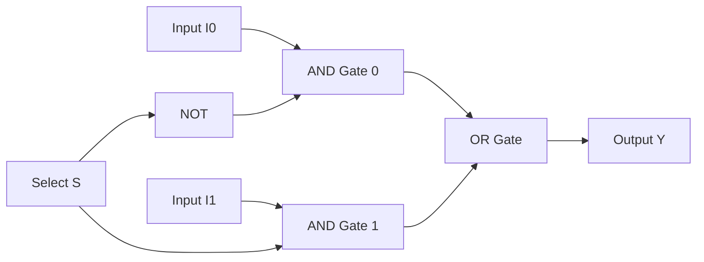
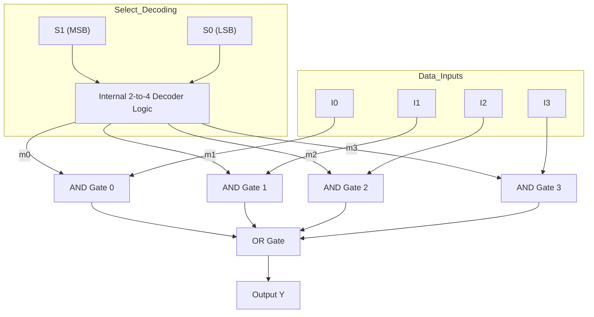
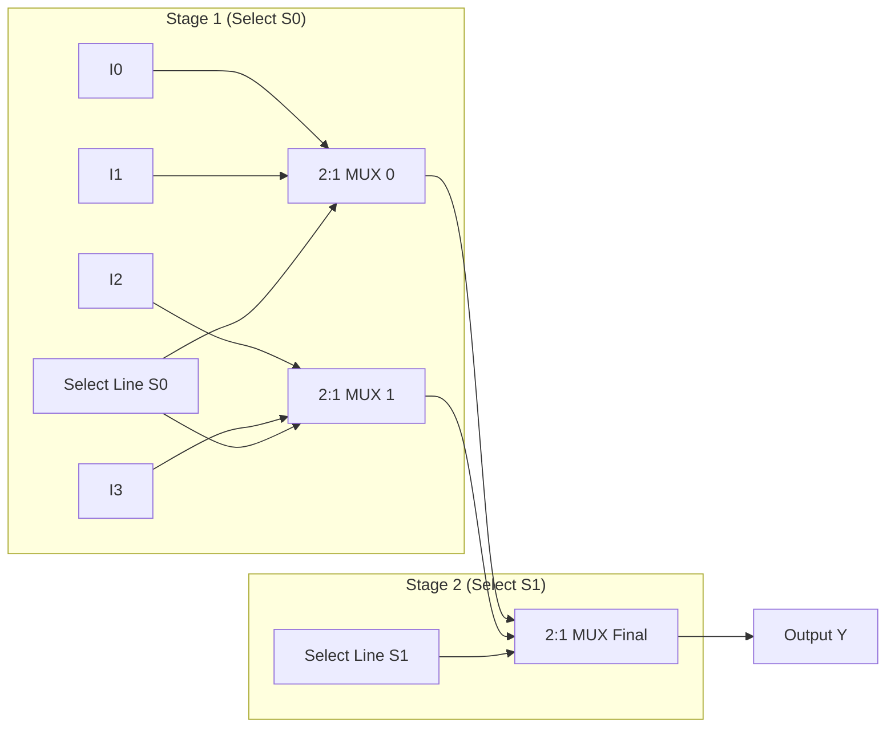
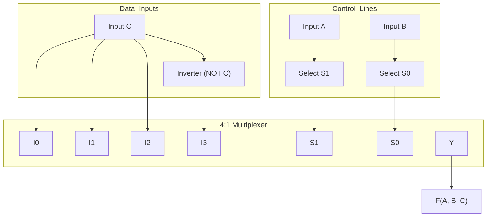
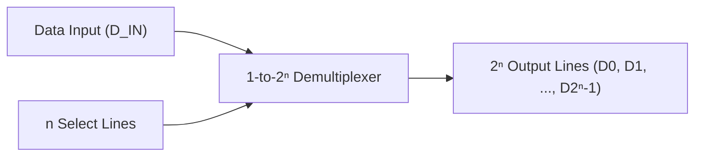

[DLCD Index](../README.md) / [Unit 1: Combinational Logic Design](Introduction.md)

# L11 - Multiplexers and Demultiplexers

In any modern digital system—from a simple microcontroller to a multi-core server CPU—thousands of signals must travel across the chip. Connecting every source register to every destination unit with dedicated copper wires would require an impossible tangle of wiring. 

Instead, computers route data over shared communication channels called buses. To direct which signal gets onto the bus at any given microsecond, digital designers use **Multiplexers** and **Demultiplexers**.

---

## What is a Multiplexer?

A **Multiplexer (MUX)**, also known as a **Data Selector**, is a combinational circuit that selects binary information from one of many input lines and directs it to a single output line.

The selection of a particular input line is controlled by a set of **selection lines** (often called select or address lines). In general:
- If a multiplexer has $2^n$ data input lines, it requires **$n$ selection lines** to uniquely identify which input to route.
- It produces exactly **1 output line**.

Think of a multiplexer as a digitally controlled single-pole, multi-throw rotary switch:

The binary code applied to the select lines physically closes the connection between one chosen input and the shared output line.

---

## 2-to-1 Line Multiplexer

The simplest multiplexer is the 2-to-1 MUX. It has:
- Two data inputs: $I_0$ and $I_1$
- One selection line: $S$
- One data output: $Y$

Let's examine how it operates:
- When $S = 0$, input $I_0$ is routed to output $Y$ ($Y = I_0$).
- When $S = 1$, input $I_1$ is routed to output $Y$ ($Y = I_1$).

We can write this behavior in a single Boolean equation:
$$Y = \overline{S}\,I_0 + S\,I_1$$

Let's trace this equation carefully:
- If $S = 0$: $\overline{S} = 1$ and $S = 0$. The equation reduces to $Y = 1 \cdot I_0 + 0 \cdot I_1 = I_0$. Whatever signal is on $I_0$ passes through to $Y$.
- If $S = 1$: $\overline{S} = 0$ and $S = 1$. The equation reduces to $Y = 0 \cdot I_0 + 1 \cdot I_1 = I_1$. The signal on $I_1$ passes through to $Y$.

The circuit requires one inverter, two AND gates, and one OR gate:

---

## 4-to-1 Line Multiplexer

A 4-to-1 line multiplexer selects one of 4 data inputs ($I_0, I_1, I_2, I_3$) using 2 selection lines ($S_1, S_0$, where $S_1$ is the MSB).

Let's inspect its function table:

| $S_1$ | $S_0$ | Selected Input | Output $Y$ |
| :---: | :---: | :---: | :---: |
| 0 | 0 | $I_0$ | $Y = I_0$ |
| 0 | 1 | $I_1$ | $Y = I_1$ |
| 1 | 0 | $I_2$ | $Y = I_2$ |
| 1 | 1 | $I_3$ | $Y = I_3$ |

Translating this table directly into sum-of-products form:
$$Y = \overline{S_1}\,\overline{S_0}\,I_0 + \overline{S_1}\,S_0\,I_1 + S_1\,\overline{S_0}\,I_2 + S_1\,S_0\,I_3$$

Notice something here — the selection lines $S_1 S_0$ form standard minterms:
- $m_0 = \overline{S_1}\,\overline{S_0}$ enables $I_0$
- $m_1 = \overline{S_1}\,S_0$ enables $I_1$
- $m_2 = S_1\,\overline{S_0}$ enables $I_2$
- $m_3 = S_1\,S_0$ enables $I_3$

This reveals a deep connection: **a multiplexer is internally a decoder connected to an array of AND gates feeding an OR gate**. The select lines are decoded to enable exactly one AND gate, allowing its data input to pass through to the output OR gate while all other AND gates output 0.

---

## Hierarchical Multiplexer Expansion

Just as with decoders, we can construct larger multiplexers by arranging smaller multiplexers hierarchically in a tree structure.

### Building a 4:1 MUX Using Three 2:1 MUXes

Suppose you only have 2:1 multiplexers available. How do you select 1 of 4 inputs?

You break the problem into two stages:
1. **Stage 1**: Use two 2:1 MUXes in parallel.
   - MUX 0 selects between $I_0$ and $I_1$ using select line $S_0$.
   - MUX 1 selects between $I_2$ and $I_3$ using the same select line $S_0$.
2. **Stage 2**: Use a third 2:1 MUX to choose between the outputs of Stage 1 using the higher-order select line $S_1$.

Let's verify the trace:
- If $S_1 S_0 = 10_2$:
  - $S_0 = 0 \implies$ MUX 0 outputs $I_0$ and MUX 1 outputs $I_2$.
  - $S_1 = 1 \implies$ MUX Final chooses the second input (the output of MUX 1), which is $I_2$.
  - Correct!

Similarly, an **8:1 MUX** can be built from two 4:1 MUXes and one 2:1 MUX (or from seven 2:1 MUXes in a 3-level tree).

---

## Implementing Boolean Functions Using Multiplexers

Multiplexers are not just data routers; they are **universal logic generators**. In fact, any Boolean function of $n$ variables can be synthesized using multiplexers without requiring any logic minimization or custom gate layout.

There are two primary methods to accomplish this:

---

### Method 1: Direct Implementation Using a $2^n:1$ MUX

If a function has $n$ input variables, you can implement it directly using a multiplexer with $n$ select lines (a $2^n:1$ MUX):
1. Connect all $n$ input variables to the multiplexer's $n$ selection lines.
2. If minterm $m_k$ is present in the canonical expansion of the function ($F = 1$), tie data input $I_k$ to logic **`1` ($V_{\text{CC}}$)**.
3. If minterm $m_k$ is absent ($F = 0$), tie data input $I_k$ to logic **`0` (GND)**.

While mathematically obvious, this method requires a relatively large multiplexer. We can do much better.

---

### Method 2: Optimal Implementation Using a $2^{n-1}:1$ MUX

A fundamental theorem of digital design states:

> **Any Boolean function of $n$ variables can be implemented using a multiplexer with only $n-1$ selection lines (a $2^{n-1}:1$ MUX) and a minimal number of inverters.**

How is this possible? 
We assign $n-1$ variables to the multiplexer select lines, and use the single remaining variable (let's call it $Z$) as an input to the data lines!

At each data pin $I_k$, the input signal can be one of four possibilities:
- `0`
- `1`
- $Z$
- $\overline{Z}$

#### The Step-by-Step Procedure (Mano's Method):

1. Given a function $F(A, B, C)$, choose $n-1$ variables (usually the most significant bits, $A$ and $B$) to connect to the MUX select lines $S_1$ and $S_0$.
2. The remaining variable ($C$) is reserved for the data inputs.
3. Construct an **Implementation Table** with:
   - Columns labeled with the MUX data inputs: $I_0, I_1, I_2, \dots$
   - Row 1 corresponding to $\overline{C}$ (minterms where $C = 0$).
   - Row 2 corresponding to $C$ (minterms where $C = 1$).
4. Circle all minterms that appear in the function's specification ($F = \sum m(\dots)$).
5. For each column, evaluate the circled entries:
   - If **neither** minterm is circled: the output must be `0` $\implies I_k = 0$.
   - If **both** minterms are circled: the output is `1` regardless of $C$ $\implies I_k = 1$.
   - If only the **top** minterm ($\overline{C}$) is circled: $\implies I_k = \overline{C}$.
   - If only the **bottom** minterm ($C$) is circled: $\implies I_k = C$.

---

### Detailed Walkthrough: 3-Variable Function

Let's implement the function:
$$F(A, B, C) = \sum m(1, 3, 5, 6)$$
using a **4:1 MUX** (which has only 2 select lines, $S_1, S_0$).

- Assign $A \to S_1$ and $B \to S_0$.
- The remaining variable is $C$.

Let's construct the implementation table:

| Variable Row | $I_0$ ($AB=00$) | $I_1$ ($AB=01$) | $I_2$ ($AB=10$) | $I_3$ ($AB=11$) |
| :---: | :---: | :---: | :---: | :---: |
| $\overline{C}$ ($C=0$) | $0$ | $2$ | $4$ | **(6)** |
| $C$ ($C=1$) | **(1)** | **(3)** | **(5)** | $7$ |
| **Data Input Assignment** | **$C$** | **$C$** | **$C$** | **$\overline{C}$** |

Let's analyze each column:
- **Column $I_0$**: Minterm 1 is circled; 0 is not. Therefore, $I_0 = C$.
- **Column $I_1$**: Minterm 3 is circled; 2 is not. Therefore, $I_1 = C$.
- **Column $I_2$**: Minterm 5 is circled; 4 is not. Therefore, $I_2 = C$.
- **Column $I_3$**: Minterm 6 is circled; 7 is not. Therefore, $I_3 = \overline{C}$.

The resulting implementation requires exactly **one 4:1 MUX and one single inverter** (to generate $\overline{C}$):

Look at the economy of this circuit. We synthesized an arbitrary 3-variable function without a single AND or OR gate, using off-the-shelf multiplexer logic.

---

## Demultiplexers (DEMUX)

A **Demultiplexer (DEMUX)** performs the exact opposite operation of a multiplexer:
- It takes **1 single data input line**.
- It routes that single input to **one of $2^n$ output lines**.
- The destination output is selected by **$n$ selection lines**.

### The Equivalence Between Decoders and Demultiplexers

Here is a remarkable insight into digital architecture:

> **A Demultiplexer and a Decoder with an Enable input are physically the exact same circuit.**

Recall our active-high 2-to-4 line decoder from Lecture 9. It has an Enable line $E$ and two select lines $A, B$:
$$D_0 = \overline{A}\;\overline{B} \cdot E$$
$$D_1 = \overline{A}\,B \cdot E$$
$$D_2 = A\,\overline{B} \cdot E$$
$$D_3 = A\,B \cdot E$$

Now, suppose you connect an arbitrary incoming data stream to pin $E$, and use $A$ and $B$ as address lines:
- When $AB = 00$, $D_0 = E$ (the input data appears on line $D_0$), while $D_1 = D_2 = D_3 = 0$.
- When $AB = 01$, $D_1 = E$, while all others are 0.

The circuit acts as a **1-to-4 Demultiplexer**! Because of this complete physical identity, commercial IC manufacturers label these chips interchangeably as **Decoder / Demultiplexer** (for instance, the 74LS138 is formally named "3-to-8 Line Decoder / Demultiplexer").

---

## Unit 1 Summary: The Combinational Foundation

With multiplexers and demultiplexers, we have completed our journey through Unit 1. Let's look back at the architectural chain we built:

1. **Boolean Algebra & Gates**: We established Huntington's postulates, DeMorgan's laws, and algebraic simplification.
2. **Canonical Forms & K-Maps**: We learned to represent truth tables as sums of minterms and systematically minimize gate count using geometric Gray code maps with Don't Care optimizations.
3. **Universal Gates**: We proved that any digital circuit can be fabricated exclusively using NAND or NOR silicon.
4. **Arithmetic Data Paths**: We synthesized Half Adders, Full Adders, 4-bit Ripple Carry Adders, 2's complement Adder-Subtractors, BCD Decimal Adders, and Array Multipliers.
5. **Relational & Routing Logic**: We designed Magnitude Comparators, Decoders, Priority Encoders, and Multiplexers.

In all of these combinational circuits, one iron rule governed their behavior:

> **The outputs depend strictly and instantaneously on the current inputs.**

Combinational circuits have **no memory**. They cannot remember what happened a nanosecond ago. The moment power fluctuates or an input changes, the previous state vanishes forever.

---

## Key Takeaways

- A **Multiplexer (MUX)** is a data selector that routes one of $2^n$ data inputs to a single output based on $n$ select lines.
- Internally, a multiplexer is equivalent to an $n$-to-$2^n$ decoder where each decoded minterm enables an AND gate gating one data input line into a final OR gate:
  $$Y = \sum_{k=0}^{2^n-1} m_k \cdot I_k$$
- Larger multiplexers can be constructed hierarchically by connecting smaller MUXes in a tree configuration.
- Any Boolean function of $n$ variables can be implemented directly using a **$2^{n-1}:1$ MUX** and at most one inverter by assigning $n-1$ variables to select lines and deriving data inputs from the remaining variable.
- A **Demultiplexer (DEMUX)** routes a single data input to one of $2^n$ outputs. It is physically identical to a decoder with an Enable input.

---

Computers cannot function on combinational logic alone. A processor must store the result of an addition, hold the current instruction being executed, count clock cycles, and retain data in registers. To store information, circuits must possess **memory**. 

We now transition to **Unit 2: Synchronous Sequential Logic**. Begin by reading the [**Unit 2 Introduction and Roadmap**](../Unit%202/Introduction.md), and then dive into [**L01 - Latches and Storage Elements**](../Unit%202/L01%20-%20Latches%20and%20Storage%20Elements.md) to discover how introducing feedback into combinational gates creates bistable memory elements.
