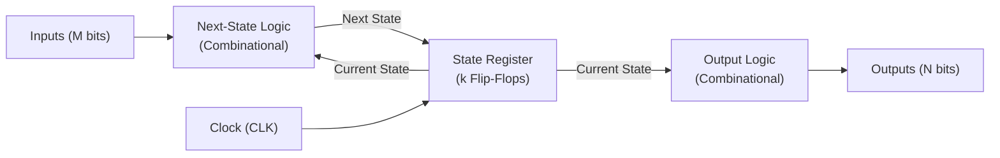
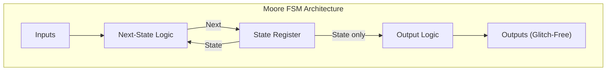
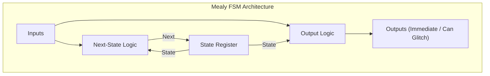
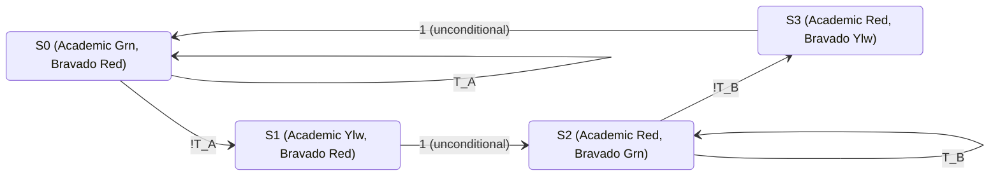
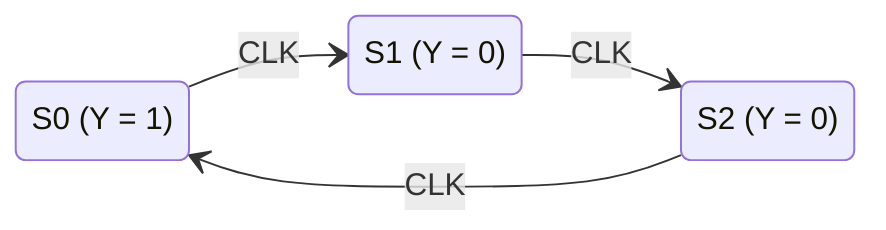
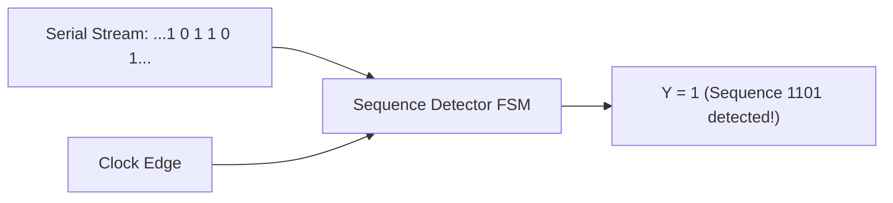

[DLCD Index](../README.md) / [Unit 2: Digital Building Blocks and Finite State Machines](Introduction.md)

# L01 - Finite State Machines - Mealy and Moore Models

In Unit 1, we learned that combining combinational logic with edge-triggered registers creates synchronous sequential circuits. But how do we organize these components to build an intelligent controller—a circuit that can sequence through operational steps, react to external sensors, and control a complex computer system?

The mathematical formalization for sequential control is the **Finite State Machine (FSM)**. An FSM moves among a finite number of predetermined internal states in response to clock pulses and external inputs. In this lecture, we examine the formal structure of FSMs, compare the fundamental **Moore** and **Mealy** architectures, analyze binary versus one-hot state encodings, and synthesize complete, working controllers step by step.

---

## Anatomy of a Finite State Machine

At the architectural level, every synchronous Finite State Machine consists of three tightly coupled components:
1. **The State Register**: A bank of $k$ edge-triggered D flip-flops that stores the system's *Current State*. For a machine with $S$ distinct states, the register requires at least $k = \lceil \log_2 S \rceil$ flip-flops.
2. **Next-State Logic**: A combinational circuit that computes the *Next State* based on the *Current State* and current *External Inputs*.
3. **Output Logic**: A combinational circuit that generates the system's *External Outputs*.

On every rising clock edge, the state register captures the Next State computed by the combinational logic, making it the new Current State. As long as the clock period satisfies the setup time constraint ($T_c \ge t_{\text{pcq}} + t_{\text{pd, next}} + t_{\text{setup}}$), the machine steps forward predictably and reliably.

---

## Moore vs. Mealy Architectures: The Crucial Distinction

How are the outputs generated? Depending on where the output logic gets its inputs, Finite State Machines are partitioned into two fundamental models:

### 1. The Moore Machine
In a **Moore Machine**, the outputs depend **exclusively on the Current State**. External inputs do not directly enter the output logic.

$$Y = f_{\text{Moore}}(\text{Current State})$$

- **Output Timing**: Outputs are updated strictly on the rising clock edge when the state register updates.
- **Glitch Immunity**: Moore outputs are decoupled from input lines. Any transient noise or combinational glitches on external inputs cannot propagate to the outputs.
- **Responsiveness**: A Moore machine takes at least one clock cycle to react to an input change, because the input must first update the state register on the next clock edge before the output changes.

### 2. The Mealy Machine
In a **Mealy Machine**, the outputs depend on **both the Current State and the Current External Inputs**.

$$Y = f_{\text{Mealy}}(\text{Current State}, \text{Inputs})$$

- **Output Timing**: Outputs can change asynchronously within the clock cycle the moment an external input changes, without waiting for a clock edge.
- **State Efficiency**: Mealy machines typically require fewer states than Moore machines to accomplish the same task (often 1 fewer state).
- **Glitch Vulnerability**: If an external input suffers from a transient glitch, that glitch shoots straight through the output logic to the output pins. Downstream circuits receiving Mealy outputs must be carefully synchronized.

---

## The Standard FSM Design Procedure

To design a rock-solid FSM from an engineering brief, we follow a rigorous seven-step methodology:

1. **Specify Inputs and Outputs**: Clearly define every input sensor and output control signal with active logic levels.
2. **Draw the State Transition Diagram**:
   - Each state is represented by a circle.
   - For a **Moore machine**, write the state name and its associated output *inside* the circle: `State / Output`.
   - Directed arrows represent transitions between states.
   - Transition arrows are labeled with the Boolean condition on the inputs that triggers the transition.
   - For a **Mealy machine**, write only the state name inside the circle, and label each transition arrow with both the input condition and the resulting output: `Input / Output`.
3. **Construct the State Transition Table**: Tabulate Current State and Inputs on the left, and Next State and Outputs on the right.
4. **Choose State Encodings**: Assign binary or one-hot codes to each symbolic state.
5. **Derive Next-State Equations**: Use K-maps to minimize the Boolean equations driving the D inputs of each state flip-flop.
6. **Derive Output Equations**: Use K-maps or direct algebraic inspection to minimize equations for each output pin.
7. **Draw the Logic Schematic**: Wire the state registers, next-state gates, and output gates.

---

## Case Study 1: Ben Bitdiddle's Campus Traffic Light Controller

Let's walk through the flagship FSM design problem from Harris & Harris: automated traffic control on a university campus.

### The Engineering Brief
At the intersection of Academic Avenue (running North-South) and Bravado Boulevard (running East-West):
- Academic Avenue has heavier traffic and should remain Green by default.
- Traffic sensors $T_A$ and $T_B$ monitor vehicle presence:
  - $T_A = 1$ if cars are waiting on Academic Avenue; $0$ if clear.
  - $T_B = 1$ if cars are waiting on Bravado Boulevard; $0$ if clear.
- A clock pulse arrives every 5 seconds, allowing lights to transition safely.
- Two traffic signal outputs, $L_A$ (Academic) and $L_B$ (Bravado), each control Green, Yellow, and Red lights. We encode light colors into 2-bit values:
  - $\text{Green} = 00_2$
  - $\text{Yellow} = 01_2$
  - $\text{Red} = 10_2$

### State Definition (Moore Architecture)
A green light must never switch instantly to red—it must pass through an intermediate yellow warning state to let cars brake. We need four distinct states:
- **$S_0$**: Academic Green, Bravado Red ($L_A = 00, L_B = 10$). Academic traffic flows. If cars are present on Academic ($T_A = 1$), the machine stays in $S_0$. If Academic is empty ($T_A = 0$) and cars are waiting on Bravado, it transitions to $S_1$.
- **$S_1$**: Academic Yellow, Bravado Red ($L_A = 01, L_B = 10$). Academic traffic slows down. After 5 seconds (1 clock cycle), the machine transitions unconditionally to $S_2$.
- **$S_2$**: Academic Red, Bravado Green ($L_A = 10, L_B = 00$). Bravado traffic flows. As long as Bravado has cars ($T_B = 1$), it stays in $S_2$. When Bravado is empty ($T_B = 0$), it transitions to $S_3$.
- **$S_3$**: Academic Red, Bravado Yellow ($L_A = 10, L_B = 01$). Bravado traffic slows down. After 5 seconds, it transitions unconditionally back to $S_0$.

---

## State Encoding: Binary vs. One-Hot

Before we can synthesize gates, we must convert symbolic states ($S_0, S_1, S_2, S_3$) into binary hardware voltages. How we choose our encoding dramatically impacts system performance and silicon area.

### 1. Binary Encoding
In binary encoding, states are numbered using minimum-width binary integers ($00, 01, 10, 11$).
- **Flip-Flops Required**: $k = \lceil \log_2 S \rceil$. For 4 states, we need only **2 flip-flops** ($S_1, S_0$).
- **Advantages**: Uses minimal flip-flop hardware and minimal state registers.
- **Disadvantages**: Requires combinational logic to decode states, which adds gate delay to next-state and output evaluations.

| State | Binary Code ($S_1 S_0$) |
|:---:|:---:|
| $S_0$ | $00$ |
| $S_1$ | $01$ |
| $S_2$ | $10$ |
| $S_3$ | $11$ |

### 2. One-Hot Encoding
In one-hot encoding, **each state is assigned its own dedicated flip-flop**. For $S$ states, we allocate $S$ flip-flops ($S_3, S_2, S_1, S_0$).
- At any given instant, **exactly one flip-flop is $1$ (HIGH)**, while all others are $0$ (LOW).
- **Flip-Flops Required**: $S$ flip-flops (4 flip-flops for 4 states).
- **Advantages**: State decoding is completely eliminated! To test if the machine is in state $S_1$, you simply tap the wire $S_1$. Next-state and output equations reduce to simple single-level OR gates, yielding maximum clock frequencies.
- **Disadvantages**: Consumes more registers and routing silicon area.

| State | One-Hot Code ($S_3 S_2 S_1 S_0$) |
|:---:|:---:|
| $S_0$ | $0001$ |
| $S_1$ | $0010$ |
| $S_2$ | $0100$ |
| $S_3$ | $1000$ |

---

## Traffic Controller Synthesis using Binary Encoding

Let's synthesize Ben Bitdiddle's controller using binary encoding ($S_1, S_0$).

### State Transition Table

| Current State ($S_1 S_0$) | Sensor $T_A$ | Sensor $T_B$ | Next State ($S_1' S_0'$) | Light $L_A$ ($L_{A1} L_{A0}$) | Light $L_B$ ($L_{B1} L_{B0}$) |
|:---:|:---:|:---:|:---:|:---:|:---:|
| $00$ ($S_0$) | 0 | X | $01$ ($S_1$) | $00$ (Green) | $10$ (Red) |
| $00$ ($S_0$) | 1 | X | $00$ ($S_0$) | $00$ (Green) | $10$ (Red) |
| $01$ ($S_1$) | X | X | $10$ ($S_2$) | $01$ (Yellow) | $10$ (Red) |
| $10$ ($S_2$) | X | 0 | $11$ ($S_3$) | $10$ (Red) | $00$ (Green) |
| $10$ ($S_2$) | X | 1 | $10$ ($S_2$) | $10$ (Red) | $00$ (Green) |
| $11$ ($S_3$) | X | X | $00$ ($S_0$) | $10$ (Red) | $01$ (Yellow) |

### Deriving Next-State Logic Equations
Let's minimize equations for the two flip-flop inputs, $S_1'$ and $S_0'$:

1. **For $S_1'$**:
   - $S_1' = 1$ when Current State is $S_1$ ($01$), or when Current State is $S_2$ ($10$) and $T_B = 0$, or when Current State is $S_2$ ($10$) and $T_B = 1$.
   - Notice that whenever Current State is $S_1$ ($01$) or $S_2$ ($10$), $S_1'$ is $1$ regardless of inputs.
   - Using algebraic reduction or K-maps:
     $$S_1' = S_1 \oplus S_0$$

2. **For $S_0'$**:
   - $S_0' = 1$ when Current State is $S_0$ ($00$) and $\overline{T_A} = 1$, or when Current State is $S_2$ ($10$) and $\overline{T_B} = 1$.
   - Factoring out $\overline{S_0}$:
     $$S_0' = \overline{S_1}\ \overline{S_0}\ \overline{T_A} + S_1 \overline{S_0}\ \overline{T_B} = \overline{S_0} (\overline{S_1}\ \overline{T_A} + S_1 \overline{T_B})$$

### Deriving Output Logic Equations
Because this is a Moore machine, outputs depend solely on $S_1$ and $S_0$:

| State ($S_1 S_0$) | $L_{A1}$ | $L_{A0}$ | $L_{B1}$ | $L_{B0}$ |
|:---:|:---:|:---:|:---:|:---:|
| $00$ ($S_0$) | 0 | 0 | 1 | 0 |
| $01$ ($S_1$) | 0 | 1 | 1 | 0 |
| $10$ ($S_2$) | 1 | 0 | 0 | 0 |
| $11$ ($S_3$) | 1 | 0 | 0 | 1 |

Inspecting the columns directly:
- $L_{A1} = S_1$ (High in $S_2$ and $S_3$).
- $L_{A0} = \overline{S_1} S_0$ (High only in $S_1$).
- $L_{B1} = \overline{S_1}$ (High in $S_0$ and $S_1$).
- $L_{B0} = S_1 S_0$ (High only in $S_3$).

The complete traffic controller is synthesized using two D flip-flops, an XOR gate, two AND gates, and an inverter!

---

## Case Study 2: The Divide-by-3 Counter

To directly compare the hardware implementation between binary and one-hot encoding, let's design an autonomous **Divide-by-3 Counter**.

A divide-by-3 counter has no external inputs other than the clock. It cycles endlessly through three states:

$$S_0 \longrightarrow S_1 \longrightarrow S_2 \longrightarrow S_0$$

The output $Y$ is asserted HIGH ($1$) only when the counter is in state $S_0$, producing one output pulse for every three clock pulses.

### Implementation A: Binary Encoding (2 Flip-Flops)
- Assign $S_0 = 00$, $S_1 = 01$, $S_2 = 10$.
- The state $11$ is unused; we treat it as a Don't Care ($X$).

| Current State ($S_1 S_0$) | Next State ($S_1' S_0'$) | Output ($Y$) |
|:---:|:---:|:---:|
| $00$ | $01$ | 1 |
| $01$ | $10$ | 0 |
| $10$ | $00$ | 0 |
| $11$ | $XX$ | X |

Using K-maps:
- $S_1' = S_0$
- $S_0' = \overline{S_1}\ \overline{S_0}$
- $Y = \overline{S_1}\ \overline{S_0}$

This implementation requires 2 flip-flops and 2 gates.

### Implementation B: One-Hot Encoding (3 Flip-Flops)
- Assign $S_0 = 001$, $S_1 = 010$, $S_2 = 100$.

| Current State ($S_2 S_1 S_0$) | Next State ($S_2' S_1' S_0'$) | Output ($Y$) |
|:---:|:---:|:---:|
| $001$ ($S_0$) | $010$ ($S_1$) | 1 |
| $010$ ($S_1$) | $100$ ($S_2$) | 0 |
| $100$ ($S_2$) | $001$ ($S_0$) | 0 |

Look at the resulting next-state equations by inspection:
- $S_0' = S_2$
- $S_1' = S_0$
- $S_2' = S_1$
- $Y = S_0$

Notice something astonishing: **there is zero combinational logic!** The next state of each flip-flop is simply wired directly to the output of the preceding flip-flop. The one-hot divide-by-3 counter is just a 3-bit ring shift register, capable of running at the maximum switching speed of the silicon!

---

## Case Study 3: Sequence Detectors (Alyssa P. Hacker's Snail)

Alyssa P. Hacker wants to build an electronic snail that smiles whenever it crawls over a specific pattern of bits on tape. The snail reads a continuous serial bit stream $A$ one bit per clock cycle, and asserts output $Y = 1$ when it detects the bit sequence `1101`.

### Moore vs. Mealy Implementation Trade-Offs
- **Moore Implementation**: The machine needs states representing:
  - $S_0$: Reset / No matching bits.
  - $S_1$: Got `1`.
  - $S_2$: Got `11`.
  - $S_3$: Got `110`.
  - $S_4$: Got `1101` $\implies$ Output $Y = 1$ inside state $S_4$.
  - Requires **5 states** ($S_0$ through $S_4$). Output changes on the clock edge *after* the final `1` is clocked in.
- **Mealy Implementation**:
  - $S_0$: Reset / No bits.
  - $S_1$: Got `1`.
  - $S_2$: Got `11`.
  - $S_3$: Got `110`.
  - In state $S_3$, if input $A = 1$ arrives, the transition arc looping back to $S_1$ is labeled $A=1 / Y=1$.
  - Requires only **4 states** ($S_0$ through $S_3$). Output $Y$ goes high *immediately* during the cycle the final `1` arrives, responding one full clock cycle earlier than the Moore machine!

---

## Key Takeaways

- A Finite State Machine consists of a state register (clocked D flip-flops), next-state combinational logic, and output combinational logic.
- In a Moore Machine, outputs depend solely on the current state. Outputs are synchronous and glitch-free, but react with a 1-cycle delay.
- In a Mealy Machine, outputs depend on both the current state and current inputs. Outputs react immediately within the cycle, but can pass input glitches through.
- The standard design flow: State Diagram $\to$ State Transition Table $\to$ State Encoding $\to$ Next-State & Output K-maps $\to$ Logic Schematic.
- Binary encoding minimizes flip-flop count ($k = \lceil \log_2 S \rceil$) but requires combinational decoding gates.
- One-hot encoding allocates one flip-flop per state, eliminating decoding delay and simplifying next-state logic to bare wires or single OR gates at the expense of extra registers.

---

Finite State Machines provide the supervisory control logic for processors. But to crunch numbers, a computer needs a computational datapath. In the next lecture, [L02 - Arithmetic Circuits](L02%20-%20Arithmetic%20Circuits.md), we build the mathematical backbone of digital processors: adders, subtractors, comparators, multipliers, and multi-function ALUs.
