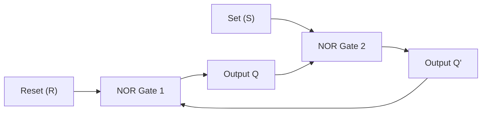
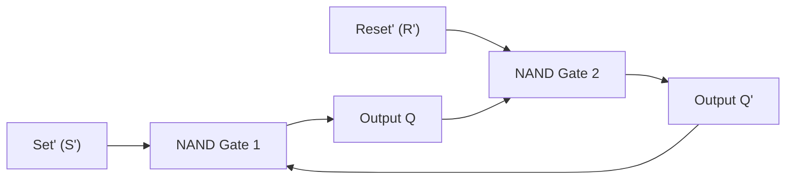
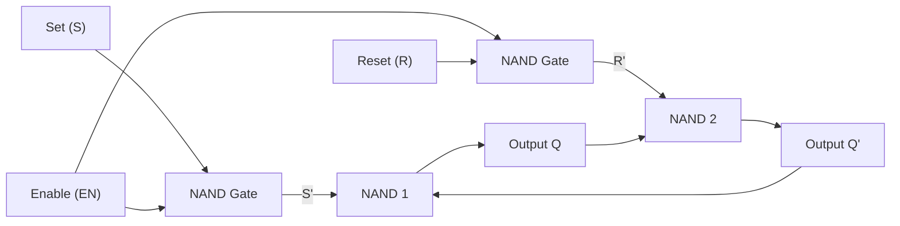
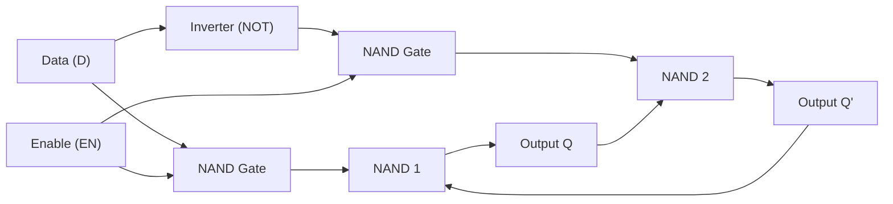

[DLCD Index](../README.md) / [Unit 2: Synchronous Sequential Logic](Introduction.md)

# L01 - Latches and Storage Elements

In all combinational circuits we have studied so far, signal flow was strictly one-way: from inputs, through gates, to outputs. An output could never loop back to influence an earlier gate.

The moment you bend a wire backwards and connect an output to an input, something profound happens. The circuit ceases to be a simple mathematical calculator. It acquires **memory**.

Let's examine how this feedback loop creates bistable electronic storage, how basic **Latches** operate, and why their behavior creates timing vulnerabilities that demand edge-triggered flip-flops.

---

## The Physics of Feedback and Bistability

How can physical silicon remember a bit?

Consider two standard inverters connected in a closed circle: the output of Inverter 1 drives Inverter 2, and the output of Inverter 2 drives Inverter 1.


Let's trace what happens:
- Suppose Inverter 1 outputs a logic `1` ($Q = 1$).
- This `1` enters Inverter 2, which produces a logic `0` ($\overline{Q} = 0$).
- This `0` loops back into Inverter 1, reinforcing its original output of `1`.
- The circuit is perfectly stable.

Now suppose the circuit was initialized in the opposite state:
- Inverter 1 outputs `0`.
- Inverter 2 outputs `1`.
- The `1` loops back and holds Inverter 1 at `0`.
- This state is also completely stable.

This circuit is **bistable**: it has two stable operating points (`0` and `1`). It will hold its stored bit indefinitely as long as electrical power is supplied.

However, this two-inverter loop is useless as a computer memory element. Why? Because there are no input terminals! We have no way to write new data into it without physically short-circuiting the transistors and fighting the existing voltage.

To make bistable storage useful, we must replace the simple inverters with **logic gates that have control inputs**.

---

## The SR Latch with NOR Gates

Let's replace the two inverters with two cross-coupled **NOR gates**. This gives us two external control inputs:
- **$S$ (Set)**: Forces the stored bit $Q$ to `1`.
- **$R$ (Reset)**: Forces the stored bit $Q$ to `0`.

The outputs are complementary: $Q$ represents the normal stored state, and $\overline{Q}$ represents its complement.



To understand the SR latch, remember the golden rule of a NOR gate:
> **If ANY input to a NOR gate is `1`, its output is immediately forced to `0`. Only when ALL inputs are `0` does the output become `1`.**

Let's trace all four combinations of $S$ and $R$:

### 1. The Quiescent State: $S = 0, R = 0$ (No Change / Memory)
Suppose $Q = 1$ and $\overline{Q} = 0$:
- NOR 1 receives $R = 0$ and $\overline{Q} = 0$. Since both inputs are 0, NOR 1 outputs $Q = 1$.
- NOR 2 receives $S = 0$ and $Q = 1$. Since one input is 1, NOR 2 outputs $\overline{Q} = 0$.
- The state $Q = 1$ is self-sustaining.

Suppose $Q = 0$ and $\overline{Q} = 1$:
- NOR 1 receives $R = 0$ and $\overline{Q} = 1$, producing $Q = 0$.
- NOR 2 receives $S = 0$ and $Q = 0$, producing $\overline{Q} = 1$.
- The state $Q = 0$ is self-sustaining.

When $S = 0$ and $R = 0$, the latch **remembers whatever state it previously held** ($Q_{\text{next}} = Q$).

---

### 2. The Set Operation: $S = 1, R = 0$
- We assert $S = 1$ while keeping $R = 0$.
- Because $S = 1$, NOR 2 has at least one high input. Its output $\overline{Q}$ is instantly forced to `0`.
- This $\overline{Q} = 0$ feeds back to NOR 1. Now NOR 1 has both inputs low ($R = 0$ and $\overline{Q} = 0$).
- Therefore, NOR 1 drives $Q$ to `1`.
- Even if we now release $S$ back to `0`, the circuit settles into the quiescent memory state with $Q = 1$. We have successfully written a `1` to memory.

---

### 3. The Reset Operation: $S = 0, R = 1$
- We assert $R = 1$ while keeping $S = 0$.
- Because $R = 1$, NOR 1 has at least one high input, immediately forcing $Q$ to `0`.
- This $Q = 0$ feeds back to NOR 2. Now NOR 2 has both inputs low ($S = 0$ and $Q = 0$).
- NOR 2 drives $\overline{Q}$ to `1`.
- When $R$ returns to `0`, the latch remains at $Q = 0$. We have successfully reset memory to `0`.

---

### 4. The Forbidden / Invalid State: $S = 1, R = 1$
Now look at what happens if someone asserts both inputs simultaneously ($S = 1$ and $R = 1$):
- $R = 1$ forces NOR 1 to output $Q = 0$.
- $S = 1$ forces NOR 2 to output $\overline{Q} = 0$.

Notice something disastrous here:
1. $Q$ and $\overline{Q}$ are **both `0`**. This violates the fundamental definition of complementary outputs ($Q \neq \overline{Q}$).
2. **The Race Hazard**: What happens when both $S$ and $R$ transition back to `00` at the exact same instant? 
   Both NOR gates simultaneously see all inputs turn to 0. Both attempt to drive their outputs high to `1`. Those high outputs race back through the cross-coupled wires to shut each other down. 
   Which gate wins? It depends entirely on microscopic differences in transistor fabrication, temperature, and wire lengths. The circuit enters a state of chaotic oscillation or **metastability**, settling into either `0` or `1` randomly.

Because the resulting state is physically unpredictable, the combination $S = 1, R = 1$ is strictly **forbidden** in NOR SR latch design.

---

### NOR SR Latch Characteristic Table

| $S$ | $R$ | $Q(t+1)$ | Operation | Description |
| :---: | :---: | :---: | :---: | :---: |
| 0 | 0 | $Q(t)$ | No Change | Retains current state (Memory) |
| 0 | 1 | 0 | Reset | Forces $Q \to 0$ |
| 1 | 0 | 1 | Set | Forces $Q \to 1$ |
| 1 | 1 | Undefined | Forbidden | Violates $Q = \overline{Q}'$, causes race hazard |

---

## The SR Latch with NAND Gates

An SR latch can also be constructed using two cross-coupled **NAND gates**.



Remember the NAND gate rule:
> **If ANY input to a NAND gate is `0`, its output is immediately forced to `1`. Only when ALL inputs are `1` does the output become `0`.**

Because of this inverted behavior:
- The control inputs are **active-low**: $\overline{S}$ and $\overline{R}$.
- The quiescent memory state (no change) occurs when both inputs are **`11`** ($\overline{S} = 1, \overline{R} = 1$).
- Asserting $\overline{S} = 0$ (while $\overline{R} = 1$) sets $Q = 1$.
- Asserting $\overline{R} = 0$ (while $\overline{S} = 1$) resets $Q = 0$.
- The forbidden condition occurs when both inputs are driven low: **$\overline{S} = 0, \overline{R} = 0$**, forcing both $Q$ and $\overline{Q}$ to `1`.

| $\overline{S}$ | $\overline{R}$ | $Q(t+1)$ | Operation |
| :---: | :---: | :---: | :---: |
| 1 | 1 | $Q(t)$ | No Change (Memory) |
| 0 | 1 | 1 | Set |
| 1 | 0 | 0 | Reset |
| 0 | 0 | Undefined | Forbidden State |

---

## The Gated SR Latch

In an uncontrolled SR latch, the outputs respond immediately whenever the $S$ or $R$ inputs change. In synchronous digital systems, we cannot allow storage elements to change whenever they feel like it; changes must be synchronized to an **Enable ($En$)** or clock signal.

A **Gated SR Latch** adds an enable gate stage in front of the basic cross-coupled storage core.



Let's trace how the Enable line works:
- When $En = 0$: The outputs of the front two NAND gates are both forced to `1` regardless of $S$ and $R$. The inputs to the cross-coupled NAND latch are $\overline{S} = 1$ and $\overline{R} = 1$. As we proved above, this is the **no-change memory condition**. The latch is completely isolated from data inputs.
- When $En = 1$: The front NAND gates act as inverters. If $S = 1$, it passes $\overline{S} = 0$ into the latch (Setting it). If $R = 1$, it passes $\overline{R} = 0$ into the latch (Resetting it).

The Gated SR Latch allows writes only when $En = 1$. However, it still suffers from one fatal vulnerability: if a glitch or bad logic asserts $S = 1$ and $R = 1$ simultaneously while $En = 1$, the circuit still enters the destructive forbidden state!

---

## The Gated D Latch (Transparent Data Latch)

How do we permanently eliminate the forbidden condition $S = R = 1$?

Notice that $S$ and $R$ should always be complements of each other during write operations: to write a `1`, we set $S=1, R=0$; to write a `0`, we set $S=0, R=1$. We never legitimately want $S$ and $R$ to have the same value!

This leads directly to the **Gated D Latch** (Data Latch). We eliminate the two separate $S$ and $R$ inputs and replace them with a single input: **$D$ (Data)**. 
- Input $D$ is connected directly to the Set side.
- An inverter feeds $\overline{D}$ to the Reset side.



Because of the inverter, it is physically impossible for the Set and Reset sides to receive a `1` at the same time. The forbidden state is eliminated forever.

Let's inspect the truth table:

| $En$ | $D$ | $Q(t+1)$ | Behavior |
| :---: | :---: | :---: | :---: |
| 0 | X | $Q(t)$ | Latch closed: Retains previous state (Memory) |
| 1 | 0 | 0 | Latch open: Resets to 0 |
| 1 | 1 | 1 | Latch open: Sets to 1 |

Notice what happens whenever $En = 1$: **$Q(t+1) = D$**. 
Whatever logic value is present on $D$ passes straight through to output $Q$.

---

## The Transparency Problem and Why Latches Fail in State Machines

The Gated D Latch is widely used as a temporary storage register. But it has a critical characteristic called **transparency**:

> **A latch is level-sensitive. As long as the Enable signal is High ($En = 1$), the latch is "transparent"—any variation or noise on $D$ flows immediately to $Q$.**

Now, think about what happens when you build a sequential state machine. In a sequential circuit, the output $Q$ of a storage element feeds through combinational logic (e.g., an adder or next-state logic) and loops back into its own input $D$:

```
Present State (Q) ---> [ Combinational Logic ] ---> Next State (D)
        ^                                                   |
        |                                                   |
        +------------------ [ Latch ] <---------------------+
                              Enable
```

Now trace what happens during a clock cycle where $En = 1$ stays high for, say, 5 nanoseconds:
1. At the beginning of the pulse, $Q = 0$.
2. The combinational logic computes $D = Q + 1 = 1$.
3. Since $En = 1$, the latch opens, and $Q$ updates to `1` within 0.5 nanoseconds.
4. But the clock pulse is still high!
5. The combinational logic sees $Q = 1$ and computes new $D = 1 + 1 = 2$.
6. The latch updates $Q$ to `2`.
7. The signal races around the loop again and again, counting uncontrollably for as long as $En = 1$ remains high!

This catastrophic instability is known as the **race-around condition**.

To build reliable digital state machines, we cannot allow the storage element to stay transparent throughout the entire high duration of a clock pulse. We need a device that captures data only at a **single, infinitesimal instant in time**—the exact moment the clock transitions from Low to High.

Such a device is not called a latch. It is called a **Flip-Flop**.

---

## Key Takeaways

- Memory in digital electronics requires **feedback**, where gate outputs loop back to reinforce and stabilize an internal state.
- A cross-coupled NOR gate loop creates an **SR Latch**. Asserting $S = 1$ sets $Q = 1$; asserting $R = 1$ resets $Q = 0$; $S = R = 0$ holds the current state.
- In a NOR SR latch, the condition $S = R = 1$ is strictly **forbidden** because both outputs become `0`, and transitioning to `00` triggers a race hazard and unpredictable metastability.
- An SR latch with NAND gates uses **active-low** inputs ($\overline{S}, \overline{R}$), with $\overline{S} = \overline{R} = 1$ acting as the memory state and $\overline{S} = \overline{R} = 0$ as the forbidden condition.
- A **Gated D Latch** replaces the $S$ and $R$ pins with a single data input $D$ and its complement $\overline{D}$, eliminating the forbidden state completely.
- Latches are **level-sensitive** and transparent whenever $En = 1$. In closed feedback loops, this transparency causes uncontrolled race-around oscillation, necessitating the transition to edge-triggered flip-flops.

---

To prevent the race-around hazard and lock state transitions to a precise nanosecond instant, sequential machines rely on edge-triggered storage. In the next lecture, we analyze [**Flip-Flops and Edge-Triggered Storage**](L02%20-%20Flip-Flops%20and%20Edge-Triggered%20Storage.md), dissecting Master-Slave architectures, D, JK, and T flip-flops, and their characteristic and excitation tables.
