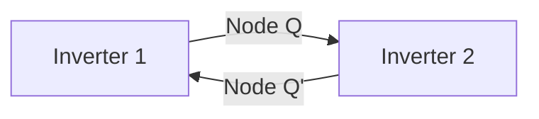
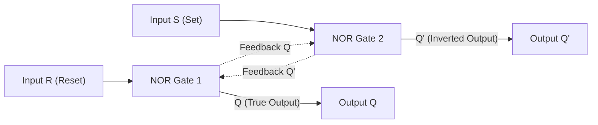
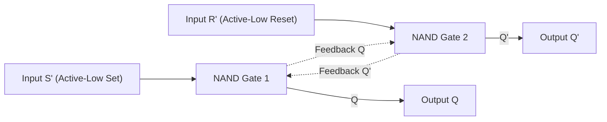
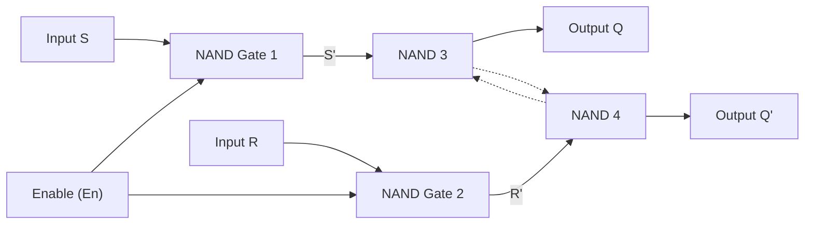
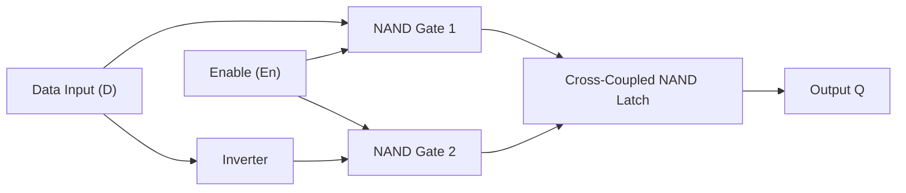
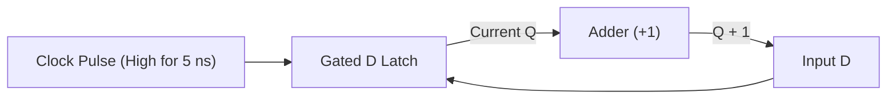
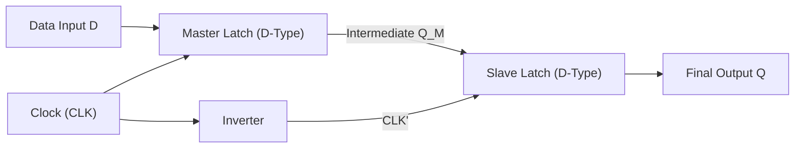
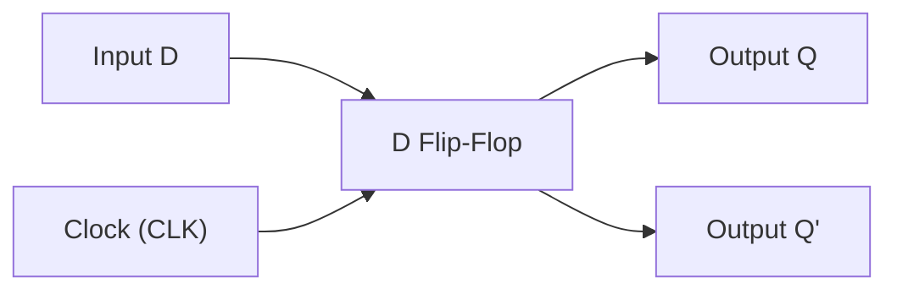

[DLCD Index](../README.md) / [Unit 2: Synchronous Sequential Logic](Introduction.md)

# Storage Elements: Latches and Flip-Flops

Everything we designed in Unit 1 suffered from a severe computational limitation: **amnesia**. 

In a combinational logic circuit, the output depends solely on the current inputs. Remove the input voltages, or change them, and the previous state vanishes instantly. A combinational circuit has no memory of what happened five nanoseconds ago.

Yet, real-world computation requires state. A computer needs to remember the results of previous calculations, count elapsed clock cycles, and step through sequential program instructions. To build a machine with memory, we must introduce a physical phenomenon that combinational circuits strictly forbade: **feedback**.

The moment we connect the output of a logic gate back into its own input, we create a closed loop capable of storing a bit of data indefinitely. But doing so introduces serious timing hazards, race conditions, and bistable dynamics.

---

## The Physics of Feedback and Bistability

Consider two standard inverters connected in a circle: the output of Inverter 1 connects to the input of Inverter 2, and the output of Inverter 2 feeds directly back into the input of Inverter 1.

What happens to this circuit?
- If Node $Q = 1$, Inverter 2 inverts it to produce $Q' = 0$.
- That $0$ feeds back into Inverter 1, which inverts it to maintain $Q = 1$.
- The circuit locks into a stable state.
- Conversely, if Node $Q = 0$, Inverter 2 produces $Q' = 1$, which feeds back to keep $Q = 0$.

This circuit is **bistable**: it has two stable resting states ($Q=1, Q'=0$ and $Q=0, Q'=1$). It will hold whichever state it was set to as long as electrical power is supplied. 

However, two cross-coupled inverters make a useless memory cell because there is no input terminal. We cannot force a new value into the loop from the outside without physically overpowering the transistors. To turn this bistable feedback loop into a controllable memory element, we replace the simple inverters with two-input gates: NOR or NAND.

---

## The SR Latch with NOR Gates

The **Set-Reset (SR) Latch** constructed with cross-coupled NOR gates provides two external control inputs:
- $S$ (**Set**): Forces the stored bit $Q$ to $1$.
- $R$ (**Reset**): Forces the stored bit $Q$ to $0$.

To analyze how this circuit functions, remember the decisive physical property of a NOR gate: **if any input is $1$, the output is guaranteed to be $0$**. Only when all inputs are $0$ does a NOR gate produce a $1$.

Let us trace the four input combinations:

### 1. The Normal Storage State ($S = 0, R = 0$)
Assume the circuit is currently holding $Q = 1$ (and therefore $Q' = 0$). 
- NOR 1 receives $R = 0$ and $Q' = 0$. Since both inputs are $0$, output $Q = 1$.
- NOR 2 receives $S = 0$ and $Q = 1$. Since one input is $1$, output $Q' = 0$.
- The state remains rock solid: $Q_{\text{next}} = Q$. The circuit remembers.

### 2. The Set Operation ($S = 1, R = 0$)
- With $S = 1$, NOR 2 immediately produces $Q' = 0$ regardless of its other input.
- That $Q' = 0$ travels through the feedback wire to NOR 1.
- NOR 1 now sees $R = 0$ and $Q' = 0$, driving its output $Q = 1$.
- Even if $S$ now drops back to $0$, the feedback maintains $Q = 1$. We have successfully written a logical `1` into memory.

### 3. The Reset Operation ($S = 0, R = 1$)
- With $R = 1$, NOR 1 immediately forces $Q = 0$.
- That $Q = 0$ feeds into NOR 2. Since $S = 0$, NOR 2 sees two zeros and drives $Q' = 1$.
- We have successfully cleared memory: $Q = 0$.

### 4. The Forbidden / Invalid State ($S = 1, R = 1$)
Now here is the critical vulnerability. What happens if both inputs are asserted simultaneously?
- $R = 1$ forces NOR 1 to output $Q = 0$.
- $S = 1$ forces NOR 2 to output $Q' = 0$.
- But by definition, $Q'$ must be the logical inverse of $Q$! Here, both outputs are $0$.
- The real disaster strikes when both inputs drop simultaneously back to $00$ to "store" the result. Both NOR gates see $00$ simultaneously and try to drive their outputs to $1$. 
- The outputs fight each other through the feedback wires in an electrical race condition. The final state depends on sub-picosecond transistor manufacturing asymmetries or thermal noise. 
- Because digital hardware cannot tolerate non-deterministic behavior, the condition $S = R = 1$ is strictly **forbidden** in a NOR SR latch.

| $S$ | $R$ | Next State $Q_{\text{next}}$ | Output $Q'$ | Operating Mode |
| :---: | :---: | :---: | :---: | :--- |
| $0$ | $0$ | $Q$ (No change) | $Q'$ | **Hold / Storage** |
| $0$ | $1$ | $0$ | $1$ | **Reset** |
| $1$ | $0$ | $1$ | $0$ | **Set** |
| $1$ | $1$ | $0$ | $0$ | **Forbidden / Unstable** |

---

## The SR Latch with NAND Gates

In silicon manufacturing, NAND gates are preferred over NOR gates because N-channel MOSFETs have higher electron mobility than P-channel holes, resulting in smaller, faster gates.

When cross-coupling two NAND gates, the behavior inverts. Because a NAND gate produces a $0$ only when all inputs are $1$, the control inputs become **active-low**, denoted $\overline{S}$ and $\overline{R}$.

- **Hold State**: Occurs at $\overline{S} = 1, \overline{R} = 1$.
- **Set State**: Occurs when $\overline{S}$ is pulled low ($\overline{S} = 0, \overline{R} = 1 \implies Q = 1$).
- **Reset State**: Occurs when $\overline{R}$ is pulled low ($\overline{S} = 1, \overline{R} = 0 \implies Q = 0$).
- **Forbidden State**: Occurs when both inputs are pulled low ($\overline{S} = 0, \overline{R} = 0$). Both outputs are forced to $1$, and releasing them to $11$ causes an uncontrolled race condition.

---

## The Gated SR Latch

Raw SR latches respond continuously to their inputs at all times. In a complex digital computer with thousands of interconnected components, having memory elements update asynchronously whenever signals glitch would cause chaos. We need a way to control *when* a latch is allowed to change its state.

We achieve this by adding an **Enable ($En$)** or **Clock ($Clk$)** control terminal using two input gating NAND gates:

When $En = 0$:
- The outputs of both gating NANDs are forced to $1$ ($\overline{S} = 1, \overline{R} = 1$).
- As seen earlier, $11$ on a cross-coupled NAND latch is the Hold condition.
- The inputs $S$ and $R$ are completely locked out. The latch ignores all incoming noise.

When $En = 1$:
- The gating NANDs invert $S$ and $R$, passing $\overline{S}$ and $\overline{R}$ to the internal latch.
- The latch responds normally: $S=1, R=0$ sets the latch; $S=0, R=1$ resets the latch.

---

## The Gated D Latch (Transparent Data Latch)

The gated SR latch solved the timing control problem, but it left the fatal forbidden state ($S = R = 1$) intact. If external combinational logic glitches and drives both $S$ and $R$ high while $En = 1$, the circuit enters an undefined condition.

How do we physically eliminate the possibility of $S$ and $R$ ever being equal to $1$ at the same time?

The engineering solution is simple: **we use a single Data input ($D$) and route its logical complement to the reset input**.

Because an inverter separates the two input paths:
- When $D = 1 \implies S = 1, R = 0 \implies Q_{\text{next}} = 1$.
- When $D = 0 \implies S = 0, R = 1 \implies Q_{\text{next}} = 0$.
- The condition $S = R = 1$ is physically impossible.

| $En$ | $D$ | Next State $Q_{\text{next}}$ | Description |
| :---: | :---: | :---: | :--- |
| $0$ | X | $Q$ | **Disabled / Stored State** |
| $1$ | $0$ | $0$ | **Reset** |
| $1$ | $1$ | $1$ | **Set** |

While $En = 1$, the output $Q$ simply mimics whatever is on input $D$. If $D$ changes five times while $En$ is high, $Q$ changes five times. Because the output transparently mirrors the input during the active enable window, this circuit is called a **Transparent Latch**.

---

## The Transparency Problem and the Need for Edge-Triggering

Now think about building a sequential state machine using transparent latches.

Suppose you want to build a simple digital counter that increments by 1 on every clock pulse: $Q_{\text{next}} = Q + 1$. You route the current output $Q$ through an adder circuit and connect the adder's output back to input $D$:

The moment the clock goes High ($En = 1$), the latch opens.
- The adder calculates $0 + 1 = 1$. That $1$ passes through the latch to $Q$.
- But the clock is *still high*!
- The adder immediately sees $Q = 1$ and calculates $1 + 1 = 2$.
- That $2$ passes through the latch to $Q$.
- The adder calculates $2 + 1 = 3$.
- The circuit enters an uncontrollable high-speed oscillation, spinning through random states until the clock finally drops low!

This is the **race-around problem**. Level-sensitive latches cannot be safely used in feedback loops where the output determines the next input during the same clock cycle. 

To make digital state machines work, the storage element must sample the input and lock the output at a **precise, instantaneous instant in time**—not across an entire time window. We need **Edge-Triggered Flip-Flops**.

---

## Edge-Triggering and the Master-Slave Architecture

An edge-triggered flip-flop changes state only at a transition of the clock signal:
- **Positive-Edge Triggered**: Updates precisely when the clock transitions from Low to High ($0 \to 1$).
- **Negative-Edge Triggered**: Updates precisely when the clock transitions from High to Low ($1 \to 0$).

At all other times—whether the clock is steady High or steady Low—the flip-flop isolates its input from its output.

How do we build a circuit that isolates inputs while still sampling data? The classic solution is the **Master-Slave Flip-Flop**, constructed from two cascaded latches controlled by complementary clock phases:

Notice the clock inversion between the Master and the Slave:
1. **When $\text{CLK} = 1$**:
   - The Master latch is enabled ($En = 1$). It samples the external input $D$.
   - The Slave latch receives $\text{CLK}' = 0$ (disabled). The Slave is locked in storage mode and holds its previous output stable.
   - The outside world sees no change at $Q$.
2. **When $\text{CLK}$ transitions from $1 \to 0$ (Negative Edge)**:
   - The Master latch disables ($En = 0$) and isolates itself from $D$. The data bit is trapped inside the Master.
   - Simultaneously, the Slave latch enables ($\text{CLK}' = 1$). It reads the trapped data from the Master and transfers it to the final output $Q$.

At no point in time are both latches transparent together! The feedback loop is physically broken, completely eliminating the race-around hazard.

---

## The Three Fundamental Flip-Flops

Digital design relies on three standard edge-triggered flip-flop types, each providing a specific functional behavior:

### 1. The D Flip-Flop (Data / Delay Flip-Flop)
The D flip-flop is the workhorse of modern digital processors and register files. It stores whatever single bit appears on line $D$ at the instant the clock edge arrives:

$$Q_{\text{next}} = D$$

| $D$ | Present State $Q(t)$ | Next State $Q(t+1)$ |
| :---: | :---: | :---: |
| $0$ | $0$ | $0$ |
| $0$ | $1$ | $0$ |
| $1$ | $0$ | $1$ |
| $1$ | $1$ | $1$ |

### 2. The JK Flip-Flop (Universal Flip-Flop)
The JK flip-flop eliminates the old SR forbidden state by internally cross-coupling the outputs back to the input gating logic:
- $J$ acts as Set.
- $K$ acts as Reset.
- When $J = K = 1$, the flip-flop **toggles** its output: $Q_{\text{next}} = Q'$.

Its characteristic equation is:

$$Q(t+1) = J Q' + K' Q$$

| $J$ | $K$ | Next State $Q(t+1)$ | Operation |
| :---: | :---: | :---: | :--- |
| $0$ | $0$ | $Q(t)$ | **No Change / Hold** |
| $0$ | $1$ | $0$ | **Reset** |
| $1$ | $0$ | $1$ | **Set** |
| $1$ | $1$ | $Q'(t)$ | **Toggle (Invert)** |

### 3. The T Flip-Flop (Toggle Flip-Flop)
Connecting the $J$ and $K$ terminals of a JK flip-flop together yields the Toggle (T) flip-flop:
- If $T = 0$, the state holds constant ($Q_{\text{next}} = Q$).
- If $T = 1$, the state toggles on every active clock edge ($Q_{\text{next}} = Q'$).

Its characteristic equation is:

$$Q(t+1) = T \oplus Q = T Q' + T' Q$$

| $T$ | Present State $Q(t)$ | Next State $Q(t+1)$ | Operation |
| :---: | :---: | :---: | :--- |
| $0$ | $0$ | $0$ | **Hold** |
| $0$ | $1$ | $1$ | **Hold** |
| $1$ | $0$ | $1$ | **Toggle** |
| $1$ | $1$ | $0$ | **Toggle** |

Because a T flip-flop alternates its output between 0 and 1 on every clock pulse when $T=1$, the output waveform has exactly **half the frequency** of the clock. This makes the T flip-flop the fundamental component for digital frequency dividers and ripple counters.

---

## Characteristic Tables vs. Excitation Tables

In digital design, you will encounter two complementary table formats. Knowing when to use which is essential for synthesis:

1. **Characteristic Table**: Answers the *analysis* question:
   > *"Given the current state $Q(t)$ and the current inputs, what will the next state $Q(t+1)$ be?"*
2. **Excitation Table**: Answers the *synthesis/design* question:
   > *"I know where the machine is now ($Q(t)$), and I know where I want it to go ($Q(t+1)$). What input signals must I feed into the flip-flop to force that transition?"*

Here is the master excitation reference table:

| Transition $Q(t) \to Q(t+1)$ | Required $D$ | Required $J$ | Required $K$ | Required $T$ |
| :---: | :---: | :---: | :---: | :---: |
| $0 \to 0$ | $0$ | $0$ | X (Don't Care) | $0$ |
| $0 \to 1$ | $1$ | $1$ | X (Don't Care) | $1$ |
| $1 \to 0$ | $0$ | X (Don't Care) | $1$ | $1$ |
| $1 \to 1$ | $1$ | X (Don't Care) | $0$ | $0$ |

Notice the Don't Cares ($X$) in the JK inputs:
- To stay at $0$ ($0 \to 0$), $J$ must be $0$ (we must not Set), but $K$ can be either $0$ (Hold) or $1$ (Reset). Thus, $K = X$.
- To transition from $1 \to 1$, $K$ must be $0$ (we must not Reset), but $J$ can be either $0$ (Hold) or $1$ (Set). Thus, $J = X$.
- These Don't Care conditions allow K-maps to minimize input logic into compact gates during sequential machine design.

---

## Asynchronous Inputs: Preset and Clear

In addition to synchronous inputs ($D, J, K, T$) that update only on the active clock edge, practical flip-flops include **asynchronous control pins**:
- **Preset ($\overline{\text{PRE}}$)**: Forces $Q = 1$ immediately, overriding the clock and data inputs.
- **Clear ($\overline{\text{CLR}}$)**: Forces $Q = 0$ immediately, overriding the clock.

These are active-low pins used during system power-up. When a computer boots, power-on reset circuitry pulses $\overline{\text{CLR}} = 0$ across all registers simultaneously to initialize the CPU state and Program Counter to a clean starting state before the clock begins executing instructions.

---

## Key Takeaways

- Feedback is the physical prerequisite for memory in digital systems: cross-coupled inverters produce bistable states holding logical `0` or `1`.
- Basic SR latches suffer from a forbidden state ($S=R=1$ in NOR, $00$ in NAND) that produces non-deterministic race conditions when released.
- Gated D latches eliminate the forbidden state by ensuring inputs are complementary, but they are level-sensitive and transparent while $En = 1$.
- The transparency of latches makes them unusable in feedback loops where the current state determines the next state (the race-around condition).
- Edge-triggered flip-flops solve the transparency problem using Master-Slave or pulse-narrowing architectures, updating state exclusively at instantaneous clock transitions ($0 \to 1$ or $1 \to 0$).
- The D flip-flop provides transparent data sampling ($Q_{\text{next}} = D$), the JK flip-flop provides universal set/reset/hold/toggle, and the T flip-flop provides toggle actions ($Q_{\text{next}} = T \oplus Q$) ideal for counters.
- Excitation tables map desired state transitions $Q(t) \to Q(t+1)$ into required flip-flop inputs, providing the foundation for state machine design.

Now that we have reliable, edge-triggered storage elements, we can combine them with combinational logic to construct synchronized digital systems. In the next lecture, we establish the formal mathematical procedure to analyze clocked sequential circuits and derive their complete state transitions.
