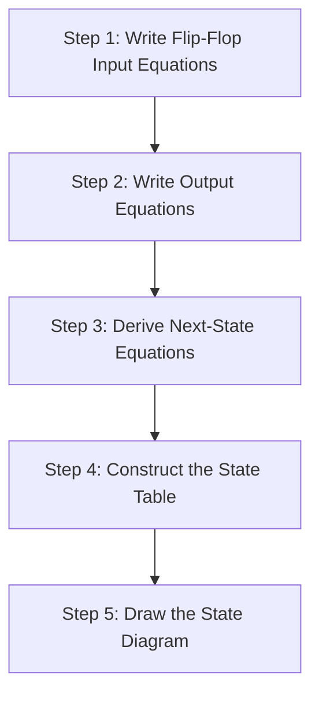
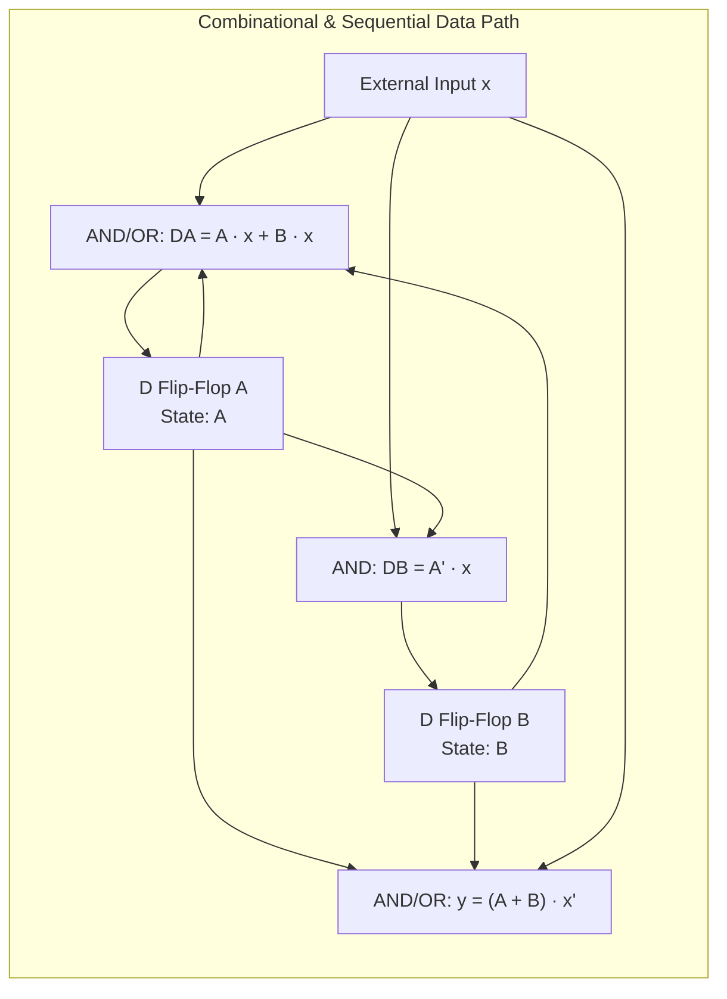
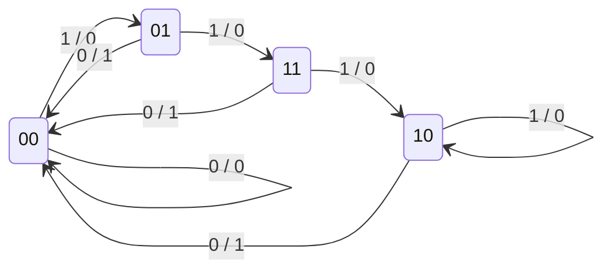

[DLCD Index](../README.md) / [Unit 2: Synchronous Sequential Logic](Introduction.md)

# Analysis of Clocked Sequential Circuits

In combinational logic, analyzing a circuit was simple: you traced logic gates from left to right, substituted variable values into Boolean expressions, and compiled a truth table.

In sequential logic, however, a circuit has memory. Its future behavior depends not only on what signals you apply right now, but on what state it currently holds. 

The process of taking an existing sequential schematic—with interconnected flip-flops, gates, and clock lines—and mathematically determining its exact time-dependent behavior is called **Sequential Circuit Analysis**. Let's break down this systematic procedure step by step.

---

## The Sequential Analysis Framework

A synchronous sequential circuit consists of a set of flip-flops connected to combinational logic. All flip-flops share a common clock. 

To determine how the circuit behaves over time, we execute a rigorous 5-step pipeline:

1. **Flip-Flop Input Equations**: Identify the Boolean signals connected to the control pins of each flip-flop ($D, J, K, T$).
2. **Output Equations**: Write the Boolean expressions for the external outputs of the circuit as functions of the present states and external inputs.
3. **Next-State Equations**: Substitute the input equations into the characteristic equations of the corresponding flip-flops to find algebraic formulas for $Q(t+1)$.
4. **State Table**: Tabulate every possible combination of Present State and External Inputs to determine the resulting Next State and Outputs.
5. **State Diagram**: Draw a directed graph showing states as vertices and transitions as arrows, giving an intuitive visual roadmap of the machine.

---

## Worked Example 1: D Flip-Flop Sequential Circuit

Consider a sequential circuit with two D flip-flops, $A$ and $B$, one external input $x$, and one external output $y$.

### Step 1: Input Equations
By inspecting the connections entering the $D$ pins of flip-flops $A$ and $B$:
$$D_A = A x + B x$$
$$D_B = A' x$$

### Step 2: Output Equations
By inspecting the logic driving output $y$:
$$y = (A + B) x'$$

### Step 3: Next-State Equations
For a D flip-flop, the characteristic equation is simply $Q(t+1) = D$. Therefore, substituting our input equations yields the next-state equations directly:
$$A(t+1) = D_A = A x + B x$$
$$B(t+1) = D_B = A' x$$

### Step 4: State Table
With two flip-flops ($A, B$) and one input ($x$), there are $2^{2+1} = 8$ possible combinations of Present State and Input:

| Present State ($A \ B$) | Input ($x$) | Next State ($A(t+1) \ B(t+1)$) | Output ($y$) |
| :---: | :---: | :---: | :---: |
| $0 \ 0$ | $0$ | $0 \ 0$ | $0$ |
| $0 \ 0$ | $1$ | $0 \ 1$ | $0$ |
| $0 \ 1$ | $0$ | $0 \ 0$ | $1$ |
| $0 \ 1$ | $1$ | $1 \ 1$ | $0$ |
| $1 \ 0$ | $0$ | $0 \ 0$ | $1$ |
| $1 \ 0$ | $1$ | $1 \ 0$ | $0$ |
| $1 \ 1$ | $0$ | $0 \ 0$ | $1$ |
| $1 \ 1$ | $1$ | $1 \ 0$ | $0$ |

### Step 5: State Diagram
We represent each unique binary state ($00, 01, 10, 11$) as a circle. Transitions between states are directed arrows labeled with the format **$\text{Input} / \text{Output}$** ($x / y$):

Notice something interesting: whenever $x = 0$, the circuit transitions unconditionally back to state $00$, generating an output of $y = 1$ if the previous state had at least one $1$. When $x = 1$, the machine steps between states without asserting output $y$.

---

## Worked Example 2: JK Flip-Flop Sequential Circuit

Now let us analyze a circuit with two JK flip-flops ($A$ and $B$) and one external input $x$.

### Step 1: Input Equations
Suppose circuit analysis reveals:
$$J_A = B, \quad K_A = B x'$$
$$J_B = x', \quad K_B = A \oplus x$$

### Step 2: Next-State Equations
Recall the JK characteristic equation: $Q(t+1) = J Q' + K' Q$.

For Flip-Flop $A$:
$$A(t+1) = J_A A' + K_A' A$$
Substitute $J_A = B$ and $K_A = B x'$:
$$A(t+1) = B A' + (B x')' A = B A' + (B' + x) A = A' B + A B' + A x$$

For Flip-Flop $B$:
$$B(t+1) = J_B B' + K_B' B$$
Substitute $J_B = x'$ and $K_B = (A \oplus x)$:
$$B(t+1) = x' B' + (A \oplus x)' B$$

### Step 3: State Table Construction
Evaluating these algebraic expressions for all 8 combinations of $(A, B, x)$:

| Present State ($A \ B$) | Input ($x$) | $J_A \ K_A$ | $J_B \ K_B$ | Next State ($A(t+1) \ B(t+1)$) |
| :---: | :---: | :---: | :---: | :---: |
| $0 \ 0$ | $0$ | $0 \ 0$ | $1 \ 0$ | $0 \ 1$ |
| $0 \ 0$ | $1$ | $0 \ 0$ | $0 \ 1$ | $0 \ 0$ |
| $0 \ 1$ | $0$ | $1 \ 1$ | $1 \ 0$ | $1 \ 1$ |
| $0 \ 1$ | $1$ | $1 \ 0$ | $0 \ 1$ | $1 \ 0$ |
| $1 \ 0$ | $0$ | $0 \ 0$ | $1 \ 1$ | $1 \ 1$ |
| $1 \ 0$ | $1$ | $0 \ 0$ | $0 \ 0$ | $1 \ 0$ |
| $1 \ 1$ | $0$ | $1 \ 1$ | $1 \ 1$ | $0 \ 0$ |
| $1 \ 1$ | $1$ | $1 \ 0$ | $0 \ 0$ | $1 \ 1$ |

---

## Comparing Behavioral Representations

| Representation | Format | Best Used For |
| :--- | :--- | :--- |
| **Logic Schematic** | Interconnected gates and flip-flops | Physical hardware layout, routing, and simulation. |
| **Input & Next-State Equations** | Algebraic Boolean expressions | Algebraic minimization and formal equivalence checking. |
| **State Table** | Tabular mapping of states and inputs | Algorithmic logic synthesis, state reduction, and K-map generation. |
| **State Diagram** | Directed graph with nodes and transitions | High-level mental models, algorithm verification, and protocol debugging. |

---

## Key Takeaways

- Sequential circuit analysis is the deterministic 5-step process of deriving high-level behavioral models from physical logic schematics.
- Flip-flop input equations describe the signals arriving at flip-flop inputs; substituting them into flip-flop characteristic equations yields the next-state equations.
- For D flip-flops, the next state is equal to the input equation ($Q_{\text{next}} = D$); for JK flip-flops, the next state requires algebraic expansion via $Q_{\text{next}} = J Q' + K' Q$.
- The state table enumerates all transitions across the $2^{n+m}$ combinations of present state flip-flops and inputs.
- The state diagram visually maps states as nodes and transitions as directed edges labeled $\text{Input} / \text{Output}$.

Now that we can analyze how sequential circuits behave, notice that the position of the output logic fundamentally alters the machine's timing. In the next lecture, we explore the structural distinction between Mealy and Moore state machine models.
