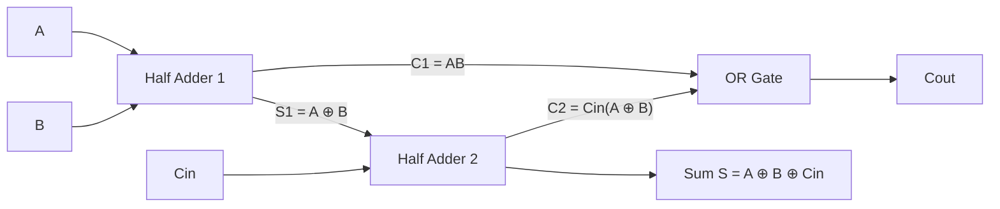
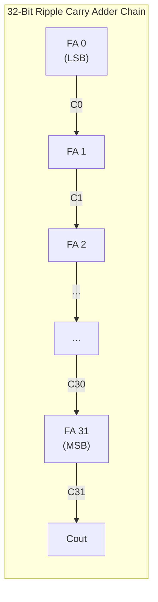
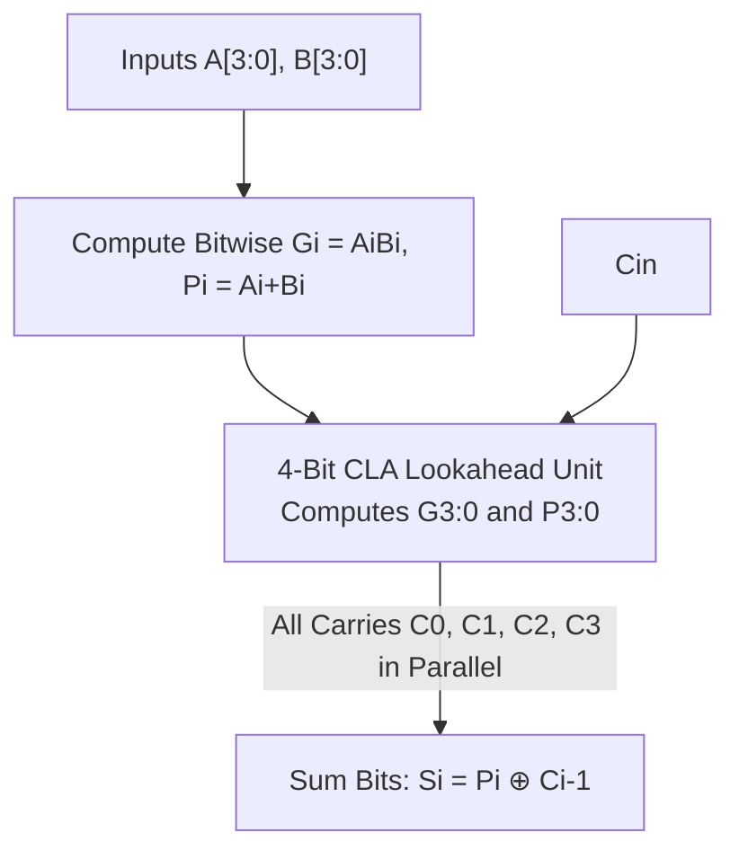
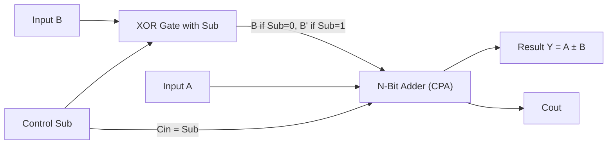
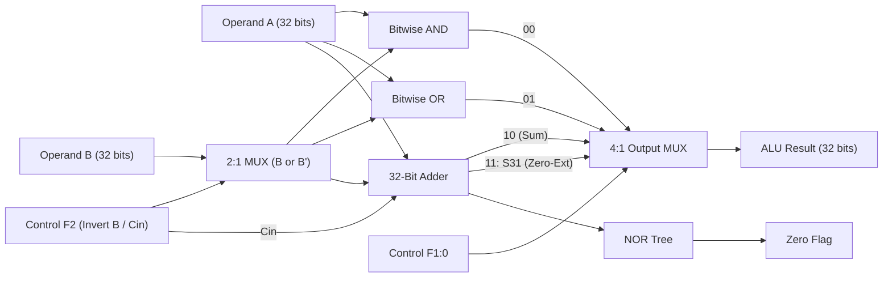
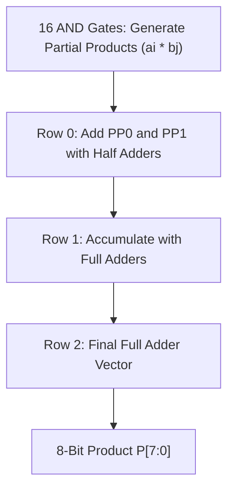

[DLCD Index](../README.md) / [Unit 2: Digital Building Blocks and Finite State Machines](Introduction.md)

# L02 - Arithmetic Circuits

In modern computing, the Central Processing Unit (CPU) spends the vast majority of its time performing mathematical calculations: adding pointers to base addresses, incrementing loop counters, comparing variables, and executing arithmetic instructions. The hardware subsystem that performs these calculations is the **Arithmetic Logic Unit (ALU)**.

In this lecture, we examine the progression of arithmetic circuits from basic 1-bit adders to high-speed carry-lookahead and prefix tree adders. We then construct 2's complement subtractors, comparators, shifters, and array multipliers, culminating in the complete design and timing analysis of the standard 32-bit MIPS ALU.

---

## 1-Bit Adders: Half Adders and Full Adders

All digital addition begins with single-bit binary numbers.

### The Half Adder
A **Half Adder (HA)** adds two 1-bit inputs, $A$ and $B$. It produces a 1-bit Sum ($S$) and a Carry Out ($C$):

| $A$ | $B$ | Sum ($S$) | Carry Out ($C$) |
|:---:|:---:|:---:|:---:|
| 0 | 0 | 0 | 0 |
| 0 | 1 | 1 | 0 |
| 1 | 0 | 1 | 0 |
| 1 | 1 | 0 | 1 |

Inspecting the truth table gives the Boolean equations:

$$S = A \oplus B, \quad C = A B$$

A half adder requires only one XOR gate and one AND gate. However, it cannot accept an incoming carry from a less-significant column, making it incapable of chaining into multi-bit addition on its own.

### The Full Adder
A **Full Adder (FA)** adds three 1-bit inputs: operand bits $A$ and $B$, plus an incoming Carry In ($C_{\text{in}}$).

| $A$ | $B$ | $C_{\text{in}}$ | Sum ($S$) | Carry Out ($C_{\text{out}}$) |
|:---:|:---:|:---:|:---:|:---:|
| 0 | 0 | 0 | 0 | 0 |
| 0 | 0 | 1 | 1 | 0 |
| 0 | 1 | 0 | 1 | 0 |
| 0 | 1 | 1 | 0 | 1 |
| 1 | 0 | 0 | 1 | 0 |
| 1 | 0 | 1 | 0 | 1 |
| 1 | 1 | 0 | 0 | 1 |
| 1 | 1 | 1 | 1 | 1 |

The Sum bit is the parity (odd-function) of all three inputs:

$$S = A \oplus B \oplus C_{\text{in}}$$

The Carry Out is generated if at least two of the three inputs are $1$:

$$C_{\text{out}} = A B + B C_{\text{in}} + A C_{\text{in}} = A B + C_{\text{in}}(A \oplus B)$$

A full adder can be synthesized by cascading two half adders and an OR gate.

---

## Multi-Bit Carry Propagate Adders (CPAs)

To add $N$-bit numbers, we compose 1-bit full adders into a **Carry Propagate Adder (CPA)**. The fundamental architectural challenge is speed: how fast can the carry signal propagate from the least-significant bit (LSB) to the most-significant bit (MSB)?

### 1. Ripple-Carry Adder (RCA)
The simplest way to build an $N$-bit adder is to chain $N$ full adders together, connecting the $C_{\text{out}}$ of each stage directly into the $C_{\text{in}}$ of the next stage.

The critical path of an RCA is the **carry ripple path**: the MSB sum $S_{N-1}$ and carry $C_{\text{out}}$ cannot be computed until the carry has rippled through all $N$ stages:

$$t_{\text{ripple}} = N \times t_{\text{FA}}$$

For a 32-bit adder with a full-adder delay of $t_{\text{FA}} = 300\text{ ps}$:

$$t_{\text{ripple}} = 32 \times 300\text{ ps} = 9.6\text{ ns}$$

A delay of $9.6\text{ ns}$ caps the clock frequency of the entire CPU below $100\text{ MHz}$! To build gigahertz microprocessors, we must break this serial carry ripple.

---

## The Carry-Lookahead Adder (CLA)

The **Carry-Lookahead Adder (CLA)** eliminates the ripple delay by computing carries in parallel across multi-bit blocks.

### Generate and Propagate Logic
For any bit column $i$, consider whether it produces a carry out:
- **Generate ($G_i$)**: Column $i$ generates a carry out regardless of the incoming carry if both inputs are $1$:
  $$G_i = A_i B_i$$
- **Propagate ($P_i$)**: Column $i$ propagates an incoming carry through to its carry out if at least one input is $1$:
  $$P_i = A_i + B_i \quad (\text{or } A_i \oplus B_i)$$

Using $G_i$ and $P_i$, the carry out of column $i$ is:

$$C_i = G_i + P_i C_{i-1}$$

### Expanding Carries in a 4-Bit Block
Let's unroll this recurrence for a 4-bit block (bits $0$ to $3$):
- $C_0 = G_0 + P_0 C_{\text{in}}$
- $C_1 = G_1 + P_1 C_0 = G_1 + P_1(G_0 + P_0 C_{\text{in}}) = G_1 + P_1 G_0 + P_1 P_0 C_{\text{in}}$
- $C_2 = G_2 + P_2 G_1 + P_2 P_1 G_0 + P_2 P_1 P_0 C_{\text{in}}$
- $C_3 = G_3 + P_3 G_2 + P_3 P_2 G_1 + P_3 P_2 P_1 G_0 + P_3 P_2 P_1 P_0 C_{\text{in}}$

Notice that every single carry $C_0, C_1, C_2, C_3$ is expressed as a two-level AND-OR equation directly in terms of the primary inputs and $C_{\text{in}}$. They are evaluated **simultaneously in parallel** in just two gate delays!

For a 4-bit block as a whole, we define **Block Generate ($G_{3:0}$)** and **Block Propagate ($P_{3:0}$)**:

$$G_{3:0} = G_3 + P_3(G_2 + P_2(G_1 + P_1 G_0))$$

$$P_{3:0} = P_3 P_2 P_1 P_0$$

Then the block carry out is simply:

$$C_3 = G_{3:0} + P_{3:0} C_{\text{in}}$$

---

## Prefix Adders: Fast Carry Trees

While a Carry-Lookahead Adder uses 4-bit hierarchical blocks, a **Prefix Adder** (also called a Carry-Tree Adder) takes parallel carry generation to its theoretical limit.

A prefix adder views carry computation as an associative prefix operation. For any block spanning bits $i$ down to $j$:
- It will generate a carry ($G_{i:j}$) if the upper block generates a carry, or if the upper block propagates a carry generated by the lower block:
  $$G_{i:j} = G_{i:k} + P_{i:k} G_{k-1:j}$$
- It will propagate a carry ($P_{i:j}$) if both upper and lower blocks propagate:
  $$P_{i:j} = P_{i:k} P_{k-1:j}$$

Using a binary tree structure of prefix cells (such as Kogge-Stone or Brent-Kung architectures), the prefix adder computes all carries simultaneously in:

$$\text{Tree Stages} = O(\log_2 N)$$

---

## Quantitative Adder Delay Comparison

Let's evaluate the real-world performance of a 32-bit adder built with each technology, assuming standard CMOS gate delays: 2-input gate delay $t_{\text{gate}} = 100\text{ ps}$ and 1-bit full adder delay $t_{\text{FA}} = 300\text{ ps}$.

| Adder Architecture | Delay Formula | Calculated 32-Bit Delay | Speedup vs. RCA |
|:---|:---|:---:|:---:|
| **Ripple-Carry (RCA)** | $t = N \times t_{\text{FA}} = 32 \times 300\text{ ps}$ | **$9.6\text{ ns}$** | $1.0\times$ (Baseline) |
| **Carry-Lookahead (CLA, 4-bit blocks)** | $t = t_{\text{pg}} + t_{\text{pg\_block}} + \left(\frac{N}{k} - 1\right)t_{\text{AND-OR}} + k t_{\text{FA}}$ | **$3.3\text{ ns}$** | **$2.9\times$ faster** |
| **Prefix Tree Adder (PA)** | $t = t_{\text{pg}} + \log_2 N(t_{\text{pg\_prefix}}) + t_{\text{XOR}}$ | **$1.2\text{ ns}$** | **$8.0\times$ faster** |

The prefix adder is **eight times faster** than the ripple-carry adder. This is the difference between an uncompetitive $100\text{ MHz}$ microcontroller and a modern gigahertz processor!

---

## The Adder-Subtractor Circuit

How do we perform subtraction ($A - B$) without building a completely separate subtraction circuit?

In 2's complement arithmetic, subtraction is defined as adding the negated operand:

$$A - B = A + (-B) = A + (\overline{B} + 1)$$

Notice what this requires:
1. Invert every bit of $B$ (one's complement: $\overline{B}$).
2. Add $1$ to the result.

We can integrate addition and subtraction into a single unified circuit by adding XOR gates to input $B$ and using a control signal called $\text{Sub}$:

- When $\text{Sub} = 0$: The XOR gates pass $B$ unchanged ($B \oplus 0 = B$), and $C_{\text{in}} = 0$. The adder performs $A + B + 0 = A + B$.
- When $\text{Sub} = 1$: The XOR gates invert $B$ ($B \oplus 1 = \overline{B}$), and $C_{\text{in}} = 1$. The adder performs $A + \overline{B} + 1 = A - B$.

---

## Comparators

Digital processors constantly perform relational comparisons (`if (A == B)`, `if (A < B)`).

### Equality Comparator ($A == B$)
Two $N$-bit numbers are equal if and only if every single corresponding bit pair is identical ($A_i == B_i$).
- The XNOR gate is an equivalence detector: $A_i \odot B_i = 1$ when $A_i = B_i$.
- Therefore, we XNOR each bit pair and combine all outputs through an $N$-input AND gate:
  $$A_{\text{eq}} = (A_{N-1} \odot B_{N-1}) \cdot (A_{N-2} \odot B_{N-2}) \dots (A_0 \odot B_0)$$

### Magnitude Comparator ($A < B$)
To determine if $A < B$, we simply subtract $B$ from $A$ using our adder-subtractor:

$$\text{Difference} = A - B$$

In 2's complement:
- If $A < B$, the mathematical difference $A - B$ is negative.
- In 2's complement, a negative number has its Most Significant Bit (sign bit) equal to $1$.
- Thus, the sign bit of the subtraction result ($S_{N-1}$) indicates whether $A < B$ (with overflow detection if signs differ).

---

## Arithmetic Logic Unit (ALU) Design

Now we combine our adder-subtractor, comparator, and bitwise logic gates into the unified **32-Bit MIPS ALU**.

### ALU Control Specifications
The ALU takes two 32-bit operands ($A, B$) and a 3-bit control code $F_{2:0}$:

| ALU Control ($F_{2:0}$) | Operation Name | Description | Internal Function |
|:---:|:---:|:---|:---|
| **$000$** | **AND** | Bitwise AND ($A \ \& \ B$) | Bitwise AND |
| **$001$** | **OR** | Bitwise OR ($A \ \| \ B$) | Bitwise OR |
| **$010$** | **ADD** | Addition ($A + B$) | Adder with $C_{\text{in}} = 0$, $B$ normal |
| **$011$** | *Unused* | — | Reserved |
| **$100$** | **AND NOT** | Bitwise AND with inverted $B$ | Invert $B$, Bitwise AND |
| **$101$** | **OR NOT** | Bitwise OR with inverted $B$ | Invert $B$, Bitwise OR |
| **$110$** | **SUB** | Subtraction ($A - B$) | Adder with $C_{\text{in}} = 1$, $B$ inverted |
| **$111$** | **SLT** | Set Less Than | Subtraction, routes sign bit $S_{31}$ to $Y_0$ |

### ALU Internal Architecture
The ALU is organized into four distinct stages:
1. **$B$-Inversion MUX**: Controlled by $F_2$. When $F_2 = 1$ (for SUB and SLT), $B$ is inverted to $\overline{B}$, and $C_{\text{in}}$ of the adder is driven to $1$.
2. **The 32-Bit Adder**: Computes $A + B$ (when $F_2 = 0$) or $A + \overline{B} + 1 = A - B$ (when $F_2 = 1$).
3. **Bitwise Logic**: Parallel gates compute $A \ \& \ B_{\text{mux}}$ and $A \ \| \ B_{\text{mux}}$.
4. **Output MUX**: A 4:1 multiplexer controlled by $F_{1:0}$ selects the final result:
   - $00 \implies$ Bitwise AND output
   - $01 \implies$ Bitwise OR output
   - $10 \implies$ Adder sum output
   - $11 \implies$ SLT output (sign bit $S_{31}$ zero-extended to 32 bits)

### Detailed SLT Operation: $A = 25, B = 32$
Let's trace how the ALU executes `SLT` when $A = 25$ and $B = 32$:
1. The control code is set to $F_{2:0} = 111$.
2. $F_2 = 1$: The $B$-MUX inverts $B$, and $C_{\text{in}}$ is set to $1$. The adder performs subtraction:
   $$25 - 32 = -7$$
3. In 32-bit 2's complement, $-7$ is represented with a leading $1$ in its most-significant sign bit: $S_{31} = 1$.
4. The output MUX receives $F_{1:0} = 11$, which selects the SLT input: the sign bit $S_{31}$ zero-extended:
   $$\text{ALU Result} = 0\text{x}00000001$$
The ALU successfully asserts $1$, signifying that $25 < 32$!

---

## Shifters and Barrel Shifters

Processors frequently need to shift or rotate bit patterns for multiplication, bitmask manipulation, and floating-point alignment.

- **Logical Shifter**: Shifts bits left (`<<`) or right (`>>`), always shifting in **zeros** at the empty positions.
  - Example: $11001_2 \gg 2 = 00110_2$.
- **Arithmetic Shifter**: Shifts bits right (`>>>`), but fills empty positions with the **sign bit (MSB)** to preserve the signed 2's complement value.
  - Example: $11001_2 \ggg 2 = 11110_2$ (preserves negative sign).
- **Rotator**: Rotates bits in a closed circle (`ROL`, `ROR`); bits shifted off one end wrap around into the other end.
  - Example: $11001_2 \text{ ROR } 2 = 01110_2$.

### Shifters as Fast Multipliers and Dividers
Shifting by $k$ bit positions is mathematically equivalent to multiplying or dividing by powers of two:

$$A \ll k = A \times 2^k, \quad A \ggg k = A \div 2^k$$

A **Barrel Shifter** uses a multi-stage tree of multiplexers to shift an $N$-bit operand by an arbitrary shift amount ($0$ to $N-1$ positions) in a single clock cycle with $O(\log_2 N)$ gate delays.

---

## Array Multipliers and Restoring Division

### The 4x4 Array Multiplier
Multiplying two binary numbers $A = a_3 a_2 a_1 a_0$ and $B = b_3 b_2 b_1 b_0$ involves two steps:
1. **Partial Product Generation**: Each bit product $a_i b_j$ is evaluated using a simple 2-input AND gate. For a $4 \times 4$ multiplier, 16 AND gates generate 16 partial product bits.
2. **Partial Product Accumulation**: Shifted partial product rows are summed using an array grid of half adders and full adders.

### The Restoring Division Algorithm
Binary division computes $\frac{A}{B} = Q$ with remainder $R$:
1. Initialize remainder register $R' = 0$.
2. For bit index $i = N-1$ down to $0$:
   - Shift remainder left and bring down dividend bit: $R = (R' \ll 1) \mid A_i$.
   - Trial subtraction: $D = R - B$.
   - If $D < 0$ (result is negative): the quotient bit is $Q_i = 0$, and the remainder is **restored** ($R' = R$).
   - If $D \ge 0$ (result is non-negative): the quotient bit is $Q_i = 1$, and the remainder is kept ($R' = D$).

---

## Key Takeaways

- A 1-bit full adder computes $S = A \oplus B \oplus C_{\text{in}}$ and $C_{\text{out}} = A B + C_{\text{in}}(A \oplus B)$.
- Ripple-Carry Adders have linear propagation delay $O(N)$ and are too slow for high-performance processors ($9.6\text{ ns}$ for 32 bits).
- Carry-Lookahead Adders (CLA) compute carries in parallel using Generate ($G_i = A_i B_i$) and Propagate ($P_i = A_i + B_i$) logic, reducing 32-bit delay to $3.3\text{ ns}$.
- Prefix Adders use tree networks to achieve logarithmic delay $O(\log_2 N)$, operating at $1.2\text{ ns}$ (8x faster than RCA).
- Subtraction is performed via 2's complement addition ($A + \overline{B} + 1$) using XOR gates and $C_{\text{in}} = 1$.
- The 32-bit MIPS ALU integrates an adder-subtractor, bitwise AND/OR gates, and an output multiplexer to perform arithmetic, logic, and `SLT` comparison.
- Shifters perform rapid multiplication and division by powers of $2$; arithmetic right shift preserves the 2's complement sign bit.

---

We have built arithmetic circuits for integers, but how do computer systems represent fractions, decimal numbers, and scientific real values? In the next lecture, [L03 - Number Systems and Floating-Point Representation](L03%20-%20Number%20Systems%20and%20Floating-Point%20Representation.md), we explore fixed-point numbers, the IEEE 754 Floating-Point Standard, and floating-point addition algorithms.
