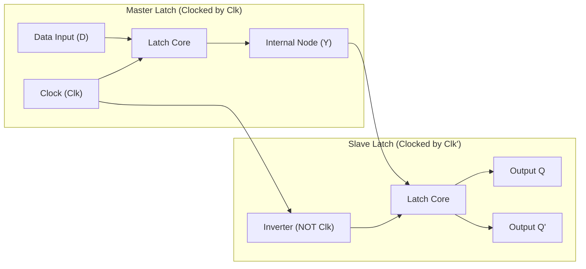
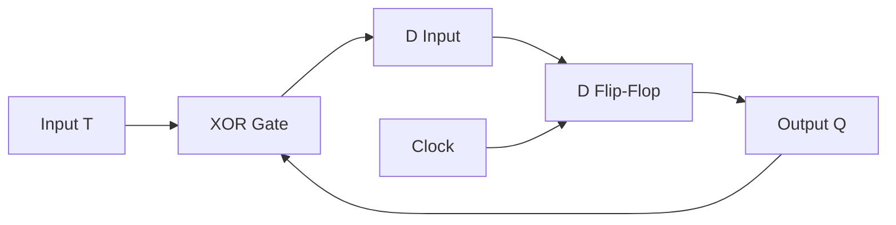

[DLCD Index](../README.md) / [Unit 2: Synchronous Sequential Logic](Introduction.md)

# L02 - Flip-Flops and Edge-Triggered Storage

In Lecture 1, we saw how latches provide memory through feedback, but suffer from a critical flaw: **transparency**. Because a latch remains open for the entire duration of a high clock level, feedback signals can race around the loop multiple times in a single cycle.

To build predictable, synchronized digital systems, we need storage elements that sample input data only at a precise, razor-sharp boundary: the **clock transition edge**. 

These edge-triggered devices are called **Flip-Flops**. Let's examine how flip-flops are constructed, how the Master-Slave architecture eliminates transparency, and master the characteristic and excitation tables of D, JK, and T flip-flops.

---

## Edge-Triggering vs. Level-Sensitivity

The difference between a latch and a flip-flop lies entirely in their clock response:
- A **Latch** is **level-sensitive**: it is transparent and continuously sensitive to inputs whenever the clock signal is at logic level `1` (or `0`).
- A **Flip-Flop** is **edge-triggered**: it captures data *only* at the instant the clock voltage transitions:
  - **Positive-Edge Triggered ($\uparrow$)**: Samples inputs during the rising edge (low-to-high transition, $0 \to 1$).
  - **Negative-Edge Triggered ($\downarrow$)**: Samples inputs during the falling edge (high-to-low transition, $1 \to 0$).

During the rest of the clock period—whether the clock is steady High or steady Low—the flip-flop is completely deaf to input changes.

```
Clock:       ___|‾‾‾‾‾‾‾‾|________|‾‾‾‾‾‾‾‾|___
                ^                 ^
             Rising Edge       Rising Edge
           (Samples Here)    (Samples Here)
```

### Setup and Hold Times

Because physical transistors require time to switch, input signals cannot change at the exact instant the clock edge arrives:
- **Setup Time ($t_{\text{su}}$)**: The minimum time the input data must remain stable **before** the active clock edge.
- **Hold Time ($t_h$)**: The minimum time the input data must remain stable **after** the active clock edge.

If an input transitions within the $(t_{\text{su}} + t_h)$ window, the internal transistors may enter a metastable state, producing a non-binary intermediate voltage that can persist for multiple nanoseconds, corrupting downstream logic.

---

## The Master-Slave Flip-Flop Architecture

How do you physically build a circuit that is never transparent from input to output at the same time?

The classic solution is the **Master-Slave Architecture**. It cascades two separate latches controlled by complementary clock signals:
1. The **Master Latch**: Clocked directly by the clock signal $Clk$.
2. The **Slave Latch**: Clocked by the inverted clock signal $\overline{Clk}$.



Let's trace how this circuit behaves across a complete clock cycle:

1. **When $Clk = 1$ (High)**:
   - The Master latch is enabled and transparent. It samples the input $D$ and stores it on internal node $Y$.
   - Meanwhile, the inverter feeds $\overline{Clk} = 0$ to the Slave latch. The Slave latch is **disabled and locked**. The external output $Q$ remains completely isolated from whatever is happening at the inputs.
2. **When $Clk$ transitions from $1 \to 0$ (Falling Edge)**:
   - The Master latch immediately disables and locks the current value of $Y$.
   - Simultaneously, $\overline{Clk}$ transitions from $0 \to 1$, opening the Slave latch.
   - The Slave latch reads the locked value from $Y$ and updates the external output $Q$.

Notice the brilliance of this layout: **at no point during the cycle are both latches transparent simultaneously**. When the front door is open, the back door is locked; when the back door opens, the front door is locked. Data can only step forward by one stage per clock edge, eliminating the race-around hazard.

---

## The Edge-Triggered D Flip-Flop

The **D (Data or Delay) Flip-Flop** is the workhorse of modern synchronous digital systems. It has one data input $D$, a clock input $Clk$, and complementary outputs $Q$ and $\overline{Q}$.

### Logic Behavior and Characteristic Equation

On the active clock edge, whatever value is present on $D$ is transferred directly to the output $Q$:
- If $D = 0 \implies Q_{\text{next}} = 0$
- If $D = 1 \implies Q_{\text{next}} = 1$

The **Characteristic Equation** defines the next state $Q(t+1)$ as a function of the present state $Q(t)$ and inputs:
$$\mathbf{Q(t+1) = D}$$

The next state depends strictly on $D$, completely independent of the present state $Q(t)$.

### Characteristic Table

| Present State $Q(t)$ | Input $D$ | Next State $Q(t+1)$ | Operation |
| :---: | :---: | :---: | :---: |
| 0 | 0 | 0 | Reset |
| 0 | 1 | 1 | Set |
| 1 | 0 | 0 | Reset |
| 1 | 1 | 1 | Set |

### Excitation Table

When designing sequential circuits, we often know the desired state transition ($Q(t) \to Q(t+1)$) and need to determine what input $D$ must be applied to cause that transition. This reverse lookup table is called an **Excitation Table**.

For a D flip-flop, the excitation requirement is trivial because $Q(t+1) = D$:

| Present State $Q(t)$ | Next State $Q(t+1)$ | Required Input $D$ |
| :---: | :---: | :---: |
| 0 | 0 | **0** |
| 0 | 1 | **1** |
| 1 | 0 | **0** |
| 1 | 1 | **1** |

---

## The JK Flip-Flop

The SR latch had one major flaw: the input combination $S = R = 1$ was strictly forbidden because it produced invalid outputs and caused race hazards.

The **JK Flip-Flop** eliminates this flaw by redesigning the circuit so that when both control inputs are asserted simultaneously, the flip-flop **toggles** (inverts) its current state:
- $J$ acts like **Set** ($S$).
- $K$ acts like **Reset** ($R$).
- When $J = 1$ and $K = 1$, the output flips: $Q(t+1) = \overline{Q}(t)$.

### Characteristic Table

| $J$ | $K$ | $Q(t)$ | $Q(t+1)$ | Description |
| :---: | :---: | :---: | :---: | :---: |
| 0 | 0 | 0 | 0 | No Change (Memory) |
| 0 | 0 | 1 | 1 | No Change (Memory) |
| 0 | 1 | 0 | 0 | Reset ($Q \to 0$) |
| 0 | 1 | 1 | 0 | Reset ($Q \to 0$) |
| 1 | 0 | 0 | 1 | Set ($Q \to 1$) |
| 1 | 0 | 1 | 1 | Set ($Q \to 1$) |
| 1 | 1 | 0 | 1 | Toggle ($Q \to \overline{Q}$) |
| 1 | 1 | 1 | 0 | Toggle ($Q \to \overline{Q}$) |

### Deriving the Characteristic Equation

Let's plot the next state $Q(t+1)$ on a 3-variable K-map with variables $J, K, Q$:

```
        K Q
J       00   01   11   10
 0       0    1    0    0   <- minterm 1 (J' K' Q)
 1       1    1    0    1   <- minterms 4, 5, 6 (J K' Q', J K' Q, J K Q')
```

Let's group the 1s:
- Group 1: cells $(4, 6)$ and $(4, 5)$ simplify to $J \overline{Q}$ (rows where $J=1$ and $Q=0$).
- Group 2: cells $(1, 5)$ simplify to $\overline{K} Q$ (columns where $K=0$ and $Q=1$).

This gives the fundamental **JK Characteristic Equation**:
$$\mathbf{Q(t+1) = J\,\overline{Q} + \overline{K}\,Q}$$

Let's verify this formula:
- If $J=0, K=0$: $Q(t+1) = 0 \cdot \overline{Q} + 1 \cdot Q = Q$ (No change).
- If $J=0, K=1$: $Q(t+1) = 0 \cdot \overline{Q} + 0 \cdot Q = 0$ (Reset).
- If $J=1, K=0$: $Q(t+1) = 1 \cdot \overline{Q} + 1 \cdot Q = \overline{Q} + Q = 1$ (Set).
- If $J=1, K=1$: $Q(t+1) = 1 \cdot \overline{Q} + 0 \cdot Q = \overline{Q}$ (Toggle).

---

### JK Flip-Flop Excitation Table

The excitation table of the JK flip-flop is exceptionally versatile because many transitions allow **Don't Care ($X$)** inputs, which drastically simplifies combinational logic during sequential design.

Let's derive each row systematically:

1. **Transition $0 \to 0$**:
   The output is currently 0 and must remain 0. We can achieve this either by:
   - "No Change" ($J = 0, K = 0$), or
   - "Reset" ($J = 0, K = 1$).
   Notice that $J$ must be `0`, but $K$ can be anything! Therefore: **$J = 0, K = X$**.

2. **Transition $0 \to 1$**:
   The output is 0 and must change to 1. This happens either by:
   - "Set" ($J = 1, K = 0$), or
   - "Toggle" ($J = 1, K = 1$).
   $J$ must be `1`, while $K$ can be either: **$J = 1, K = X$**.

3. **Transition $1 \to 0$**:
   The output is 1 and must change to 0. This happens either by:
   - "Reset" ($J = 0, K = 1$), or
   - "Toggle" ($J = 1, K = 1$).
   $K$ must be `1`, while $J$ can be either: **$J = X, K = 1$**.

4. **Transition $1 \to 1$**:
   The output is 1 and must remain 1. This happens either by:
   - "No Change" ($J = 0, K = 0$), or
   - "Set" ($J = 1, K = 0$).
   $K$ must be `0`, while $J$ can be either: **$J = X, K = 0$**.

| Present State $Q(t)$ | Next State $Q(t+1)$ | Required $J$ | Required $K$ |
| :---: | :---: | :---: | :---: |
| 0 | 0 | **0** | **X** |
| 0 | 1 | **1** | **X** |
| 1 | 0 | **X** | **1** |
| 1 | 1 | **X** | **0** |

Every single state transition provides a Don't Care on either $J$ or $K$, making JK flip-flops the most hardware-efficient choice for discrete gate minimization.

---

## The T (Toggle) Flip-Flop

The **T (Toggle) Flip-Flop** has a single control input, $T$. It is derived directly from a JK flip-flop by tying both inputs together: $J = K = T$.

- When $T = 0$: $J = K = 0 \implies$ No change ($Q(t+1) = Q(t)$).
- When $T = 1$: $J = K = 1 \implies$ Toggle ($Q(t+1) = \overline{Q}(t)$).

Alternatively, a T flip-flop can be constructed from a D flip-flop by placing an XOR gate at its input:
$$D = T \oplus Q$$



### Characteristic Equation

$$\mathbf{Q(t+1) = T \oplus Q = T\,\overline{Q} + \overline{T}\,Q}$$

### Excitation Table

When does a T flip-flop need $T = 1$? Only when the state changes!
- If $Q(t) \neq Q(t+1)$ (a transition occurs), we must toggle $\implies T = 1$.
- If $Q(t) = Q(t+1)$ (the state stays the same), we must not toggle $\implies T = 0$.

Mathematically, the excitation equation is simply an XOR of the present and next states:
$$\mathbf{T = Q(t) \oplus Q(t+1)}$$

| Present State $Q(t)$ | Next State $Q(t+1)$ | Required Input $T$ |
| :---: | :---: | :---: |
| 0 | 0 | **0** |
| 0 | 1 | **1** |
| 1 | 0 | **1** |
| 1 | 1 | **0** |

---

## Clock Frequency Division with T Flip-Flops

If we tie $T = 1$ permanently to $V_{\text{CC}}$, the flip-flop toggles its output on **every single active clock edge**.

Think about the waveform:
- On clock rising edge 1: $Q$ transitions $0 \to 1$.
- On clock rising edge 2: $Q$ transitions $1 \to 0$.
- On clock rising edge 3: $Q$ transitions $0 \to 1$.

```
Clock:  ___|‾‾‾|___|‾‾‾|___|‾‾‾|___|‾‾‾|___  (Frequency = f)
Output: ___|‾‾‾‾‾‾‾‾‾‾‾|___________|‾‾‾‾‾‾‾  (Frequency = f / 2)
```

The output waveform completes one full cycle for every **two** clock cycles of the input. The output frequency is exactly:
$$f_{\text{out}} = \frac{f_{\text{clk}}}{2}$$

This makes the T flip-flop the fundamental physical building block of all digital binary counters and clock prescalers.

---

## Asynchronous Inputs (Preset and Clear)

In all flip-flops discussed so far, state changes occur strictly on the clock edge. These are called **synchronous inputs**.

However, when a computer powers up, the flip-flops settle into arbitrary, random states. To force the processor into a known initial state (such as resetting the Program Counter to address `0x00000000`), flip-flops include **asynchronous inputs**:
- **$\overline{\text{PRE}}$ (Preset)**: An active-low input that immediately forces $Q = 1$, regardless of the clock or data inputs.
- **$\overline{\text{CLR}}$ (Clear / Reset)**: An active-low input that immediately forces $Q = 0$, regardless of the clock or data inputs.

Under normal operation, both $\overline{\text{PRE}}$ and $\overline{\text{CLR}}$ are held at logic `1` (inactive). During system reset, the reset line pulls $\overline{\text{CLR}}$ to `0`, clearing all registers instantaneously without waiting for a clock edge.

---

## Flip-Flop Comparison Summary

| Flip-Flop Type | Inputs | Characteristic Equation | Primary Advantage | Typical Usage |
| :---: | :---: | :---: | :---: | :---: |
| **D Flip-Flop** | $D$ | $Q(t+1) = D$ | Simplest excitation logic (no decoding required) | CPU data registers, pipelines, memory caches |
| **JK Flip-Flop** | $J, K$ | $Q(t+1) = J\overline{Q} + \overline{K}Q$ | Rich Don't Cares maximize gate minimization | Counters, controllers, discrete MSI circuits |
| **T Flip-Flop** | $T$ | $Q(t+1) = T \oplus Q$ | Natural toggling behavior | Binary counters, frequency dividers |

---

## Key Takeaways

- Flip-flops are **edge-triggered**, capturing data only during the instantaneous rising or falling clock transition, eliminating the transparency race-around hazards of latches.
- Setup time ($t_{\text{su}}$) and hold time ($t_h$) define the temporal window surrounding the clock edge during which inputs must remain strictly stable to avoid **metastability**.
- The **Master-Slave architecture** breaks the feedback loop by cascading two latches clocked on opposite phases; at no time are both latches transparent together.
- For a **D flip-flop**: $Q(t+1) = D$.
- For a **JK flip-flop**: $Q(t+1) = J\overline{Q} + \overline{K}Q$. When $J = K = 1$, the state toggles. Its excitation table provides Don't Cares for every transition.
- For a **T flip-flop**: $Q(t+1) = T \oplus Q$. When $T = 1$, it toggles on every clock edge, dividing the clock frequency by 2.
- **Asynchronous inputs** ($\overline{\text{PRE}}$ and $\overline{\text{CLR}}$) override clock operations to initialize state machines upon power-on.

---

Now that we understand the individual storage cells, how do we analyze circuits composed of multiple flip-flops interconnected with combinational logic gates? In the next lecture, we establish the step-by-step pipeline for the [**Analysis of Clocked Sequential Circuits**](L03%20-%20Analysis%20of%20Clocked%20Sequential%20Circuits.md), deriving state tables, next-state equations, and visual state diagrams.
