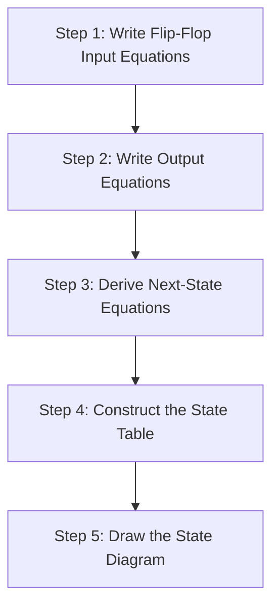
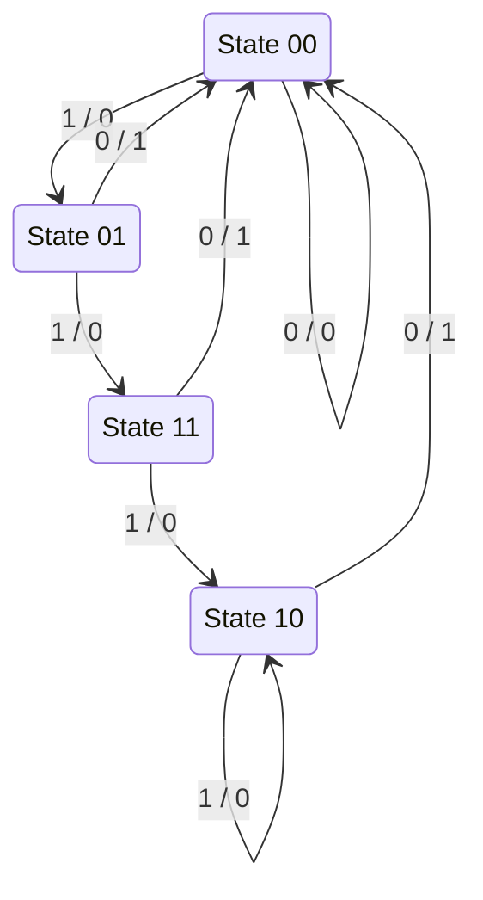
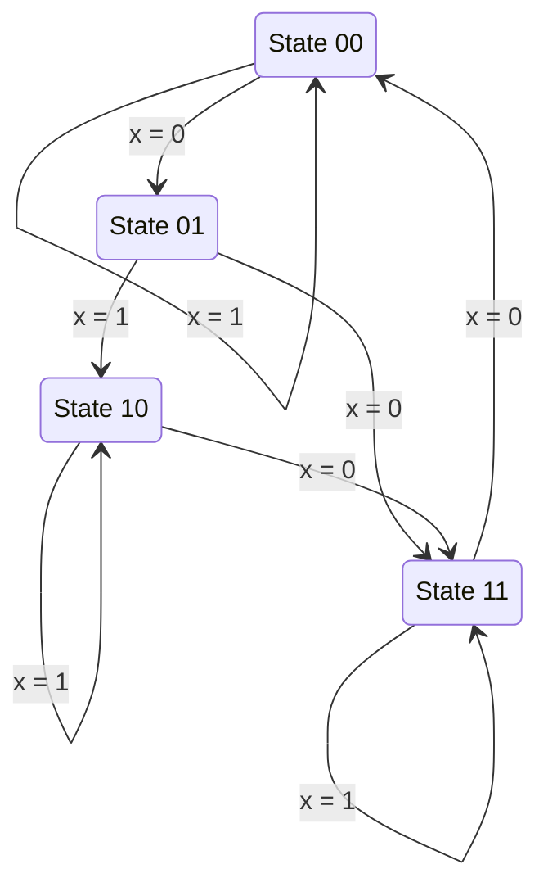

[DLCD Index](../README.md) / [Unit 2: Synchronous Sequential Logic](Introduction.md)

# L03 - Analysis of Clocked Sequential Circuits

In combinational logic, analyzing a circuit was simple: you traced logic gates from left to right, substituted variable values into Boolean expressions, and compiled a truth table.

In sequential logic, however, a circuit has memory. Its future behavior depends not only on what signals you apply right now, but on what state it currently holds. 

The process of taking an existing sequential schematic—with interconnected flip-flops, gates, and clock lines—and mathematically determining its exact time-dependent behavior is called **Sequential Circuit Analysis**. Let's break down this systematic procedure step by step.

---

## The Sequential Analysis Framework

A synchronous sequential circuit consists of a set of flip-flops connected to combinational logic. All flip-flops share a common clock. 

To determine how the circuit behaves over time, we execute a rigorous 5-step pipeline:

1. **Flip-Flop Input Equations**: Identify the Boolean signals connected to the control pins of each flip-flop ($D, J, K, T$).
2. **Output Equations**: Write the Boolean expressions for the external outputs of the circuit as functions of the present states and external inputs.
3. **Next-State Equations**: Substitute the input equations into the characteristic equations of the corresponding flip-flops to find algebraic formulas for $Q(t+1)$.
4. **State Table**: Tabulate every possible combination of Present State and External Inputs to determine the resulting Next State and Outputs.
5. **State Diagram**: Draw a directed graph showing states as vertices and transitions as arrows, giving an intuitive visual roadmap of the machine.

---

## Worked Example 1: D Flip-Flop Sequential Circuit

Let's walk through a complete, rigorous analysis of a sequential circuit containing:
- Two positive-edge-triggered D flip-flops: labeled $A$ and $B$.
- One external input: $x$.
- One external output: $y$.

Suppose the schematic reveals the following wiring:
- The input to flip-flop $A$ comes from an OR gate summing two AND gates: $D_A = A x + B x$.
- The input to flip-flop $B$ comes from an AND gate: $D_B = \overline{A} x$.
- The output $y$ comes from an AND gate combining $(A + B)$ and $\overline{x}$: $y = (A + B)\overline{x}$.

---

### Step 1 & 2: Write Input and Output Equations

From the schematic inspection:
$$\mathbf{D_A = A x + B x}$$
$$\mathbf{D_B = \overline{A}\,x}$$
$$\mathbf{y = (A + B)\,\overline{x}}$$

---

### Step 2: Derive Next-State Equations

Recall the characteristic equation of a D flip-flop from Lecture 2:
$$Q(t+1) = D$$

Therefore, the next state for each flip-flop is simply whatever expression drives its $D$ input:
$$\mathbf{A(t+1) = D_A = A x + B x}$$
$$\mathbf{B(t+1) = D_B = \overline{A}\,x}$$

Notice what these equations reveal:
- Flip-flop $A$ will transition to `1` on the next clock tick if $x = 1$ AND either $A$ or $B$ is currently `1`.
- Flip-flop $B$ will transition to `1` on the next clock tick if $x = 1$ AND $A$ is currently `0`.
- If $x = 0$, both $A(t+1) = 0$ and $B(t+1) = 0$, meaning the circuit immediately resets to state `00`!

---

### Step 3: Construct the State Table

Since there are 2 flip-flops ($A$ and $B$) and 1 input ($x$), there are $2^{2+1} = 8$ possible combinations of Present State and Input.

Let's evaluate each row:

| Present State ($A\;B$) | Input ($x$) | Next State ($A(t+1)\;B(t+1)$) | Output ($y$) | Notes / Calculation |
| :---: | :---: | :---: | :---: | :---: |
| 0 0 | 0 | **0 0** | **0** | $A(t+1)=0, B(t+1)=0, y=(0+0)\cdot 1 = 0$ |
| 0 0 | 1 | **0 1** | **0** | $A(t+1)=0, B(t+1)=1\cdot 1=1, y=(0+0)\cdot 0 = 0$ |
| 0 1 | 0 | **0 0** | **1** | $A(t+1)=0, B(t+1)=0, y=(0+1)\cdot 1 = 1$ |
| 0 1 | 1 | **1 1** | **0** | $A(t+1)=0+1=1, B(t+1)=1\cdot 1=1, y=0$ |
| 1 0 | 0 | **0 0** | **1** | $A(t+1)=0, B(t+1)=0, y=(1+0)\cdot 1 = 1$ |
| 1 0 | 1 | **1 0** | **0** | $A(t+1)=1+0=1, B(t+1)=0\cdot 1=0, y=0$ |
| 1 1 | 0 | **0 0** | **1** | $A(t+1)=0, B(t+1)=0, y=(1+1)\cdot 1 = 1$ |
| 1 1 | 1 | **1 0** | **0** | $A(t+1)=1+1=1, B(t+1)=0\cdot 1=0, y=0$ |

---

### Alternative Representation: 2-Dimensional State Table

In university exams and engineering literature, state tables are frequently written in a compact 2D matrix format, where columns represent input conditions:

| Present State ($AB$) | Next State ($x = 0$) | Next State ($x = 1$) | Output $y$ ($x = 0$) | Output $y$ ($x = 1$) |
| :---: | :---: | :---: | :---: | :---: |
| **00** | 00 | 01 | 0 | 0 |
| **01** | 00 | 11 | 1 | 0 |
| **10** | 00 | 10 | 1 | 0 |
| **11** | 00 | 10 | 1 | 0 |

---

### Step 4: Draw the State Diagram

A **State Diagram** translates the table into a visual directed graph:
- Each state is represented by a circle containing the state bits ($AB$).
- Directed arrows represent transitions occurring on the clock edge.
- Each arrow is labeled with the notation: **$\text{Input} \;/\; \text{Output}$** (e.g., $x / y$).

Let's trace how the machine works:
- Start at `00`. If $x = 0$, it loops at `00` outputting 0.
- If $x = 1$, it transitions to `01`.
- From `01`, if $x = 1$ continues, it transitions to `11`.
- From `11`, if $x = 1$ continues, it transitions to `10`.
- At `10`, if $x = 1$, it loops at `10`.
- Whenever $x$ drops to `0` from any non-zero state (`01`, `10`, `11`), the circuit instantly transitions back to `00` while emitting an output pulse $y = 1$!

---

## Worked Example 2: JK Flip-Flop Sequential Circuit

Now let's analyze a sequential circuit that uses **JK flip-flops**. 

Because a JK flip-flop has two control inputs ($J$ and $K$), finding the next state requires substituting the input equations into the JK characteristic equation:
$$\mathbf{Q(t+1) = J\,\overline{Q} + \overline{K}\,Q}$$

### Circuit Specification:
- Flip-flops: $A$ and $B$.
- Input: $x$.
- Input equations:
  $$J_A = B, \quad K_A = B\,\overline{x}$$
  $$J_B = \overline{x}, \quad K_B = A \oplus x$$

---

### Deriving the Next-State Equations

Let's derive $A(t+1)$:
$$A(t+1) = J_A\,\overline{A} + \overline{K_A}\,A$$
Substitute $J_A = B$ and $K_A = B\,\overline{x}$:
$$A(t+1) = B\,\overline{A} + \overline{B\,\overline{x}}\;A$$
Applying DeMorgan's theorem: $\overline{B\,\overline{x}} = \overline{B} + x$:
$$A(t+1) = \overline{A}\,B + A\,(\overline{B} + x) = \overline{A}\,B + A\,\overline{B} + A\,x$$
Notice that $\overline{A}\,B + A\,\overline{B} = A \oplus B$:
$$\mathbf{A(t+1) = (A \oplus B) + A\,x}$$

Now let's derive $B(t+1)$:
$$B(t+1) = J_B\,\overline{B} + \overline{K_B}\,B$$
Substitute $J_B = \overline{x}$ and $K_B = A \oplus x$:
$$\mathbf{B(t+1) = \overline{x}\;\overline{B} + \overline{A \oplus x}\;B}$$

---

### Constructing the State Table

Now we calculate the values for all 8 combinations:

| Present State ($AB$) | Input ($x$) | $J_A, K_A$ | $J_B, K_B$ | Next State ($A(t+1)\;B(t+1)$) |
| :---: | :---: | :---: | :---: | :---: |
| **00** | 0 | $J_A=0, K_A=0$ | $J_B=1, K_B=0$ | **0 1** |
| **00** | 1 | $J_A=0, K_A=0$ | $J_B=0, K_B=1$ | **0 0** |
| **01** | 0 | $J_A=1, K_A=1$ | $J_B=1, K_B=0$ | **1 1** |
| **01** | 1 | $J_A=1, K_A=0$ | $J_B=0, K_B=1$ | **1 0** |
| **10** | 0 | $J_A=0, K_A=0$ | $J_B=1, K_B=1$ | **1 1** |
| **10** | 1 | $J_A=0, K_A=0$ | $J_B=0, K_B=0$ | **1 0** |
| **11** | 0 | $J_A=1, K_A=1$ | $J_B=1, K_B=1$ | **0 0** |
| **11** | 1 | $J_A=1, K_A=0$ | $J_B=0, K_B=0$ | **1 1** |

Let's double-check a couple of rows:
- At row `01` with $x=0$: $J_A=1, K_A=1 \implies A$ toggles from $0 \to 1$. $J_B=1, K_B=0 \implies B$ sets to $1$. Result: `11`. Correct!
- At row `11` with $x=0$: $J_A=1, K_A=1 \implies A$ toggles from $1 \to 0$. $J_B=1, K_B=1 \implies B$ toggles from $1 \to 0$. Result: `00`. Correct!

---

### Drawing the State Diagram

Notice the pattern:
- When $x = 1$, each state either loops to itself (`00`, `10`, `11`) or steps to a fixed target.
- When $x = 0$, the machine cycles sequentially: $00 \to 01 \to 11 \to 00$, acting as a non-binary Modulo-3 counter, while state `10` branches into `11`.

---

## Comparing Behavioral Representations

Every sequential circuit can be expressed in three mathematically equivalent representations:

1. **State Equations**: Concise, algebraic, and directly tied to physical gate logic. Ideal for software simulation and Boolean manipulation.
2. **State Table**: Tabular, exhaustive, and precise. Shows every possible transition and serves as the starting point for minimization and truth-table verification.
3. **State Diagram**: Visual and topological. Shows loops, unreachable states, deadlock conditions, and cyclic behavior at a glance.

---

## Key Takeaways

- Sequential circuit analysis reverses the synthesis process: given a gate schematic, it determines the functional state machine.
- The standard analysis pipeline: **Flip-flop input equations $\to$ Next-state equations $\to$ State table $\to$ State diagram**.
- For D flip-flops, the next-state equation is simply $Q(t+1) = D$.
- For JK flip-flops, the next-state equation is derived by substituting $J$ and $K$ into $Q(t+1) = J\overline{Q} + \overline{K}Q$.
- For T flip-flops, the next-state equation is derived from $Q(t+1) = T \oplus Q$.
- State transitions are visual directed arcs labeled with the triggering input condition and resulting output ($\text{Input} / \text{Output}$).

---

Notice something in our first example: the output $y = (A+B)\overline{x}$ depended on both the present state AND the external input $x$. But in other circuits, outputs depend *only* on the stored state bits. This distinction divides all sequential machines into two fundamental architectural classes. In the next lecture, we dissect [**Mealy and Moore State Machine Models**](L04%20-%20Mealy%20and%20Moore%20State%20Machine%20Models.md).
