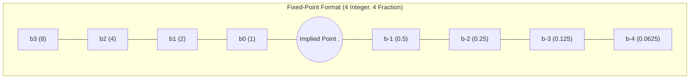
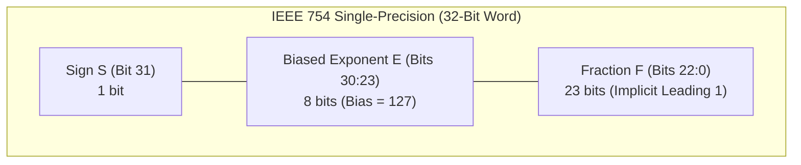
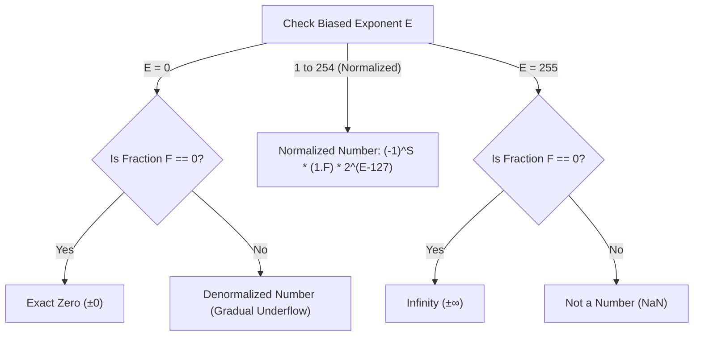
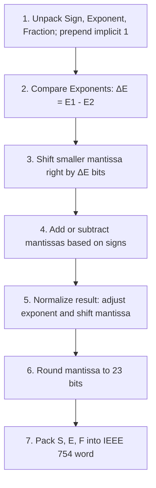

[DLCD Index](../README.md) / [Unit 2: Digital Building Blocks and Finite State Machines](Introduction.md)

# L03 - Number Systems and Floating-Point Representation

In the previous lecture, we constructed arithmetic circuits to add, subtract, and compare binary values. But binary bits are just electrical voltages—they carry no inherent mathematical meaning until we agree upon an encoding scheme. How do digital computers represent negative numbers, fractional quantities, and astronomical or microscopic real values within fixed 32-bit or 64-bit words?

In this lecture, we examine the evolution of numerical representations: from unsigned and 2's complement integers to fixed-point fractional formats, and finally to the ubiquitous **IEEE 754 Floating-Point Standard**. We trace the mechanics of biased exponents, implicit leading bits, special encodings ($\pm 0, \pm \infty, \text{NaN}$, denormals), rounding modes, and step through a complete, manual trace of floating-point addition in hardware.

---

## Integer Representations: Unsigned and Signed Formats

Before examining fractions, let us revisit how integers are encoded in an $N$-bit word.

### 1. Unsigned Binary
In an unsigned binary representation, all $N$ bits represent non-negative magnitudes. Each bit position $i$ carries a place weight of $2^i$:

$$\text{Value} = \sum_{i=0}^{N-1} b_i 2^i$$

The numerical range for an $N$-bit unsigned integer is $[0, 2^N - 1]$. For an 8-bit byte, this range is $0$ to $255$.

### 2. Signed Representations: Sign/Magnitude vs. 2's Complement
To represent negative numbers, we need a convention to distinguish positive from negative quantities.

- **Sign/Magnitude**: The most significant bit (MSB) acts as the sign flag ($0 = +, 1 = -$), while the remaining $N-1$ bits represent the magnitude.
  - *Fatal Flaws*: It has two representations for zero ($+0 = 00000000_2$ and $-0 = 10000000_2$), and ordinary binary adders produce incorrect results when adding positive and negative operands.
- **Two's Complement**: The standard signed format used in all modern processors. The MSB carries a **negative weight** of $-2^{N-1}$:
  $$\text{Value} = -b_{N-1} 2^{N-1} + \sum_{i=0}^{N-2} b_i 2^i$$
  - *Range*: $[-2^{N-1}, 2^{N-1} - 1]$. For 8 bits, $[-128, +127]$.
  - *Key Property*: To negate a number, invert all bits and add $1$ ($\overline{B} + 1$). Zero has a single unique representation ($00000000_2$), and the exact same hardware adder handles both addition and subtraction seamlessly.

---

## Fractional Numbers: Fixed-Point Representation

How do we represent numbers with fractional parts, such as $7.5_{10}$ or $0.125_{10}$?

### The Fixed-Point Concept
In a **fixed-point** number system, we imagine a binary point placed at a predetermined, fixed location between bits. The position of the binary point is **implied**: hardware does not store a physical decimal point; the system designer simply agrees beforehand on how many bits represent the integer part and how many represent the fractional part.

Bits to the right of the binary point carry negative powers of two:

$$\text{Place Weights} = 2^3, 2^2, 2^1, 2^0 \ .\ 2^{-1}, 2^{-2}, 2^{-3}, 2^{-4}$$

$$\text{Weights} = 8, 4, 2, 1 \ .\ 0.5, 0.25, 0.125, 0.0625$$

### Fixed-Point Encoding Walkthroughs
Consider an 8-bit fixed-point format with **4 integer bits** and **4 fraction bits**:

#### Example 1: Represent $6.75_{10}$
1. Convert integer part $6_{10}$ to 4-bit binary: $6 = 4 + 2 = 0110_2$.
2. Convert fractional part $0.75_{10}$ to binary: $0.75 = 0.5 + 0.25 = 2^{-1} + 2^{-2} = 1100_2$.
3. Combine bits: $0110.1100_2 \implies \mathbf{01101100_2}$ ($0\text{x}6\text{C}$).

#### Example 2: Represent $+7.5_{10}$ and $-7.5_{10}$
1. $+7.5_{10} = 7 + 0.5 = 0111.1000_2 \implies \mathbf{01111000_2}$.
2. In **Sign/Magnitude**: Set the MSB to $1$: $11111000_2$.
3. In **Two's Complement**: Invert all bits and add $1$ to the LSB ($2^{-4}$ position):
   - Invert: $\overline{01111000} = 10000111$
   - Add 1: $10000111 + 1 = \mathbf{10001000_2}$.
   - Verification: $-2^3 + 2^{-1} = -8 + 0.5 = -7.5$. It works perfectly!

### The Limitation of Fixed-Point
Fixed-point arithmetic is fast because it uses ordinary integer ALUs. However, it suffers from a rigid trade-off between **dynamic range** and **precision**. With 4 fraction bits, the smallest non-zero quantity we can resolve is $2^{-4} = 0.0625$. We cannot represent tiny quantities like the charge of an electron ($1.6 \times 10^{-19}\text{ C}$) or massive numbers like the speed of light in nanometers ($3 \times 10^{17}\text{ nm/s}$) within the same format.

To solve this, we must allow the binary point to **float**.

---

## The Floating-Point Concept and Binary Scientific Notation

In decimal scientific notation, real numbers are expressed with a normalized mantissa multiplied by a power of ten:

$$273.15_{10} = 2.7315 \times 10^2$$

In **binary scientific notation**, we do the exact same thing in base 2:

$$\text{Value} = \pm 1.\text{fraction} \times 2^{\text{exponent}}$$

The binary point always "floats" immediately to the right of the most significant non-zero bit ($1$).

---

## The IEEE 754 Floating-Point Standard

Formulated in 1985 by a committee chaired by William Kahan, the **IEEE 754 Standard** defines standard binary formats for floating-point computation, adopted universally across modern microprocessors, GPUs, and programming languages.

An IEEE 754 number allocates its bits among three fields:
1. **Sign Bit ($S$)**: 1 bit. $S = 0$ indicates a positive number; $S = 1$ indicates a negative number.
2. **Biased Exponent ($E$)**: Represents the exponent as an unsigned integer shifted by a fixed positive constant called the **bias**.
   $$\text{Biased } E = \text{True Exponent} + \text{Bias}$$
3. **Fraction ($F$, or Mantissa)**: Represents the fractional bits to the right of the binary point.

### The Implicit Leading 1 (The Hidden Bit)
Notice something clever about normalized binary scientific notation: in base 2, the only non-zero digit is **1**. Therefore, the bit to the left of the binary point is **always 1**!

Because that leading 1 is mathematically guaranteed, **we do not waste a bit storing it in hardware**. The hardware automatically assumes the mantissa is $1.F$, gaining one extra bit of precision for free!

The mathematical value of a normalized IEEE 754 number is:

$$\text{Value} = (-1)^S \times (1.F) \times 2^{E - \text{Bias}}$$

### Single Precision vs. Double Precision Specifications

| Format | Total Bits | Sign ($S$) | Exponent ($E$) | Bias | Fraction ($F$) | Precision | Approximate Range |
|:---|:---:|:---:|:---:|:---:|:---:|:---:|:---:|
| **Single Precision (`float`)** | 32 | 1 bit | 8 bits | **127** | 23 bits | ~7 decimal digits | $\pm 10^{\pm 38}$ |
| **Double Precision (`double`)** | 64 | 1 bit | 11 bits | **1023** | 52 bits | ~16 decimal digits | $\pm 10^{\pm 308}$ |

---

## Step-by-Step IEEE 754 Conversion Walkthroughs

### Walkthrough 1: Convert $228_{10}$ to 32-Bit Single Precision
1. **Determine the Sign Bit ($S$)**:
   - The number is positive $\implies S = 0$.
2. **Convert the Magnitude to Binary**:
   - $228 = 128 + 64 + 32 + 4 = 11100100_2$.
3. **Normalize into Binary Scientific Notation**:
   - Shift binary point 7 positions left:
     $$11100100_2 = 1.11001_2 \times 2^7$$
   - True exponent $= 7$.
4. **Compute the Biased Exponent ($E$)**:
   - $E = \text{True Exponent} + \text{Bias} = 7 + 127 = 134$.
   - Convert $134_{10}$ to 8-bit binary: $134 = 128 + 4 + 2 = \mathbf{10000110_2}$.
5. **Extract the 23-Bit Fraction ($F$)**:
   - Drop the implicit leading $1$. The remaining fractional bits are $11001_2$.
   - Pad with trailing zeros to 23 bits:
     $$F = 11001000000000000000000_2$$
6. **Pack into the 32-Bit Word**:
   - Bit 31: `0`
   - Bits 30–23: `1000 0110`
   - Bits 22–0: `110 0100 0000 0000 0000 0000`
   - Group by nibbles: `0100 0011 0110 0100 0000 0000 0000 0000`
   - **Hexadecimal**: **`0x43640000`**

### Walkthrough 2: Convert $-58.25_{10}$ to 32-Bit Single Precision
1. **Determine Sign**:
   - Negative number $\implies S = 1$.
2. **Convert Magnitude to Binary**:
   - Integer part: $58 = 32 + 16 + 8 + 2 = 111010_2$.
   - Fraction part: $0.25 = 2^{-2} = 0.01_2$.
   - Combined: $58.25_{10} = 111010.01_2$.
3. **Normalize**:
   - Shift 5 positions left:
     $$111010.01_2 = 1.1101001_2 \times 2^5$$
   - True exponent $= 5$.
4. **Compute Biased Exponent**:
   - $E = 5 + 127 = 132 = \mathbf{10000100_2}$.
5. **Extract Fraction**:
   - $F = 11010010000000000000000_2$ (23 bits).
6. **Pack Word**:
   - Binary: `1 10000100 11010010000000000000000`
   - Grouping: `1100 0010 0110 1001 0000 0000 0000 0000`
   - **Hexadecimal**: **`0xC2690000`**

---

## Special Cases and Exceptional Values

To handle mathematical limits and errors gracefully without crashing the hardware, IEEE 754 reserves specific bit patterns:

| Special Case | Exponent ($E$) | Fraction ($F$) | Value / Meaning |
|:---|:---:|:---:|:---|
| **Zero ($\pm 0$)** | $00000000_2$ ($0$) | $000\dots 0_2$ ($0$) | Exact Zero ($+0$ if $S=0$, $-0$ if $S=1$) |
| **Denormalized (Subnormal)** | $00000000_2$ ($0$) | Non-zero ($F \ne 0$) | $(-1)^S \times (0.F) \times 2^{-126}$ (Gradual underflow) |
| **Infinity ($\pm \infty$)** | $11111111_2$ ($255$) | $000\dots 0_2$ ($0$) | Overflow / Division by Zero ($+\infty$ or $-\infty$) |
| **Not a Number ($\text{NaN}$)** | $11111111_2$ ($255$) | Non-zero ($F \ne 0$) | Invalid operation (e.g., $0/0$, $\sqrt{-1}$, $\infty - \infty$) |

---

## Rounding Modes

When mathematical operations produce more fractional bits than can fit in 23 bits, the hardware must round the mantissa. IEEE 754 defines four official rounding modes:

- **Round Down ($-\infty$)**: Rounds toward negative infinity (truncates positive numbers, rounds negative numbers to more negative values).
- **Round Up ($+\infty$)**: Rounds toward positive infinity.
- **Round Toward Zero (Truncate)**: Simply discards extra bits.
- **Round to Nearest (Ties to Even)**: The default IEEE standard mode. Rounds to the nearest representable number; in the event of an exact tie, rounds to the value with an even LSB ($0$) to eliminate statistical drift.

### Rounding Example: Truncating $1.100101_2$ ($1.578125_{10}$) to 3 Fraction Bits
- Original value: $1.100101_2$
- **Round Down**: $1.100_2$ ($1.5_{10}$)
- **Round Up**: $1.101_2$ ($1.625_{10}$)
- **Round Toward Zero**: $1.100_2$ ($1.5_{10}$)
- **Round to Nearest**: $1.101_2$ (because $1.578125$ is closer to $1.625$ than $1.5$).

---

## Hardware Tracing: Floating-Point Addition Algorithm

Adding floating-point numbers in hardware is far more complex than integer addition because **the binary points must be aligned** before addition can take place.

### Complete Traced Problem: Add `0x3FC00000` and `0x40500000`

Let's trace how the hardware executes this addition step-by-step:

#### Step 1: Unpack Operands
- **Number 1 ($N_1 = 0\text{x}3FC00000$)**:
  - Binary: `0 01111111 10000000000000000000000`
  - Sign $S_1 = 0$ (positive)
  - Biased $E_1 = 01111111_2 = 127 \implies \text{True exponent } = 127 - 127 = 0$.
  - Fraction $F_1 = 100\dots 0 \implies \text{Mantissa } M_1 = 1.1000\dots 0_2 = 1.5_{10}$.
- **Number 2 ($N_2 = 0\text{x}40500000$)**:
  - Binary: `0 10000000 10100000000000000000000`
  - Sign $S_2 = 0$ (positive)
  - Biased $E_2 = 10000000_2 = 128 \implies \text{True exponent } = 128 - 127 = 1$.
  - Fraction $F_2 = 101\dots 0 \implies \text{Mantissa } M_2 = 1.1010\dots 0_2 = 3.25_{10}$.

#### Step 2: Compare Exponents
$$\Delta E = E_2 - E_1 = 128 - 127 = 1$$
$N_1$ has the smaller exponent.

#### Step 3: Align Mantissas
Shift mantissa $M_1$ right by $\Delta E = 1$ bit:
$$M_1 = 1.1000_2 \times 2^0 \longrightarrow \mathbf{0.1100_2 \times 2^1}$$

#### Step 4: Add Mantissas
Both signs are positive, so perform addition:
$$\begin{array}{r@{\quad}l}
  & 1.1010_2 \times 2^1 \quad (M_2) \\
+ & 0.1100_2 \times 2^1 \quad (M_1) \\
\hline
  & 10.0110_2 \times 2^1
\end{array}$$

#### Step 5: Normalize Result
The mantissa $10.0110_2$ has an overflow into bit 1 (it is $\ge 2.0$). Shift mantissa right by 1 bit and increment exponent:
$$10.0110_2 \times 2^1 \longrightarrow \mathbf{1.00110_2 \times 2^2}$$
- Normalized True Exponent $= 2$.
- Biased Exponent $E = 2 + 127 = 129 = \mathbf{10000001_2}$.

#### Step 6: Round Mantissa
The fraction bits $001100\dots 0$ fit easily within 23 bits without precision loss. No rounding adjustment needed.

#### Step 7: Pack IEEE 754 Result
- Sign $S = 0$
- Exponent $E = 10000001_2$
- Fraction $F = 00110000000000000000000_2$
- Binary word: `0 10000001 00110000000000000000000`
- Grouped: `0100 0000 1001 1000 0000 0000 0000 0000`
- **Final Result**: **`0x40980000`**
- Verification: $1.0011_2 \times 2^2 = (1 + 0.1875) \times 4 = 4.75_{10} = 1.5 + 3.25$. Exactly correct!

---

## Key Takeaways

- Unsigned integers represent non-negative magnitudes; 2's complement integers represent signed values using an MSB weight of $-2^{N-1}$.
- Fixed-point numbers place an implied binary point at a fixed location, providing fast fractional arithmetic but severely limited dynamic range.
- The IEEE 754 Standard represents floating-point numbers in binary scientific notation: $(-1)^S \times (1.F) \times 2^{E - \text{Bias}}$.
- The leading 1 before the binary point is implicit, gaining one extra bit of precision without hardware cost.
- Single Precision (32-bit) uses 1 sign bit, 8 exponent bits ($\text{bias} = 127$), and 23 fraction bits. Double Precision (64-bit) uses 1 sign bit, 11 exponent bits ($\text{bias} = 1023$), and 52 fraction bits.
- Special values include $\pm 0$ ($E=0, F=0$), $\pm \infty$ ($E=255, F=0$), $\text{NaN}$ ($E=255, F \ne 0$), and denormalized numbers ($E=0, F \ne 0$) for gradual underflow.
- Floating-point addition requires unpacking, aligning the smaller mantissa by the exponent difference ($\Delta E$), adding mantissas, normalizing, rounding, and packing.

---

We have now conquered both control units (FSMs) and computational datapaths (ALUs and IEEE 754 arithmetic). How do these components fit into a complete computer architecture? In the next unit, starting with [Unit 3 / L01 - Sequential Building Blocks - Counters and Shift Registers](../Unit%203/L01%20-%20Sequential%20Building%20Blocks%20-%20Counters%20and%20Shift%20Registers.md), we explore counters, memory arrays (SRAM/DRAM/ROM), and dive headfirst into the MIPS instruction set architecture!
