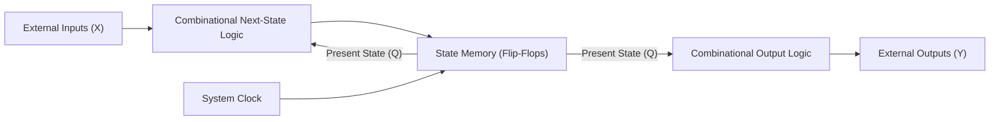
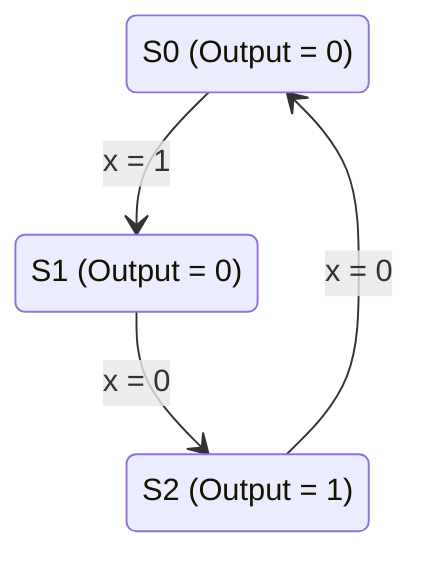
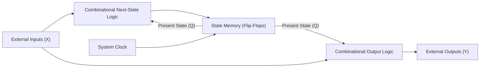
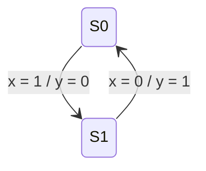
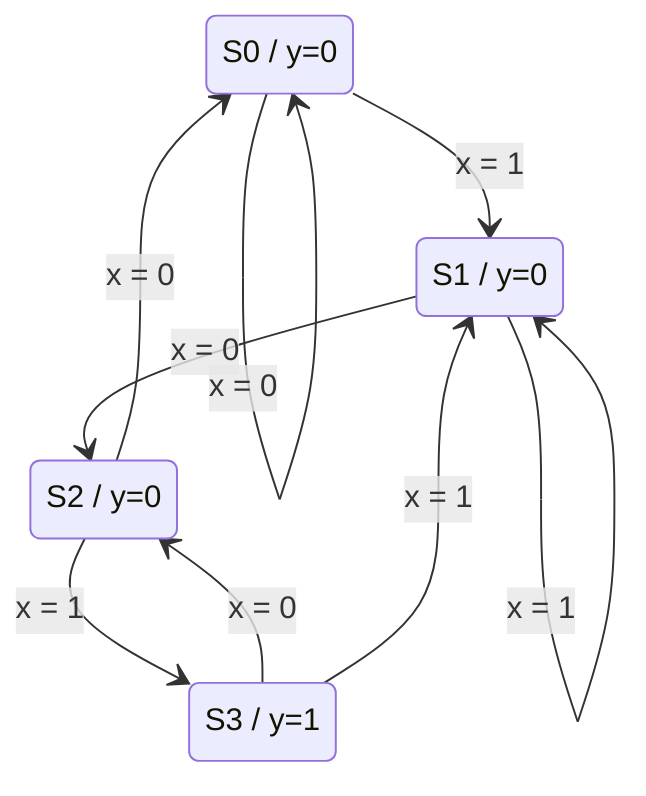
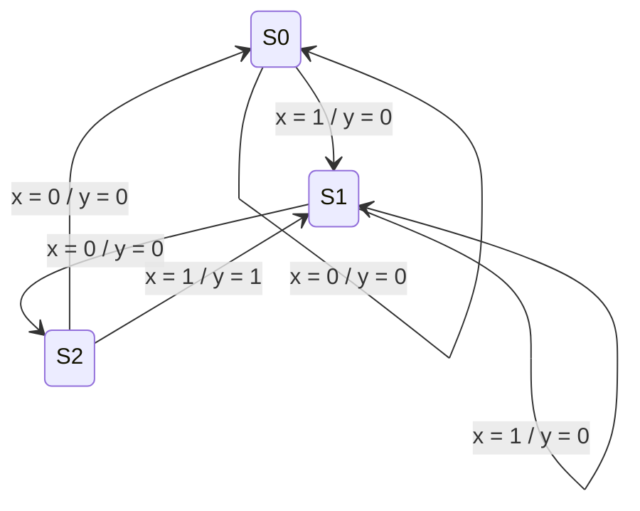

[DLCD Index](../README.md) / [Unit 2: Synchronous Sequential Logic](Introduction.md)

# L04 - Mealy and Moore State Machine Models

Every synchronous sequential circuit is an implementation of a mathematical abstraction known as a **Finite State Machine (FSM)**. A finite state machine processes a stream of inputs over discrete clock cycles, transitions through a predetermined finite set of internal states, and generates outputs.

In 1955 and 1956, two pioneers of digital theory—Edward F. Moore and George H. Mealy—formulated two distinct models for how an FSM generates its outputs. 

The choice between a **Moore Machine** and a **Mealy Machine** is not merely academic; it dictates the speed, state complexity, glitch vulnerability, and timing closure of real-world hardware. Let's analyze both architectures in detail.

---

## The Moore Machine Model

In a **Moore Machine**, the outputs depend **strictly and solely on the present state of the flip-flops**. 

External inputs influence what state the machine transitions to next, but they have zero direct combinational path to the outputs. The inputs must pass through the flip-flops before they can affect what the outside world sees.

### Block Diagram



Notice the architecture:
- Next-State Function: $S(t+1) = f(S(t), X(t))$
- Output Function: $\mathbf{Y(t) = g(S(t))}$

Because the output is purely a function of the internal state, **outputs can only change when the state changes**—which happens strictly on the active clock edge.

### State Diagram Notation for Moore Machines

In a Moore state diagram, because the output is permanently tied to a state, the output value is written **inside the state circle**, right next to the state name (e.g., `State / Output`):



Notice that the transition arrows are labeled *only* with the input condition that causes the transition (e.g., $x = 1$).

---

## The Mealy Machine Model

In a **Mealy Machine**, the outputs depend on **both the present state AND the current external inputs**.

External inputs do not have to wait for a clock edge to affect the output. An input line connects directly into the output combinational logic.

### Block Diagram



Notice the architecture:
- Next-State Function: $S(t+1) = f(S(t), X(t))$
- Output Function: $\mathbf{Y(t) = g(S(t), X(t))}$

Because input $X(t)$ feeds the output logic directly, **any change or electrical noise on the input line instantaneously alters the output**, even in the middle of a clock cycle when the clock is completely idle!

### State Diagram Notation for Mealy Machines

Because the output depends on the input applied to a state, different inputs applied to the *same* state can generate different outputs. Therefore, the output cannot be written inside the state circle.

Outputs are written **on the transition arrows**, formatted as: **$\text{Input} \;/\; \text{Output}$** ($x / y$):



---

## Comparative Case Study: The '101' Sequence Detector

To see the operational differences between Moore and Mealy machines in high contrast, let's design both models to solve the classic digital problem: a **serial sequence detector that detects the pattern `101`** with overlapping sequences allowed.

Suppose incoming data arrives bit-by-bit on line $x$:
- Input stream: `0 1 0 1 0 1 1`
- Detector should output `1` the moment the third bit of `101` completes.

---

### Moore Machine Implementation

In a Moore machine, since the output is bound to the state, we cannot assert output `1` until the circuit has successfully clocked into a dedicated "Pattern Detected" state.

Let's define the required states:
1. **$S_0$ (Idle / Reset)**: No relevant bits seen. (Output = 0)
2. **$S_1$ (Got '1')**: Last bit was `1`. (Output = 0)
3. **$S_2$ (Got '10')**: Last two bits were `10`. (Output = 0)
4. **$S_3$ (Got '101' - Success!)**: Sequence detected. (Output = 1)



Let's trace from $S_2$ (we have already seen `10`):
- If $x = 1$ arrives: we have now seen `101`. On the next clock edge, the machine steps into **$S_3$**, and the output switches to **$y = 1$**.
- Because overlapping sequences are allowed, the final `1` of `101` can serve as the first `1` of a subsequent `101` sequence. So from $S_3$:
  - If next bit is $x = 0$, we transition to $S_2$ (we now have `10`).
  - If next bit is $x = 1$, we transition to $S_1$ (we have `11`).

Notice: The Moore detector requires **4 states**.

---

### Mealy Machine Implementation

Now let's build the exact same sequence detector using a Mealy machine.

In a Mealy machine, when the circuit is in state $S_2$ (having seen `10`), and the input pin $x$ goes high to `1`, the output logic sees *both* Present State = $S_2$ and Input = $1$. 

The circuit can assert **$y = 1$ immediately on that transition**, without needing a dedicated 4th state!

Let's define the states:
1. **$S_0$ (Idle / Reset)**: No bits seen.
2. **$S_1$ (Got '1')**: Last bit was `1`.
3. **$S_2$ (Got '10')**: Last two bits were `10`.



Look at the transition from $S_2$:
- When $x = 1$, the sequence `101` is fulfilled. The transition arrow loops directly back to $S_1$ (since the terminating `1` is the start of the next sequence) while simultaneously asserting **$y = 1$**!

Notice: The Mealy detector requires only **3 states**.

---

## Timing and Waveform Comparison

Let's trace what happens when the bitstream `1 - 0 - 1` enters both circuits:

```
Clock:         ___|‾‾‾|___|‾‾‾|___|‾‾‾|___|‾‾‾|___
Input x:       ___/‾‾‾\___/‾‾‾\___/‾‾‾\___________
Bits:                 1       0       1

Mealy State:      S0  --> S1  --> S2  --> S1
Mealy Output y:   ________________/‾‾‾\___________ (Asserts in Cycle 3!)

Moore State:      S0  --> S1  --> S2  --> S3  --> ...
Moore Output y:   ________________________/‾‾‾\___ (Asserts in Cycle 4!)
```

Notice two critical operational differences:
1. **Latency**: The Mealy machine asserts its output in **Cycle 3**, the exact moment $x=1$ is applied. The Moore machine cannot assert its output until **Cycle 4**, after the active clock edge updates the state register to $S_3$. A Mealy machine responds **one clock cycle faster**.
2. **Pulse Duration**: 
   - In a Moore machine, the output is held stable for the **entire clock cycle** that the machine spends in state $S_3$.
   - In a Mealy machine, if the input $x$ is a short pulse that drops before the clock edge, the output pulse drops with it. The output pulse width is directly tied to the input signal width.

---

## The Asynchronous Glitch Hazard in Mealy Machines

While Mealy machines are faster and use fewer states, they introduce a severe electrical danger: **asynchronous glitching**.

Because the input line $x$ connects directly to the output logic through combinational gates:
- Any electrical noise, ringing, or race condition occurring on line $x$ in the middle of a clock period will immediately appear on output line $y$.
- If $y$ is connected to an asynchronous reset pin or an interrupt line of another chip, an input glitch can trigger an accidental system crash.

In a Moore machine, the output logic is driven exclusively by flip-flop outputs. Since flip-flops only update on the clock edge, the output $y$ is completely immune to any noise or ringing on input $x$ during the rest of the clock cycle.

---

## Architectural Comparison Summary

| Feature | Moore Machine | Mealy Machine |
| :---: | :---: | :---: |
| **Output Dependency** | Present State only ($Y = g(S)$) | Present State AND Inputs ($Y = g(S, X)$) |
| **Diagram Notation** | Output inside state circle (`S / Y`) | Output on transition arc (`X / Y`) |
| **Number of States** | Typically more states ($N+1$ for sequence detection) | Typically fewer states ($N$ for sequence detection) |
| **Output Timing** | Synchronous to clock edge; changes only on state changes | Asynchronous; changes immediately when inputs change |
| **Response Speed** | Slower (1 cycle latency to output) | Faster (0 cycle latency; immediate response) |
| **Noise & Glitch Vulnerability** | Low (immune to input glitches between clock ticks) | High (input noise passes directly to output) |
| **Preferred Usage** | High-speed pipelined CPUs, synchronous bus controllers | Ultra-low-power ASICs where state count must be minimized |

---

## Key Takeaways

- An FSM is categorized as **Moore** or **Mealy** based entirely on how its outputs are generated.
- In a **Moore Machine**, $Y = g(S(t))$. Outputs depend strictly on state, changing only on clock edges. Outputs are drawn inside state circles.
- In a **Mealy Machine**, $Y = g(S(t), X(t))$. Inputs feed directly into the output logic. Outputs are drawn on transition arcs.
- Mealy machines respond one clock cycle earlier than Moore machines and typically require fewer states.
- Moore machines offer superior electrical stability because their outputs are buffered behind flip-flops, isolating downstream logic from input glitches.

---

Regardless of whether we choose a Mealy or Moore architecture, our initial state diagram often contains redundant or duplicate states. In silicon manufacturing, every unnecessary state means extra flip-flops and extra gates. In the next lecture, we master [**State Reduction and State Assignment**](L05%20-%20State%20Reduction%20and%20State%20Assignment.md), using systematic row reduction and implication tables to strip out redundant states before assigning optimal binary codes.
