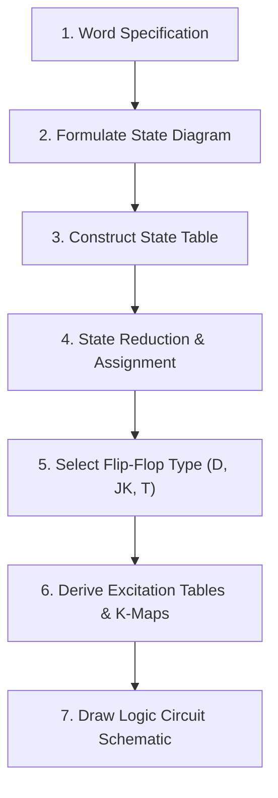
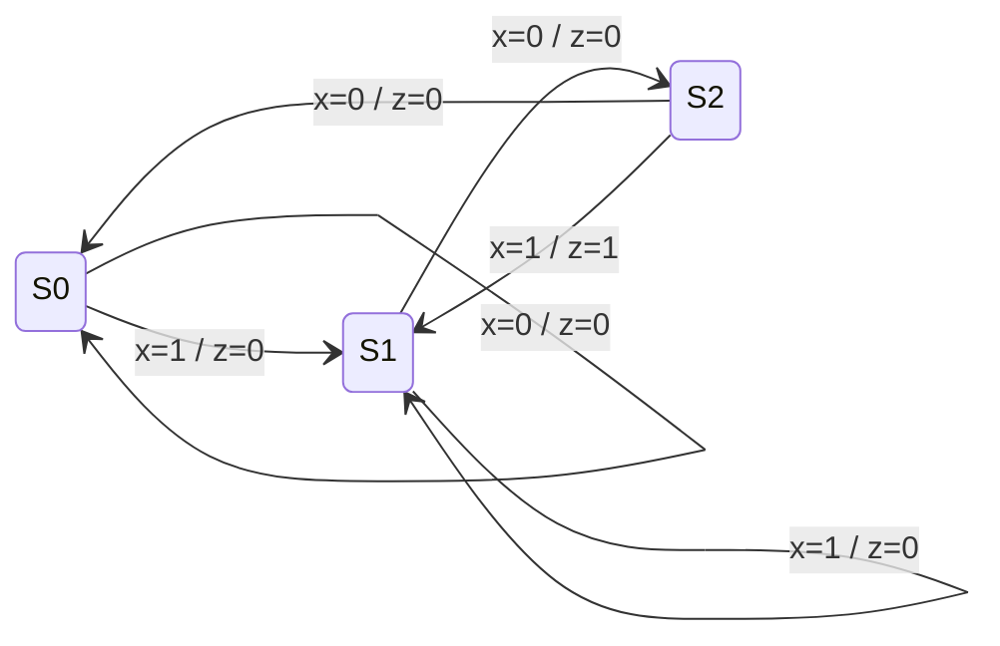
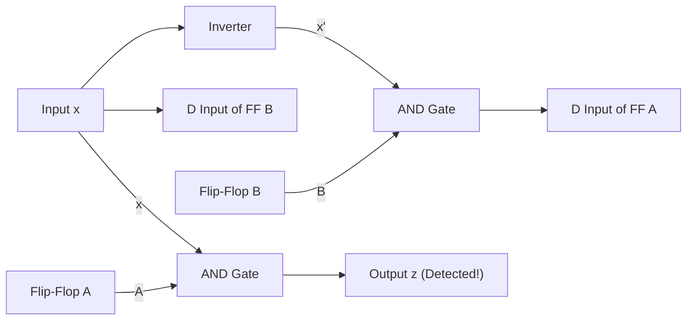

[DLCD Index](../README.md) / [Unit 2: Synchronous Sequential Logic](Introduction.md)

# State Reduction, State Assignment, and Sequential Design

When translating an engineering specification into an initial Finite State Machine, your primary focus is functional correctness: making sure every condition, branch, and sequence is accounted for. As a result, initial state diagrams almost always contain **redundant states**—states that duplicate the exact same input-output behavior.

In digital hardware, states are not free. An $m$-state machine requires at least $n = \lceil \log_2 m \rceil$ flip-flops. If a machine has 5 states, it requires 3 flip-flops (which can support up to 8 states). If we can reduce those 5 states to 4, we save an entire flip-flop and eliminate substantial combinational gating.

Once redundant states are eliminated, we must assign binary bit patterns to the remaining symbolic states, derive the excitation equations for our flip-flops, and synthesize the physical logic gates. This lecture covers that complete synthesis pipeline.

---

## The Principle of State Equivalence

Two states, $S_1$ and $S_2$, in a sequential circuit are said to be **equivalent** if and only if:
> For every possible input sequence applied to the circuit starting from either $S_1$ or $S_2$, the machine generates the **exact same sequence of outputs** and transitions either to the same next state or to equivalent next states.

When two states are equivalent, one of them can be completely removed from the state table without altering the observable input-output behavior of the system. All transitions pointing to the deleted state are simply redirected to the surviving equivalent state.

### The Row-Matching Reduction Algorithm

For completely specified state machines, state reduction is performed directly on the state table by finding rows with identical outputs and equivalent next states:

1. Examine the state table for any two rows with **identical output values** for all input combinations.
2. If those rows also specify **identical or equivalent next states**, the two states are equivalent.
3. Remove one state from the table and replace every occurrence of its symbol in the next-state columns with the surviving state symbol.
4. Repeat this inspection iteratively until no further identical rows can be found.

### Worked Example: Reducing a 7-State Machine

Consider the following 7-state sequential machine with one input $x$ and one output $y$:

| Present State | Next State ($x = 0$) | Next State ($x = 1$) | Output ($x = 0$) | Output ($x = 1$) |
| :---: | :---: | :---: | :---: | :---: |
| $a$ | $a$ | $b$ | $0$ | $0$ |
| $b$ | $c$ | $d$ | $0$ | $0$ |
| $c$ | $a$ | $d$ | $0$ | $0$ |
| $d$ | $e$ | $f$ | $0$ | $1$ |
| $e$ | $a$ | $f$ | $0$ | $1$ |
| $f$ | $g$ | $f$ | $0$ | $1$ |
| $g$ | $a$ | $f$ | $0$ | $1$ |

Let us inspect the rows systematically:
- Look at state $e$ and state $g$:
  - Both produce identical outputs: $y = 0$ when $x=0$, and $y = 1$ when $x=1$.
  - Both transition to state $a$ on $x=0$, and to state $f$ on $x=1$.
  - Therefore, **state $g$ is equivalent to state $e$ ($g \equiv e$)**.
  - We remove row $g$ and replace all occurrences of $g$ in the table with $e$.

Now examine the updated row $f$:
- Row $f$ originally transitioned to $g$ on $x=0$. With $g$ replaced by $e$, row $f$ now transitions to $e$ on $x=0$ and to $f$ on $x=1$, with outputs $0$ and $1$.
- Look at state $d$: it transitions to $e$ on $x=0$ and $f$ on $x=1$, with outputs $0$ and $1$!
- Therefore, **state $f$ is equivalent to state $d$ ($f \equiv d$)**.
- We remove row $f$ and replace all occurrences of $f$ in the table with $d$.

The reduced state table now has only **5 states** instead of 7:

| Present State | Next State ($x = 0$) | Next State ($x = 1$) | Output ($x = 0$) | Output ($x = 1$) |
| :---: | :---: | :---: | :---: | :---: |
| $a$ | $a$ | $b$ | $0$ | $0$ |
| $b$ | $c$ | $d$ | $0$ | $0$ |
| $c$ | $a$ | $d$ | $0$ | $0$ |
| $d$ | $e$ | $d$ | $0$ | $1$ |
| $e$ | $a$ | $d$ | $0$ | $1$ |

We have eliminated 2 full states and simplified the logic without changing a single output bit for any input sequence.

---

## State Assignment (State Encoding)

To build physical hardware, symbolic state names ($a, b, c, d, e$) must be encoded into binary bit patterns. For a machine with $m$ distinct states, the minimum number of flip-flops $n$ required is:

$$2^n \ge m \implies n = \lceil \log_2 m \rceil$$

For our 5-state machine, $2^2 = 4 < 5$, so we require at least **3 flip-flops** ($2^3 = 8 \ge 5$).

Digital designers use three primary state assignment strategies:

| Encoding Method | 5-State Example ($a, b, c, d, e$) | Flip-Flops Required | Characteristics |
| :--- | :--- | :---: | :--- |
| **Binary Encoding** | $000, 001, 010, 011, 100$ | $n = \lceil \log_2 m \rceil$ (3) | Minimum number of flip-flops; standard for compact hardware. |
| **Gray Code Encoding** | $000, 001, 011, 010, 110$ | $n = \lceil \log_2 m \rceil$ (3) | Only one bit changes between adjacent states; minimizes switching noise. |
| **One-Hot Encoding** | $00001, 00010, 00100, 01000, 10000$ | $n = m$ (5) | Exactly one flip-flop is active (`1`) at any time. Eliminates next-state decoders; preferred in FPGAs. |

Substituting the binary encoding ($a=000, b=001, c=010, d=011, e=100$) into our reduced state table converts it into a numerical **Transition Table**, ready for hardware synthesis.

---

## The Sequential Circuit Design Pipeline

The process of taking an informal functional requirement and converting it into physical hardware follows a rigorous 7-stage engineering pipeline:



Let us execute this complete pipeline by designing an industry-standard sequential subsystem: a **Sequence Detector**.

---

## End-to-End Design Example: A '101' Sequence Detector

**Specification**: Design a synchronous sequential circuit with one input $x$ and one output $z$. The circuit inspects the incoming serial bit stream on $x$ and asserts $z = 1$ whenever the sequence `101` occurs, allowing overlapping sequences (e.g., `...10101...` generates two detections).

### Stage 1: Formulate the State Diagram (Mealy Model)
We define the minimum operational states needed to track progress through the string:
- **$S_0$ (Reset / Idle)**: No relevant bits seen.
- **$S_1$ (Got '1')**: The first bit `1` has arrived.
- **$S_2$ (Got '10')**: The sequence `10` has arrived.

Transitions:
- In $S_0$: If $x=0 \to$ stay in $S_0$ ($z=0$). If $x=1 \to$ advance to $S_1$ ($z=0$).
- In $S_1$: If $x=1 \to$ stay in $S_1$ ($z=0$). If $x=0 \to$ advance to $S_2$ ($z=0$).
- In $S_2$: If $x=0 \to$ sequence broken, reset to $S_0$ ($z=0$). If $x=1 \to$ **Match `101`!** Assert $z=1$ and transition to $S_1$ (since the terminating `1` could be the first `1` of the next overlapping `101`).



### Stage 2: State Table and Binary Assignment
Since there are 3 states ($S_0, S_1, S_2$), we require $\lceil \log_2 3 \rceil = 2$ flip-flops ($A$ and $B$).
We assign: $S_0 = 00, S_1 = 01, S_2 = 10$. State $11$ is unused.

| Present State ($A \ B$) | Input ($x$) | Next State ($A \ B$) | Output ($z$) |
| :---: | :---: | :---: | :---: |
| $0 \ 0$ ($S_0$) | $0$ | $0 \ 0$ | $0$ |
| $0 \ 0$ ($S_0$) | $1$ | $0 \ 1$ | $0$ |
| $0 \ 1$ ($S_1$) | $0$ | $1 \ 0$ | $0$ |
| $0 \ 1$ ($S_1$) | $1$ | $0 \ 1$ | $0$ |
| $1 \ 0$ ($S_2$) | $0$ | $0 \ 0$ | $0$ |
| $1 \ 0$ ($S_2$) | $1$ | $0 \ 1$ | $1$ |
| $1 \ 1$ (Unused) | $0$ | X X | X |
| $1 \ 1$ (Unused) | $1$ | X X | X |

---

## Synthesis with D Flip-Flops

For D flip-flops, the excitation rule is direct: $D = Q_{\text{next}}$.
- $D_A = A(t+1)$
- $D_B = B(t+1)$
- $z = \text{Output}$

### K-Map Minimization for $D_A, D_B, z$

```
K-Map for DA (Inputs: A, B, x)
       x=0   x=1
AB=00   0     0
AB=01   1     0
AB=11   X     X
AB=10   0     0

Group the single '1' with Don't Care:
Group: m2 + m6 = A' B x' + A B x' = B x'
DA = B · x'
```

```
K-Map for DB (Inputs: A, B, x)
       x=0   x=1
AB=00   0     1
AB=01   0     1
AB=11   X     X
AB=10   0     1

Column x=1 is all 1s (including Don't Care):
DB = x
```

```
K-Map for Output z (Inputs: A, B, x)
       x=0   x=1
AB=00   0     0
AB=01   0     0
AB=11   X     X
AB=10   0     1

Group m5 with Don't Care m7:
Group: A B' x + A B x = A x
z = A · x
```

### Resulting Hardware Logic
The synthesized D flip-flop circuit requires only two gates:
- Flip-Flop $A$ input: $D_A = B \cdot x'$
- Flip-Flop $B$ input: $D_B = x$
- Circuit output: $z = A \cdot x$



---

## Synthesis with JK Flip-Flops

What if we implement the same detector using JK flip-flops?
Recall the JK excitation rules:
- $0 \to 0 \implies J=0, K=X$
- $0 \to 1 \implies J=1, K=X$
- $1 \to 0 \implies J=X, K=1$
- $1 \to 1 \implies J=X, K=0$

We map the transitions from the state table:

| State ($A \ B$) | $x$ | Next ($A \ B$) | $J_A \ K_A$ | $J_B \ K_B$ |
| :---: | :---: | :---: | :---: | :---: |
| $0 \ 0$ | $0$ | $0 \ 0$ | $0 \ X$ | $0 \ X$ |
| $0 \ 0$ | $1$ | $0 \ 1$ | $0 \ X$ | $1 \ X$ |
| $0 \ 1$ | $0$ | $1 \ 0$ | $1 \ X$ | $X \ 1$ |
| $0 \ 1$ | $1$ | $0 \ 1$ | $0 \ X$ | $X \ 0$ |
| $1 \ 0$ | $0$ | $0 \ 0$ | $X \ 1$ | $0 \ X$ |
| $1 \ 0$ | $1$ | $0 \ 1$ | $X \ 1$ | $1 \ X$ |

Minimizing using K-maps with the abundant Don't Cares:
- $J_A = B x'$
- $K_A = 1$ (Tie input $K_A$ High!)
- $J_B = x$
- $K_B = x'$

JK flip-flops provide tremendous flexibility because the don't-care conditions frequently allow inputs to be tied directly to power rails ($V_{CC}$) or single input lines.

---

## Unused States and Self-Starting Verification

Notice that in our 2-flip-flop design, state $11$ was unused. We treated it as a Don't Care ($X$) to simplify our K-maps.

However, when a circuit powers up, electrical noise can force the flip-flops into state $11$. What happens if the circuit lands in state $11$?

Let us evaluate our D flip-flop equations at state $AB = 11$:
- If $x = 0$:
  - $D_A = B x' = 1 \cdot 1 = 1$
  - $D_B = x = 0$
  - Next state: $AB = 10$ ($S_2$)
- If $x = 1$:
  - $D_A = B x' = 1 \cdot 0 = 0$
  - $D_B = x = 1$
  - Next state: $AB = 01$ ($S_1$)

Notice what happens: from the unused state $11$, the circuit transitions to $S_2$ on $x=0$, and to $S_1$ on $x=1$. **Both transitions lead back into valid states!** 

The circuit is **self-starting**. It will never lock up in an infinite illegal loop. If an unused state ever had transitions leading back to itself ($11 \to 11$), the designer would be forced to redesign the K-maps without Don't Cares to ensure the machine safely returns to $S_0$.

---

## Key Takeaways

- State reduction eliminates redundant equivalent states from an FSM, saving flip-flops and reducing combinational gate complexity.
- Two states are equivalent if for all input combinations they generate identical outputs and transition to identical or equivalent next states.
- An $m$-state machine requires $\lceil \log_2 m \rceil$ flip-flops under binary encoding, while One-Hot encoding uses $m$ flip-flops to simplify decoding logic.
- Sequential circuit synthesis translates word specifications into state diagrams, state tables, excitation mappings, and K-map minimized gate equations.
- D flip-flops minimize design effort because $D = Q_{\text{next}}$; JK and T flip-flops introduce Don't Cares that often reduce external gate count.
- Every sequential design with unused states must be checked for self-starting behavior to prevent permanent lock-up during power glitches.

Now that we understand how individual flip-flops are synthesized into complex state machines, we can scale up these storage cells to build multi-bit data storage and transmission blocks. In the next lecture, we examine registers and shift registers.
