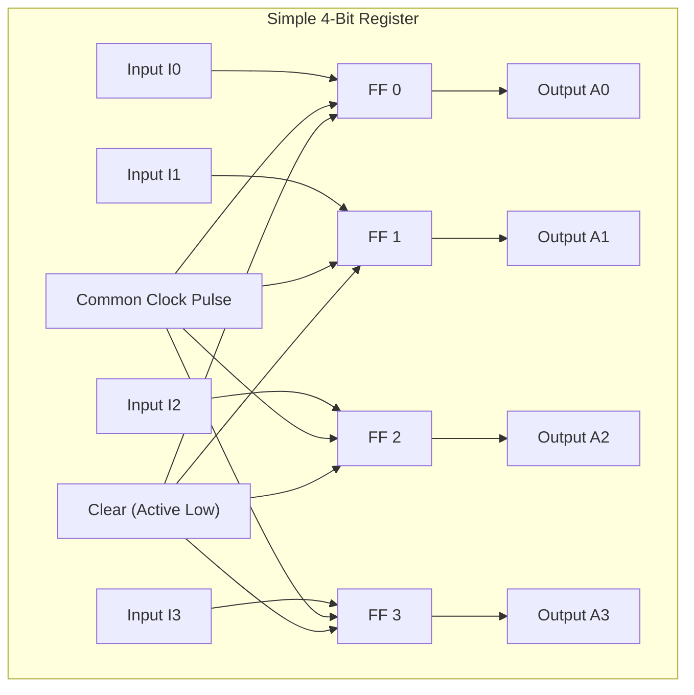
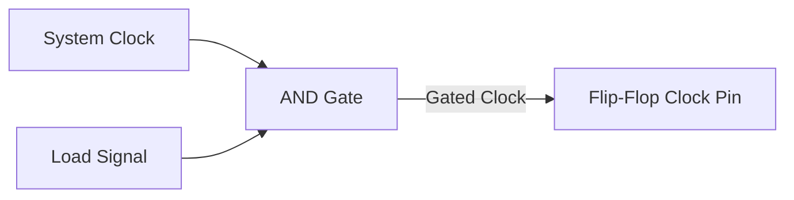
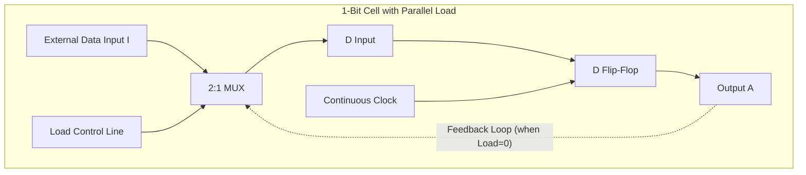
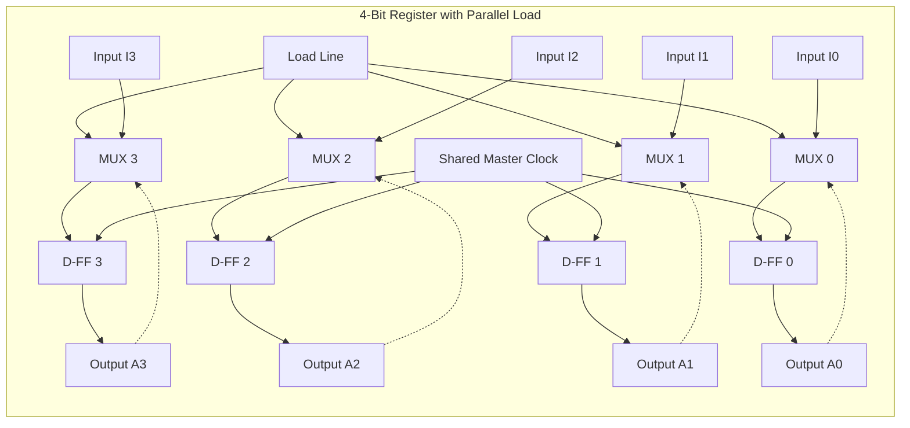
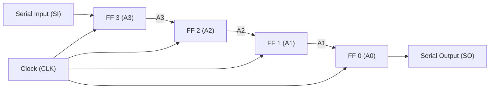
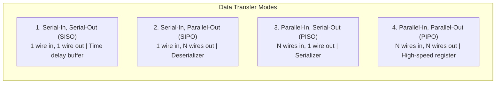
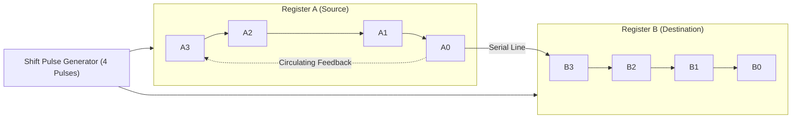
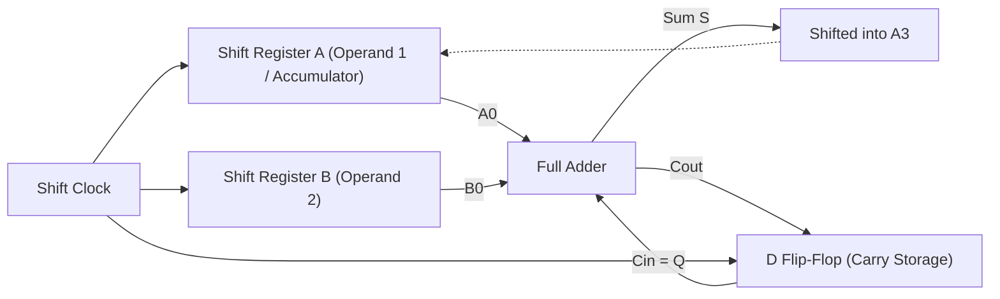

[DLCD Index](../README.md) / [Unit 2: Synchronous Sequential Logic](Introduction.md)

# Registers and Shift Registers

In digital computing, individual flip-flops store a single binary bit ($0$ or $1$). But computers do not manipulate isolated bits; they process multi-bit words—$8$-bit bytes, $16$-bit integers, $32$-bit instructions, or $64$-bit memory addresses.

To store and manipulate these binary words, we group multiple flip-flops together under a shared timing control. Such a collection of flip-flops is called a **Register**. 

When configured with routing logic that shifts stored bits one position to the left or right on every clock cycle, the register becomes a **Shift Register**. Shift registers form the physical backbone of serial communication channels, serial arithmetic units, and data conversion pipelines.

---

## What is a Register?

An $n$-bit register consists of a group of $n$ flip-flops capable of storing $n$ bits of binary information. In its simplest form, a register consists purely of $n$ D-type flip-flops sharing a single common clock line and an asynchronous clear line:

Every time the active clock edge arrives, whatever $4$-bit data sits on inputs $I_3 I_2 I_1 I_0$ is latched simultaneously into flip-flops $A_3 A_2 A_1 A_0$.

However, this basic register has a critical operational flaw: **it must load new data on every single clock cycle**. In a real CPU, a register must hold its data unchanged for dozens of clock cycles until a specific instruction tells it to update.

How do we instruct a register to load new data *only* when requested, and hold its existing contents stable at all other times?

---

## The Danger of Clock Gating

A naive software engineer might suggest: *"Just disconnect the clock! Put an AND gate on the clock line and enable it only when `Load = 1`."*

In digital hardware engineering, **clock gating is strictly forbidden** in data path designs. 

Why? Because passing the system clock through an AND gate introduces **propagation delay**. The gated clock signal arrives at the flip-flop tens or hundreds of picoseconds later than the master clock distributed across the rest of the chip. 

This timing offset is called **clock skew**. When clock skew accumulates across cascaded stages, fast flip-flops can update before slower flip-flops have even seen the clock edge, destroying setup and hold times and corrupting data.

---

## 4-Bit Register with Parallel Load

To control loading safely, we maintain an unbroken, continuous master clock distributed to all flip-flops. Instead of gating the clock, we **control the data path feeding the D input**.

By placing a 2-to-1 multiplexer in front of each flip-flop's $D$ input, controlled by a shared $\text{Load}$ signal:
- When $\text{Load} = 0$: The multiplexer selects the flip-flop's **own output $A$** and loops it back into input $D$. On every clock tick, the flip-flop continuously reloads its existing value. The stored word remains rock stable.
- When $\text{Load} = 1$: The multiplexer selects the **external data input $I$**. On the next clock edge, the register loads the new binary word.

### Complete 4-Bit Parallel Load Architecture

Replicating this cell across four bits ($A_0, A_1, A_2, A_3$) yields the standard 4-bit register with parallel load:

| $\text{Load}$ | Clock ($\text{CLK}$) | Next State ($A_3 A_2 A_1 A_0$) | Operation |
| :---: | :---: | :---: | :--- |
| $0$ | $\uparrow$ | $A_3 A_2 A_1 A_0$ | **Hold (Feedback circulation)** |
| $1$ | $\uparrow$ | $I_3 I_2 I_1 I_0$ | **Parallel Load (Capture inputs)** |

Because all 4 bits are latched simultaneously in a single clock cycle, this is called **Parallel Load**.

---

## Shift Registers: Moving Data Serially

A **Shift Register** is a cascade of flip-flops in which the output of each flip-flop is connected directly to the $D$ input of the adjacent flip-flop to its right:

Every active clock edge shifts the entire bit pattern one position to the right:
$$A_2 \leftarrow A_3, \quad A_1 \leftarrow A_2, \quad A_0 \leftarrow A_1, \quad A_3 \leftarrow \text{Serial Input}$$

Let us trace what happens when we shift an incoming bit stream $1011$ (sent LSB first: $1, 1, 0, 1$) into an initially cleared shift register:

| Clock Cycle | Serial Input ($\text{SI}$) | $A_3$ | $A_2$ | $A_1$ | $A_0$ (Serial Out) |
| :---: | :---: | :---: | :---: | :---: | :---: |
| **Initial State** | — | $0$ | $0$ | $0$ | $0$ |
| **Cycle 1** | $1$ | **$1$** | $0$ | $0$ | $0$ |
| **Cycle 2** | $1$ | **$1$** | **$1$** | $0$ | $0$ |
| **Cycle 3** | $0$ | **$0$** | **$1$** | **$1$** | $0$ |
| **Cycle 4** | $1$ | **$1$** | **$0$** | **$1$** | **$1$** |

After 4 clock cycles, the entire 4-bit word $1011$ resides within the register. 

---

## The Four Operating Modes of Shift Registers

Depending on how data enters and exits the register, shift registers are classified into four fundamental configurations:

1. **Serial-In, Serial-Out (SISO)**: Data enters bit-by-bit and exits bit-by-bit. Primarily used as a hardware delay line (a bit takes $N$ clock cycles to travel through an $N$-bit SISO register).
2. **Serial-In, Parallel-Out (SIPO)**: Data arrives over a single serial transmission wire (like USB, SATA, or Ethernet) and is converted into an $N$-bit parallel word for the processor.
3. **Parallel-In, Serial-Out (PISO)**: The processor loads an $N$-bit word simultaneously, and the shift register transmits it one bit at a time over a single long-distance communication line.
4. **Parallel-In, Parallel-Out (PIPO)**: Complete words are loaded in parallel and read in parallel, providing instantaneous multi-bit staging.

---

## Serial Transfer Between Registers

Consider transferring a 4-bit word stored in Register $A$ into Register $B$ over a single serial line. 

If we simply shift Register $A$ right, its contents will be pushed into Register $B$, but Register $A$ will be overwritten with incoming zeros! To preserve the data in Register $A$, we connect its serial output $A_0$ back into its own serial input:

After exactly 4 clock pulses:
- All 4 bits of Register $A$ have been shifted into Register $B$.
- Because of the circulating feedback loop, Register $A$ has shifted all 4 bits back into their original positions!
- Both registers now hold identical data: $B = A$, and $A$ remains restored.

---

## Serial Addition Using Shift Registers

While modern processors use parallel adders (like Carry Lookahead Adders) for maximum speed, serial addition demonstrates the fundamental tradeoff between hardware cost and execution time.

Instead of needing four Full Adders, a **Serial Adder** requires only **one single Full Adder** and **one D flip-flop**:

### How Serial Addition Operates:
1. In cycle 1, the least significant bits $A_0$ and $B_0$ are fed into the Full Adder along with the initial carry $C_{\text{in}} = 0$ stored in the D flip-flop.
2. The Full Adder computes the sum bit $S_0$ and the carry bit $C_{\text{out}}$.
3. On the clock edge:
   - Sum bit $S_0$ is shifted into the left of Register $A$ ($A_3$).
   - The carry bit $C_{\text{out}}$ is latched into the D flip-flop, becoming $C_{\text{in}}$ for the next cycle.
   - Both registers shift right by one bit.
4. This sequence repeats for 4 clock cycles.
5. At the end of 4 cycles, the complete sum resides inside Register $A$, replacing the original operand.

A serial adder uses minimal silicon (1 Full Adder vs. $N$ Full Adders), but requires $N$ clock cycles to compute a sum that a parallel adder computes in a single clock cycle.

---

## Key Takeaways

- An $n$-bit register is a collection of $n$ flip-flops operating under a common clock to store multi-bit binary words.
- Clock gating introduces dangerous clock skew; registers with parallel load maintain a continuous clock and use input multiplexers to circulate data during hold states.
- Shift registers cascade flip-flops so that bits shift by one position on each clock edge, enabling serial data transmission and delay lines.
- The four operational modes—SISO, SIPO, PISO, and PIPO—form the foundation of serial-to-parallel and parallel-to-serial data converters.
- Serial transfer preserves source data by circulating the serial output back to the serial input.
- Serial arithmetic uses a single Full Adder with a carry flip-flop to compute addition over $N$ clock cycles, trading speed for minimal hardware area.

When shift registers are combined with feedback logic that counts events, they become specialized counters. In the next lecture, we analyze asynchronous ripple counters and their timing characteristics.
