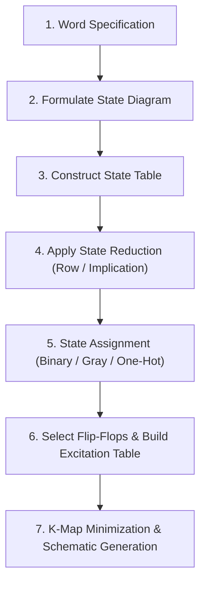
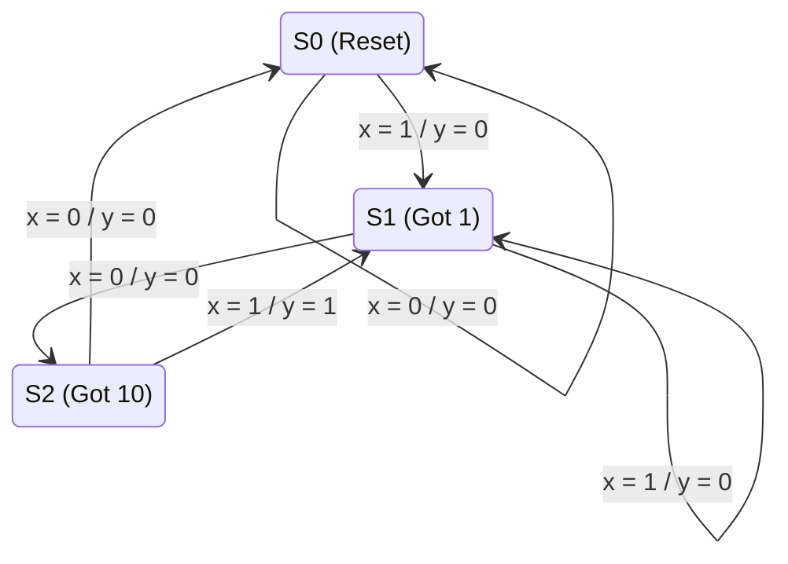
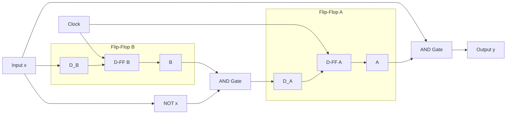

[DLCD Index](../README.md) / [Unit 2: Synchronous Sequential Logic](Introduction.md)

# L06 - Sequential Circuit Design Procedure

Up to this point, we have analyzed existing sequential circuits, classified them into Mealy and Moore models, and optimized their state tables through reduction and assignment algorithms.

Now we bring all these tools together to solve the central challenge of digital engineering: **Sequential Circuit Synthesis**. How do you take a vague, informal English description of a system's desired behavior and systematically convert it into an optimized schematic of flip-flops and logic gates?

In this lecture, we walk through the complete end-to-end design procedure, synthesizing a complex sequential sequence detector using both D and JK flip-flops, and resolving the critical issue of unused state lock-out.

---

## The Sequential Design Pipeline

Sequential circuit design is a rigorous, 7-stage engineering pipeline:



1. **Word Specification**: Understand the exact functional behavior, clocking rules, and reset conditions.
2. **State Diagram**: Translate the human requirements into states, directed transitions, and output conditions.
3. **State Table**: Tabulate Present States, Inputs, Next States, and Outputs.
4. **State Reduction**: Eliminate redundant states using row elimination or implication tables.
5. **State Assignment**: Map symbolic states ($S_0, S_1, \dots$) to binary bit strings.
6. **Excitation Table**: Using the excitation rules of the chosen flip-flop type (D, JK, or T), determine the required input values for every state transition.
7. **K-Map Minimization**: Simplify the logic equations driving each flip-flop input and external output, then draw the schematic.

---

## End-to-End Design Example: The '101' Sequence Detector

Let's design a synchronous sequential circuit from scratch:
- **Specification**: The circuit has one serial binary input $x$ and one output $y$. It monitors the bitstream on $x$ and asserts $y = 1$ whenever the sequence `101` is detected. Overlapping sequences are permitted (e.g., input `10101` should produce two detection pulses).
- **Architecture**: We will choose a **Mealy Machine** to minimize state count and eliminate output latency.

---

### Step 1: Formulate the State Diagram

Let's identify the historical states the machine must track:
- **$S_0$**: Reset / Initial state. No relevant sequence bits seen.
- **$S_1$**: The circuit has received a `1`.
- **$S_2$**: The circuit has received `10`.

Let's trace the transitions:
- From $S_0$: If $x = 0$, stay in $S_0$ with $y = 0$. If $x = 1$, advance to $S_1$ with $y = 0$.
- From $S_1$: If $x = 1$, stay in $S_1$ with $y = 0$ (a second `1` could be the start of `101`). If $x = 0$, advance to $S_2$ with $y = 0$.
- From $S_2$: We have `10`. 
  - If $x = 0$: The sequence is broken (`100`). Reset to $S_0$ with $y = 0$.
  - If $x = 1$: The sequence `101` is complete! Assert **$y = 1$**. Because this final `1` can serve as the first bit of the next `101` sequence, transition to **$S_1$**!



---

### Step 2 & 3: Construct the State Table & Verify Reduction

| Present State | Next State ($x = 0$) | Next State ($x = 1$) | Output $y$ ($x = 0$) | Output $y$ ($x = 1$) |
| :---: | :---: | :---: | :---: | :---: |
| **$S_0$** | $S_0$ | $S_1$ | 0 | 0 |
| **$S_1$** | $S_2$ | $S_1$ | 0 | 0 |
| **$S_2$** | $S_0$ | $S_1$ | 0 | 1 |

Inspecting the rows:
- $S_2$ is distinct from $S_0$ and $S_1$ because its output is `1` when $x = 1$.
- $S_0$ transitions to $(S_0, S_1)$ while $S_1$ transitions to $(S_2, S_1)$. Their next states differ.
- Therefore, all 3 states are non-equivalent. The table is already in **minimal form**.

---

### Step 4: State Assignment

With 3 states, we require $n = \lceil \log_2 3 \rceil = \mathbf{2\text{ flip-flops}}$ ($A$ and $B$).
Two flip-flops provide $2^2 = 4$ possible states (`00`, `01`, `10`, `11`).

Let's make the assignment:
- $S_0 \to \mathbf{00}$
- $S_1 \to \mathbf{01}$
- $S_2 \to \mathbf{10}$
- State **$11$ is unused** (an unassigned Don't Care condition).

Substituting binary codes into our state table:

| Present State ($AB$) | Input ($x$) | Next State ($A(t+1)\;B(t+1)$) | Output ($y$) |
| :---: | :---: | :---: | :---: |
| **00** | 0 | 0 0 | 0 |
| **00** | 1 | 0 1 | 0 |
| **01** | 0 | 1 0 | 0 |
| **01** | 1 | 0 1 | 0 |
| **10** | 0 | 0 0 | 0 |
| **10** | 1 | 0 1 | 1 |
| **11** | 0 | X X | X |
| **11** | 1 | X X | X |

---

## Implementation Option A: Synthesis with D Flip-Flops

In modern ASIC and FPGA design, the **D Flip-Flop** is the universal standard. Its excitation rule is trivial:
$$D_A = A(t+1)$$
$$D_B = B(t+1)$$

Let's extract the columns for $D_A$, $D_B$, and $y$:

| $A$ | $B$ | $x$ | $D_A$ | $D_B$ | $y$ |
| :---: | :---: | :---: | :---: | :---: | :---: |
| 0 | 0 | 0 | 0 | 0 | 0 |
| 0 | 0 | 1 | 0 | 1 | 0 |
| 0 | 1 | 0 | 1 | 0 | 0 |
| 0 | 1 | 1 | 0 | 1 | 0 |
| 1 | 0 | 0 | 0 | 0 | 0 |
| 1 | 0 | 1 | 0 | 1 | 1 |
| 1 | 1 | 0 | X | X | X |
| 1 | 1 | 1 | X | X | X |

---

### K-Map Minimization for D Flip-Flops

Let's plot each function on a 3-variable K-map with variables $A, B$ on the rows and $x$ on the columns:

#### 1. Input Equation for $D_A$:
```
       x
A B    0   1
0 0    0   0
0 1    1   0   <- minterm 2 (A' B x')
1 1    X   X   <- row 11 is Don't Care
1 0    0   0
```
Cell $(01, 0)$ is `1`. We can group it with the Don't Care at cell $(11, 0)$!
Grouping cells $(01, 0)$ and $(11, 0)$ eliminates $A$:
$$\mathbf{D_A = B\,\overline{x}}$$

#### 2. Input Equation for $D_B$:
```
       x
A B    0   1
0 0    0   1   <- minterm 1
0 1    0   1   <- minterm 3
1 1    X   X   <- Don't Cares
1 0    0   1   <- minterm 5
```
Look at column $x = 1$: every single row is either `1` or `X`!
We group the entire column of four cells:
$$\mathbf{D_B = x}$$

Notice how clean that is: the input to flip-flop $B$ requires zero logic gates. Wire $x$ connects directly to pin $D_B$!

#### 3. Output Equation for $y$:
```
       x
A B    0   1
0 0    0   0
0 1    0   0
1 1    X   X   <- Don't Cares
1 0    0   1   <- minterm 5 (A B' x)
```
Cell $(10, 1)$ is `1`. We can group it with Don't Care cell $(11, 1)$, eliminating $B$:
$$\mathbf{y = A\,x}$$

---

### Logic Schematic with D Flip-Flops



Total hardware cost: **Two D flip-flops, two 2-input AND gates, and one inverter**.

---

## Implementation Option B: Synthesis with JK Flip-Flops

Now let's synthesize the exact same detector using **JK flip-flops** to observe how JK excitation Don't Cares simplify gate design.

Recall the JK Excitation Table:
- $0 \to 0 \implies J = 0, K = X$
- $0 \to 1 \implies J = 1, K = X$
- $1 \to 0 \implies J = X, K = 1$
- $1 \to 1 \implies J = X, K = 0$

Let's determine $J_A, K_A, J_B, K_B$ for every transition:

| $A$ | $B$ | $x$ | $A(t+1)$ | $B(t+1)$ | $J_A$ | $K_A$ | $J_B$ | $K_B$ |
| :---: | :---: | :---: | :---: | :---: | :---: | :---: | :---: | :---: |
| 0 | 0 | 0 | 0 | 0 | **0** | **X** | **0** | **X** |
| 0 | 0 | 1 | 0 | 1 | **0** | **X** | **1** | **X** |
| 0 | 1 | 0 | 1 | 0 | **1** | **X** | **X** | **1** |
| 0 | 1 | 1 | 0 | 1 | **0** | **X** | **X** | **0** |
| 1 | 0 | 0 | 0 | 0 | **X** | **1** | **0** | **X** |
| 1 | 0 | 1 | 0 | 1 | **X** | **1** | **1** | **X** |
| 1 | 1 | 0 | X | X | **X** | **X** | **X** | **X** |
| 1 | 1 | 1 | X | X | **X** | **X** | **X** | **X** |

---

### K-Map Minimization for JK Inputs

Let's minimize each JK input equation:

1. **$J_A$**:
   - Cell $(01, 0) = 1$. Row 10 has Xs on $J_A$, row 11 has Xs.
   - Grouping cell $(01, 0)$ with cell $(11, 0)$ gives:
     $$\mathbf{J_A = B\,\overline{x}}$$

2. **$K_A$**:
   - Rows 10 and 11 are filled entirely with 1s and Xs!
   - Grouping the entire bottom half of the map gives:
     $$\mathbf{K_A = 1}$$
   - Pin $K_A$ is tied directly to $V_{\text{CC}}$!

3. **$J_B$**:
   - Column $x = 1$ has 1s at rows 00 and 10, with Xs at 01 and 11.
   - Grouping the entire column gives:
     $$\mathbf{J_B = x}$$

4. **$K_B$**:
   - Cell $(01, 0) = 1$. Rows 00, 10, and 11 have Xs.
   - Grouping cells where $x = 0$ gives:
     $$\mathbf{K_B = \overline{x}}$$

Notice how elegant the JK implementation is:
- $J_A = B\overline{x}, \quad K_A = 1$
- $J_B = x, \quad K_B = \overline{x}$
- $y = A x$

---

## The Danger of Unused States: Self-Starting Verification

In our design, we had 3 valid states ($S_0, S_1, S_2$), but 2 flip-flops create 4 possible states. State **$11$** is unused.

When we synthesized the K-maps, we treated row $11$ as **Don't Cares ($X$)** to simplify the equations. 

Now ask yourself a critical safety question:
> **What happens if a noise spike, static discharge, or power-on transient accidentally drops the flip-flops into state $11$?**

If state $11$ transitions back into a valid state ($S_0, S_1, \text{ or } S_2$), the circuit will self-recover within one clock tick. This is a **Self-Starting Circuit**.

However, if state $11$ loops back to $11$ forever, the circuit is permanently frozen in a **lockout loop**, requiring a hard power cycle to recover!

Let's test our D flip-flop equations for state $AB = 11$:
- $D_A = B\overline{x} = 1 \cdot \overline{x} = \overline{x}$
- $D_B = x$

Let's evaluate the next state from $11$:
- If $x = 0$: $D_A = 1, D_B = 0 \implies \text{Next State } = \mathbf{10}$ (State $S_2$, a valid state!).
- If $x = 1$: $D_A = 0, D_B = 1 \implies \text{Next State } = \mathbf{01}$ (State $S_1$, a valid state!).

Under *both* input conditions, the unused state immediately transitions back into the normal operating cycle within one clock cycle! The circuit is provably **self-starting and lockout-free**.

---

## Key Takeaways

- Sequential synthesis proceeds methodically: **Specification $\to$ State Diagram $\to$ State Table $\to$ State Reduction $\to$ State Assignment $\to$ Excitation Table $\to$ K-Map Minimization $\to$ Logic Schematic**.
- For D flip-flops, $D_i = Q_i(t+1)$, making algebraic derivation fast and standard in CAD tools.
- For JK flip-flops, transitions produce extensive Don't Cares ($X$), often yielding fewer external logic gates than D flip-flop implementations.
- Whenever $2^n > m$ (unused states exist), treating unused states as Don't Cares simplifies logic, but requires a **self-starting verification** to ensure the machine cannot become trapped in an unrecoverable lockout loop.

---

Now that we know how to design custom sequential state controllers, let's explore the standardized medium-scale sequential building blocks found inside every computer processor. In the next lecture, we examine [**Registers and Shift Registers**](L07%20-%20Registers%20and%20Shift%20Registers.md), investigating parallel load registers and universal multi-mode data shifters.
