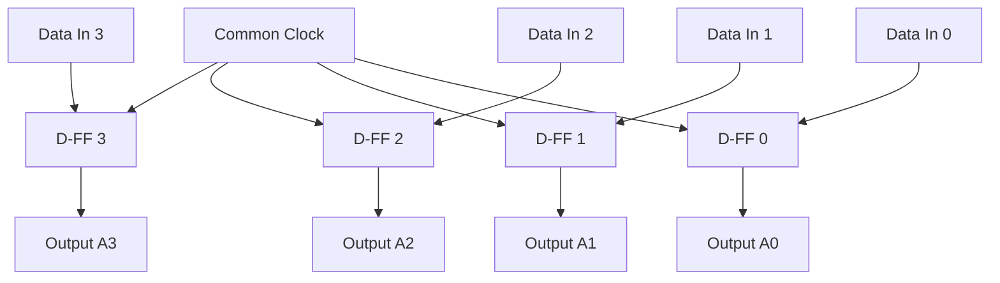
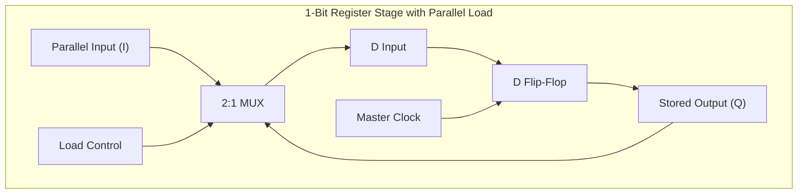
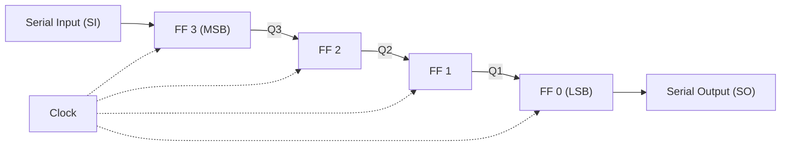
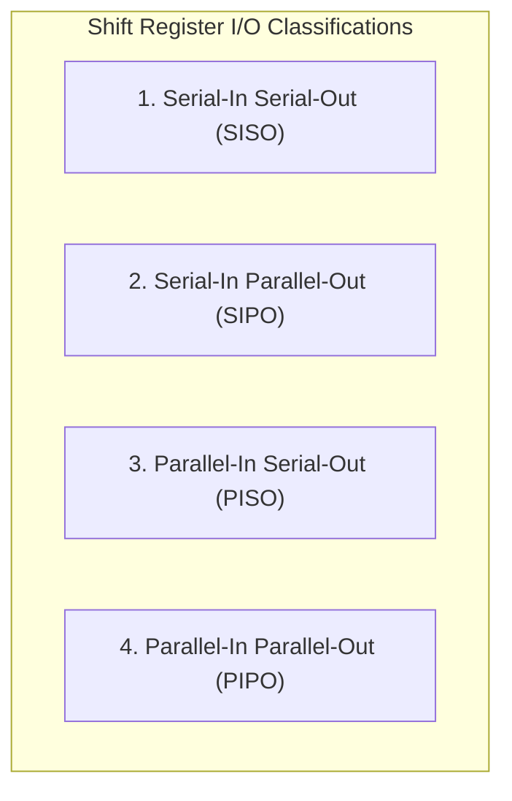
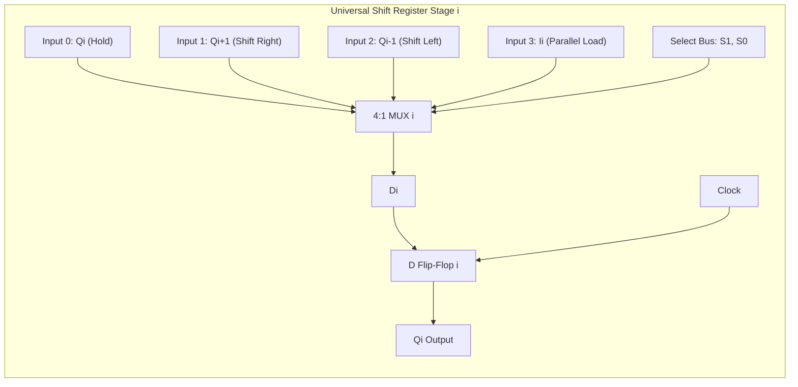

[DLCD Index](../README.md) / [Unit 2: Synchronous Sequential Logic](Introduction.md)

# L07 - Registers and Shift Registers

In digital computing, a single flip-flop stores exactly one binary digit. But computers do not manipulate individual bits in isolation. They manipulate words: 8-bit bytes, 32-bit integers, 64-bit memory pointers, and 128-bit vector instructions.

To hold and manipulate multi-bit words as unified entities, digital designers group multiple flip-flops together under a shared control network. 

Such a circuit is called a **Register**. In this lecture, we examine multi-bit storage registers, solve the clock gating problem using parallel load multiplexers, and analyze the architecture of the **Universal Shift Register**.

---

## What is a Register?

A **Register** is a sequential circuit consisting of a group of $n$ flip-flops that share a common clock signal. An $n$-bit register can store any one of $2^n$ distinct binary states.

In its most rudimentary form, a 4-bit register is simply four D flip-flops with their clock pins wired together in parallel:

Now think about the fatal flaw in this simple circuit:
The clock signal in a computer runs continuously at millions or billions of cycles per second. On **every single rising clock edge**, this register will overwrite its stored contents with whatever electrical voltages are present on lines $I_3..I_0$.

In a real CPU, a register must hold its data indefinitely until the instruction explicitly commands: *"Load new data now!"*

How do we implement a **Load Control** signal?

---

## The Danger of Clock Gating

A naive student often proposes placing an AND gate on the clock line:
$$\text{Clock\_to\_FF} = \text{Clock} \cdot \text{Load}$$

When $\text{Load} = 0$, no clock pulses reach the flip-flops, so the data is preserved. When $\text{Load} = 1$, the clock passes through.

**Never do this in discrete synchronous digital design.** 

Placing logic gates on a clock distribution path is called **Clock Gating**. It introduces two severe physical problems:
1. **Clock Skew**: The propagation delay of the AND gate delays the clock edge reaching this register relative to the rest of the CPU. When registers clocked on different phases exchange data, setup and hold times are violated.
2. **Clock Glitches**: If the $\text{Load}$ control line changes while the system clock is high, the AND gate output will produce a fractional, runt pulse that can corrupt the flip-flop contents.

All flip-flops in a synchronous system should be connected directly to the **uncompromised master clock line**. Control must be exercised through the **data inputs**.

---

## 4-Bit Register with Parallel Load

The correct engineering solution is to place a **2-to-1 Multiplexer** in front of each flip-flop's $D$ input, controlled by a shared **$\text{Load}$** line:

Let's trace how the 2:1 multiplexer operates:
- **When $\text{Load} = 0$ (Hold / No Change)**:
  The multiplexer selects input 0, which is fed by the flip-flop's own output $Q$:
  $$D_i = Q_i$$
  On every rising clock edge, the flip-flop simply re-samples its current value and writes it back into itself. The stored data remains frozen.
- **When $\text{Load} = 1$ (Load New Data)**:
  The multiplexer selects input 1, which connects to the external data bus line $I_i$:
  $$D_i = I_i$$
  On the next rising clock edge, all 4 bits of the new binary word are loaded into the register simultaneously.

Using 2-input AND and OR gates, the Boolean equation for each stage is:
$$\mathbf{D_i = Q_i \cdot \overline{\text{Load}} + I_i \cdot \text{Load}}$$

The master clock runs continuously and cleanly, while the register updates strictly under program control.

---

## Shift Registers: Moving Data Serially

A **Shift Register** is a register designed to move its stored bits one position to the left or right on each active clock edge.

To construct a basic 4-bit right-shift register, we cascade four D flip-flops in a chain, connecting the output $Q$ of each stage directly to the data input $D$ of the subsequent stage:

On each clock pulse:
- A new bit from the external line enters FF 3 ($Q_3 \leftarrow \text{SI}$).
- Bit $Q_3$ moves into FF 2 ($Q_2 \leftarrow Q_3$).
- Bit $Q_2$ moves into FF 1 ($Q_1 \leftarrow Q_2$).
- Bit $Q_1$ moves into FF 0 ($Q_0 \leftarrow Q_1$).
- The previous bit in FF 0 exits the register as the serial output bit.

---

## The Four Operating Modes of Shift Registers

Shift registers are classified by how data enters and exits the circuit:

### 1. Serial-In Serial-Out (SISO)
- Data enters one bit per clock cycle through a single input wire, and leaves one bit per clock cycle through a single output wire.
- **Latency**: To transfer an $n$-bit word requires $n$ clock cycles to load and $n$ cycles to read.
- **Advantage**: Minimum pin count (only 1 data pin required). Ideal for digital delay lines.

### 2. Serial-In Parallel-Out (SIPO)
- Data enters serially over $n$ clock cycles. Once all bits are inside, all $n$ flip-flop outputs ($Q_{n-1}..Q_0$) are read out simultaneously in parallel.
- **Application**: The receiver block of a serial communication interface (e.g., UART, SPI, USB). It captures a stream of serial pulses arriving over a wire and reassembles them into a parallel byte for the CPU bus.

### 3. Parallel-In Serial-Out (PISO)
- Data is loaded into all $n$ flip-flops simultaneously in a single clock cycle using parallel load logic. Then, the bits are shifted out one-by-one over $n$ clock cycles.
- **Application**: The transmitter block of a serial communication interface. It takes an 8-bit parallel byte from the CPU and serializes it to be transmitted across a single copper wire or fiber optic cable.

### 4. Parallel-In Parallel-Out (PIPO)
- Data is loaded in parallel in 1 clock cycle and read in parallel continuously.
- **Application**: Standard CPU general-purpose registers (e.g., `RAX`, `RBX` in x86 or `R0`–`R15` in ARM).

---

## The 4-Bit Universal Shift Register

Why manufacture separate SISO, SIPO, PISO, and bidirectional shift registers when you can integrate all modes into a single chip?

A **Universal Shift Register** (such as the standard **TTL 74194**) is a versatile MSI component capable of performing all four operations under the control of a 2-bit mode selection bus ($S_1 S_0$):

| $S_1$ | $S_0$ | Operation Mode | Description |
| :---: | :---: | :---: | :---: |
| 0 | 0 | **No Change (Hold)** | Register retains current data indefinitely |
| 0 | 1 | **Shift Right** | Bits move toward LSB ($Q_3 \to Q_2 \to Q_1 \to Q_0$) |
| 1 | 0 | **Shift Left** | Bits move toward MSB ($Q_0 \to Q_1 \to Q_2 \to Q_3$) |
| 1 | 1 | **Parallel Load** | All 4 external input bits ($I_3..I_0$) loaded simultaneously |

---

### Internal Architecture

To provide four distinct operating modes, the input to every D flip-flop is fed by a **4-to-1 Multiplexer**. 

The selection lines $S_1$ and $S_0$ are connected in parallel to all four multiplexers:

Let's examine how each of the 4 inputs of MUX $i$ is wired:

1. **Input 0 ($S_1 S_0 = 00$ - Hold)**:
   Connected to the flip-flop's own output $Q_i$. The bit is continually recirculated.
2. **Input 1 ($S_1 S_0 = 01$ - Shift Right)**:
   Connected to the output of its left neighbor: $Q_{i+1}$. 
   *(For the most significant stage, MUX 3, Input 1 is connected to an external pin called **Serial Input for Shift-Right ($MSI$)**).*
3. **Input 2 ($S_1 S_0 = 10$ - Shift Left)**:
   Connected to the output of its right neighbor: $Q_{i-1}$. 
   *(For the least significant stage, MUX 0, Input 2 is connected to an external pin called **Serial Input for Shift-Left ($LSI$)**).*
4. **Input 3 ($S_1 S_0 = 11$ - Parallel Load)**:
   Connected to the external parallel data input pin $I_i$.

---

## Arithmetic Applications of Shift Registers

Beyond data buffering and serial communication, shift registers serve as ultra-fast mathematical multipliers and dividers:

- **Logical Shift Left**: Shifting a binary word one position to the left (inserting a `0` at the LSB) multiplies the number by **$2$**:
  $$0000101_2 \; (5_{10}) \ll 1 \implies 0001010_2 \; (10_{10})$$
- **Logical Shift Right**: Shifting an unsigned binary word one position to the right (inserting a `0` at the MSB) performs an integer division by **$2$**:
  $$0001010_2 \; (10_{10}) \gg 1 \implies 0000101_2 \; (5_{10})$$

In high-performance ALUs, multi-bit shifters called **Barrel Shifters** use multiplexer arrays to shift a word by an arbitrary number of bits ($k$) in a single clock cycle, executing multiplication and division by $2^k$ at gigahertz speeds.

---

## Key Takeaways

- A **Register** is a group of flip-flops driven by a common clock that stores a multi-bit binary word.
- Never use **clock gating** to control register loading; gate propagation delays cause clock skew and race hazards. Always control loading via **multiplexers on the data inputs**.
- A register with parallel load uses 2:1 multiplexers to either recirculate stored data ($D_i = Q_i$) when $\text{Load} = 0$, or load new bus data ($D_i = I_i$) when $\text{Load} = 1$.
- **Shift Registers** move bits laterally across cascaded flip-flops on each clock edge. They operate in four configurations: SISO, SIPO, PISO, and PIPO.
- A **Universal Shift Register** uses 4:1 multiplexers to support four operational modes: Hold ($00$), Shift-Right ($01$), Shift-Left ($10$), and Parallel Load ($11$).
- Shifting binary data left or right by one position corresponds mathematically to multiplication or division by $2$.

---

Registers store and shift arbitrary data. But what if we want a circuit that autonomously transitions through a fixed numerical sequence on every clock pulse? In the next lecture, we investigate [**Ripple Counters**](L08%20-%20Ripple%20Counters.md), examining asynchronous binary up/down counters and the accumulation of propagation delay.
