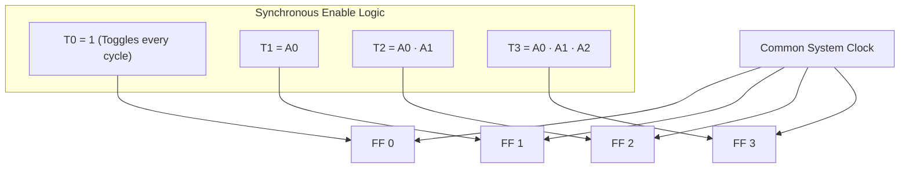
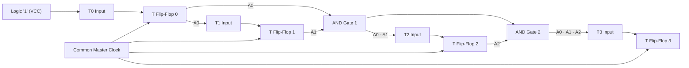

[DLCD Index](../README.md) / [Unit 2: Synchronous Sequential Logic](Introduction.md)

# Synchronous Counters

In asynchronous ripple counters, each flip-flop is triggered by the output of the preceding stage. While that architecture requires minimal wiring, the cumulative ripple delay ($n \cdot t_{pd}$) severely limits its maximum operating frequency and generates transient decoding glitches.

To break past these speed and noise bottlenecks, high-performance computing systems rely on **Synchronous Counters**. 

In a synchronous counter, **every single flip-flop shares the exact same master clock line**. All flip-flops receive the clock edge simultaneously and transition in unison, reducing the total delay of the entire counter to that of a single flip-flop.

---

## The Synchronous Counter Principle

How can all flip-flops share the same clock if some bits must toggle on every cycle while others toggle only once every eight cycles?

In a synchronous counter:
1. The clock terminals of all flip-flops are tied directly to the common system clock.
2. The decision of *whether* a given flip-flop toggles on the next clock tick is determined by **combinational steering logic** feeding its $T$ or $J\text{-}K$ inputs.

---

## 4-Bit Binary Synchronous Up-Counter

Let us deduce the toggle logic by observing the 4-bit binary counting sequence:

| Clock Cycle | $A_3$ | $A_2$ | $A_1$ | $A_0$ | Observations |
| :---: | :---: | :---: | :---: | :---: | :--- |
| **0** | 0 | 0 | 0 | **0** | $A_0$ must toggle on every single active clock edge. |
| **1** | 0 | 0 | 0 | **1** | $A_1$ toggles when $A_0 = 1$. |
| **2** | 0 | 0 | **1** | 0 | $A_0$ toggles again; $A_1$ holds. |
| **3** | 0 | 0 | **1** | **1** | $A_2$ toggles only when **both $A_1 = 1$ and $A_0 = 1$** ($0011 \to 0100$). |
| **4** | 0 | **1** | 0 | 0 | |
| ... | | | | | |
| **7** | 0 | **1** | **1** | **1** | $A_3$ toggles only when **all lower bits are 1** ($A_2 = A_1 = A_0 = 1$). |
| **8** | **1** | 0 | 0 | 0 | |

From this counting pattern, we establish the fundamental rule of binary synchronous counting:
> **A given flip-flop toggles on the active clock edge if and only if all preceding, lower-order flip-flops currently hold a logical `1`.**

### Derivation of Input Equations
Using T flip-flops, the input equations are derived directly:
- **Bit 0 ($A_0$)**: Toggles every clock pulse $\implies \mathbf{T_0 = 1}$.
- **Bit 1 ($A_1$)**: Toggles when $A_0 = 1 \implies \mathbf{T_1 = A_0}$.
- **Bit 2 ($A_2$)**: Toggles when $A_0 = 1$ and $A_1 = 1 \implies \mathbf{T_2 = A_0 \cdot A_1}$.
- **Bit 3 ($A_3$)**: Toggles when $A_0 = A_1 = A_2 = 1 \implies \mathbf{T_3 = A_0 \cdot A_1 \cdot A_2}$.

### Hardware Circuit Schematic

Notice that each stage can simply AND the previous stage's enable signal with the current flip-flop's output:
- $T_2 = T_1 \cdot A_1$
- $T_3 = T_2 \cdot A_2$

When the clock edge arrives:
- Every flip-flop whose $T$ input is $1$ toggles simultaneously.
- Every flip-flop whose $T$ input is $0$ holds its state.
- There is zero cascading delay across clock inputs!

---

## Design of Arbitrary Non-Binary Sequence Counters

Standard binary counters follow a rigid $0, 1, 2, \dots, 2^n-1$ sequence. But practical systems often require counters that step through non-sequential or arbitrary state patterns (such as stepping motor drivers or state sequencers).

Such circuits are designed by treating the counter as a specialized finite state machine with no external inputs (except the clock).

### Step-by-Step Synthesis: Modulo-6 Arbitrary Counter

Let us design a synchronous counter that cycles through the following 6 states using **JK Flip-Flops**:
$$000 \to 001 \to 010 \to 100 \to 101 \to 110 \to 000$$

States $011$ and $111$ are **unused**.

### 1. State Transition and Excitation Table
Using the JK excitation rules:
- $0 \to 0 \implies J=0, K=X$
- $0 \to 1 \implies J=1, K=X$
- $1 \to 0 \implies J=X, K=1$
- $1 \to 1 \implies J=X, K=0$

| Present State ($A_2 A_1 A_0$) | Next State ($A_2^+ A_1^+ A_0^+$) | $J_2 \ K_2$ | $J_1 \ K_1$ | $J_0 \ K_0$ |
| :---: | :---: | :---: | :---: | :---: |
| $0 \ 0 \ 0$ | $0 \ 0 \ 1$ | $0 \ X$ | $0 \ X$ | $1 \ X$ |
| $0 \ 0 \ 1$ | $0 \ 1 \ 0$ | $0 \ X$ | $1 \ X$ | $X \ 1$ |
| $0 \ 1 \ 0$ | $1 \ 0 \ 0$ | $1 \ X$ | $X \ 1$ | $0 \ X$ |
| $1 \ 0 \ 0$ | $1 \ 0 \ 1$ | $X \ 0$ | $0 \ X$ | $1 \ X$ |
| $1 \ 0 \ 1$ | $1 \ 1 \ 0$ | $X \ 0$ | $1 \ X$ | $X \ 1$ |
| $1 \ 1 \ 0$ | $0 \ 0 \ 0$ | $X \ 1$ | $X \ 1$ | $0 \ X$ |
| $0 \ 1 \ 1$ (Unused) | X X X | $X \ X$ | $X \ X$ | $X \ X$ |
| $1 \ 1 \ 1$ (Unused) | X X X | $X \ X$ | $X \ X$ | $X \ X$ |

### 2. K-Map Simplification for Flip-Flop Inputs

Minimizing using 3-variable K-maps with Don't Cares:
- **Flip-Flop 2**:
  - $J_2 = A_1$
  - $K_2 = A_1$
- **Flip-Flop 1**:
  - $J_1 = A_0$
  - $K_1 = 1$
- **Flip-Flop 0**:
  - $J_0 = A_1'$
  - $K_0 = 1$

Notice the minimal hardware required: three flip-flops, one inverter ($A_1'$), and zero complex logic gates!

---

## Speed Comparison: Ripple vs. Synchronous Counters

| Metric | Asynchronous (Ripple) Counter | Synchronous Counter |
| :--- | :--- | :--- |
| **Clock Connection** | Clock cascades from stage to stage | Common clock connected simultaneously to all flip-flops |
| **Total Propagation Delay** | $t_{\text{total}} = n \cdot t_{pd}$ (grows linearly with bits) | $t_{\text{total}} = t_{pd} + t_{\text{gate}}$ (nearly constant) |
| **Maximum Operating Frequency** | Low ($f_{\max} = 1 / (n \cdot t_{pd})$) | High ($f_{\max} = 1 / (t_{pd} + t_{\text{AND}})$) |
| **Hardware Complexity** | Minimal (no external logic gates needed) | Requires combinational enable gates between stages |
| **Decoding Glitches** | Severe (temporary intermediate states occur) | Negligible (all bits transition synchronously) |

---

## Key Takeaways

- Synchronous counters eliminate cumulative propagation delays by connecting a common clock line to every flip-flop simultaneously.
- A stage toggles if and only if all preceding lower-order bits are currently `1` ($T_i = A_0 \cdot A_1 \cdots A_{i-1}$).
- The maximum operating frequency of a synchronous counter is limited only by one flip-flop propagation delay plus the delay of the enable chain, making it far superior to ripple counters for high-speed systems.
- Arbitrary non-binary counters are synthesized systematically by mapping state transitions into flip-flop excitation tables and minimizing the input equations using K-maps.

Beyond binary counters, digital systems frequently require specialized counters that cycle a single active bit or generate non-weighted timing phases. In the next lecture, we examine Ring Counters and Johnson Counters.
