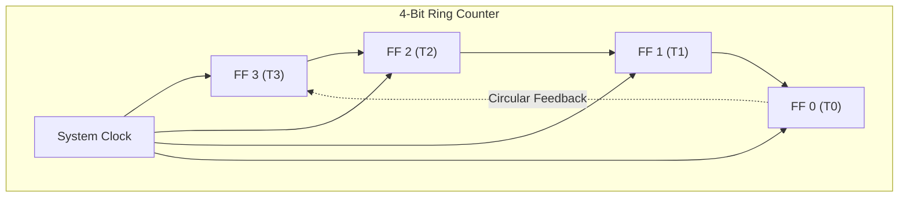

[DLCD Index](../README.md) / [Unit 2: Synchronous Sequential Logic](Introduction.md)

# Ring Counter and Johnson Counter

Binary counters represent states using weighted binary codes ($000, 001, 010, \dots$). While binary encoding minimizes the number of flip-flops ($n = \lceil \log_2 N \rceil$), it requires an external decoder circuit to convert those binary patterns into individual control signals (e.g., activating timing signal $T_0$, then $T_1$, then $T_2$).

In control unit design and multi-phase clock generators, we often need **unencoded timing signals**: signals where exactly one control wire goes High at any given instant.

Instead of building a binary counter and attaching a multi-gate decoder, we can take a standard shift register and configure its feedback path. This yields two elegant non-binary counters: the **Ring Counter** and the **Johnson Counter** (Twisted-Ring Counter).

---

## The Ring Counter

A **Ring Counter** is a circular shift register in which the output of the final flip-flop is connected directly back into the serial input of the first flip-flop:

### Initial State and Operational Sequence
To operate as a ring counter, the register must be initialized (using Preset and Clear pins) so that **exactly one flip-flop contains a `1`** and all other flip-flops contain `0` (e.g., $1000$):

| Clock Pulse | $T_3$ | $T_2$ | $T_1$ | $T_0$ | Active Timing Phase |
| :---: | :---: | :---: | :---: | :---: | :--- |
| **Initial** | **1** | 0 | 0 | 0 | Phase 0 ($T_3$ active) |
| **Pulse 1** | 0 | **1** | 0 | 0 | Phase 1 ($T_2$ active) |
| **Pulse 2** | 0 | 0 | **1** | 0 | Phase 2 ($T_1$ active) |
| **Pulse 3** | 0 | 0 | 0 | **1** | Phase 3 ($T_0$ active) |
| **Pulse 4** | **1** | 0 | 0 | 0 | Repeats back to Phase 0 |

### Advantages and Costs
- **Zero Decoding Logic Required**: The outputs $T_3, T_2, T_1, T_0$ can be connected directly to control bus wires without a single external AND gate!
- **State Inefficiency**: An $N$-bit ring counter cycles through only **$N$ valid states**. The remaining $2^N - N$ states (e.g., $16 - 4 = 12$ states in a 4-bit counter) are completely unused.
- **Vulnerability to Noise**: If electrical noise sets an extra bit ($1100$) or clears all bits ($0000$), the ring counter will circulate the error indefinitely. Practical ring counters use self-correcting feedback logic: $D_3 = (T_2 + T_1 + T_0)'$, ensuring that any illegal state automatically resets into $1000$.

---

## The Johnson Counter (Twisted-Ring Counter)

Can we double the number of timing states generated by an $N$-bit shift register while still avoiding complex decoding logic?

The answer is the **Johnson Counter** (also called a **Twisted-Ring Counter** or **Moebius Counter**).

The only physical difference between a ring counter and a Johnson counter is a single wire inversion: **we feed the inverted output ($Q'$) of the last flip-flop back into the input of the first flip-flop**:

### Operational Sequence of a 4-Bit Johnson Counter
Starting from an initially cleared state ($0000$):
- Since $D = 0$, its inverted output is $D' = 1$. On the next clock pulse, a $1$ shifts into $A$.
- This injects consecutive 1s from the left until the counter is filled with 1s ($1111$).
- Once $D = 1$, its inverted output becomes $D' = 0$. On subsequent clock pulses, zeros are shifted in from the left until the register clears back to $0000$.

| Clock Pulse | $A$ | $B$ | $C$ | $D$ | State Description |
| :---: | :---: | :---: | :---: | :---: | :--- |
| **0** | 0 | 0 | 0 | 0 | Initial cleared state |
| **1** | **1** | 0 | 0 | 0 | First 1 enters |
| **2** | **1** | **1** | 0 | 0 | Second 1 enters |
| **3** | **1** | **1** | **1** | 0 | Third 1 enters |
| **4** | **1** | **1** | **1** | **1** | Register full of 1s |
| **5** | 0 | **1** | **1** | **1** | First 0 enters |
| **6** | 0 | 0 | **1** | **1** | Second 0 enters |
| **7** | 0 | 0 | 0 | **1** | Third 0 enters |
| **8** | 0 | 0 | 0 | 0 | Repeats back to State 0 |

Notice that $N$ flip-flops produce **$2N$ distinct states**! A 4-bit Johnson counter produces 8 states (MOD-8), exactly double the capacity of a 4-bit ring counter.

### Decoding the Johnson Counter States

To decode each of the 8 states into an individual active-high timing signal, we require only **simple 2-input AND gates**.

Look at the transition boundaries where adjacent bits differ:

| State Number | Bit Pattern ($ABCD$) | Decoding Expression | Why It Works |
| :---: | :---: | :---: | :--- |
| **0** | $0000$ | $A' \cdot D'$ | $A$ and $D$ are both 0 only in state 0 |
| **1** | $1000$ | $A \cdot B'$ | $A=1$ and $B=0$ occurs only in state 1 |
| **2** | $1100$ | $B \cdot C'$ | $B=1$ and $C=0$ occurs only in state 2 |
| **3** | $1110$ | $C \cdot D'$ | $C=1$ and $D=0$ occurs only in state 3 |
| **4** | $1111$ | $A \cdot D$ | $A$ and $D$ are both 1 only in state 4 |
| **5** | $0111$ | $A' \cdot B$ | $A=0$ and $B=1$ occurs only in state 5 |
| **6** | $0011$ | $B' \cdot C$ | $B=0$ and $C=1$ occurs only in state 6 |
| **7** | $0001$ | $C' \cdot D$ | $C=0$ and $D=1$ occurs only in state 7 |

Because adjacent states differ by only a single bit, the decoding logic is **completely free of transient decoding glitches**.

---

## Comparison of Counter Architectures

| Counter Type | States for $N$ Flip-Flops | Decoding Logic Complexity | Speed / Glitches | Primary Application |
| :--- | :---: | :--- | :--- | :--- |
| **Binary Ripple Counter** | $2^N$ | Requires full $N$-input decoders | Slow ($n \cdot t_{pd}$ delay); heavy glitches | Low-power, low-speed frequency division |
| **Binary Synchronous Counter** | $2^N$ | Requires full $N$-input decoders | Fast ($t_{pd} + t_{\text{gate}}$ delay); glitch-free | High-speed address generation, CPU Program Counter |
| **Ring Counter** | $N$ | **Zero decoding logic** (direct pin outputs) | Fast; simple | Multi-phase clock and non-overlapping timing strobes |
| **Johnson Counter** | $2N$ | **Minimal** (simple 2-input AND gates) | Fast; zero decoding glitches | Compact sequence generators, stepper motor drivers |

---

## Key Takeaways

- Ring counters circulate a single active `1` through an $N$-bit shift register, providing $N$ unencoded timing signals with zero external decoding gates.
- Ring counters are state-inefficient ($N$ states out of $2^N$), and require self-correcting logic to recover from power-on noise glitches.
- Johnson counters twist the feedback loop ($D' \to \text{Input}$), doubling the state capacity to $2N$ states.
- Johnson counter states are decoded using simple 2-input AND gates that are immune to transient decoding glitches because adjacent states differ by only a single bit.

With counters and registers, we have mastered the foundational building blocks of digital hardware: combinational arithmetic, sequential state machines, and synchronized multi-bit storage. In Unit 3, we step up to computer organization: assembling these registers, buses, and logic units into a complete processing architecture.
