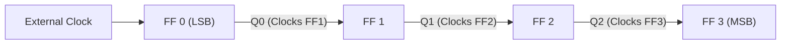
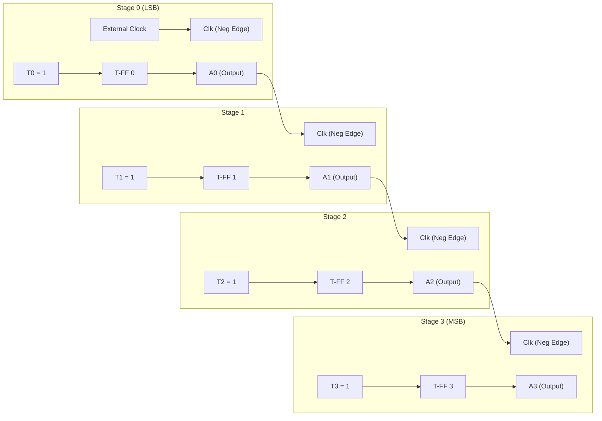
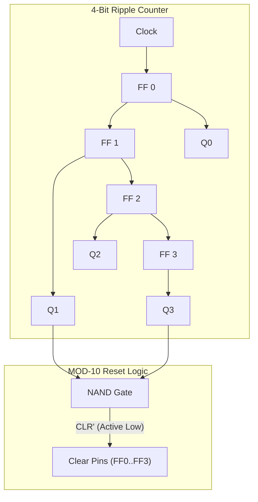

[DLCD Index](../README.md) / [Unit 2: Synchronous Sequential Logic](Introduction.md)

# L08 - Ripple Counters

In the previous lecture, we examined registers that store and shift arbitrary data words. Now we turn to circuits that autonomously advance through a fixed sequence of numeric states: **Counters**.

Counters are ubiquitous across computing. They track instruction addresses in the Program Counter (PC), divide clock frequencies, measure time intervals, and step through microcode states.

Counters fall into two major categories: **Asynchronous (Ripple) Counters** and **Synchronous Counters**. In this lecture, we examine the mechanics of ripple counters, design up-, down-, and BCD decade counters, and analyze why cumulative propagation delay creates a severe speed bottleneck.

---

## What is a Counter?

A **Counter** is a sequential circuit that steps through a predetermined sequence of binary states upon the arrival of input pulses. 

- **Modulo-$N$ ($\text{MOD-}N$) Counter**: A counter that cycles through $N$ distinct states before repeating. For example, a MOD-8 counter cycles through 8 states ($0, 1, 2, 3, 4, 5, 6, 7$).
- The number of flip-flops required to construct a MOD-$N$ counter is the smallest integer $n$ such that:
  $$2^n \ge N$$

---

## The Asynchronous Ripple Principle

In an **Asynchronous Counter**, the flip-flops **do not share a common clock line**.

Instead:
- The external clock signal drives **only the first flip-flop** (the Least Significant Bit, LSB).
- The output of each flip-flop serves as the clock source for the next higher-order flip-flop!



Because clock pulses do not arrive simultaneously at all flip-flops, state transitions do not happen at once. A transition must ripple down the chain from LSB to MSB, like a wave propagating across water. For this reason, asynchronous counters are universally known as **Ripple Counters**.

---

## 4-Bit Binary Ripple Up-Counter

Let's construct a 4-bit binary up-counter ($A_3 A_2 A_1 A_0$) that counts from $0000_2$ ($0_{10}$) up to $1111_2$ ($15_{10}$) and then rolls back to $0000_2$.

To understand the design, look at how binary numbers count upward:

```
Count    A3  A2  A1  A0
  0       0   0   0   0
  1       0   0   0   1   <- A0 toggles on every step
  2       0   0   1   0   <- A1 toggles when A0 goes 1 -> 0
  3       0   0   1   1
  4       0   1   0   0   <- A2 toggles when A1 goes 1 -> 0
  5       0   1   0   1
...
  7       0   1   1   1
  8       1   0   0   0   <- A3 toggles when A2 goes 1 -> 0
```

Notice the pattern:
1. Bit $A_0$ toggles on **every single input pulse**.
2. Bit $A_1$ toggles **only when $A_0$ transitions from $1 \to 0$**.
3. Bit $A_2$ toggles **only when $A_1$ transitions from $1 \to 0$**.
4. Bit $A_3$ toggles **only when $A_2$ transitions from $1 \to 0$**.

Now think back to Lecture 2: what electronic event is a $1 \to 0$ transition? It is a **negative (falling) clock edge**!

Therefore, if we configure every flip-flop in **Toggle mode** ($T = 1$ or $J = K = 1$) and use **negative-edge-triggered flip-flops**, we can build the entire counter by simply connecting the normal output $Q$ of each stage directly to the clock input of the next stage!



Let's trace how simple this is:
- Clock pulse 1 falls: FF 0 toggles $A_0$ from $0 \to 1$. Since this is a rising edge ($0 \to 1$), FF 1 ignores it. Count is $0001$.
- Clock pulse 2 falls: FF 0 toggles $A_0$ from $1 \to 0$. This falling edge enters the clock pin of FF 1, causing FF 1 to toggle $A_1$ from $0 \to 1$. Count is $0010$.
- The circuit counts autonomously with zero combinational gates!

---

## Binary Ripple Down-Counters

What if we want the counter to count downwards: $1111 \to 1110 \to 1101 \dots \to 0000$?

In a down-counter, a bit must toggle when its preceding bit transitions from **$0 \to 1$** (a rising edge).

We can synthesize a down-counter in one of two ways:
1. **Keep negative-edge flip-flops**, but connect the clock pin of the next stage to the complemented output **$\overline{Q}$** instead of $Q$. When $Q$ transitions $0 \to 1$, $\overline{Q}$ transitions $1 \to 0$, providing the necessary falling edge.
2. **Use positive-edge-triggered flip-flops**, keeping the connection to $Q$.

---

## BCD (Decade) Ripple Counter (MOD-10)

A 4-bit binary counter naturally counts to 16 ($0$ to $15$). But human interfaces and digital meters require **BCD (Decade) Counters** that count from $0000_2$ ($0_{10}$) to $1001_2$ ($9_{10}$) and then reset immediately to $0000_2$ on the 10th pulse.

How do we force a 4-bit counter to skip states 10 through 15?

We use an **asynchronous reset gate**:
- The binary representation of $10_{10}$ is **$1010_2$** ($Q_3 = 1, Q_2 = 0, Q_1 = 1, Q_0 = 0$).
- Notice that $1010_2$ is the very first count in the sequence where **both $Q_3 = 1$ and $Q_1 = 1$** simultaneously.
- We connect outputs $Q_3$ and $Q_1$ to a 2-input **NAND gate**, and route the NAND output to the active-low **$\overline{\text{CLR}}$** pins of all four flip-flops!



Let's trace what happens on the 10th clock pulse:
1. The counter advances from $1001_2$ ($9$) to $1010_2$ ($10$).
2. The instant $Q_3$ and $Q_1$ both reach `1`, the NAND gate output drops to `0`.
3. This low pulse activates the asynchronous clear inputs, forcing all flip-flops to $0000_2$.
4. The moment the flip-flops clear, $Q_3$ and $Q_1$ return to 0, which releases the NAND gate back to `1`.

The state $1010_2$ exists only as a transient electrical glitch lasting a few nanoseconds—just long enough to reset the flip-flops.

---

## The Cumulative Propagation Delay Bottleneck

While ripple counters are remarkably simple and require almost no combinational gates, they suffer from a fatal physical flaw: **cumulative propagation delay**.

In a synchronous system, all flip-flops trigger simultaneously from a master clock line. In a ripple counter, however, flip-flop 1 cannot trigger until flip-flop 0 switches; flip-flop 2 cannot trigger until flip-flop 1 switches; and so on.

If each flip-flop has a propagation delay of $t_{\text{pd}}$:
- Delay to $A_0 = t_{\text{pd}}$
- Delay to $A_1 = 2 \cdot t_{\text{pd}}$
- Delay to $A_2 = 3 \cdot t_{\text{pd}}$
- Delay to $A_3 = 4 \cdot t_{\text{pd}}$

For an $n$-bit ripple counter, the worst-case transition occurs when the counter rolls over from all 1s to all 0s ($0111 \to 1000$ or $1111 \to 0000$), where the transition must ripple through every single flip-flop:
$$\mathbf{t_{\text{total}} = n \times t_{\text{pd}}}$$

```
Clock:     ___|‾‾‾\___________________________________
A0:        ________|‾‾‾\______________________________  (1 t_pd)
A1:        ______________|‾‾‾\________________________  (2 t_pd)
A2:        ____________________|‾‾‾\__________________  (3 t_pd)
A3:        __________________________|‾‾‾\____________  (4 t_pd)
```

### Maximum Operational Frequency

To ensure that the counter has settled into its correct state before the next clock pulse arrives, the clock period $T_{\text{clk}}$ must be strictly greater than the total ripple delay:
$$T_{\text{clk}} > n \cdot t_{\text{pd}} + t_{\text{su}}$$
$$f_{\max} < \frac{1}{n \cdot t_{\text{pd}} + t_{\text{su}}}$$

Notice something here: **the maximum clock frequency drops linearly with every bit you add**. A 16-bit ripple counter built from 10 ns flip-flops has a ripple latency of $160\text{ ns}$, restricting its maximum operating frequency to less than 6 MHz, even though individual flip-flops could easily run at 100 MHz!

### Dynamic Decoding Glitches

Even worse, during that 160 ns ripple window, the counter briefly outputs **false, transient states**:

```
Starting State:   0 1 1 1   (7)
Transitioning:    0 1 1 0   (6)  <- Transient Glitch!
                  0 1 0 0   (4)  <- Transient Glitch!
                  0 0 0 0   (0)  <- Transient Glitch!
Final State:      1 0 0 0   (8)
```

If these output lines are connected to a decoder (e.g., to trigger an alarm when count = 6), the decoder will see state 6 for a few nanoseconds and fire a false, spurious output pulse!

These two limitations—low operating frequency and decoding glitches—make ripple counters unsuitable for high-speed processors and precision timing.

---

## Key Takeaways

- A **Counter** is a sequential circuit that cycles through $N$ predetermined states upon the arrival of clock pulses.
- In an **Asynchronous (Ripple) Counter**, flip-flops do not share a common clock. Only the LSB flip-flop is driven by the external clock; each subsequent stage is clocked by the output of the preceding stage.
- A 4-bit binary up-counter is constructed by cascading negative-edge-triggered toggle flip-flops with each $Q$ output driving the next clock input.
- A **BCD Decade Counter (MOD-10)** resets on count $10_{10}$ ($1010_2$) by decoding $Q_3$ and $Q_1$ with a NAND gate that fires the asynchronous clear pins.
- The fundamental limitation of ripple counters is **cumulative propagation delay** ($t_{\text{total}} = n \cdot t_{\text{pd}}$).
- Ripple latency limits maximum clock frequency and produces transient intermediate states that cause **decoding glitches**.

---

To overcome the ripple delay bottleneck, high-speed computers use counters where all flip-flops are clocked simultaneously by the master clock. In the next lecture, we analyze [**Synchronous Counters**](L09%20-%20Synchronous%20Counters.md), examining 4-bit parallel carry counters, synchronous up/down architectures, and arbitrary non-binary sequence synthesis.
