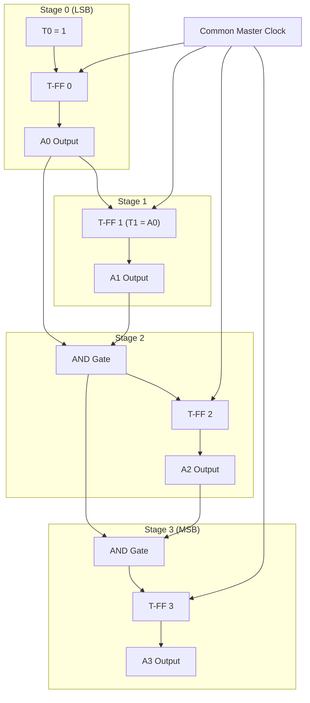
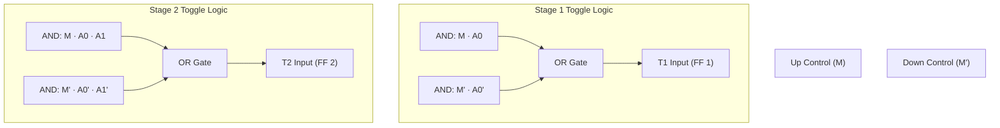

[DLCD Index](../README.md) / [Unit 2: Synchronous Sequential Logic](Introduction.md)

# L09 - Synchronous Counters

In Lecture 8, we discovered the fatal limitation of asynchronous ripple counters: because each flip-flop clocks the next, propagation delays accumulate linearly down the chain ($n \cdot t_{\text{pd}}$). In high-bit-width systems, this ripple latency cripples clock frequency and spawns spurious decoding glitches.

Modern computing architectures overcome this bottleneck by making counters **Synchronous**.

In a **Synchronous Counter**, the master clock signal is connected in parallel to **every single flip-flop**. Every stage updates on the exact same clock edge, eliminating cumulative delay. 

In this lecture, we examine the logic that allows synchronous counters to count, design 4-bit parallel carry and up/down counters, and master the synthesis of arbitrary non-binary sequence counters.

---

## The Synchronous Counter Principle

If every flip-flop is clocked at the exact same instant, how does the counter know which bits to toggle and which to leave alone?

The decision to toggle is not determined during the clock edge; it is **pre-computed by combinational logic** during the clock period before the edge arrives!

Think about the standard 4-bit binary counting sequence:

```
Count    A3  A2  A1  A0
  0       0   0   0   0
  1       0   0   0   1   <- A0 toggles every cycle
  2       0   0   1   0   <- A1 toggles because A0 was 1
  3       0   0   1   1
  4       0   1   0   0   <- A2 toggles because A0 and A1 were BOTH 1
...
  7       0   1   1   1
  8       1   0   0   0   <- A3 toggles because A0, A1, and A2 were ALL 1
```

From this binary progression, we derive the fundamental rule of binary up-counting:

> **A flip-flop must toggle on the next clock edge if and only if ALL preceding lower-order flip-flops are currently in state `1`.**

---

## 4-Bit Binary Synchronous Up-Counter

Let's express this rule mathematically for a 4-bit counter using **T (Toggle) Flip-Flops**:

1. **Stage 0 ($A_0$, LSB)**:
   $A_0$ must toggle on every single clock edge. Therefore, its toggle input is tied permanently to `1`:
   $$\mathbf{T_0 = 1}$$

2. **Stage 1 ($A_1$)**:
   $A_1$ must toggle only when $A_0 = 1$:
   $$\mathbf{T_1 = A_0}$$

3. **Stage 2 ($A_2$)**:
   $A_2$ must toggle only when both $A_0 = 1$ and $A_1 = 1$:
   $$\mathbf{T_2 = A_0 \cdot A_1}$$

4. **Stage 3 ($A_3$, MSB)**:
   $A_3$ must toggle only when $A_0 = 1$, $A_1 = 1$, and $A_2 = 1$:
   $$\mathbf{T_3 = A_0 \cdot A_1 \cdot A_2 = T_2 \cdot A_2}$$

Notice that the carry logic can be chained: the condition $A_0 A_1$ already exists at $T_2$. To generate $T_3$, we simply take $T_2$ and AND it with $A_2$.

### Circuit Schematic



Look at the clock distribution: the line labeled `Common Master Clock` connects directly to the clock pins of all four flip-flops. 
When the clock edge arrives:
- If the count is $0111_2$ ($7$), the AND gates have already evaluated: $T_0 = 1, T_1 = 1, T_2 = 1, T_3 = 1$.
- On the clock edge, **all four flip-flops toggle simultaneously** in parallel!
- The counter steps from $0111_2 \to 1000_2$ in a single propagation delay ($t_{\text{pd}}$), with zero intermediate ripple glitches!

---

## Synchronous Up/Down Counter

In many applications—such as elevator controllers, motor position encoders, and FIFO buffer pointers—a counter must be capable of counting both upward and downward based on a direction control line.

Let's define a control input:
- **$M = 1$**: Count **UP** ($0, 1, 2, 3, \dots$)
- **$M = 0$**: Count **DOWN** ($3, 2, 1, 0, \dots$)

### Deriving the Direction Logic

How does a binary counter count down?
Look at the downward counting sequence:

```
Count    A2  A1  A0
  3       0   1   1
  2       0   1   0   <- A0 toggles every step
  1       0   0   1   <- A1 toggles when A0 was 0
  0       0   0   0   <- A2 toggles when A0 and A1 were BOTH 0
```

Notice the inversion:
- To count **UP**: toggle stage $i$ when all lower stages have **$A = 1$**.
- To count **DOWN**: toggle stage $i$ when all lower stages have **$A = 0$** (which means **$\overline{A} = 1$**)!

Using an AND-OR multiplexer configuration controlled by $M$:
$$\mathbf{T_0 = 1}$$
$$\mathbf{T_1 = M \cdot A_0 + \overline{M} \cdot \overline{A_0}}$$
$$\mathbf{T_2 = M \cdot (A_0 A_1) + \overline{M} \cdot (\overline{A_0}\;\overline{A_1})}$$
$$\mathbf{T_3 = M \cdot (A_0 A_1 A_2) + \overline{M} \cdot (\overline{A_0}\;\overline{A_1}\;\overline{A_2})}$$



When $M = 1$, the upper AND gates are enabled, routing the normal outputs $A_i$ to perform up-counting. When $M = 0$, the lower AND gates are enabled, routing the complemented outputs $\overline{A_i}$ to perform down-counting.

---

## Design of Arbitrary Non-Binary Sequence Counters

Standard binary counters follow a rigid $0, 1, 2, \dots, 2^n-1$ sequence. But practical systems often require counters that step through non-sequential or arbitrary state patterns.

For example, a stepper motor driver might need the repetitive sequence:
$$000 \to 010 \to 011 \to 101 \to 110 \to 000$$

Such circuits are designed by treating the counter as a specialized finite state machine with no external inputs (except the clock).

---

### Step-by-Step Synthesis: Modulo-6 Arbitrary Counter

Let's design a synchronous counter that cycles through the following 6 states using **JK Flip-Flops**:
$$000 \to 001 \to 010 \to 100 \to 101 \to 110 \to 000$$

States $011$ and $111$ are **unused**.

---

### Step 1: Construct the State and Excitation Table

We assign three flip-flops: $A, B, C$.
Using the JK excitation table ($0 \to 0: 0,X$; $0 \to 1: 1,X$; $1 \to 0: X,1$; $1 \to 1: X,0$):

| Present State ($A B C$) | Next State ($A^+ B^+ C^+$) | $J_A, K_A$ | $J_B, K_B$ | $J_C, K_C$ |
| :---: | :---: | :---: | :---: | :---: |
| **000** | **001** | $0, X$ | $0, X$ | $1, X$ |
| **001** | **010** | $0, X$ | $1, X$ | $X, 1$ |
| **010** | **100** | $1, X$ | $X, 1$ | $0, X$ |
| **100** | **101** | $X, 0$ | $0, X$ | $1, X$ |
| **101** | **110** | $X, 0$ | $1, X$ | $X, 1$ |
| **110** | **000** | $X, 1$ | $X, 1$ | $0, X$ |
| **011** (Unused) | **X X X** | $X, X$ | $X, X$ | $X, X$ |
| **111** (Unused) | **X X X** | $X, X$ | $X, X$ | $X, X$ |

---

### Step 2: K-Map Minimization

Let's plot each input function on a 3-variable K-map ($A, B$ on rows, $C$ on columns):

#### Flip-Flop A Inputs:
- **$J_A$**: Cell $010 = 1$. Unused states $011, 111$ are $X$. Row 10 is $X$.
  Grouping cells $010$ and $011$ gives:
  $$\mathbf{J_A = \overline{A}\,B = B}$$ (since $A=0$ when $B=1$ among active states).
- **$K_A$**: Cell $110 = 1$. Rows 00, 01 are $X$. Unused $111$ is $X$.
  Grouping cells $110$ and $111$ gives:
  $$\mathbf{K_A = B}$$

Notice that $J_A = K_A = B$! Flip-flop $A$ simply acts as a T flip-flop driven by $B$.

#### Flip-Flop B Inputs:
- **$J_B$**: Cells $001 = 1$ and $101 = 1$. Unused states are $X$.
  Grouping cells $(001, 101)$ gives:
  $$\mathbf{J_B = C}$$
- **$K_B$**: Cells $010 = 1$ and $110 = 1$. Unused states are $X$.
  Grouping cells $(010, 110)$ gives:
  $$\mathbf{K_B = 1}$$

#### Flip-Flop C Inputs:
- **$J_C$**: Cells $000 = 1$ and $100 = 1$.
  Grouping cells $(000, 100)$ gives:
  $$\mathbf{J_C = \overline{B}}$$
- **$K_C$**: Cells $001 = 1$ and $101 = 1$.
  Grouping cells $(001, 101)$ gives:
  $$\mathbf{K_C = 1}$$

Look at the astonishing simplicity of these synthesized equations:
- $J_A = B, \quad K_A = B$
- $J_B = C, \quad K_B = 1$
- $J_C = \overline{B}, \quad K_C = 1$

The entire Modulo-6 non-binary sequence requires **zero external AND or OR gates**—only the wire connections from the flip-flop outputs!

---

### Step 3: Self-Starting Check

Let's verify whether the unused states ($011$ and $111$) safely recover into the main sequence.

For State $011$ ($A=0, B=1, C=1$):
- $J_A = 1, K_A = 1 \implies A^+ = 1$
- $J_B = 1, K_B = 1 \implies B^+ = 0$
- $J_C = 0, K_C = 1 \implies C^+ = 0$
- Result: **Next State $= 100$** (a valid state in our sequence!).

For State $111$ ($A=1, B=1, C=1$):
- $J_A = 1, K_A = 1 \implies A^+ = 0$
- $J_B = 1, K_B = 1 \implies B^+ = 0$
- $J_C = 0, K_C = 1 \implies C^+ = 0$
- Result: **Next State $= 000$** (the reset state of our sequence!).

Both unused states immediately transition into the valid counting cycle within a single clock tick. The design is **100% self-starting and robust**.

---

## Speed Comparison: Ripple vs. Synchronous

| Metric | Asynchronous (Ripple) Counter | Synchronous Counter |
| :---: | :---: | :---: |
| **Clock Distribution** | Driven sequentially (stage-to-stage) | Driven in parallel to all flip-flops |
| **Propagation Delay** | Cumulative: $\mathbf{t_{\text{total}} = n \times t_{\text{pd}}}$ | Independent of $n$: $\mathbf{t_{\text{total}} = t_{\text{pd}} + t_{\text{gate}}}$ |
| **Maximum Frequency** | Decreases rapidly as $n$ grows ($f \propto 1/n$) | Extremely high; constant across bit-widths |
| **Decoding Glitches** | Severe transient output spikes | Glitch-free synchronous state changes |
| **Hardware Complexity** | Minimal (no carry gates) | Higher (requires lookahead carry AND gates) |

---

## Key Takeaways

- In a **Synchronous Counter**, all flip-flops share the same master clock line. State transitions occur simultaneously on the clock edge, eliminating cumulative propagation delay.
- In a binary synchronous up-counter, flip-flop $i$ toggles if and only if **all preceding flip-flops are `1`**:
  $$T_i = A_0 \cdot A_1 \cdot \dots \cdot A_{i-1}$$
- A **Synchronous Up/Down Counter** steers the toggle inputs using an AND-OR multiplexer controlled by direction bit $M$: selecting $A_k$ for up-counting and $\overline{A_k}$ for down-counting.
- **Arbitrary Sequence Counters** are synthesized using the standard sequential design procedure, treating the sequence as an autonomous FSM.
- Unused states must always be evaluated to verify that the circuit is **self-starting** and immune to deadlock lockout.

---

Binary counters advance through numerical codes. But in timing generators, distributed phase clocks, and stepper motor sequencers, we often need circuits that activate a series of individual output wires one at a time. In the final lecture of Unit 2, we explore [**Other Specialized Counters**](L10%20-%20Other%20Specialized%20Counters.md), examining Ring counters, Johnson (twisted-ring) counters, and lockout recovery design.
