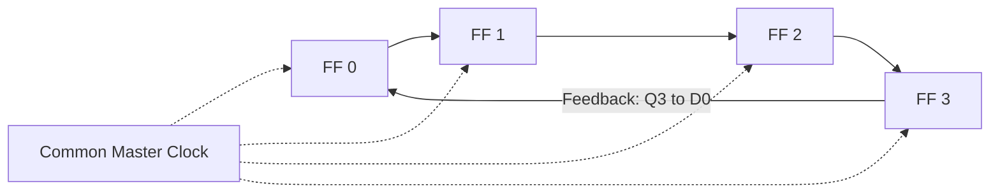
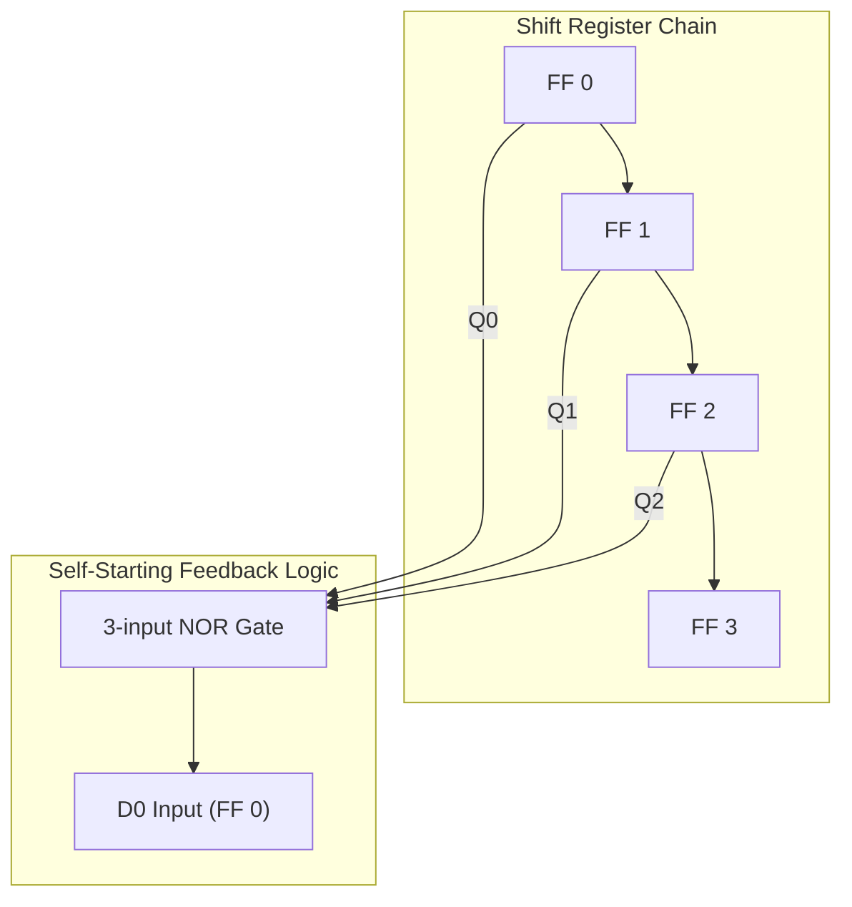
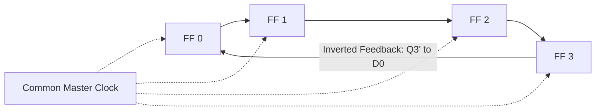
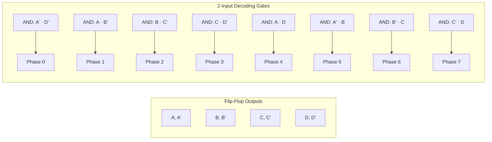
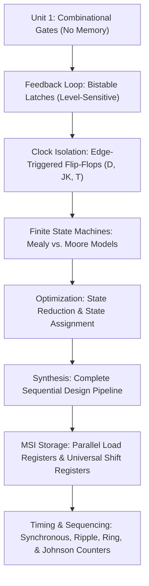

[DLCD Index](../README.md) / [Unit 2: Synchronous Sequential Logic](Introduction.md)

# L10 - Other Specialized Counters

In the preceding two lectures, we analyzed binary counters that advance through sequential numerical values ($0, 1, 2, 3, \dots$). 

However, in processor control units and timing generators, we frequently do not want a dense binary code. When a CPU executes an instruction across four discrete clock phases—Fetch ($T_0$), Decode ($T_1$), Execute ($T_2$), and Writeback ($T_3$)—the control unit requires four dedicated wires, where exactly **one wire is active at any given moment**.

If we used a standard binary counter, we would need to add an external 2-to-4 decoder to convert the binary count into individual timing pulses. 

To eliminate decoding hardware, digital designers use **Specialized Shift-Register Counters**: the **Ring Counter** and the **Johnson Counter**. In this final lecture of Unit 2, we explore their architectures, decoding properties, and self-starting lockout recovery circuits.

---

## The Ring Counter

A **Ring Counter** is a circular shift register where the output of the last flip-flop is connected directly back to the data input of the first flip-flop:
$$D_0 \leftarrow Q_{n-1}$$

The register is initialized (seeded) with a single `1` and all other bits `0` (a **one-hot code**):
$$\text{Initial State} = 1000_2$$

On every active clock edge, the single `1` circulates one position to the right. 

For a 4-bit ring counter, the state sequence is:

| Clock Cycle | $Q_0$ | $Q_1$ | $Q_2$ | $Q_3$ | Active Phase / Timing Signal |
| :---: | :---: | :---: | :---: | :---: | :---: |
| Initial | **1** | 0 | 0 | 0 | Phase $T_0$ Active |
| Clock 1 | 0 | **1** | 0 | 0 | Phase $T_1$ Active |
| Clock 2 | 0 | 0 | **1** | 0 | Phase $T_2$ Active |
| Clock 3 | 0 | 0 | 0 | **1** | Phase $T_3$ Active |
| Clock 4 | **1** | 0 | 0 | 0 | Phase $T_0$ Active (Recycles) |

---

### Characteristics of the Ring Counter

1. **State Modulus ($N = n$)**:
   An $n$-bit ring counter cycles through exactly **$n$ distinct states**.
   Compare this to a standard binary counter, where $n$ flip-flops produce $2^n$ states. A 4-bit binary counter has 16 states; a 4-bit ring counter has only 4 states!
2. **Zero Decoding Logic**:
   This is the supreme advantage of the ring counter. To generate multi-phase non-overlapping clock pulses ($T_0, T_1, T_2, T_3$), you do not need a single AND gate or decoder. The output pins of the flip-flops *are* the timing signals!
3. **No Decoding Glitches**:
   Because only one bit transitions at a time, there are zero intermediate transient states.

---

### The Lockout Hazard in Ring Counters

While the ring counter is elegant, it has an inherent vulnerability: **state lockout**.

A 4-bit register has $2^4 = 16$ possible states. Only **4** of these states are valid ($1000, 0100, 0010, 0001$). The remaining **12 states are invalid**!

Now consider what happens if a noise spike occurs:
- If noise clears all flip-flops to **$0000$**: The 0 in FF 3 feeds back to FF 0. The counter will circulate $0000 \to 0000 \to 0000$ forever. The counter is dead.
- If noise sets an extra bit, entering **$1100$**: The counter will circulate $1100 \to 0110 \to 0011 \to 1001 \to 1100$, trapped in an invalid 2-hot cycle forever!

---

### Making the Ring Counter Self-Starting

To make a ring counter robust against noise, we must modify the feedback logic so that it **automatically forces itself back into the valid sequence** from any invalid state.

Instead of directly wiring $D_0 = Q_3$, we feed $D_0$ from a combinational logic gate:
$$\mathbf{D_0 = \overline{Q_0 + Q_1 + Q_2} = \overline{Q_0}\;\overline{Q_1}\;\overline{Q_2}}$$

This is a single 3-input NOR gate monitoring the first three flip-flops:

Let's trace how this circuit behaves:
- In the normal cycle:
  - When state is $1000$: $Q_0 = 1 \implies$ NOR output = $0 \implies D_0 = 0$. (Next state: $0100$).
  - When state is $0100$: $Q_1 = 1 \implies$ NOR output = $0 \implies D_0 = 0$. (Next state: $0010$).
  - When state is $0010$: $Q_2 = 1 \implies$ NOR output = $0 \implies D_0 = 0$. (Next state: $0001$).
  - When state is $0001$: $Q_0 = Q_1 = Q_2 = 0 \implies$ NOR output = **$1$** $\implies D_0 = 1$. (Next state: $1000$).
  The valid 4-state cycle operates flawlessly.
- What if an error creates the dead state **$0000$**?
  Since $Q_0 = Q_1 = Q_2 = 0$, the NOR gate outputs **$1$**! On the very next clock pulse, a `1` is injected into FF 0, instantly recovering to state $1000$!

The counter is provably **self-starting**.

---

## The Johnson Counter (Twisted-Ring Counter)

Can we get the glitch-free decoding advantages of a ring counter without wasting so many states?

Yes. In 1953, Robert Royce Johnson invented the **Twisted-Ring Counter** (also known as a **Johnson Counter** or **Moebius Counter**).

A **Johnson Counter** is a circular shift register where the **inverted output ($\overline{Q_{n-1}}$)** of the last flip-flop is fed back into the data input ($D_0$) of the first flip-flop:
$$\mathbf{D_0 = \overline{Q_{n-1}}}$$

---

### The Johnson Counting Sequence

Let's initialize a 4-bit Johnson counter to all zeros ($0000_2$) and trace its progression:
1. Initially: $Q_0 Q_1 Q_2 Q_3 = 0000$. Since $Q_3 = 0$, its complement $\overline{Q_3} = 1$ is waiting at $D_0$.
2. Clock 1: The `1` enters FF 0 $\implies \mathbf{1000}$.
3. Clock 2: FF 0 passes `1` to FF 1, and another `1` enters FF 0 $\implies \mathbf{1100}$.
4. Clock 3: Another `1` enters $\implies \mathbf{1110}$.
5. Clock 4: Another `1` enters $\implies \mathbf{1111}$.
6. Clock 5: Now $Q_3 = 1$, so its complement $\overline{Q_3} = 0$ enters FF 0 $\implies \mathbf{0111}$.
7. Clock 6: Another `0` enters $\implies \mathbf{0011}$.
8. Clock 7: Another `0` enters $\implies \mathbf{0001}$.
9. Clock 8: Another `0` enters $\implies \mathbf{0000}$ (Returns to start!).

---

### Characteristics of the Johnson Counter

1. **State Modulus ($N = 2n$)**:
   An $n$-bit Johnson counter cycles through exactly **$2n$ states**!
   A 4-bit Johnson counter produces **8 states** ($2 \times 4 = 8$), doubling the efficiency of a ring counter.
2. **Adjacent Bit Transitions**:
   Between any two consecutive states, **only a single bit changes**. This Gray-code-like property guarantees that Johnson counters generate zero dynamic switching glitches.

---

### The Decoding Elegance of the Johnson Counter

In a standard 3-bit binary counter, decoding 8 states requires eight 3-input AND gates.

In a 4-bit Johnson counter, **every single one of its 8 states can be uniquely decoded using only a 2-input AND gate!**

Why? Because every state is uniquely identified by the boundary between adjacent 1s and 0s:

| State Index | State ($A B C D$) | Unique Identifying Feature | Minimal 2-Input Decoding Gate |
| :---: | :---: | :---: | :---: |
| **0** | $0000$ | Both endpoints are 0 | $\overline{A}\;\overline{D}$ |
| **1** | $1000$ | $A$ is 1, but $B$ is 0 | $A\,\overline{B}$ |
| **2** | $1100$ | $B$ is 1, but $C$ is 0 | $B\,\overline{C}$ |
| **3** | $1110$ | $C$ is 1, but $D$ is 0 | $C\,\overline{D}$ |
| **4** | $1111$ | Both endpoints are 1 | $A\,D$ |
| **5** | $0111$ | $A$ is 0, but $B$ is 1 | $\overline{A}\,B$ |
| **6** | $0011$ | $B$ is 0, but $C$ is 1 | $\overline{B}\,C$ |
| **7** | $0001$ | $C$ is 0, but $D$ is 1 | $\overline{C}\,D$ |

Look at how economical this is: 8 distinct, glitch-free timing phases decoded using only 2-input gates! This architecture is the core of commercial timing chips like the ubiquitous **CD4017 Decade Counter/Divider**.

---

## Unit 2 Architectural Summary

With specialized counters complete, we have reached the end of Unit 2. Let's trace the technological progression we built from the opening lecture:

We now possess the complete hardware toolkit of digital computing:
- We can perform combinational arithmetic and logic (ALU).
- We can store words in registers.
- We can route and select data using multiplexers.
- We can coordinate sequential execution through clock cycles and state machines.

---

## Key Takeaways

- A **Ring Counter** connects the output of the last flip-flop to the input of the first ($D_0 = Q_{n-1}$), circulating a single `1` across $n$ flip-flops to produce **$n$ states**.
- Ring counters require **zero decoding logic** to produce multi-phase timing signals ($T_k = Q_k$).
- A basic ring counter can suffer from **state lockout** if noise creates an invalid state; self-starting feedback ($D_0 = \overline{Q_0 + Q_1 + Q_2}$) guarantees automatic recovery.
- A **Johnson (Twisted-Ring) Counter** feeds back the inverted output of the last stage ($D_0 = \overline{Q_{n-1}}$), generating **$2n$ states** from $n$ flip-flops.
- All $2n$ states of a Johnson counter are decoded using simple **2-input AND gates**, providing glitch-free multiphase clocking at low hardware cost.

---

Everything we have designed in Units 1 and 2—adders, multiplexers, decoders, registers, counters, and finite state machines—serves a single ultimate purpose: **building a general-purpose computer**. 

How do these individual silicon blocks assemble into a Central Processing Unit? How does memory store both instructions and data? How does a processor interpret assembly language and interact with peripheral hardware?

We now cross the threshold from circuit components into system architecture. Begin exploring **Unit 3: Basic Computer Structure, Addressing Modes, I/O, and Memory** by reading the [**Unit 3 Introduction and Roadmap**](../Unit%203/Introduction.md), and then dive into [**L01 - Basic Structure of Computers and Functional Units**](../Unit%203/L01%20-%20Basic%20Structure%20of%20Computers%20and%20Functional%20Units.md).
