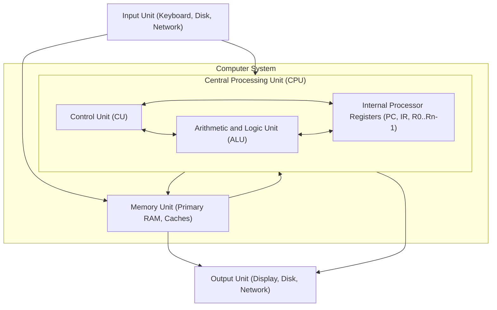
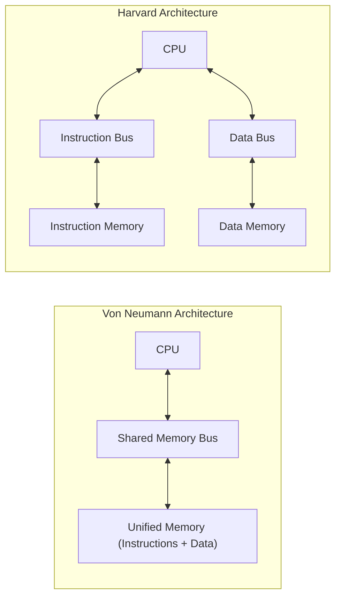
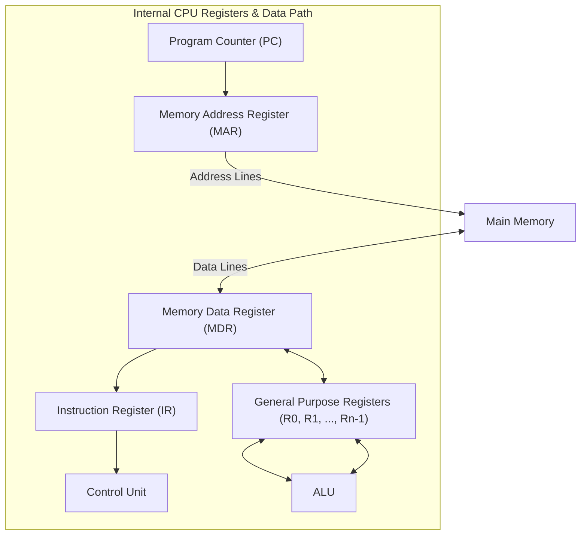
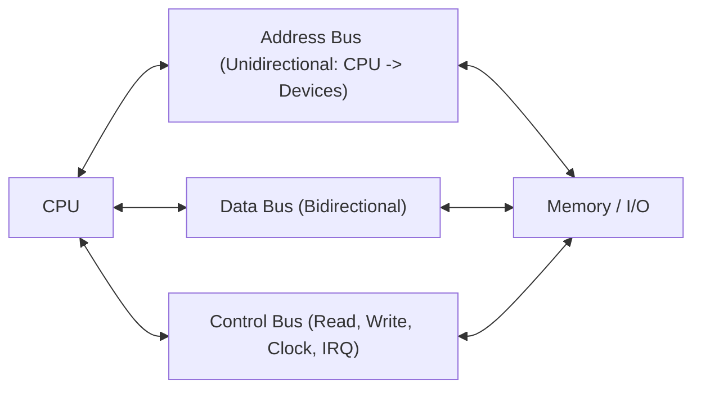
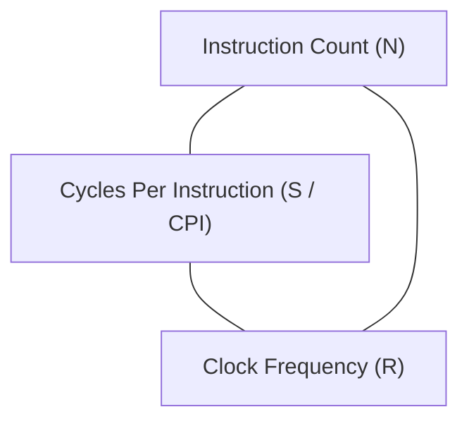

[DLCD Index](../README.md) / [Unit 3: Computer Structure and Organization](Introduction.md)

# L01 - Basic Structure of Computers and Functional Units

In Units 1 and 2, we mastered the individual building blocks of digital hardware: gates, adders, decoders, multiplexers, flip-flops, registers, and counters. But a pile of electronic components is not a computer.

A computer is an integrated system designed to execute arbitrary human programs autonomously. It accepts digitized inputs, stores instructions and data in memory, performs arithmetic and logical reasoning, and presents results to the external world.

In this opening lecture of Unit 3, we analyze the classic **functional units** of a computer, trace the foundational **operational concepts** of the Central Processing Unit (CPU), compare **Von Neumann and Harvard architectures**, and formulate the **fundamental processor performance equation**.

---

## The Five Classic Functional Units

In 1945, mathematician John von Neumann described the fundamental architecture that still defines general-purpose computers today. A computer consists of **five primary functional units**:

Let's dissect the responsibility of each unit:

### 1. Input Unit
Computers must receive data and program instructions from the outside world. The **Input Unit** accepts information in diverse physical forms (keystrokes, optical mouse movement, radio waves, microphones) and converts them into standardized digital binary words. Examples include keyboards, touchscreens, network interface cards (NICs), and disk controllers.

### 2. Memory Unit
The **Memory Unit** stores programs and data. It is partitioned into two distinct tiers:
- **Primary Storage (Main Memory / RAM)**: Fast semiconductor memory that stores programs actively being executed by the CPU. Memory is organized as an array of addressable words. Because semiconductor RAM is volatile (it loses data when powered off), primary memory is supplemented by cache memories.
- **Secondary Storage**: High-capacity, non-volatile, but slower storage media (Solid-State Drives (SSDs), Hard Disk Drives (HDDs), optical media) that retain programs and files permanently.

### 3. Arithmetic and Logic Unit (ALU)
The **ALU** is the computational engine of the computer. It executes all arithmetic operations (addition, subtraction, multiplication, division) and logical decisions (AND, OR, NOT, bitwise shifting, numerical comparisons). 

The ALU is constructed directly from the combinational circuits we designed in Unit 1: parallel adders, multipliers, and multiplexer-based function generators. Operands are brought from memory into internal processor registers, processed by the ALU, and the results are stored back into registers or memory.

### 4. Output Unit
The **Output Unit** performs the inverse operation of the input unit: it takes processed binary results from the computer and converts them into human-perceptible or machine-usable formats. Examples include video display controllers, audio amplifiers, printers, and network transmitters.

### 5. Control Unit (CU)
The ALU can calculate, and the memory can store, but neither knows *what* to do or *when* to do it. The **Control Unit** is the nervous system of the computer. 

It fetches instructions one-by-one from memory, decodes the operation code, and issues a sequence of micro-timing and control pulses to all other units. The control unit coordinates memory reads, ALU operations, register transfers, and input/output handshakes.

---

## Von Neumann vs. Harvard Architectures

A critical design decision in computer engineering is how instructions and data are organized in memory:

### 1. The Von Neumann Architecture
- **Single Shared Memory**: Program instructions and data variables share the **exact same physical memory space** and the **same system bus**.
- **The Stored-Program Concept**: Programs are treated as binary data. This revolutionary idea allows compilers to write programs into memory and operating systems to load programs dynamically.
- **The Von Neumann Bottleneck**: Because there is only one shared bus, the processor **cannot fetch an instruction and read/write data memory at the exact same clock cycle**. Data throughput is throttled by memory bus bandwidth.

### 2. The Harvard Architecture
- **Physically Separate Memories**: Instructions and data reside in completely separate physical memory modules, accessed via **independent address and data buses**.
- **Simultaneous Access**: The CPU can fetch the next instruction from instruction memory at the exact same instant that it reads or writes an operand in data memory.
- **Common Usage**: Digital Signal Processors (DSPs) and microcontrollers (e.g., ARM Cortex-M, PIC, AVR) where deterministic, ultra-fast real-time throughput is mandatory.

### The Modern Hybrid: Modified Harvard Architecture
Modern high-performance processors (such as Intel x86, AMD, and Apple Silicon ARM chips) use an ingenious compromise:
- **Externally (Main Memory)**: They use a unified **Von Neumann** memory model for simple operating system management and flexible RAM allocation.
- **Internally (On-Chip CPU Caches)**: The Level-1 cache is split into a **Harvard** organization: a dedicated **L1 Instruction Cache (L1I)** and a dedicated **L1 Data Cache (L1D)**. The execution core enjoys simultaneous dual-bus bandwidth without sacrificing unified RAM.

---

## Basic Operational Concepts of the Processor

To understand how instructions are executed, let's look inside the CPU at its primary internal registers:

Let's trace the dedicated roles of these internal registers:
- **Program Counter (PC)**: A register that holds the memory address of the **next instruction** to be fetched and executed. After an instruction is fetched, the PC is automatically incremented to point to the subsequent sequential instruction.
- **Instruction Register (IR)**: When an instruction is fetched from memory, it is held in the IR while the control unit decodes its operation code (opcode) and operand addresses.
- **Memory Address Register (MAR)**: Holds the physical memory address that the CPU is currently reading from or writing to. Its output pins drive the memory address bus.
- **Memory Data Register (MDR)**: Holds the data word read from memory, or the data word waiting to be written to memory. Its pins connect directly to the bidirectional memory data bus.
- **General-Purpose Registers ($R_0 \dots R_{n-1}$)**: High-speed temporary storage registers inside the CPU used by the compiler to hold intermediate calculation values, minimizing slow RAM accesses.

---

### Step-by-Step Instruction Execution Trace

Suppose the processor executes an assembly instruction that adds the contents of a memory location to a register:
$$\text{Add } \text{LOC}, R_1$$

Let's trace the microscopic hardware steps executed by the CPU:

1. **Instruction Fetch**:
   - The contents of the **PC** are transferred into the **MAR**: $\text{MAR} \leftarrow \text{PC}$.
   - The Control Unit asserts the **Memory Read** signal on the control bus.
   - The memory subsystem reads the word at address MAR and places it on the data bus.
   - The incoming instruction is latched into the **MDR**: $\text{MDR} \leftarrow \text{Memory}[\text{MAR}]$.
   - The instruction moves from MDR into the **IR**: $\text{IR} \leftarrow \text{MDR}$.
   - The **PC is incremented** to point to the next instruction: $\text{PC} \leftarrow \text{PC} + 4$.
2. **Instruction Decode & Operand Fetch**:
   - The Control Unit decodes the opcode in the IR and discovers it is an `Add` instruction requiring operand address `LOC`.
   - Address `LOC` (extracted from the instruction word in IR) is transferred to the **MAR**: $\text{MAR} \leftarrow \text{LOC}$.
   - The Control Unit asserts another **Memory Read** signal.
   - The operand from memory is latched into the **MDR**: $\text{MDR} \leftarrow \text{Memory}[\text{MAR}]$.
3. **ALU Execution & Storage**:
   - The contents of register $R_1$ and the contents of the MDR are routed into the inputs of the **ALU**.
   - The Control Unit commands the ALU to perform addition: $\text{Result} \leftarrow R_1 + \text{MDR}$.
   - The ALU output is transferred back into destination register $R_1$: $R_1 \leftarrow \text{Result}$.

Every computer program—no matter how complex—is executed as millions of variations of this exact step-by-step register transfer choreography.

---

## Bus Structures

A **Bus** is a shared group of electrical conductive lines that connects multiple functional units together, allowing them to exchange addresses, data words, and control signals.

A system bus is partitioned into three functionally distinct line groups:

1. **Address Bus**: Carries the physical address from the CPU to memory and peripheral interfaces. It is unidirectional. If an address bus has $k$ parallel lines, the CPU can uniquely address $2^k$ distinct memory locations. (A 32-bit address bus can access $2^{32} = 4\text{ GB}$; a 64-bit bus can access $16\text{ Exabytes}$).
2. **Data Bus**: Carries the actual data words and instruction bytes between units. It is bidirectional. The width of the data bus ($m$ bits) defines how many bits the system can transfer in a single memory cycle (typically 32 or 64 bits in modern systems).
3. **Control Bus**: Carries synchronization and timing commands throughout the system. Typical lines include:
   - **Memory Read ($\overline{\text{MEMR}}$) / Memory Write ($\overline{\text{MEMW}}$)**
   - **I/O Read ($\overline{\text{IOR}}$) / I/O Write ($\overline{\text{IOW}}$)**
   - **System Clock ($Clk$) and Reset**
   - **Bus Request / Bus Grant** (for arbitration)
   - **Interrupt Request (IRQ)** lines

---

## The Fundamental Computer Performance Equation

How do computer architects quantitatively evaluate whether a processor design is fast?

The ultimate physical metric of computer performance is **Execution Time ($T$)**: the total elapsed wall-clock time required to execute a given program.

Execution time is governed by the classic **Iron Law of Processor Performance**:

$$\mathbf{T = \frac{N \times S}{R}}$$

or equivalently:
$$\mathbf{T = N \times \text{CPI} \times P}$$

where:
- **$N$ (Dynamic Instruction Count)**: The total number of machine-level instructions executed during the program's run.
- **$S$ or $\text{CPI}$ (Average Cycles Per Instruction)**: The average number of clock cycles required to execute one machine instruction.
- **$R$ (Clock Rate)**: The processor clock frequency measured in Hertz ($\text{Hz}$ or $\text{GHz}$).
- **$P$ (Clock Period)**: The duration of a single clock cycle ($P = 1/R$), typically measured in nanoseconds ($\text{ns}$) or picoseconds ($\text{ps}$).

---

### The Performance Triad Trade-Off

The three parameters in the performance equation are tightly coupled:

1. **Instruction Count ($N$)**:
   Determined by the **algorithm**, the **compiler optimization flags**, and the **Instruction Set Architecture (ISA)**. 
   - A Complex Instruction Set Computer (CISC) like x86 may achieve a lower $N$ because a single instruction performs complex memory-to-register arithmetic.
   - However, complex instructions require more micro-steps, which increases $S$!
2. **Cycles Per Instruction ($S$)**:
   Determined by the **microarchitecture** (pipelining, branch prediction, superscalar out-of-order execution) and the **memory hierarchy latency** (cache hit rates). 
   - A Reduced Instruction Set Computer (RISC) aims for $\text{CPI} \approx 1$ through deep pipelining.
3. **Clock Frequency ($R$)**:
   Determined by **semiconductor fabrication technology** (transistor gate size, e.g., 3nm CMOS) and the length of the **longest combinational critical path** between flip-flop stages. 
   - Making an instruction do too much work in a single cycle elongates the critical path, forcing $R$ to drop!

A computer architect cannot optimize one variable in isolation. Doubling the clock frequency $R$ by chopping pipeline stages into tiny slices often increases branch misprediction penalties and memory stalls, driving up $S$ and nullifying the speedup.

---

## Key Takeaways

- A computer is composed of **five classic functional units**: Input, Memory, ALU, Output, and Control Unit. The CPU consists of the ALU, Control Unit, and internal registers.
- In a **Von Neumann Architecture**, instructions and data share a single physical memory and system bus, creating the Von Neumann bandwidth bottleneck.
- In a **Harvard Architecture**, instructions and data reside in separate memories accessed via independent buses, enabling concurrent access. Modern processors use a hybrid: unified main memory externally, with split L1 instruction/data caches internally.
- The **Program Counter (PC)** holds the address of the next instruction; the **Instruction Register (IR)** holds the instruction currently being decoded; the **MAR** and **MDR** buffer addresses and data interfacing with the system bus.
- System buses are divided into **Address** (unidirectional), **Data** (bidirectional), and **Control** (timing and commands) buses.
- Total program execution time is governed by the fundamental performance equation:
  $$\mathbf{T = \frac{N \times S}{R} = N \times \text{CPI} \times P}$$

---

Now that we understand how functional units interact across buses, how does memory actually represent numbers, characters, and data words at the byte level? In the next lecture, we analyze [**Data Representation and Memory Organization**](L02%20-%20Data%20Representation%20and%20Memory%20Organization.md), exploring byte addressability, Big-Endian vs. Little-Endian word alignment, and signed integer representations.
