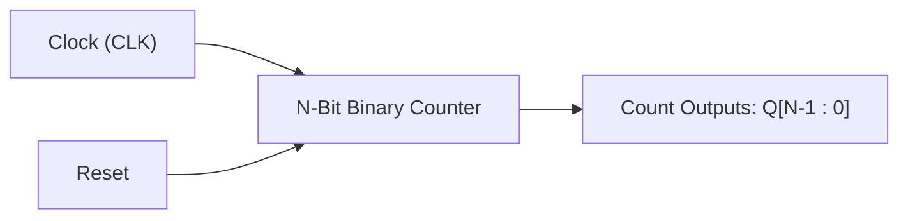
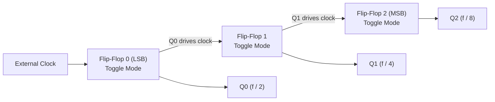
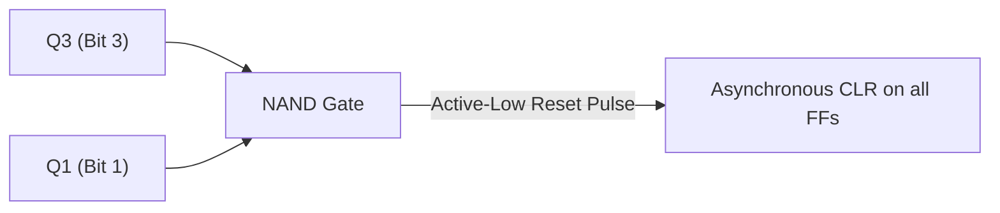
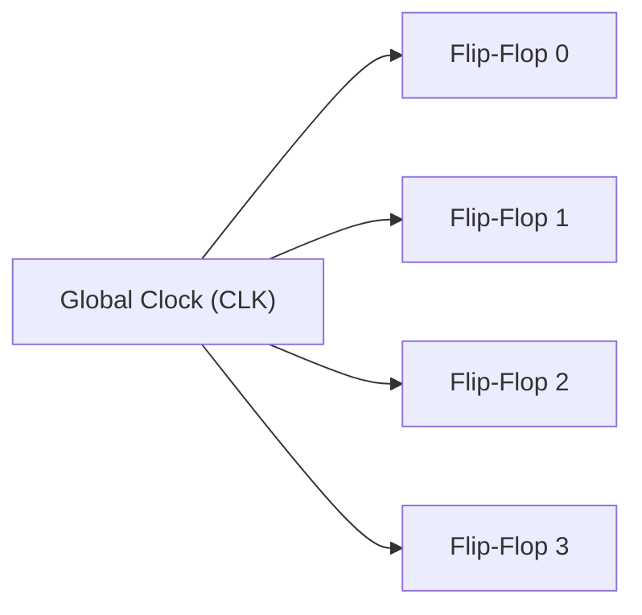
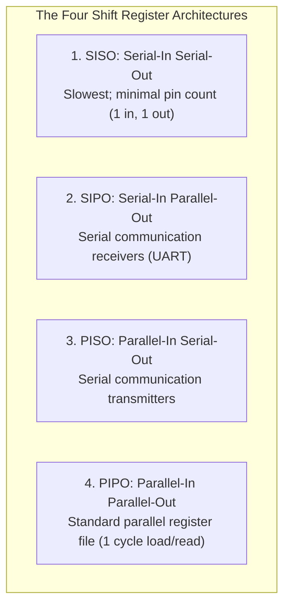
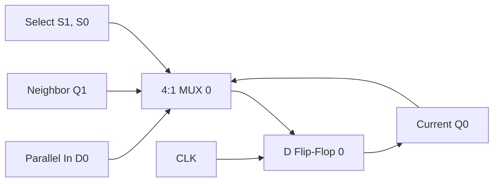
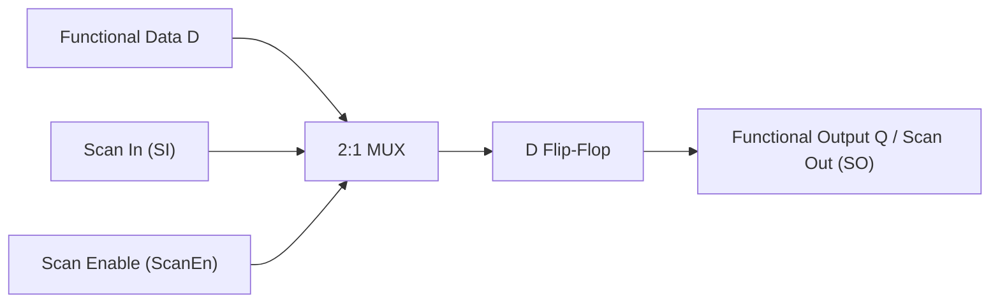

[DLCD Index](../README.md) / [Unit 3: Architecture, Memory, and MIPS Assembly](Introduction.md)

# L01 - Sequential Building Blocks - Counters and Shift Registers

In Unit 1, we learned that registers capture multi-bit binary data on a clock edge. But registers alone are passive—they simply hold whatever data is placed on their inputs. To build autonomous digital controllers and communication channels, we need sequential circuits that actively manipulate their contents on every clock cycle.

Two of the most foundational sequential building blocks in digital hardware are **counters** and **shift registers**. Counters cycle through predetermined numerical sequences to track time, loop iterations, and program memory addresses. Shift registers slide data bits laterally across a chain of storage cells, converting parallel buses into serial communication streams and providing the backbone for hardware manufacturing testability. In this lecture, we examine the internal circuitry, timing hazards, and synthesis of both components.

---

## What is a Counter?

An **$N$-bit binary counter** is a clocked sequential circuit that progresses through a predetermined sequence of $2^N$ binary states upon receiving clock pulses.

- **Number of States**: An $N$-bit counter has $2^N$ unique states, counting from $0$ up to $2^N - 1$. For example, a 4-bit counter cycles from $0000_2$ ($0$) to $1111_2$ ($15$), and then rolls over to $0000_2$ on the sixteenth clock pulse.
- **Modulo ($\text{MOD}$)**: The modulo of a counter is the total number of unique states in its counting cycle. A counter that visits $M$ states before repeating is called a **$\text{MOD}-M$ counter**. An $N$-bit binary counter is inherently a $\text{MOD}-2^N$ counter.

Counters are divided into two fundamental architectural categories depending on how their clock signals are wired: **asynchronous (ripple) counters** and **synchronous counters**.

---

## Asynchronous (Ripple) Counters

In an **asynchronous counter** (commonly known as a **ripple counter**), the flip-flops are **not** connected to a common clock line. Instead, only the first flip-flop (LSB) receives the external system clock; the output of each flip-flop is used to drive the clock input of the next subsequent flip-flop.

Because flip-flops configured to toggle (such as T flip-flops with $T=1$, or JK flip-flops with $J=K=1$, or D flip-flops with $D = \overline{Q}$) divide frequency by 2, cascading them produces binary counting.

### The Ripple Carry Delay and Glitch Hazards
While ripple counters require minimal wiring, they suffer from a fatal drawback: **cumulative propagation delay**.

When the count transitions from $011_2$ ($3$) to $100_2$ ($4$):
1. The clock edge triggers Flip-Flop 0 to switch $Q_0$ from $1$ to $0$.
2. The falling transition of $Q_0$ triggers Flip-Flop 1 to switch $Q_1$ from $1$ to $0$.
3. The falling transition of $Q_1$ triggers Flip-Flop 2 to switch $Q_2$ from $0$ to $1$.

Notice what happens in physical time: the flip-flops do not switch simultaneously! The carry transition ripples serially through the chain. For an $N$-bit counter with flip-flop delay $t_{\text{pd}}$, the total settling time is:

$$t_{\text{settle}} = N \times t_{\text{pd}}$$

During this ripple interval, the counter outputs momentarily pass through false intermediate states ($011_2 \to 010_2 \to 000_2 \to 100_2$). If combinational logic decodes these outputs (e.g., to trigger an alarm or branch), these transient **glitches** can cause disastrous system misfires. For high-speed systems, ripple counters are strictly avoided.

---

## Truncated Sequences: The Decade / Mod-10 Counter

Often we need a counter that counts up to a non-power-of-two value. A classic example is a **Decade Counter (BCD Counter)**, which counts decimal digits $0$ through $9$ ($0000_2$ to $1001_2$) and resets to $0000_2$ on the tenth pulse.

To build a $\text{MOD}-10$ counter using an asynchronous 4-bit ripple counter:
1. Allow the counter to count normally up to $9$ ($1001_2$).
2. On the very next clock edge, the counter momentarily touches state $10_{10}$ ($1010_2$, where $Q_3 = 1$ and $Q_1 = 1$).
3. We connect outputs $Q_3$ and $Q_1$ to the inputs of a 2-input **NAND gate**.
4. The output of the NAND gate connects to the active-low **Asynchronous Clear ($\overline{\text{CLR}}$)** inputs of all four flip-flops.

The instant the counter enters $1010_2$, the NAND gate detects $Q_3=1$ and $Q_1=1$ and pulls $\overline{\text{CLR}}$ to $0$, resetting all flip-flops back to $0000_2$ in a few nanoseconds. The state $1010_2$ exists for only a brief transient glitch before being wiped clean.

---

## Synchronous Counters: Parallel Clocking

To eliminate ripple delay and transient glitching, we use **Synchronous Counters**.

In a synchronous counter, **all flip-flops share the exact same global clock signal**. Every flip-flop updates on the exact same clock edge, eliminating cumulative propagation delay.

### Deriving Synchronous Counter Logic
How do we determine when each flip-flop should toggle? Let us inspect the binary counting sequence:

| Count | $Q_3$ | $Q_2$ | $Q_1$ | $Q_0$ |
|:---:|:---:|:---:|:---:|:---:|
| 0 | 0 | 0 | 0 | 0 |
| 1 | 0 | 0 | 0 | **1** |
| 2 | 0 | 0 | **1** | 0 |
| 3 | 0 | 0 | 1 | **1** |
| 4 | 0 | **1** | 0 | 0 |

Notice the mathematical pattern governing when each bit flips:
- Bit $Q_0$ toggles on **every single clock cycle**:
  $$T_0 = 1$$
- Bit $Q_1$ toggles only when **$Q_0 = 1$**:
  $$T_1 = Q_0$$
- Bit $Q_2$ toggles only when **both $Q_1$ and $Q_0$ are $1$**:
  $$T_2 = Q_1 Q_0$$
- Bit $Q_3$ toggles only when **$Q_2, Q_1,$ and $Q_0$ are all $1$**:
  $$T_3 = Q_2 Q_1 Q_0$$

In general, for any stage $i$:

$$T_i = \prod_{j=0}^{i-1} Q_j$$

Using a chain of 2-input AND gates, each stage enables the next. Because all state changes are synchronized to the clock edge, the settling time is simply the delay of a single flip-flop ($t_{\text{pcq}}$), independent of the number of counter bits!

---

## Shift Registers: Lateral Data Movement

A **shift register** is a cascade of flip-flops where the output of one flip-flop feeds directly into the data input of the next, sharing a common clock. On every rising clock edge, the entire bit pattern shifts one position to the left or right.

Shift registers are classified into four fundamental operational topologies based on how data enters and exits the device:

### 1. Serial-In Serial-Out (SISO)
- Data is fed into the first flip-flop one bit at a time, and extracted from the last flip-flop one bit at a time.
- To store an $N$-bit word, it requires $N$ clock cycles to load and another $N$ clock cycles to read out.
- *Use Case*: Digital delay lines and bitwise serializers.

### 2. Serial-In Parallel-Out (SIPO)
- Data enters serially over $N$ clock cycles. Once fully loaded, all $N$ flip-flop outputs ($Q_{N-1:0}$) are read simultaneously in parallel in a single clock cycle.
- *Use Case*: Serial communication receivers (e.g., Ethernet, USB, SPI, UART), converting incoming serial wire pulses into parallel CPU byte words.

### 3. Parallel-In Serial-Out (PISO)
- An $N$-bit parallel word is loaded into all flip-flops simultaneously in 1 cycle using a Load control line. Once loaded, the word is shifted out serially one bit per clock cycle onto a single output wire.
- *Use Case*: Serial communication transmitters.

### 4. Parallel-In Parallel-Out (PIPO)
- All $N$ bits are loaded in parallel in 1 cycle, and all $N$ bits are read in parallel in 1 cycle.
- *Use Case*: Standard CPU registers and pipeline latches.

---

## The 4-Bit Universal Shift Register

A **Universal Shift Register** combines all four operational modes into a single reconfigurable component.

By placing a 4:1 multiplexer in front of each flip-flop input, two control select lines ($S_1, S_0$) dictate the operation performed on each clock edge:

| $S_1$ | $S_0$ | Register Operation | Multiplexer Routing |
|:---:|:---:|:---|:---|
| **0** | **0** | **Hold State (No Change)** | MUX selects current output $Q_i$ (recirculation) |
| **0** | **1** | **Shift Right** | MUX selects left neighbor $Q_{i+1}$ (or Serial In Right) |
| **1** | **0** | **Shift Left** | MUX selects right neighbor $Q_{i-1}$ (or Serial In Left) |
| **1** | **1** | **Parallel Load** | MUX selects external parallel input $D_i$ |

On every clock edge, the universal shift register can hold, shift in either direction, or swallow a complete parallel word in a single cycle.

---

## Design for Testability (DFT): Scan Chains

When an integrated circuit containing billions of transistors is fabricated in a silicon foundry, microscopic dust particles or manufacturing defects can cause internal wires to short to ground or power. But how can engineers test an internal flip-flop buried deep inside a 32-bit CPU core if it has no physical pin connecting to the outside world?

The solution is **Design for Testability (DFT)** using **Scannable Flip-Flops**.

A scannable flip-flop places a 2:1 multiplexer before its $D$ input, controlled by a global signal called **Scan Enable ($\text{ScanEn}$)**:
- **Normal Mode ($\text{ScanEn} = 0$)**: The flip-flop samples its normal functional data path $D$. The chip operates as an ordinary CPU.
- **Scan Mode ($\text{ScanEn} = 1$)**: The flip-flop samples a secondary input called **Scan In ($\text{SI}$)**.

By connecting the output ($Q$) of every flip-flop on the chip to the $\text{SI}$ input of the next flip-flop, **all millions of internal flip-flops are chained together into one gigantic shift register (a Scan Chain)**!

To test a fabricated processor chip:
1. Assert $\text{ScanEn} = 1$.
2. Shift a known test vector serially into the chip over the scan chain until every internal flip-flop holds a predetermined test state.
3. Switch $\text{ScanEn} = 0$ for **one single clock cycle**, allowing internal combinational logic to evaluate.
4. Assert $\text{ScanEn} = 1$ again and shift the resulting states serially out of the chip to compare against expected values.

If any bit mismatches, the automated test equipment pinpoints the exact internal gate failure!

---

## Key Takeaways

- An $N$-bit binary counter cycles through $2^N$ states ($0$ to $2^N - 1$). The modulo ($\text{MOD}$) is the total count of unique states.
- Asynchronous (ripple) counters chain flip-flops clock-to-output, leading to cumulative delay ($N \cdot t_{\text{pd}}$) and hazardous decoding glitches.
- Synchronous counters clock all flip-flops simultaneously, evaluating toggle conditions ($T_i = Q_{i-1} \dots Q_0$) in parallel for fast, glitch-free operation.
- Non-power-of-two counters (such as MOD-10 decade counters) use combinational gates to detect terminal counts and trigger asynchronous clear resets.
- Shift registers move data laterally across flip-flops in four configurations: SISO (serial delay), SIPO (communication receiver), PISO (communication transmitter), and PIPO (parallel register).
- Universal shift registers use 4:1 multiplexers to support Hold, Shift Right, Shift Left, and Parallel Load modes.
- Scannable flip-flops and scan chains connect internal storage cells into serial test chains, providing the foundation for modern silicon manufacturing defect testing (DFT).

---

Counters and registers provide temporary storage for active execution. But how do computers store billions of bytes of persistent data, programs, and variables? In the next lecture, [L02 - Memory Arrays - SRAM, DRAM, and ROM](L02%20-%20Memory%20Arrays%20-%20SRAM%2C%20DRAM%2C%20and%20ROM.md), we explore the transistor-level architectures of SRAM, DRAM, and semiconductor ROM arrays.
