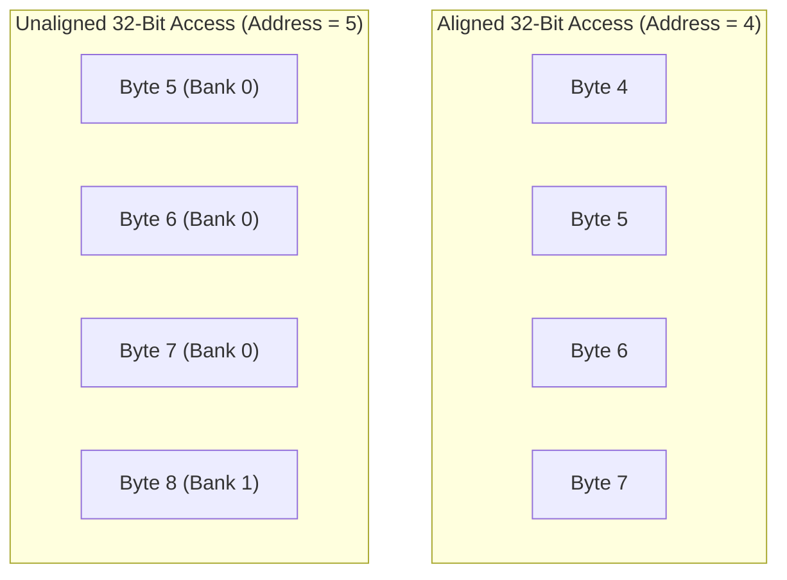
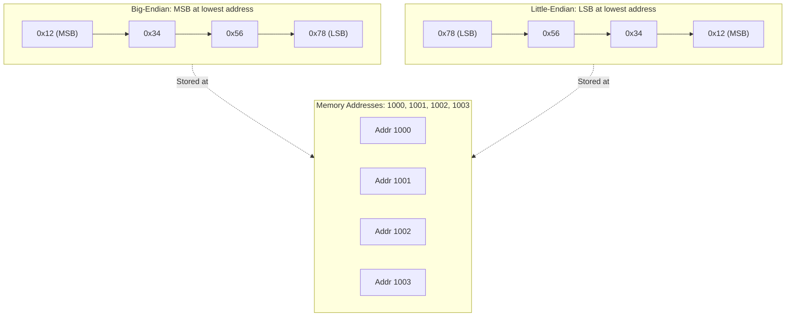

[DLCD Index](../README.md) / [Unit 3: Computer Structure and Organization](Introduction.md)

# L02 - Data Representation and Memory Organization

In the previous lecture, we established that primary memory is an array of storage locations connected to the CPU via address and data buses. But how does physical silicon actually store numbers, text, and memory addresses?

When a compiler writes a 32-bit integer or a string into memory, it must obey strict architectural conventions regarding **byte addressability**, **word alignment**, and **endianness**. Furthermore, the ALU must manipulate negative numbers without requiring separate, dedicated subtraction hardware.

In this lecture, we explore how memory is organized at the byte and word levels, resolve the classic **Big-Endian vs. Little-Endian** conflict, analyze **signed integer representations**, and understand **sign extension**.

---

## Memory Byte Addressability

In the earliest computers, memory was **word-addressable**: if a computer had a 36-bit word length, address `0` referred to the first 36-bit word, address `1` referred to the second 36-bit word, and individual characters inside a word could not be directly addressed.

Modern computing architectures (ARM, x86, RISC-V, MIPS) are universally **byte-addressable**:
> **Every single 8-bit byte in memory is assigned a unique, successive numerical address ($0, 1, 2, 3, \dots$).**

```
Memory Address:    0        1        2        3        4        5
                 +--------+--------+--------+--------+--------+--------+
Data:            | 8 bits | 8 bits | 8 bits | 8 bits | 8 bits | 8 bits |
                 +--------+--------+--------+--------+--------+--------+
```

Why did the computer industry standardize on byte addressability?
Because text, network packets, and file streams are fundamentally streams of 8-bit characters (ASCII bytes). Byte addressability allows a program to read, modify, or advance through a string character-by-character simply by incrementing an address pointer by 1.

If an address bus has $k$ lines, the CPU can address $2^k$ distinct **bytes**. For example:
- A 32-bit address bus can access $2^{32} \text{ bytes} = 4,294,967,296\text{ bytes} = \mathbf{4\text{ Gigabytes (GB)}}$.
- A 64-bit address bus can access $2^{64} \text{ bytes} \approx \mathbf{16\text{ Exabytes (EB)}}$.

---

## Memory Words and Word Alignment

While memory is addressed in bytes, CPUs manipulate data in larger units called **Words**.
- A 32-bit processor has a **word length of 32 bits (4 bytes)**.
- A 64-bit processor has a **word length of 64 bits (8 bytes)**.

When a 32-bit word is stored in memory, it occupies **4 consecutive byte locations**.

### Word Alignment Rules

Memory hardware is physically organized into wide banks (typically 32, 64, or 128 bits wide) that read multiple bytes across the bus simultaneously.

To maximize memory bus transfer efficiency, words must be placed at **aligned memory addresses**:

> **A data item of size $S$ bytes is aligned in memory if its starting byte address is an exact multiple of $S$:**
> $$\text{Address} \pmod S = 0$$

- **16-bit halfword (2 bytes)**: Must start at an even address ($0, 2, 4, 6, 8, \dots$). The lowest address bit must be `0` ($A_0 = 0$).
- **32-bit word (4 bytes)**: Must start at an address divisible by 4 ($0, 4, 8, 12, 16, \dots$). The lowest two address bits must be `00` ($A_1 A_0 = 00$).
- **64-bit doubleword (8 bytes)**: Must start at an address divisible by 8 ($0, 8, 16, 24, \dots$). The lowest three address bits must be `000` ($A_2 A_1 A_0 = 000$).



### The Performance Cost of Unaligned Access

What happens if a program places a 32-bit integer at an unaligned address, say **Address 5**?
- Bytes 5, 6, and 7 reside in the first 4-byte memory word (addresses 4–7).
- Byte 8 resides in the second 4-byte memory word (addresses 8–11).

To read this single integer, the memory controller must:
1. Issue a read to Address 4 to fetch bytes 4–7.
2. Issue a second read to Address 8 to fetch bytes 8–11.
3. Use internal CPU shift-and-mask logic to splice byte 8 onto bytes 5–7.

An unaligned read doubles the memory bus traffic and incurs heavy latency penalties. On some architectures (such as older ARM or SPARC processors), attempting an unaligned memory access throws a fatal hardware trap: **Alignment Fault Bus Error**.

---

## Big-Endian vs. Little-Endian Byte Ordering

Now consider a fundamental dilemma that divided the computing industry for decades:

Suppose we have a 32-bit hexadecimal integer:
$$\mathbf{\text{Value} = 0\text{x}12345678}$$

This word consists of 4 distinct bytes:
- Byte 3 (Most Significant Byte, MSB): `0x12`
- Byte 2: `0x34`
- Byte 1: `0x56`
- Byte 0 (Least Significant Byte, LSB): `0x78`

We decide to store this 4-byte word at memory location **Address 1000** (spanning addresses 1000, 1001, 1002, 1003).

Which byte should be stored at the lowest address (Address 1000)? 
Does the Most Significant Byte go first, or does the Least Significant Byte go first?

This is the famous **Endianness** problem (named by Danny Cohen after the Big-Endians and Little-Endians in Jonathan Swift's *Gulliver's Travels* who fought over which end of a boiled egg to crack first).

---

### Big-Endian Representation

In a **Big-Endian** system, the **Most Significant Byte (MSB)** is stored at the lowest memory address:

| Address | Byte Stored | Significance |
| :---: | :---: | :---: |
| **1000** | `0x12` | Most Significant Byte (MSB) |
| **1001** | `0x34` | Mid-High Byte |
| **1002** | `0x56` | Mid-Low Byte |
| **1003** | `0x78` | Least Significant Byte (LSB) |

- **Natural Reading Order**: Big-Endian matches how humans read numbers from left to right.
- **Architectures**: Motorola 68000, SPARC, IBM PowerPC / Mainframes, and **TCP/IP Network Byte Order** (all Internet packets transmit Big-Endian headers).

---

### Little-Endian Representation

In a **Little-Endian** system, the **Least Significant Byte (LSB)** is stored at the lowest memory address:

| Address | Byte Stored | Significance |
| :---: | :---: | :---: |
| **1000** | `0x78` | Least Significant Byte (LSB) |
| **1001** | `0x56` | Mid-Low Byte |
| **1002** | `0x34` | Mid-High Byte |
| **1003** | `0x12` | Most Significant Byte (MSB) |

- **Mathematical Elegance**: The byte address corresponds directly to the numerical power of 2 ($2^{8 \times 0}, 2^{8 \times 1}, \dots$). Furthermore, a 32-bit integer at address 1000 can be cast to an 8-bit or 16-bit integer without changing the pointer address!
- **Architectures**: Intel x86, AMD64, RISC-V, and modern ARM (which is bi-endian, but configured to Little-Endian by default in Android, iOS, and Linux).



---

## Integer Number Representations

Inside the CPU, binary numbers are manipulated by arithmetic circuits. While unsigned integers are straightforward ($n$ bits represent values from $0$ to $2^n - 1$), representing **signed integers** (positive and negative) requires careful architectural selection.

Historically, three systems were evaluated:

### 1. Sign-and-Magnitude
- The Most Significant Bit (MSB) is a dedicated **sign bit**: $0$ for positive ($+$), $1$ for negative ($-$).
- The remaining $n-1$ bits represent the absolute magnitude of the number.
- For 4 bits: $+5 = 0101_2$, $-5 = 1101_2$.
- **The Fatal Flaws**:
  1. **Dual Representation of Zero**: $+0 = 0000_2$ and $-0 = 1000_2$. Testing `if (x == 0)` requires extra comparator logic.
  2. **Complex Hardware**: Adding positive and negative numbers requires completely separate adder and subtractor units that inspect signs, compare magnitudes, and negate results.

### 2. 1's Complement
- Positive numbers start with $0$ and follow normal binary.
- A negative number is formed by **inverting every single bit** (bitwise NOT) of its positive counterpart: $-A = \overline{A}$.
- For 4 bits: $+5 = 0101_2 \implies -5 = 1010_2$.
- **The Fatal Flaws**:
  1. Still suffers from **dual zeros**: $+0 = 0000_2$ and $-0 = 1111_2$.
  2. Addition requires an **End-Around Carry**: when adding numbers, any carry-out from the MSB must be routed back and added into the LSB, requiring a two-pass addition cycle.

### 3. 2's Complement (The Universal Standard)
- Positive numbers start with $0$ and follow normal binary.
- A negative number is formed by taking the 1's complement and **adding 1**:
  $$\mathbf{-A = \overline{A} + 1}$$
- For 4 bits: $+5 = 0101_2 \implies \overline{0101} = 1010 \implies + 1 = \mathbf{1011_2} = -5$.

Let's examine why **2's complement is universally used in all modern computers**:

1. **Unique Representation of Zero**:
   $+0 = 0000_2$.
   $-0 = \overline{0000} + 1 = 1111 + 1 = 10000_2 \to \mathbf{0000_2}$ (the 5th bit carry is discarded). Zero has exactly one unique binary pattern!
2. **Unified Arithmetic Hardware**:
   Subtractions ($A - B$) are executed using the exact same adder hardware by simply computing $A + (-B) = A + \overline{B} + 1$. As we built in Unit 1 (Lecture 6), setting the Carry-In $C_0 = 1$ and inverting $B$ performs subtraction with zero extra gate stages!
3. **Asymmetric Range**:
   An $n$-bit 2's complement system represents numbers in the range:
   $$\mathbf{-2^{n-1} \quad \text{to} \quad +(2^{n-1} - 1)}$$
   For 8 bits: $-128$ to $+127$. 
   For 32 bits: $-2,147,483,648$ to $+2,147,483,647$.

---

## Sign Extension

In computer programming, we frequently promote a smaller signed integer to a larger integer type (for example, converting an 8-bit `char` or 16-bit `short` into a 32-bit `int` in C/C++).

How do you expand an $n$-bit signed number into an $m$-bit representation ($m > n$) without changing its numerical value?

You perform **Sign Extension**:

> **To expand a 2's complement number into a wider bit-width, replicate the Most Significant Bit (the sign bit) across all newly created upper bit positions.**

### Positive Number Example:
Suppose we expand the 4-bit number $+5$ ($0101_2$) into 8 bits:
- The sign bit is `0`.
- Replicate `0` into the upper 4 bits:
  $$\mathbf{0000}0101_2 = +5_{10}$$

### Negative Number Example:
Suppose we expand the 4-bit number $-5$ ($1011_2$) into 8 bits:
- The sign bit is `1`.
- Replicate `1` into the upper 4 bits:
  $$\mathbf{1111}1011_2$$
- Let's verify its value in 8-bit 2's complement:
  $$\text{Value} = -2^7 + (2^6 + 2^5 + 2^4 + 2^3 + 0 + 2^1 + 2^0)$$
  $$\text{Value} = -128 + (64 + 32 + 16 + 8 + 2 + 1) = -128 + 123 = \mathbf{-5_{10}}$$

The value is perfectly preserved. Modern CPU instruction sets include dedicated sign-extension instructions (e.g., `MOVSX` in x86, `SXTB`/`SXTH` in ARM) to execute this in a single clock cycle.

---

## Character Representations: ASCII and Unicode

Computers manipulate text by mapping human glyphs to standardized numeric byte codes:

1. **ASCII (American Standard Code for Information Interchange)**:
   - A **7-bit code** representing 128 characters ($0$ to $127$): uppercase letters (`A` = `0x41`), lowercase letters (`a` = `0x61`), decimal digits (`0` = `0x30`), punctuation, and control characters (Line Feed `0x0A`, Carriage Return `0x0D`, Null `0x00`).
   - Stored in memory as 8-bit bytes (with the 8th bit either 0 or used for parity).
2. **Unicode (UTF-8, UTF-16, UTF-32)**:
   - Modern global computing requires representing every script on Earth (Chinese, Arabic, Devanagari, Cyrillic, emojis).
   - **UTF-8**: The universal standard of the modern Web and Linux. It is a **variable-length encoding** (1 to 4 bytes per character). Standard ASCII characters occupy exactly 1 byte (making UTF-8 100% backward-compatible with legacy ASCII), while non-Latin characters dynamically expand into 2, 3, or 4 bytes.

---

## Key Takeaways

- Modern computer memory is **byte-addressable**: every 8-bit byte possesses a unique physical address.
- A data word of size $S$ bytes is **aligned** if its starting address is a multiple of $S$ ($\text{Address} \pmod S = 0$). Unaligned accesses require multiple memory bus cycles, severely degrading performance.
- In **Big-Endian** ordering, the Most Significant Byte (MSB) is stored at the lowest address (human reading order; network byte order).
- In **Little-Endian** ordering, the Least Significant Byte (LSB) is stored at the lowest address (x86, RISC-V, ARM).
- **2's Complement** is the universal standard for signed integers because it eliminates negative zero, provides a single unique zero ($0000$), and allows additions and subtractions to use the exact same adder circuit.
- **Sign Extension** converts a signed number to a wider bit format by replicating the sign bit across all newly added upper bit positions.

---

With memory organization, word alignment, and numerical data representations clear, we are ready to examine how the processor actually reads instructions from memory and coordinates execution. In the next lecture, we investigate [**Memory Operations and Instruction Sequencing**](L03%20-%20Memory%20Operations%20and%20Instruction%20Sequencing.md), analyzing the instruction cycle, condition flags, and instruction formats.
