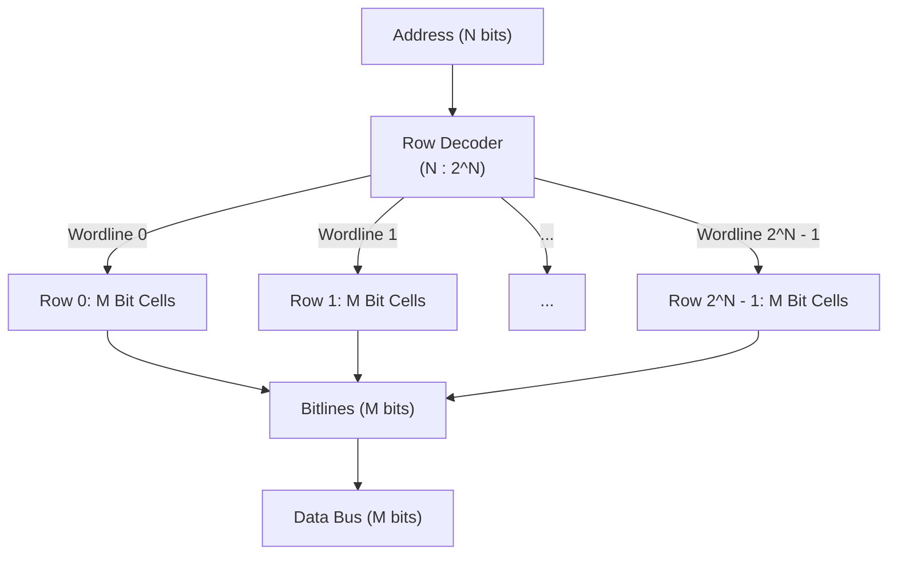
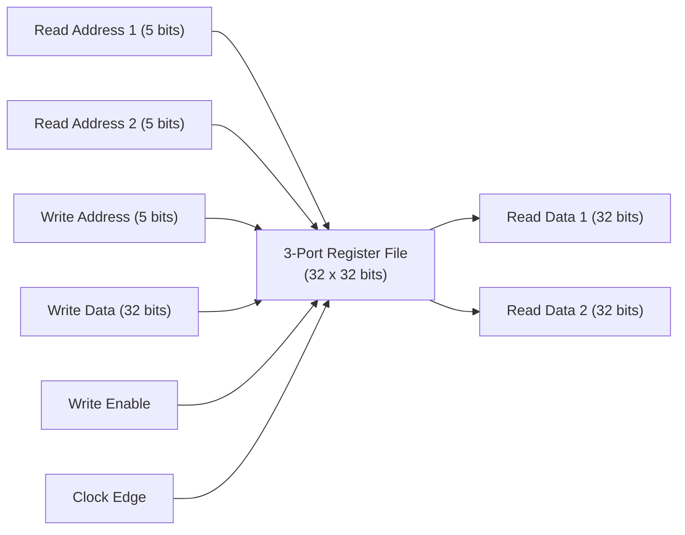
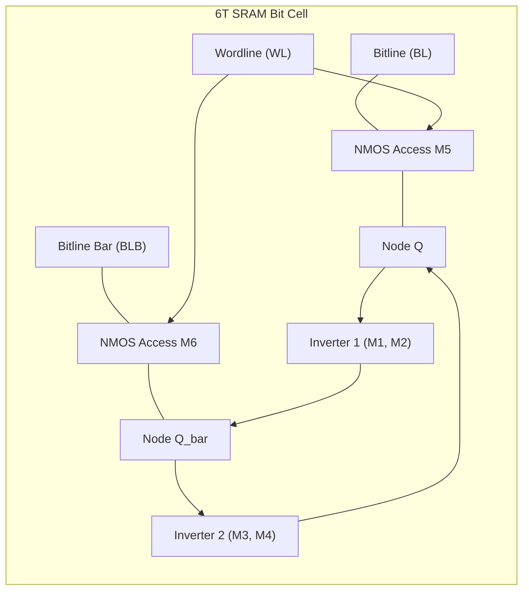
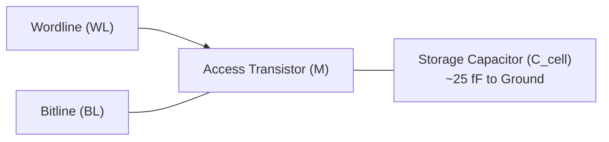
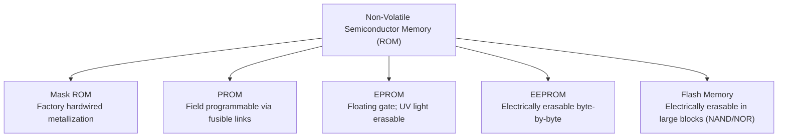
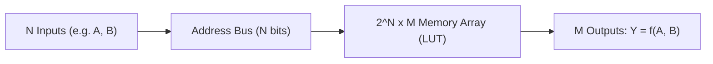

[DLCD Index](../README.md) / [Unit 3: Architecture, Memory, and MIPS Assembly](Introduction.md)

# L02 - Memory Arrays - SRAM, DRAM, and ROM

In the previous lecture, we built registers and shift registers using banks of flip-flops. While flip-flops provide lightning-fast, edge-triggered storage, each flip-flop requires between 16 and 24 transistors. If we attempted to build a modern 16-gigabyte computer memory out of flip-flops, the chip would require over two trillion transistors, consuming untenable amounts of power and silicon area.

To store millions or billions of bits economically, digital designers abandon the bulky flip-flop in favor of **dense, two-dimensional memory arrays**. In this lecture, we examine the structural anatomy of memory arrays, dissect the transistor-level operation of **SRAM** and **DRAM**, compare non-volatile **ROM** variants, and explore how multi-ported register files and memory-based Look-Up Tables (LUTs) execute computation.

---

## The Two-Dimensional Memory Array Architecture

A memory array organizes $1$-bit storage cells into a regular, two-dimensional grid of rows and columns, resembling a dense spreadsheet:
- **Each row** corresponds to one **word** (a group of bits accessed together).
- **Each column** corresponds to one **bit position** of the word.

### Key Dimensional Parameters
- **Depth ($2^N$)**: The number of words (rows) in the memory. An $N$-bit address input decodes into $2^N$ wordlines.
- **Width ($M$)**: The number of bits per word (columns).
- **Total Capacity**: $\text{Capacity} = \text{Depth} \times \text{Width} = 2^N \times M\text{ bits}$.

For example, a memory with a 10-bit address bus and a 32-bit data bus has a depth of $2^{10} = 1024$ words. Its total capacity is $1024 \times 32 = 32,768\text{ bits}$ ($32\text{ Kb}$ or $4\text{ KB}$).

### Wordlines and Bitlines
Every individual bit cell in the grid connects to two perpendicular wires:
- **Wordline (Row wire)**: Driven by the address decoder. For any memory operation, the decoder activates **exactly one wordline**, connecting every bit cell in that chosen row to the column wires.
- **Bitline (Column wire)**: Transfers data into or out of the bit cells. In high-speed memories, bitlines are run as complementary differential pairs ($\text{BL}$ and $\overline{\text{BL}}$) to maximize noise immunity.

### Read vs. Write Operations
- **Read Operation**:
  1. The bitlines are precharged to an intermediate voltage or left floating.
  2. The address decoder asserts the selected wordline HIGH.
  3. The weak internal storage cell in each column drives its bitline slightly HIGH or LOW.
  4. Sensitive analog **sense amplifiers** at the bottom of the columns detect this voltage differential and amplify it into clean digital $0$s and $1$s.
- **Write Operation**:
  1. External **write drivers** forcefully drive the bitlines to full digital voltage levels ($V_{DD}$ and GND).
  2. The wordline is asserted HIGH.
  3. Because the external write drivers are significantly larger and stronger than the tiny transistors inside the bit cell, they **overpower** the cell's internal feedback, forcing the cell into the new state.

---

## Multi-Ported Memories: The Processor Register File

Most commodity memory chips are **single-ported**: they have one address bus and one data bus, allowing only one read or one write operation per cycle.

However, a pipelined CPU datapath cannot survive on single-port access. Consider an arithmetic instruction:

$$\text{add } \$s0, \$s1, \$s2$$

In a single clock cycle, the CPU must **read two source operands** ($\$s1$ and $\$s2$) while simultaneously **writing the destination result** of an earlier instruction ($\$s0$).

This requires a **Multi-Ported Register File**:

A standard 32-bit MIPS register file contains 32 words of 32 bits each, featuring:
- **Two independent read ports**: Read address lines $A_1$ and $A_2$ decode onto two independent sets of wordlines, allowing simultaneous combinational reading of two registers onto buses $\text{RD}_1$ and $\text{RD}_2$.
- **One synchronous write port**: When Write Enable $\text{WE}_3 = 1$, write address $A_3$ decodes onto a write wordline, updating the destination register with $\text{WD}_3$ on the rising clock edge.

---

## Static Random Access Memory (SRAM)

**SRAM (Static RAM)** is volatile semiconductor memory that retains its data indefinitely as long as DC power is supplied, without requiring periodic refresh cycles.

### The 6T SRAM Cell Architecture
A standard SRAM bit cell consists of **six transistors (6T)**:
- **Two cross-coupled CMOS inverters** ($M_1, M_2, M_3, M_4$): Form a bistable latch that continuously reinforces its stored state ($Q$ and $\overline{Q}$).
- **Two NMOS access transistors** ($M_5, M_6$): Connect the internal nodes $Q$ and $\overline{Q}$ to the complementary bitlines ($\text{BL}$ and $\overline{\text{BL}}$) when the wordline ($\text{WL}$) is energized.

### SRAM Operational Characteristics
- **Read Operation**: Non-destructive. The sense amplifiers read the small voltage delta between $\text{BL}$ and $\overline{\text{BL}}$ without flipping the inverters.
- **Write Operation**: The write drivers pull one bitline firmly to $0\text{ V}$, which discharges the corresponding internal node through the access transistor, forcing the inverters to toggle.
- **Speed**: Exceptionally fast access times ($0.5\text{ ns}$ to $2\text{ ns}$).
- **Silicon Area**: Moderate density. At 6 transistors per bit, it is much denser than a flip-flop (~20 transistors) but significantly larger than DRAM.
- **Primary Use**: CPU L1, L2, and L3 on-chip cache memories.

---

## Dynamic Random Access Memory (DRAM)

While SRAM uses 6 transistors to store a bit, **DRAM (Dynamic RAM)** achieves extreme density by storing a bit as an electrical charge on a **single microscopic capacitor**.

### The 1T-1C DRAM Cell Architecture
A DRAM bit cell consists of only **one access transistor and one storage capacitor (1T-1C)**:
- **Storage Capacitor ($C_{\text{cell}}$)**: Stored charge represents the bit ($V_{DD} = 1$, $0\text{ V} = 0$). The capacitance is minuscule—roughly $20$ to $30\text{ femtofarads}$ ($10^{-15}\text{ F}$).
- **Access Transistor ($M$)**: An NMOS pass transistor that gates the capacitor to the bitline when the wordline is activated.

### The Physical Realities of DRAM

1. **Why is it called "Dynamic"?**
   Silicon is not a perfect insulator. Sub-threshold leakage currents constantly bleed charge off the storage capacitor through the access transistor. Within a few milliseconds, a stored $1$ will decay into an ambiguous $0$.
   Therefore, DRAM is **dynamic**: the data must be **periodically refreshed** (read and rewritten) every $64\text{ ms}$ to prevent data loss.

2. **Destructive Read and Charge Sharing**:
   Because the bitline wire is thousands of times longer than the tiny capacitor, the bitline capacitance ($C_{\text{BL}}$) is much larger than the cell capacitance ($C_{\text{cell}}$).
   When the wordline opens the access transistor, charge flows between the capacitor and the bitline, altering the bitline voltage by only a few millivolts ($\Delta V \approx V_{DD} \times \frac{C_{\text{cell}}}{C_{\text{BL}}}$).
   This process **completely drains and destroys the stored charge** in the capacitor! Consequently, every DRAM read cycle must be followed immediately by a **write-back restoration cycle** performed by the sense amplifier.

3. **Speed and Density**:
   - Access time is relatively slow ($40\text{ ns}$ to $60\text{ ns}$) due to capacitor charging, sensing delays, and refresh cycles.
   - Density is unmatched: with only 1 transistor and 1 capacitor, billions of cells fit on a single chip.
   - Primary Use: Main system memory (RAM) in computers and smartphones.

---

## Memory Technology Comparison

Let's contrast the fundamental storage technologies across digital computing:

| Metric | Flip-Flop Register | Static RAM (SRAM) | Dynamic RAM (DRAM) |
|:---|:---:|:---:|:---:|
| **Transistors per Bit** | 16 – 24 | **6** | **1 (+ 1 Capacitor)** |
| **Relative Silicon Area** | $20\times$ (Huge) | $6\times$ (Medium) | **$1\times$ (Ultra-Dense)** |
| **Typical Access Latency** | $< 0.2\text{ ns}$ | $1 – 2\text{ ns}$ | $40 – 60\text{ ns}$ |
| **Volatile?** | Yes | Yes | Yes |
| **Requires Refresh?** | No | **No** | **Yes (Every 64 ms)** |
| **Destructive Read?** | No | No | **Yes (Requires write-back)** |
| **Typical Architectural Role** | CPU Registers, Latches | L1 / L2 / L3 Caches | Main System Memory |

---

## Non-Volatile Memory: Read-Only Memory (ROM)

**Read-Only Memory (ROM)** retains its stored information even when system power is completely removed (non-volatile). Historically used for boot firmware (BIOS), modern ROM architectures are also rewritable.

### The ROM Family Tree
- **Mask ROM**: The bit pattern is physically baked into the silicon masks during manufacturing using presence or absence of metal contacts. It cannot be altered; cheapest for millions of identical units.
- **PROM (Programmable ROM)**: Shipped blank with microscopic fusible links. The user burns fuses using high voltage pulses to program the bits once.
- **EPROM (Erasable PROM)**: Uses floating-gate transistors that trap electrical charge. Erasing requires shining high-intensity **ultraviolet (UV) light** through a clear quartz window on top of the chip package for 20 minutes.
- **EEPROM (Electrically Erasable PROM)**: Uses quantum mechanical Fowler-Nordheim tunneling to erase and write bits electrically in-circuit, without UV light. Supports byte-level erasing.
- **Flash Memory**: The modern standard for solid-state storage. Like EEPROM, it is electrically erasable, but erases data in large **blocks** (e.g., $128\text{ KB}$ sectors) rather than individual bytes, drastically increasing density and write throughput. NAND Flash powers SSDs, SD cards, and smartphone storage; NOR Flash powers CPU BIOS chips.

---

## Memory Arrays as Logic: Look-Up Tables (LUTs)

Beyond storing data, memory arrays can implement **arbitrary combinational logic**.

Recall that a truth table maps $N$ input bits to $M$ output bits. If we take an $N$-input truth table:
- We can connect the $N$ input variables directly to the **$N$ address lines** of a $2^N \times M$ ROM.
- We store the desired output bits of the truth table into the corresponding memory words.
- The $M$ data bitlines produce the logic outputs!

### Example: Implementing $Y = AB$ with a $4 \times 1$ LUT
To implement a 2-input AND gate:
- Number of inputs $N = 2$ ($A, B$). Number of outputs $M = 1$ ($Y$).
- We use a $2^2 \times 1 = 4\text{-word} \times 1\text{-bit}$ memory array:

| $A$ | $B$ | Address | Desired Output ($Y = AB$) | Stored Memory Value |
|:---:|:---:|:---:|:---:|:---:|
| 0 | 0 | $00_2$ ($0$) | 0 | **0** |
| 0 | 1 | $01_2$ ($1$) | 0 | **0** |
| 1 | 0 | $10_2$ ($2$) | 0 | **0** |
| 1 | 1 | $11_2$ ($3$) | 1 | **1** |

The memory simply stores the bit sequence `0, 0, 0, 1`. This concept—the **Look-Up Table (LUT)**—is the core building block of all modern Field-Programmable Gate Arrays (FPGAs). Instead of rewiring physical silicon gates, an FPGA programs the truth tables into small SRAM LUTs!

---

## Key Takeaways

- Memory arrays store words in a regular 2D grid: depth ($2^N$ rows) $\times$ width ($M$ columns). The address decoder drives one wordline; column bitlines transfer data.
- Read operations sense small voltage deltas on bitlines; write operations use strong drivers to overpower cell feedback.
- Multi-ported register files feature multiple independent read ports and write ports, enabling simultaneous parallel operand reads and result writebacks in CPU datapaths.
- SRAM uses 6 transistors (6T) per bit cell configured as cross-coupled inverters. It is static, non-destructive, lightning-fast, and powers CPU caches.
- DRAM uses 1 transistor and 1 capacitor (1T-1C) per bit cell. It is ultra-dense, suffers from destructive reads, and requires periodic charge refresh cycles every $64\text{ ms}$.
- Non-volatile ROM retains data without power. Flash memory erases data in blocks and serves as the foundation for modern solid-state drives.
- A $2^N \times M$ memory array acts as a universal Look-Up Table (LUT), implementing any $N$-input, $M$-output combinational Boolean function.

---

We have mastered both execution hardware (ALUs) and storage arrays (Registers, SRAM, and DRAM). How does a programmer command this hardware to execute software algorithms? In the next lecture, [L03 - Computer Architecture Principles and MIPS Overview](L03%20-%20Computer%20Architecture%20Principles%20and%20MIPS%20Overview.md), we introduce the four golden principles of computer architecture and begin our exploration of the MIPS Instruction Set Architecture!
