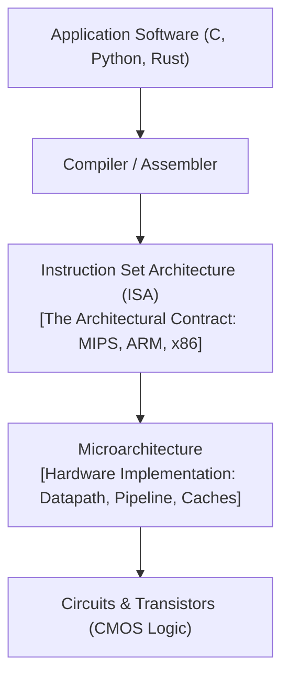
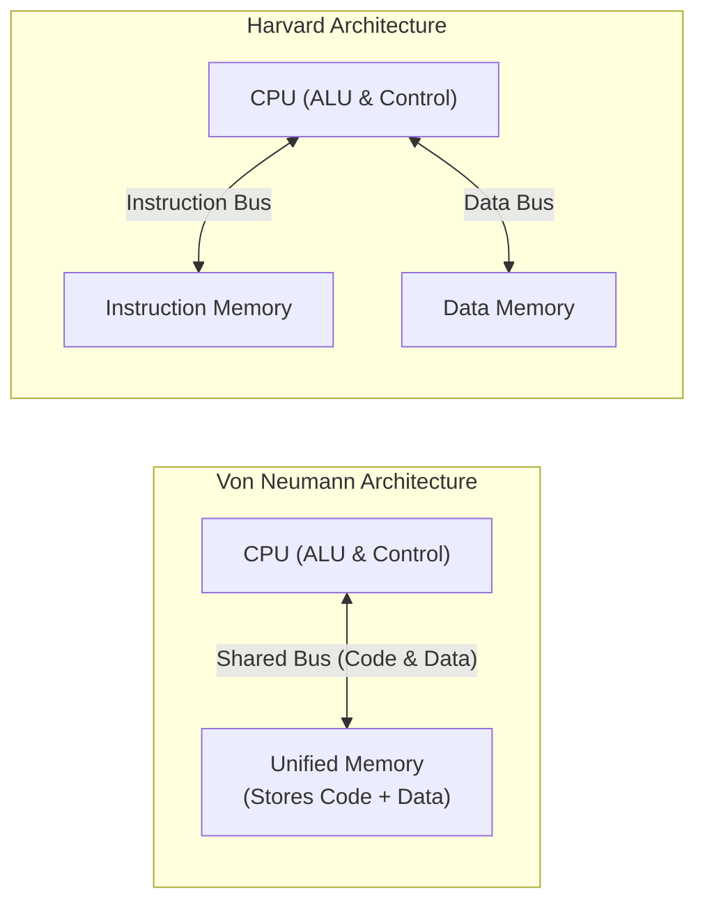
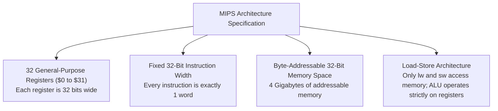

[DLCD Index](../README.md) / [Unit 3: Architecture, Memory, and MIPS Assembly](Introduction.md)

# L03 - Computer Architecture Principles and MIPS Overview

Up to this point, our perspective has been purely physical: we have designed logic gates, traced flip-flop propagation delays, and analyzed memory bit cells. But if you sit down to write software in C, Python, or Rust, you do not think about silicon transistors or sense amplifiers. You think about variables, loops, arithmetic expressions, and memory addresses.

How does the software world talk to the physical hardware? The interface that bridges this chasm is the **Instruction Set Architecture (ISA)**.

In this lecture, we formally define computer architecture, distinguish it from microarchitecture, contrast Von Neumann and Harvard paradigms, and explore the **four foundational design principles** that guided John Hennessy and his team at Stanford University when creating the **MIPS architecture**.

---

## What is Computer Architecture?

**Computer Architecture** is the programmer's view of a computer. It is the formal functional specification that defines how software communicates with hardware.

An architecture specifies:
- The **Instruction Set Architecture (ISA)**: The complete vocabulary of basic commands (instructions) that the processor understands.
- **Operand Locations**: The number, size, and conventions of user-accessible internal storage registers, as well as the structure of system memory.
- **Data Representations**: How integers, characters, and floating-point numbers are encoded in binary.
- **Instruction Formats**: How machine instructions are partitioned into binary bit fields.

### Architecture vs. Microarchitecture
To think like a computer engineer, one must never confuse architecture with microarchitecture:
- **Architecture (ISA)**: The *abstract interface* visible to the compiler and assembly programmer. It defines *what* the machine can do (e.g., "the processor has 32 registers and an instruction called `add`").
- **Microarchitecture**: The *specific physical implementation* of that architecture in silicon. It defines *how* the machine is built (e.g., "is the processor single-cycle, multi-cycle, or 5-stage pipelined? What is the cache size?").

This separation of concerns is the secret to the commercial computer industry. Intel can redesign the internal microarchitecture of its x86 processors every year to run faster, while preserving the exact same x86 ISA so that decades of compiled software run without modification!

---

## Memory Paradigms: Von Neumann vs. Harvard Architectures

Every computer system must store both **instructions** (the program code) and **data** (the variables). Historically, two distinct memory organizations emerged:

### 1. The Von Neumann Architecture
Pioneered by mathematician John von Neumann in 1945, this design stores both instructions and data in a **single, unified memory space**, accessed over a shared memory bus.
- **Advantage**: Simplicity and flexible memory allocation. A program can dynamically allocate space for code or data from the same pool.
- **Drawback (The Von Neumann Bottleneck)**: Because instructions and data share the same bus, the CPU cannot fetch a new instruction while simultaneously reading or writing a data variable in memory. Throughput is strictly bus-bandwidth limited.

### 2. The Harvard Architecture
Developed for the Harvard Mark I computer, this design uses physically **separate memory arrays and separate buses** for instructions and data.
- **Advantage**: The CPU can fetch the next instruction from instruction memory at the exact same physical moment it reads or writes an operand in data memory. Memory bandwidth is doubled!
- **Drawback**: Inflexible silicon resource allocation (unused instruction memory cannot be allocated to hold data variables).

### The Modern Resolution: Modified Harvard Architecture
Modern processors—including MIPS, ARM, and x86—combine the best of both worlds in a **Modified Harvard Architecture**:
- At the execution core, they are **Harvard**: the processor has separate **L1 Instruction Cache** and **L1 Data Cache**, enabling simultaneous instruction fetches and memory accesses per clock cycle.
- Beyond the L1 caches, they are **Von Neumann**: L2/L3 caches and main physical DRAM are unified, allowing operating systems to load programs from disk directly into system memory.

---

## The Four Golden Principles of Computer Architecture

In the early 1980s, computer architects realized that processors with hundreds of complex, variable-length instructions (Complex Instruction Set Computers, or **CISC**, like VAX and early x86) were inefficient. Most instructions were rarely generated by compilers, yet their decoding complexity slowed down every single clock cycle.

John Hennessy (Stanford) and David Patterson (UC Berkeley) pioneered the **RISC (Reduced Instruction Set Computer)** revolution. They articulated four foundational design principles that govern high-performance processor design:

### Principle 1: Simplicity Favors Regularity
Regularity makes hardware design simple, compact, and fast.
- If every instruction is exactly 32 bits wide, the Program Counter can always increment by 4 to fetch the next instruction.
- If every arithmetic instruction has exactly three operands (two sources, one destination), the decoding logic requires only a single, uniform instruction format.
- Irregular exceptions and variable-length instructions complicate decoding pipelines and inflate cycle times.

### Principle 2: Make the Common Case Fast
Engineering effort should focus on optimizing operations that execute most frequently.
- Programs spend over 80% of their execution time running basic loops, pointer arithmetic, and constant increments (`i++`).
- Therefore, MIPS includes immediate-mode arithmetic (`addi`), dedicating 16 bits of the instruction directly to constants, eliminating the need to load small numbers from memory.

### Principle 3: Smaller is Faster
Physical physics governs electronic latency: small circuits are faster than large circuits.
- Signals travel across silicon at a finite speed of light in dielectric ($\approx 15\text{ cm/ns}$).
- A small register file of **32 registers** can be accessed in picoseconds. If the architecture instead specified 1,024 registers, the larger decoding tree and longer wordline capacitances would slow down the register access time, crippling the clock frequency of the entire CPU.

### Principle 4: Good Design Demands Good Compromises
No architectural decision is free; every choice involves engineering trade-offs.
- A fixed 32-bit instruction length is simple and regular (Principle 1). But how can a 32-bit instruction specify an operation, two 32-bit registers, and a 32-bit immediate constant? That would require $6 + 5 + 5 + 32 = 48\text{ bits}$!
- The compromise: MIPS defines multiple instruction formats (R, I, J) that share identical field boundaries, limiting constants to 16 bits in exchange for maintaining a fixed 32-bit instruction footprint.

---

## Overview of the MIPS Architecture

Developed by John Hennessy and his team at Stanford in 1981, **MIPS (Microprocessor without Interlocked Pipeline Stages)** is the quintessential RISC architecture. Hennessy and Patterson were awarded the prestigious **ACM A.M. Turing Award** in 2017 for pioneering these RISC concepts.

### Core Architectural Specifications of MIPS
1. **32-Bit Word Size**: All basic data words, register contents, and instruction encodings are 32 bits wide (4 bytes).
2. **32 General-Purpose Registers**: Named `$0` through `$31` (or symbolically as `$zero`, `$s0-$s7`, `$t0-$t9`, etc.). Register `$0` is physically hardwired to constant `0`.
3. **Fixed-Length Instructions**: Every MIPS instruction occupies exactly 32 bits.
4. **Load-Store Architecture**: ALU instructions (like `add`, `sub`, `and`) can **only** operate on operands residing inside the register file. Memory operands must be explicitly loaded into registers via `lw` (load word) and written back via `sw` (store word).
5. **Byte Addressability**: Memory is addressed at the individual byte level. Because a word is 4 bytes, consecutive word addresses increment by 4 ($0, 4, 8, 12, \dots$).

MIPS processors powered some of the most iconic consumer electronics in history—including the Nintendo 64, Sony PlayStation 1 and PlayStation 2, Cisco Internet core routers, and countless automotive embedded microcontrollers.

---

## Key Takeaways

- Computer Architecture is the programmer's view of a computer (ISA, registers, memory organization, and instruction formats).
- Architecture defines *what* the computer computes; Microarchitecture defines *how* the hardware implements the architecture in silicon.
- Von Neumann architectures use a unified bus for code and data (creating a memory throughput bottleneck); Harvard architectures use separate buses for code and data. Modern CPUs use Harvard L1 caches backed by unified memory.
- The Four Foundational RISC Design Principles:
  1. *Simplicity favors regularity* (uniform 32-bit instructions).
  2. *Make the common case fast* (immediate constants, hardware branch predictors).
  3. *Smaller is faster* (limiting register file to 32 registers for sub-nanosecond access).
  4. *Good design demands good compromises* (fixed-length instructions with 16-bit immediates).
- MIPS is a 32-bit RISC, load-store architecture with 32 general-purpose registers, byte-addressable memory, and fixed 32-bit instruction words.

---

Now that we understand the architectural philosophy of MIPS, how do we write instructions in its native assembly language? In the next lecture, [L04 - MIPS Assembly Language - Instructions and Operands](L04%20-%20MIPS%20Assembly%20Language%20-%20Instructions%20and%20Operands.md), we explore MIPS arithmetic instructions, register conventions, and memory load/store operations.
