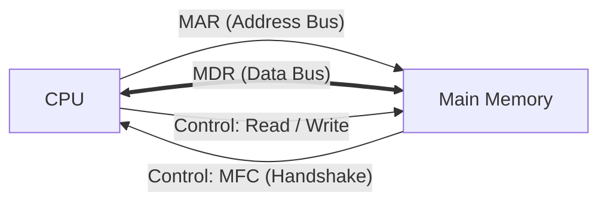
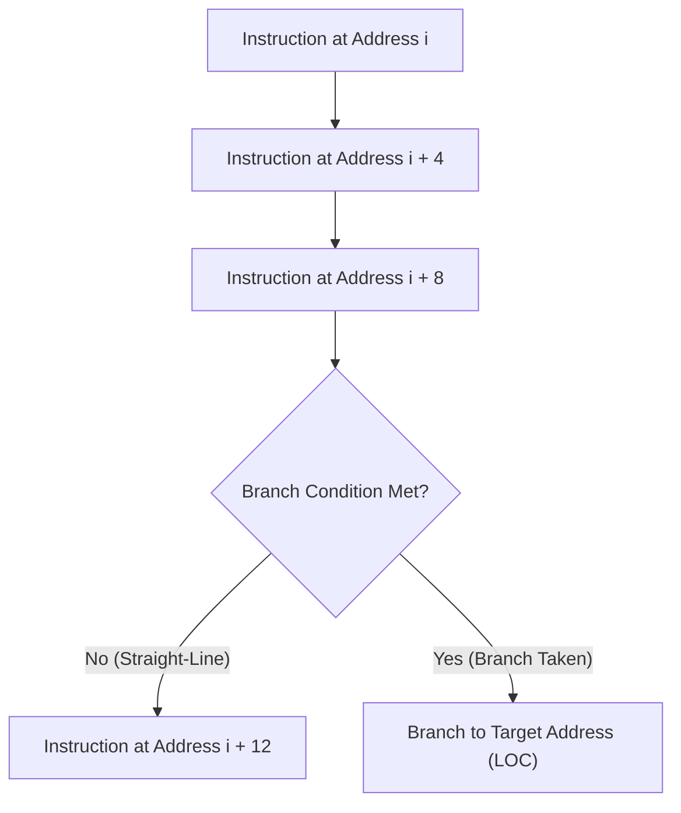
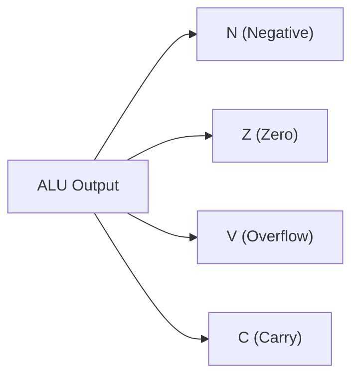
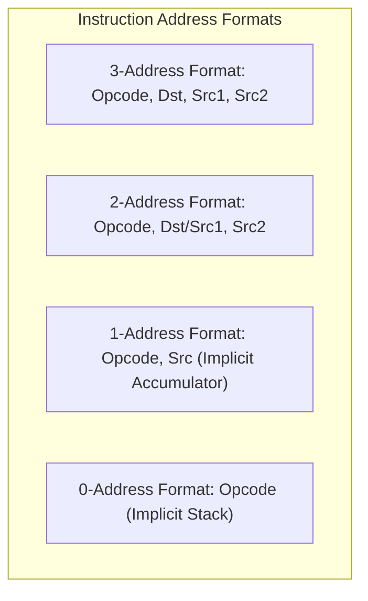

[DLCD Index](../README.md) / [Unit 3: Computer Structure and Organization](Introduction.md)

# L03 - Memory Operations and Instruction Sequencing

A computer program is not executed as a continuous, monolithic stream of thought. It is chopped into discrete, microscopic machine instructions stored in memory. The Central Processing Unit executes these instructions in a perpetual hardware rhythm: fetch the instruction, decode the operation, and execute the micro-steps.

To make this execution possible, the processor must coordinate memory transfers with clock precision, evaluate arithmetic flags to make branching decisions, and format instruction words to encode operations and operands efficiently.

In this lecture, we examine **memory read and write operations**, trace **straight-line sequencing and branching**, dissect the four **condition code flags**, and compare **3-, 2-, 1-, and 0-address instruction formats**.

---

## Memory Operations: Read and Write Cycles

All communication between the processor and memory takes place through two primary operations: **Read** (transferring data from memory to CPU) and **Write** (transferring data from CPU to memory).

The transfer involves four hardware interfaces:
- **MAR (Memory Address Register)**: Connected to the Address Bus.
- **MDR (Memory Data Register)**: Connected to the bidirectional Data Bus.
- **Control Lines**: Read, Write, and **MFC (Memory Function Completed)**.



---

### The Memory Read Operation

To fetch an instruction or read a data variable from memory location `LOC`:

1. The CPU loads the target address `LOC` into the **MAR**:
   $$\text{MAR} \leftarrow \text{LOC}$$
2. The Control Unit asserts the **Read** signal on the control bus.
3. The memory controller receives the address, enables its internal word-line decoders, and senses the stored bits in the RAM array.
4. When the data is stable on the data bus, the memory controller asserts the **MFC (Memory Function Completed)** control signal.
5. Upon sensing MFC, the CPU latches the data lines into the **MDR**:
   $$\text{MDR} \leftarrow \text{Data Bus}$$

---

### The Memory Write Operation

To store a calculated result from an internal register into memory location `LOC`:

1. The CPU loads the destination address `LOC` into the **MAR**:
   $$\text{MAR} \leftarrow \text{LOC}$$
2. The CPU places the data word to be stored into the **MDR**:
   $$\text{MDR} \leftarrow \text{Data Word}$$
3. The Control Unit asserts the **Write** signal on the control bus.
4. The memory controller routes the data from the bus into the selected RAM row and asserts the **MFC** signal once the bits are latched.

---

## The Instruction Execution Cycle

The life cycle of every instruction executed by a CPU consists of three sequential phases:


1. **Fetch**: The processor reads the instruction from memory at the address stored in the Program Counter (PC) and loads it into the Instruction Register (IR). The PC is then automatically incremented:
   $$\text{IR} \leftarrow \text{Memory}[\text{PC}]$$
   $$\text{PC} \leftarrow \text{PC} + 4$$
2. **Decode**: The Control Unit decodes the opcode bits in the IR, determines what ALU operations or memory accesses are needed, and identifies the operand registers.
3. **Execute**: The CPU carries out the command: transferring data, performing an ALU addition, or evaluating a branch condition.

---

## Straight-Line Sequencing vs. Branching

Under normal conditions, instructions are executed in **straight-line sequence**: the CPU executes the instruction at address $i$, then increments the PC to address $i+4$, then $i+8$, and so forth.



However, computing requires loops (`for`, `while`), decisions (`if-else`), and function calls. To break the straight-line flow, the processor uses **Branch (or Jump) Instructions**.

A branch instruction modifies the Program Counter directly:
- **Unconditional Branch (`JMP LOC`)**: Replaces the PC with the target address unconditionally:
  $$\text{PC} \leftarrow \text{LOC}$$
- **Conditional Branch (`BEQ LOC`, `BGT LOC`)**: Inspects the processor's **Condition Code Flags**. If the test evaluates to true, the target address is loaded into the PC; if false, the PC continues in straight-line sequence.

---

## Condition Code Flags (The Flags Register)

Whenever the ALU executes an arithmetic or logical instruction (such as `Add`, `Sub`, `Cmp`), it updates a special register called the **Condition Code Register** (or **Processor Status Word / Flags Register**).

The four most critical condition flags are:



### 1. Negative Flag ($N$)
- Set to **`1`** if the result of the operation is negative in 2's complement representation.
- In hardware, $N$ is connected directly to the **Most Significant Bit (MSB)** of the ALU result ($N = \text{Result}_{31}$).
- Set to **`0`** if the result is positive or zero.

### 2. Zero Flag ($Z$)
- Set to **`1`** if **every single bit of the result is `0`**.
- In hardware, $Z$ is generated by a wide NOR gate combining all bits of the ALU output ($Z = \overline{R_{31} + R_{30} + \dots + R_0}$).
- Used to test equality: comparing $A$ and $B$ is executed by performing $A - B$. If $A = B$, the result is 0, asserting $Z = 1$!

### 3. Overflow Flag ($V$)
- Set to **`1`** if the result of a signed 2's complement operation exceeds the representable range (e.g., adding two large positive numbers produces a negative sign bit).
- In hardware, overflow is detected by XORing the carries into and out of the MSB stage:
  $$V = C_n \oplus C_{n-1}$$

### 4. Carry Flag ($C$)
- Set to **`1`** if an unsigned addition produces a **carry-out** from the MSB ($C_{\text{out}} = 1$), or if a subtraction requires a **borrow**.
- Used for arbitrary multi-word precision arithmetic (adding 128-bit numbers across multiple 32-bit registers).

---

### How Conditional Branches Evaluate Flags

| Assembly Instruction | Full Name | Flag Condition Tested | Practical Meaning |
| :---: | :---: | :---: | :---: |
| **`BEQ`** / **`BZ`** | Branch if Equal / Zero | $Z = 1$ | Operands were equal ($A - B = 0$) |
| **`BNE`** / **`BNZ`** | Branch if Not Equal | $Z = 0$ | Operands differed |
| **`BMI`** | Branch if Minus (Negative) | $N = 1$ | Result was negative |
| **`BPL`** | Branch if Plus (Positive) | $N = 0$ | Result was positive or zero |
| **`BCS`** / **`BULT`** | Branch if Carry Set (Unsigned Less) | $C = 1$ | Unsigned $A < B$ (borrow occurred) |
| **`BGT`** | Branch if Greater Than (Signed) | $(N \oplus V) + Z = 0$ | Signed $A > B$ |

Notice the signed test for `BGT`: it checks $(N \oplus V) = 0$ (the true sign is positive) AND $Z = 0$ (the numbers are not equal). The hardware handles the mathematical subtlety effortlessly.

---

## Instruction Field Formats (Address Schemes)

An instruction must specify two things:
1. **What to do**: The **Opcode** (Operation Code, e.g., `ADD`, `SUB`, `LOAD`).
2. **What to do it to**: The **Operands** (memory addresses or registers).

How many operand addresses should a single instruction word contain? 
Throughout computer history, architectures have been categorized by their **address schemes**:



---

### Comparative Case Study: Evaluating $X = (A + B) \times (C + D)$

To understand the trade-offs in instruction count, code density, and hardware complexity, let's write the assembly program to evaluate the expression:
$$\mathbf{X = (A + B) \times (C + D)}$$
across all four instruction formats.

---

### 1. Three-Address Instructions
Each instruction explicitly specifies two source operands and one separate destination operand:
$$\text{Opcode } \text{Destination}, \text{Source1}, \text{Source2}$$

```assembly
Add   R1, A, B       ; R1 <- Memory[A] + Memory[B]
Add   R2, C, D       ; R2 <- Memory[C] + Memory[D]
Mul   X, R1, R2      ; Memory[X] <- R1 * R2
```

- **Program Length**: Exactly **3 instructions**.
- **Pros**: Clean, non-destructive (source operands $A, B, C, D$ are untouched).
- **Cons**: Requires very wide instruction words to encode three separate addresses, reducing memory code density. (Standard in modern RISC architectures like ARM and RISC-V).

---

### 2. Two-Address Instructions
One operand acts as **both a source and the destination**:
$$\text{Opcode } \text{Dest/Source1}, \text{Source2} \implies \text{Dest} \leftarrow \text{Dest} \text{ OP } \text{Source2}$$

```assembly
Move  R1, A          ; R1 <- Memory[A]
Add   R1, B          ; R1 <- R1 + Memory[B]  (R1 now holds A + B)
Move  R2, C          ; R2 <- Memory[C]
Add   R2, D          ; R2 <- R2 + Memory[D]  (R2 now holds C + D)
Mul   R1, R2         ; R1 <- R1 * R2         (R1 now holds (A+B)*(C+D))
Move  X, R1          ; Memory[X] <- R1
```

- **Program Length**: **6 instructions**.
- **Pros**: Shorter instruction words than 3-address machines.
- **Cons**: Destructive overwrite: the original contents of destination register $R_1$ are lost. (Standard in CISC architectures like Intel x86).

---

### 3. One-Address Instructions (Accumulator Machines)
The processor has a single implicit working register called the **Accumulator ($\text{AC}$)**. Every arithmetic instruction implicitly operates on the Accumulator:
$$\text{Opcode } \text{Operand} \implies \text{AC} \leftarrow \text{AC} \text{ OP } \text{Memory}[\text{Operand}]$$

```assembly
Load  A              ; AC <- Memory[A]
Add   B              ; AC <- AC + Memory[B]
Store T              ; Memory[T] <- AC       (Save temporary sum A + B)
Load  C              ; AC <- Memory[C]
Add   D              ; AC <- AC + Memory[D]  (AC now holds C + D)
Mul   T              ; AC <- AC * Memory[T]  (AC now holds (A+B)*(C+D))
Store X              ; Memory[X] <- AC
```

- **Program Length**: **7 instructions**.
- **Pros**: Very short instruction words (requires only 1 address field). Simple CPU hardware.
- **Cons**: Frequent slow memory accesses to store temporary variables ($T$). (Used in early mainframe computers and small 8-bit microcontrollers).

---

### 4. Zero-Address Instructions (Stack Machines)
Operands are kept on a **Last-In, First-Out (LIFO) Evaluation Stack**. Arithmetic instructions specify no addresses at all; they implicitly pop the top two values from the stack, compute the result, and push the result back onto the stack:

```assembly
Push  A              ; Stack: [A]
Push  B              ; Stack: [A, B]
Add                  ; Pop B, Pop A, Push (A+B) -> Stack: [A+B]
Push  C              ; Stack: [A+B, C]
Push  D              ; Stack: [A+B, C, D]
Add                  ; Pop D, Pop C, Push (C+D) -> Stack: [A+B, C+D]
Mul                  ; Pop (C+D), Pop (A+B), Push Product -> Stack: [(A+B)*(C+D)]
Pop   X              ; Pop result and store into Memory[X]
```

- **Program Length**: **8 instructions**.
- **Pros**: Instructions like `Add` and `Mul` are only 1 byte wide (opcode only). Compilers convert mathematical expressions into Reverse Polish Notation (RPN) with zero register allocation overhead.
- **Implementations**: The Java Virtual Machine (JVM bytecode), Forth programming language, PostScript printers, and Hewlett-Packard RPN scientific calculators.

---

## Architectural Comparison Summary

| Address Scheme | Typical Syntax | Instruction Length | Program Length | Internal CPU State |
| :---: | :---: | :---: | :---: | :---: |
| **3-Address** | `Add R1, R2, R3` | Longest | Shortest (3 inst.) | General Purpose Registers (GPR) |
| **2-Address** | `Add R1, R2` | Medium | Medium (6 inst.) | General Purpose Registers (GPR) |
| **1-Address** | `Add B` | Short | Long (7 inst.) | Single Accumulator (AC) |
| **0-Address** | `Add` | Shortest (Opcode only) | Longest (8 inst.) | Evaluation Stack (TOS) |

---

## Key Takeaways

- Memory transfers require **Read** and **Write** handshakes over Address, Data, and Control buses, synchronized by the Memory Function Completed (MFC) signal.
- The **Instruction Execution Cycle** continuously repeats: **Fetch $\to$ Decode $\to$ Execute**.
- Instructions normally execute in **straight-line sequence** ($\text{PC} \leftarrow \text{PC} + 4$). **Branch instructions** alter execution flow by loading a target address into the Program Counter.
- The ALU updates four primary **Condition Code Flags**:
  - $N$ (Negative): MSB of result is 1.
  - $Z$ (Zero): All result bits are 0.
  - $V$ (Overflow): Signed 2's complement overflow occurred.
  - $C$ (Carry): Unsigned carry-out / borrow occurred.
- Instruction sets are classified into **3-, 2-, 1-, and 0-address formats**, balancing instruction bit-width against overall program length.

---

In our instruction format examples, operands were referenced simply as memory names ($A, B, C$) or registers ($R_1, R_2$). But real programs must access array elements via indices, navigate pointer data structures, and access variables relative to the Program Counter. In the next lecture, we master [**Addressing Modes**](L04%20-%20Addressing%20Modes.md), analyzing all standard mechanisms used by processors to locate operands.
