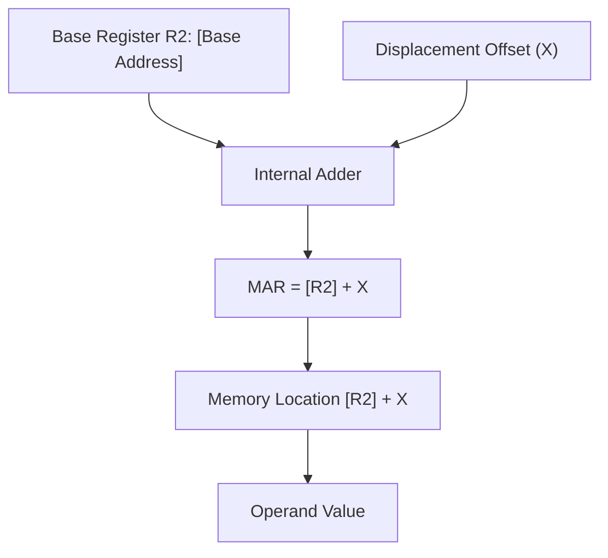

[DLCD Index](../README.md) / [Unit 3: Computer Structure and Organization](Introduction.md)

# L04 - Addressing Modes

In the previous lecture, we saw how instruction words specify operations and operands. But in real software, operands do not always sit at fixed, static memory addresses.

When a C program iterates through an array, dereferences a pointer, accesses a field inside a dynamically allocated `struct`, or invokes a function in a shared library, the CPU must calculate where that data lives at runtime.

The rule or formula a processor uses to interpret the address field of an instruction to determine the actual storage location of an operand is called the **Addressing Mode**. 

The calculated physical location is called the **Effective Address (EA)**. In this lecture, we examine all standard addressing modes, analyze how they translate high-level programming constructs into hardware, and contrast CISC and RISC design philosophies.

---

## Why Do We Need Diverse Addressing Modes?

Consider the diverse data structures you use in software:
- **Constants**: `x = x + 5;` (The number 5 should not require a memory lookup; it should be inside the instruction itself).
- **Local Variables**: Reside in high-speed CPU registers.
- **Global Variables**: Reside at fixed, known memory locations.
- **Pointers**: `*ptr = 42;` (A variable holding the memory address of another variable).
- **Arrays**: `array[i]` (A base address offset by an integer index multiplied by the element size).
- **Relocatable Code**: Operating systems load programs at arbitrary physical memory addresses; branch targets must be relative, not hardcoded.

Addressing modes provide the mathematical vocabulary for hardware to express these programming paradigms directly.

---

## The Primary Addressing Modes

Let's systematically examine each addressing mode from simplest to most complex:

---

### 1. Immediate Mode
In **Immediate Mode**, the operand is not stored in a register or memory location. The actual data value is **embedded directly inside the instruction word** itself.

- **Assembly Syntax**: `Add R1, #100` or `MOV R1, 100`
- **Effective Address**: None (operand is in the instruction).
- **Hardware Mechanism**: The operand is extracted directly from the Instruction Register (IR) during the decode phase.
- **Use Case**: Initializing variables with constant values or performing arithmetic with fixed numerical literals.
- **Memory References**: **Zero** memory accesses beyond the initial instruction fetch.

---

### 2. Register Mode
In **Register Mode**, the operand resides inside one of the CPU's internal general-purpose registers ($R_0 \dots R_{n-1}$). The instruction specifies only the register name.

- **Assembly Syntax**: `Add R1, R2`
- **Effective Address (EA)**: $R_2$
- **Operand**: $\text{Contents of } R_2$ ($[R_2]$)
- **Use Case**: Manipulating local variables and temporary calculation values.
- **Memory References**: **Zero**. Register access is near-instantaneous (a fraction of a nanosecond), making this the fastest mode in computing.

---

### 3. Absolute (Direct) Mode
In **Absolute Mode**, the instruction word contains the exact, hardcoded memory address where the operand is stored.

- **Assembly Syntax**: `Move R1, [1000]` or `Load R1, LOC`
- **Effective Address (EA)**: $\text{LOC}$
- **Operand**: $\text{Memory}[\text{LOC}]$
- **Hardware Mechanism**: Address `LOC` is extracted from IR, placed into MAR, and a memory read is executed.
- **Use Case**: Accessing static global variables whose memory locations are fixed at compile time.
- **Memory References**: **One** memory access.

---

### 4. Register Indirect Mode
In **Register Indirect Mode**, the instruction specifies a register, but that register does not hold the data operand. Instead, the register holds the **memory address** of the operand.

- **Assembly Syntax**: `Move R1, (R2)` or `LDR R1, [R2]`
- **Effective Address (EA)**: $[R_2]$ (The contents of $R_2$)
- **Operand**: $\text{Memory}[[R_2]]$
- **Use Case**: This is the hardware implementation of **Pointers** in C/C++ (`*ptr`). The pointer address is loaded into register $R_2$, and dereferencing the pointer reads the memory location stored in $R_2$.
- **Advantage**: The program can change the target memory location dynamically at runtime simply by modifying the contents of register $R_2$.

---

### 5. Memory Indirect Mode
In **Memory Indirect Mode**, the instruction contains a memory address `LOC`, which in turn contains the address of the actual operand!

- **Assembly Syntax**: `Move R1, @LOC` or `Move R1, ([LOC])`
- **Effective Address (EA)**: $\text{Memory}[\text{LOC}]$
- **Operand**: $\text{Memory}[\text{Memory}[\text{LOC}]]$
- **Memory References**: **Two** full memory accesses (one to read the pointer, and a second to read the data). Because multiple memory reads stall high-speed pipelines, memory indirect mode is avoided in modern RISC architectures.

---

### 6. Indexed Mode
In **Indexed Mode**, the effective address is generated by adding a constant offset (displacement $X$) to the contents of an index register ($R_i$):

$$\mathbf{\text{EA} = [R_i] + X}$$
$$\mathbf{\text{Operand} = \text{Memory}[[R_i] + X]}$$

- **Assembly Syntax**: `Move R1, X(R2)` or `LDR R1, [R2, #X]`
- **Hardware Mechanism**: The CPU ALU adds the constant $X$ (embedded in the instruction) to the value in register $R_2$, and loads the sum into the MAR.
- **Use Case**: Ideal for **Array Traversals**:
  - Register $R_2$ holds the base address of the array (`&array[0]`).
  - Displacement $X$ represents the element index.
  - Or conversely: $X$ holds the fixed base address of the array, and $R_2$ acts as the loop index ($i$) incremented on every iteration!

---

### 7. Base with Index Mode
In **Base with Index Mode**, the effective address is generated by adding the contents of **two separate registers**: a Base Register ($R_{\text{base}}$) and an Index Register ($R_{\text{index}}$), often with an optional displacement:

$$\mathbf{\text{EA} = [R_{\text{base}}] + [R_{\text{index}}] + X}$$

- **Assembly Syntax**: `Move R1, (R_base, R_index)` or `LDR R1, [R_base, R_index]`
- **Use Case**: Essential when accessing arrays inside subroutines. $R_{\text{base}}$ points to the array passed as a function argument, while $R_{\text{index}}$ tracks the local loop counter.

---

### 8. Relative (PC-Relative) Addressing Mode
**Relative Mode** is a specialized version of indexed mode where the base register is implicitly the **Program Counter (PC)**:

$$\mathbf{\text{EA} = [\text{PC}] + X}$$

- **Assembly Syntax**: `Branch_if_Zero LOC` (where $X = \text{LOC} - \text{PC}$)
- **Hardware Mechanism**: The displacement $X$ is a signed offset added to the current PC. If $X$ is negative, the branch jumps backward (loops); if positive, it jumps forward (skipping code).
- **The Supreme Advantage**: **Position-Independent Code (PIC)**!
  Because branch targets are specified relative to the current instruction rather than as hardcoded absolute addresses, the entire compiled program can be loaded at *any* arbitrary physical address in RAM without modifying a single branch instruction. This makes modern shared libraries (`.so` in Linux, `.dll` in Windows) possible.

---

### 9. Autoincrement Mode
In **Autoincrement Mode**, the effective address is the current content of register $R_i$. But immediately after the memory access completes, the register is **automatically incremented by the size of the data item** ($d = 1, 2, 4, \text{ or } 8$ bytes):

$$\mathbf{\text{EA} = [R_i]}$$
$$\mathbf{R_i \leftarrow [R_i] + d \quad \text{(After access)}}$$

- **Assembly Syntax**: `Move R1, (R2)+` or `LDR R1, [R2], #4`
- **Use Case**: Array stepping. A single instruction reads an array element and advances the pointer to the next element simultaneously, eliminating a separate `ADD R2, #4` instruction. In C, this directly implements `*ptr++`.

---

### 10. Autodecrement Mode
In **Autodecrement Mode**, the register is **decremented by the data size first**, and the new decremented value is then used as the effective address:

$$\mathbf{R_i \leftarrow [R_i] - d \quad \text{(Before access)}}$$
$$\mathbf{\text{EA} = [R_i]}$$

- **Assembly Syntax**: `Move R1, -(R2)` or `LDR R1, [R2, #-4]!`
- **Use Case**: Together, Autoincrement and Autodecrement modes provide the exact hardware primitives needed to implement **Stacks**:
  - Pushing onto a stack: `Move -(SP), R1` (decrement Stack Pointer, then write).
  - Popping from a stack: `Move R1, (SP)+` (read data, then increment Stack Pointer).

---

## Addressing Modes Summary Table

| Mode Name | Assembler Syntax | Effective Address (EA) | Operand Value | Primary Software Use Case |
| :---: | :---: | :---: | :---: | :---: |
| **Immediate** | `#Value` | None | `Value` | Constants, literals |
| **Register** | `Ri` | None | $[R_i]$ | Local variables, fast calculation |
| **Absolute (Direct)** | `[LOC]` | $\text{LOC}$ | $\text{Memory}[\text{LOC}]$ | Static global variables |
| **Register Indirect** | `(Ri)` | $[R_i]$ | $\text{Memory}[[R_i]]$ | C pointers (`*ptr`) |
| **Memory Indirect** | `@LOC` | $\text{Memory}[\text{LOC}]$ | $\text{Memory}[\text{Memory}[\text{LOC}]]$ | Pointer to pointer (`**ptr`) |
| **Indexed** | `X(Ri)` | $[R_i] + X$ | $\text{Memory}[[R_i] + X]$ | Static arrays (`array[i]`), struct fields |
| **Base with Index** | `(Rb, Ri)` | $[R_b] + [R_i]$ | $\text{Memory}[[R_b] + [R_i]]$ | Dynamic arrays, 2D matrices |
| **Relative (PC)** | `Label` | $[\text{PC}] + X$ | $\text{Memory}[[\text{PC}] + X]$ | Branching, Position-Independent Code |
| **Autoincrement** | `(Ri)+` | $[R_i]$ | $\text{Memory}[[R_i]]$; $R_i \leftarrow R_i + d$ | Stepping through arrays (`*ptr++`), Pop |
| **Autodecrement** | `-(Ri)` | $[R_i] - d$ | $R_i \leftarrow R_i - d$; $\text{Memory}[[R_i]]$ | Push onto stack, reverse traversal |

---

## CISC vs. RISC Philosophy on Addressing Modes

The historical debate between CISC (Complex Instruction Set Computers) and RISC (Reduced Instruction Set Computers) centers heavily on addressing modes:

- **The CISC Approach (e.g., x86)**:
  CISC architectures provide dozens of rich, highly complex addressing modes. For example, x86 supports:
  $$\text{EA} = [\text{Base}] + [\text{Index} \times \text{Scale}] + \text{Displacement}$$
  in a single instruction! This maximizes code density, but requires complex multi-cycle decoding hardware and variable-length instructions.
- **The RISC Approach (e.g., ARM, RISC-V, MIPS)**:
  RISC architectures enforce a strict **Load/Store Architecture**:
  - Arithmetic instructions (`ADD`, `SUB`, `MUL`) can **only operate on registers**. They cannot access memory!
  - Only two dedicated instructions can touch memory: **`Load` (LDR)** and **`Store` (STR)**.
  - Addressing modes are limited to simple register indirect or base-plus-offset.
  
By eliminating complex memory addressing modes, RISC instructions fit into uniform 32-bit words, allowing the CPU pipeline to fetch and execute instructions at the rate of one instruction per clock cycle.

---

## Key Takeaways

- An **Addressing Mode** defines how the CPU calculates the **Effective Address (EA)** of an operand from the instruction word.
- **Immediate Mode** embeds the literal value in the instruction word; **Register Mode** holds the data inside an internal CPU register.
- **Register Indirect Mode** ($[R_i]$) implements C pointer dereferencing (`*ptr`).
- **Indexed Mode** ($[R_i] + X$) evaluates base-plus-displacement for array traversals and data structures.
- **PC-Relative Mode** ($[\text{PC}] + X$) enables **Position-Independent Code (PIC)** by generating branch addresses relative to the current Program Counter.
- **Autoincrement** and **Autodecrement** modes provide post-increment and pre-decrement pointer adjustments, serving as hardware engines for stack Push and Pop operations.
- CISC architectures support complex memory addressing modes across all instructions, while RISC restricts memory addressing strictly to dedicated Load and Store instructions.

---

Now that we know how instructions locate operands in memory, how do software programs actually coordinate execution, translate symbolic instructions, and structure memory? In the next lecture, we analyze [**Assembly Language and Program Execution**](L05%20-%20Assembly%20Language%20and%20Program%20Execution.md), examining assembly language syntax, assembler directives, two-pass translation, and program loading.
