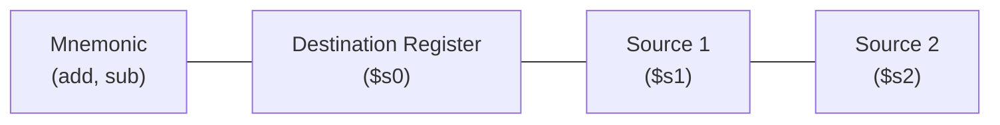
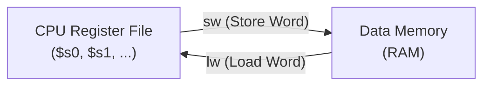
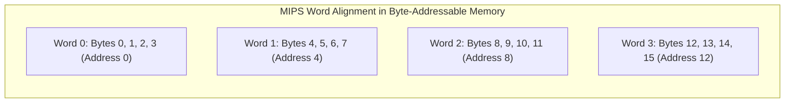
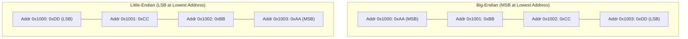

[DLCD Index](../README.md) / [Unit 3: Architecture, Memory, and MIPS Assembly](Introduction.md)

# L04 - MIPS Assembly Language - Instructions and Operands

In the previous lecture, we established the foundational principles of computer architecture and saw that MIPS is a 32-bit Reduced Instruction Set Computer (RISC). But how does a programmer express algorithms in this architecture, and where does the processor find the data it needs to compute?

In this lecture, we learn the grammar of **MIPS Assembly Language**. We examine the syntax of arithmetic instructions (`add`, `sub`, `addi`), explore the structure and software conventions of the **32-register processor register file**, analyze byte addressing and memory access via **Load Word (`lw`)** and **Store Word (`sw`)**, and dissect endianness and alignment constraints.

---

## Assembly Syntax: The Anatomy of an Instruction

An instruction is a single command executed by the processor. While hardware executes binary bits ($1$s and $0$s), programmers write human-readable **assembly language**.

In MIPS, arithmetic instructions follow a strictly regular format governed by Principle 1 (*Simplicity Favors Regularity*):

$$\mathbf{\text{mnemonic}} \quad \mathbf{\text{destination}}, \quad \mathbf{\text{source1}}, \quad \mathbf{\text{source2}}$$



Consider the C statement:
```c
a = b + c;
```
If variable `a` is stored in register `$s0`, `b` in `$s1`, and `c` in `$s2`, the compiler produces:
```assembly
add $s0, $s1, $s2       # $s0 = $s1 + $s2
```

Notice something crucial: **the destination register is always written first**, on the left! The operation takes the contents of `$s1`, adds the contents of `$s2`, and overwrites `$s0` with the result.

### Breaking Down Complex Expressions
High-level programming languages allow arbitrarily long expressions, but MIPS arithmetic instructions accept **strictly two source operands**. To evaluate a complex mathematical statement:
```c
a = b + c - d;
```
The compiler must decompose the expression into a sequence of simple two-operand instructions, using a temporary register (say, `$t0`) to hold intermediate results:
```assembly
add $t0, $s1, $s2       # $t0 = b + c
sub $s0, $t0, $s3       # a = $t0 - d
```

This is the essence of RISC: complex software operations are constructed from chains of simple, ultra-fast hardware primitives.

---

## The Three Operand Locations

Every processor instruction performs an operation on operands. In MIPS, data operands can reside in three physical locations:
1. **Registers**: Fast, on-chip storage directly inside the CPU core.
2. **Immediate Constants**: Numbers encoded directly inside the instruction word.
3. **Memory**: The vast, external DRAM storage space holding programs, arrays, and objects.

---

## Operand Location 1: The MIPS Register File

MIPS provides **32 general-purpose registers**, numbered `$0` through `$31`. Each register holds a 32-bit word.

To make assembly code readable and maintainable across software libraries, MIPS defines standard software conventions and symbolic names for each register:

| Register Number | Symbolic Name | Architectural Purpose / Software Convention | Preservation Rule |
|:---:|:---:|:---|:---|
| **`$0`** | **`$zero`** | Constant value **`0`** (Hardwired in silicon; writes are ignored) | Constant |
| **`$1`** | **`$at`** | Assembler Temporary (Reserved for macro expansion) | Do not use |
| **`$2 – $3`** | **`$v0 – $v1`** | Values returned by subroutines / functions | Not preserved |
| **`$4 – $7`** | **`$a0 – $a3`** | Arguments passed into subroutines | Not preserved |
| **`$8 – $15`** | **`$t0 – $t7`** | Temporary registers (Caller-saved; can be overwritten) | Not preserved |
| **`$16 – $23`** | **`$s0 – $s7`** | Saved registers (Callee-saved; functions must preserve) | Preserved |
| **`$24 – $25`** | **`$t8 – $t9`** | Additional temporaries | Not preserved |
| **`$26 – $27`** | **`$k0 – $k1`** | Reserved for OS Kernel exception handlers | Reserved |
| **`$28`** | **`$gp`** | Global Pointer (Points to static global variables) | Preserved |
| **`$29`** | **`$sp`** | Stack Pointer (Points to the active stack top) | Preserved |
| **`$30`** | **`$fp`** | Frame Pointer | Preserved |
| **`$31`** | **`$ra`** | Return Address (Holds target address for function return) | Preserved |

### The Power of `$zero`
Why dedicate an entire register exclusively to constant zero?
Because zero is the most common constant in computer science. Having `$zero` hardwired allows MIPS to synthesize other operations without dedicated hardware instructions:
- **Move Register**: Copying `$s1` into `$s0` is simply `add $s0, $s1, $zero`.
- **Negate Value**: Computing $-B$ is simply `sub $s0, $zero, $s1`.
- **Clear Register**: Setting a register to zero is `add $s0, $zero, $zero`.

---

## Operand Location 2: Immediate Constants (`addi`)

Programs constantly operate on numerical constants (`i = i + 4;`). If constants had to be stored in memory and loaded over the memory bus, programs would crawl.

Governed by Principle 2 (*Make the Common Case Fast*), MIPS provides immediate instructions like **`addi` (Add Immediate)**:

$$\mathbf{\text{addi}} \quad \mathbf{\text{destination}}, \quad \mathbf{\text{source}}, \quad \mathbf{\text{immediate\_constant}}$$

```assembly
addi $s0, $s0, 4        # a = a + 4
addi $s1, $s0, -12      # b = a - 12
```

Notice something interesting: **MIPS does not have a `subi` (Subtract Immediate) instruction!**
Why? Because the 16-bit immediate field in `addi` is a signed 2's complement number. To subtract $12$, you simply add $-12$! Adding a separate `subi` instruction would violate Principle 1 (*Simplicity Favors Regularity*) by adding redundant opcode decoding hardware for no functional gain.

---

## Operand Location 3: Memory Access (`lw` and `sw`)

Registers are ultra-fast, but 32 registers can hold only 128 bytes of data. Large arrays, data structures, and compiled object code must reside in **Main Memory**.

Because MIPS is a **load-store architecture**, arithmetic instructions cannot access memory directly. Instead, data must be transferred between memory and registers using two dedicated instructions:
- **`lw` (Load Word)**: Copies a 32-bit word from memory into a register.
- **`sw` (Store Word)**: Copies a 32-bit word from a register out to memory.



### Base Addressing Syntax
Both `lw` and `sw` use **Base Addressing**:

$$\mathbf{\text{lw}} \quad \mathbf{\text{target\_register}}, \quad \mathbf{\text{offset(base\_register)}}$$

$$\mathbf{\text{sw}} \quad \mathbf{\text{source\_register}}, \quad \mathbf{\text{offset(base\_register)}}$$

The effective memory address is calculated by taking the 32-bit base address stored in the base register and adding the 16-bit sign-extended integer offset:

$$\text{Effective Address} = \text{Contents}(\text{base\_register}) + \text{offset}$$

### Example: Compiling an Array Access
Consider the C code:
```c
A[8] = h + A[2];
```
Assume the base address of integer array `A` is in `$s3`, and variable `h` is in `$s2`.
In C, integers are 32-bit words (4 bytes each). Therefore:
- The byte offset for element `A[2]` is $2 \times 4 = \mathbf{8\text{ bytes}}$.
- The byte offset for element `A[8]` is $8 \times 4 = \mathbf{32\text{ bytes}}$.

The compiled MIPS assembly is:
```assembly
lw  $t0, 8($s3)         # Load A[2] into temporary $t0
add $t0, $s2, $t0       # $t0 = h + A[2]
sw  $t0, 32($s3)        # Store result into A[8]
```

---

## Memory Organization: Byte Addressability and Word Alignment

Memory is structured as a continuous array of 8-bit bytes. Each byte has its own unique numeric memory address.



### The Word Alignment Constraint
In a 32-bit computer, a word consists of **4 bytes**.
To simplify memory controller hardware and maximize bus throughput, MIPS enforces the **Word Alignment Constraint**:
- A 32-bit word **must start at a byte address that is a multiple of 4**.
- Valid word addresses: `0, 4, 8, 12, 16, 20, ...` (`0x00, 0x04, 0x08, 0x0C, 0x10, ...`).
- In binary, any number that is a multiple of 4 has its **lowest two bits equal to `00`** ($A_{1:0} = 00$).
- Attempting to load a word from address `0x00000003` or `0x00000005` triggers a fatal processor hardware exception (**Alignment Fault**)!

---

## Big-Endian vs. Little-Endian Byte Ordering

When a 32-bit word (e.g., `0xAABBCCDD`) is written to a 4-byte memory slot starting at address `0x1000`, which byte goes into address `0x1000`, and which goes into `0x1003`?

Digital architectures are split into two camps, named after Jonathan Swift's *Gulliver's Travels*:
- **Big-Endian**: The **Most Significant Byte (Big End)** is stored at the lowest byte address.
- **Little-Endian**: The **Least Significant Byte (Little End)** is stored at the lowest byte address.



### How to Detect Endianness via Assembly
Can a software program detect which endianness its host processor uses?
Yes! Write the word `0x00000001` into memory, and then read the single byte at the base address (`lbu`):
- If the byte read is `0x01`: The lowest address holds the LSB $\implies$ **Little-Endian** (x86, ARM default).
- If the byte read is `0x00`: The lowest address holds the MSB $\implies$ **Big-Endian** (Internet IP headers, classic MIPS).

---

## Practice Translation: Bit-Shifting via Addition

Can we left-shift a number by 3 bit positions ($x \ll 3$) using *only* the `add` instruction?
Recall from arithmetic: shifting a binary number left by 1 position is equivalent to multiplying by 2 ($x \times 2 = x + x$).
Therefore, to left-shift by 3 positions ($x \times 2^3 = 8x$), we simply add the number to itself three consecutive times:
```assembly
add $t0, $s0, $s0       # $t0 = x + x = 2x
add $t0, $t0, $t0       # $t0 = 2x + 2x = 4x
add $t0, $t0, $t0       # $t0 = 4x + 4x = 8x = x << 3
```
Using only one temporary register, we perform multiplication by 8 using pure addition!

---

## Key Takeaways

- MIPS arithmetic instructions use a regular 3-operand format: `operation destination, source1, source2`.
- Complex high-level expressions must be decomposed into sequential chains of simple 2-operand instructions using temporary registers.
- The MIPS register file contains 32 registers (`$0 – $31`). Register `$zero` is hardwired to constant `0`.
- Software conventions assign distinct roles: `$v0-$v1` (returns), `$a0-$a3` (arguments), `$t0-$t9` (temporaries), `$s0-$s7` (saved variables), `$sp` (stack pointer), and `$ra` (return address).
- Immediate instructions (`addi`) encode 16-bit signed constants directly inside the instruction word; subtraction is performed by adding negative immediates.
- Memory is accessed exclusively through `lw` and `sw` using base-offset addressing: `offset($base)`.
- In byte-addressable memory, 32-bit words are aligned on byte addresses that are multiples of 4 ($A_{1:0} = 00$).
- Big-Endian stores the MSB at the lowest byte address; Little-Endian stores the LSB at the lowest byte address.

---

Assembly language is clear to human programmers, but a CPU's fetch unit understands only binary $1$s and $0$s. How does the assembler convert `add $s0, $s1, $s2` into a 32-bit binary number? In the next lecture, [L05 - MIPS Machine Language and Instruction Formats](L05%20-%20MIPS%20Machine%20Language%20and%20Instruction%20Formats.md), we decode R-Type, I-Type, and J-Type machine code.
