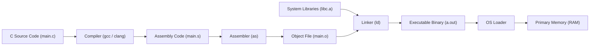
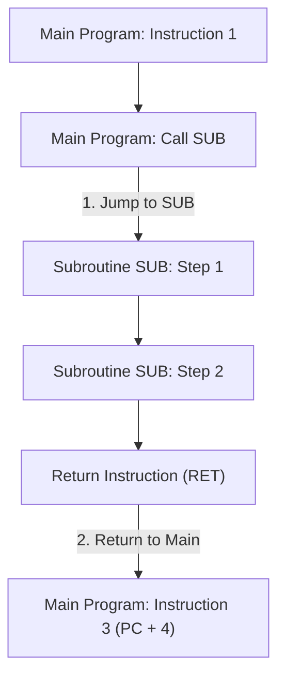
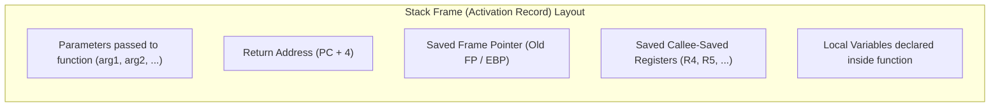

[DLCD Index](../README.md) / [Unit 3: Computer Structure and Organization](Introduction.md)

# L05 - Assembly Language and Program Execution

At the lowest physical level, a computer understands only raw binary bit patterns: voltages charging gates inside the instruction register. Humans, however, cannot write or debug streams of hexadecimal numbers like `0xE59F1004` without making constant errors.

To bridge the gap between human programmers and physical silicon, the computer industry developed **Assembly Language**: a human-readable symbolic representation of machine instructions.

In this lecture, we examine the **translation toolchain**, analyze **assembly syntax and assembler directives**, dissect the mechanics of **subroutines and parameter passing**, and trace the architecture of the **processor stack frame**.

---

## The Program Translation Toolchain

How does a high-level C/C++ program become voltage pulses executed by the CPU? It travels through a multi-stage software translation pipeline:



1. **Compiler**: Translates high-level constructs (`for`, `if`, arithmetic) into architecture-specific assembly language statements (`.s`).
2. **Assembler**: Translates symbolic assembly mnemonics into raw binary machine code, generating an **Object File (`.o`)**. The object file contains binary opcodes, raw data, and a symbol table listing functions and external references.
3. **Linker**: Resolves cross-file references, combines multiple object files with pre-compiled system libraries, and merges them into a single, cohesive **Executable Binary**.
4. **Loader**: An operating system utility that copies the executable from disk into RAM, resolves dynamic library addresses, allocates the stack and heap, and jumps the Program Counter to the entry point (`_start` / `main`).

---

## Assembly Language Syntax

An assembly language source file is composed of a sequence of text lines. Each line follows a standardized four-column format:

$$\mathbf{\text{[Label:]} \quad \text{Mnemonic (Opcode)} \quad \text{[Operands]} \quad \text{[; Comment]}}$$

```assembly
LOOP:   ADD     R1, R1, #1      ; Increment counter register R1
        CMP     R1, #10         ; Compare counter against limit 10
        BNE     LOOP            ; If R1 != 10, branch back to LOOP
```

Let's dissect each field:
1. **Label**: An optional symbolic identifier placed at the start of a line (often followed by a colon). The assembler assigns the label a numerical value equal to the memory address where that instruction or data item will be located. Labels eliminate the need for programmers to calculate hardcoded memory addresses for jumps and variables.
2. **Mnemonic (Opcode)**: The symbolic name of the hardware instruction (e.g., `ADD`, `SUB`, `MOV`, `LDR`, `STR`, `JMP`, `BEQ`). The assembler maps each mnemonic to its physical binary opcode.
3. **Operands**: The input parameters required by the instruction. Operands may be register names (`R1`), immediate constants (`#10`), or memory address labels (`TOTAL`).
4. **Comments**: Text preceded by a delimiter (typically `;` or `//`). Comments are ignored by the assembler and serve entirely for human documentation.

---

## Assembler Directives (Pseudo-Instructions)

Not every line in an assembly file corresponds to a hardware CPU instruction. Many lines are instructions directed **to the assembler program itself**, commanding it how to organize memory, define constants, or reserve space.

These are called **Assembler Directives** (or **Pseudo-Ops**):

```assembly
        .ORIG   0x2000          ; Directive: Place following code at address 0x2000
MAX_VAL .EQU    100             ; Directive: Define symbolic constant MAX_VAL = 100

        .DATA                   ; Directive: Switch to Data Segment
COUNT   .WORD   0               ; Directive: Reserve 4-byte word initialized to 0
MESSAGE .STRING "HELLO"         ; Directive: Reserve null-terminated ASCII string

        .TEXT                   ; Directive: Switch to Code (Instruction) Segment
START:  LDR     R0, COUNT       ; Real CPU instruction: Load variable COUNT into R0
        ADD     R0, R0, #1      ; Real CPU instruction: Increment R0
        STR     R0, COUNT       ; Real CPU instruction: Store R0 back to memory
        .END                    ; Directive: Marks physical end of assembly source
```

### Common Assembler Directives:
- **`ORIG` / `ORG <address>`**: Sets the assembler's Location Counter, dictating the starting memory address for subsequent instructions.
- **`EQU <symbol>, <value>`**: Associates a constant value with a symbolic name. Replaced textually during assembly with zero memory cost.
- **`DATA` and `TEXT`**: Informs the linker to partition memory into read-only executable code segments (`.text`) versus read-write variable data segments (`.data`).
- **`BYTE`, `WORD`, `SPACE`**: Reserves storage in memory:
  - `.BYTE 5, 12, 0xFF`: Allocates consecutive 8-bit bytes.
  - `.WORD 1000`: Allocates an aligned 32-bit (4-byte) integer.
  - `.SPACE 64`: Reserves a block of 64 uninitialized bytes (e.g., an empty buffer).

---

## Subroutines and the Return Address Problem

Modern software is built from modular, reusable functions known in hardware as **Subroutines** (or **Procedures**).

When a program invokes a subroutine, execution must:
1. Jump the Program Counter to the first instruction of the subroutine.
2. Execute the subroutine body.
3. Jump *back* to the calling program at the exact instruction immediately following the call instruction.



The memory address of `Instruction 3` is called the **Return Address**.

How should the processor remember the return address?
- **Attempt 1: Dedicated CPU Register (Link Register)**:
  In simple RISC architectures (like ARM's `LR` register), executing `BL SUB` (Branch with Link) automatically copies the return address into register $R_{14}$ (`LR`).
  *The Fatal Flaw*: What happens if `SUB` itself calls a second subroutine `SUB2`? 
  The new call will overwrite `LR`! The original return address back to `Main` is erased forever.
- **The Universal Solution: The Processor Stack**:
  To support nested function calls and recursive programming, return addresses must be saved in a **Last-In, First-Out (LIFO)** data structure in memory: the **Stack**.

---

## The Processor Stack

The **Processor Stack** is a dynamically managed region of RAM. A dedicated internal CPU register called the **Stack Pointer (SP)** permanently holds the memory address of the current **Top of the Stack (TOS)**.

### Architectural Convention: Stacks Grow Downward
In virtually all modern computer architectures (x86, ARM, RISC-V, MIPS):
- The stack starts at a **high memory address** and **grows downward toward lower memory addresses**.
- Pushing data onto the stack *decrements* the Stack Pointer.
- Popping data from the stack *increments* the Stack Pointer.

```
High Memory:    +-------------------------+
                | Previous Stack Data     |
                +-------------------------+
                | Word 1                  |
                +-------------------------+
SP Points Here: | Top of Stack (Word 2)   |  <- Lower Address
                +-------------------------+
                | Unused / Available      |  |
Low Memory:     +-------------------------+  v (Stack Grows Downward)
```

---

### Hardware Push and Pop Operations

1. **The Push Operation (`PUSH R1`)**:
   Pushes the contents of register $R_1$ onto the stack:
   $$\text{SP} \leftarrow \text{SP} - 4 \quad \text{(Pre-decrement Stack Pointer)}$$
   $$\text{Memory}[\text{SP}] \leftarrow R_1 \quad \text{(Write data to top of stack)}$$
2. **The Pop Operation (`POP R1`)**:
   Retrieves the top word from the stack and places it into register $R_1$:
   $$R_1 \leftarrow \text{Memory}[\text{SP}] \quad \text{(Read data from top of stack)}$$
   $$\text{SP} \leftarrow \text{SP} + 4 \quad \text{(Post-increment Stack Pointer)}$$

Notice something we learned in Lecture 4: **Push is physically an Autodecrement store (`STR R1, [SP, #-4]!`), and Pop is physically an Autoincrement load (`LDR R1, [SP], #4`)!**

---

### Hardware Mechanics of `CALL` and `RETURN`

When the CPU executes a hardware subroutine call instruction:
$$\mathbf{\text{CALL SUB}}$$

The processor automatically performs two microscopic steps in hardware:
1. Pushes the return address (the address of the instruction following the `CALL`, i.e., $\text{PC} + 4$) onto the stack:
   $$\text{SP} \leftarrow \text{SP} - 4$$
   $$\text{Memory}[\text{SP}] \leftarrow \text{PC}$$
2. Loads the target address of the subroutine into the Program Counter:
   $$\text{PC} \leftarrow \text{Address of SUB}$$

When the subroutine finishes, it terminates with:
$$\mathbf{\text{RET} \quad \text{(Return)}}$$

The processor executes:
1. Pops the saved return address from the top of the stack directly into the Program Counter:
   $$\text{PC} \leftarrow \text{Memory}[\text{SP}]$$
   $$\text{SP} \leftarrow \text{SP} + 4$$

Because the stack is LIFO, functions can call functions to arbitrary depths. The return addresses are unwound in the exact reverse order of invocation, making infinite nesting and recursion mathematically sound.

---

## The Subroutine Stack Frame (Activation Record)

When a high-level language compiler translates a function, it does not use the stack merely for return addresses. It allocates a dedicated memory block on the stack called a **Stack Frame** (or **Activation Record**) for every single function invocation.



### Frame Pointer (FP) vs. Stack Pointer (SP)
- **Stack Pointer (SP)**: Moves constantly during function execution as intermediate values are pushed and popped.
- **Frame Pointer (FP)**: A fixed reference register (often `R11` in ARM or `EBP`/`RBP` in x86). When a function is entered, the FP is set to the base of the current stack frame.
- **The Advantage**: Local variables and passed parameters can be accessed at **constant, fixed offsets from the FP** (e.g., `[FP, #-8]` for local variable 1, `[FP, #8]` for parameter 1), completely unaffected by fluctuations in the SP!

---

## Parameter Passing Mechanisms

How does a calling program pass arguments (`x`, `y`) to a subroutine, and how does the subroutine return the result?

Three primary techniques exist:

### 1. Passing in Registers
- The caller places parameters directly into designated general-purpose registers (e.g., in ARM ABI, registers `R0`–`R3` are reserved for arguments; in x86-64, `RDI`, `RSI`, `RDX`, `RCX`, `R8`, `R9`).
- **Pros**: Fastest method possible (zero RAM accesses).
- **Cons**: Limited by the number of CPU registers. If a function takes 10 arguments, registers run out!

### 2. Passing in Memory Locations
- The caller writes arguments into global memory locations, and the subroutine reads them.
- **Cons**: Completely breaks in multi-threaded programs and cannot support recursion (the next call overwrites the memory variables).

### 3. Passing on the Stack (Universal Standard)
- The caller pushes arguments onto the stack before executing the `CALL` instruction.
- The subroutine reads the parameters using indexed addressing relative to the Frame Pointer (`[FP, #offset]`).
- The return value is placed in register `R0` (or `RAX`).
- **Pros**: Unlimited number of parameters, 100% thread-safe, and natively supports recursion.

---

## Key Takeaways

- The software compilation pipeline translates source code: **Compiler $\to$ Assembler $\to$ Linker $\to$ Loader $\to$ CPU Execution**.
- An assembly line consists of: **[Label:] Mnemonic [Operands] [; Comments]**.
- **Assembler Directives** (`.ORIG`, `.EQU`, `.DATA`, `.TEXT`, `.WORD`) are commands to the assembler tool, not executable machine instructions.
- Subroutine invocation uses the **Processor Stack** to store return addresses, enabling arbitrary nesting and recursion.
- In modern computers, the stack **grows downward** from high memory toward low memory.
- `CALL` pushes $\text{PC} + 4$ onto the stack and updates the PC; `RET` pops the saved return address back into the PC.
- A **Stack Frame** encapsulates return addresses, saved registers, function arguments, and local variables, addressed reliably via the **Frame Pointer (FP)**.

---

Up to this point, our processor has executed programs in an isolated computational universe of CPU registers and memory. But real computers must communicate with the outside world: reading keypresses, streaming audio, and saving files to storage disks. In the next lecture, we examine [**Input-Output Organization and Accessing IO Devices**](L06%20-%20Input-Output%20Organization%20and%20Accessing%20IO%20Devices.md), comparing Memory-Mapped I/O against Port-Mapped I/O and analyzing polling routines.
