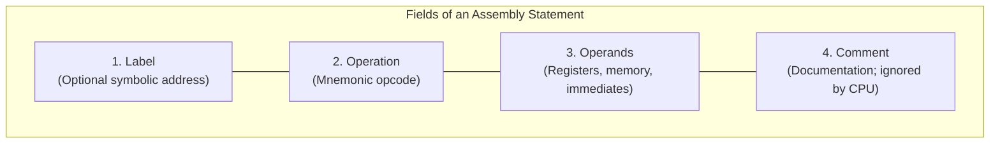
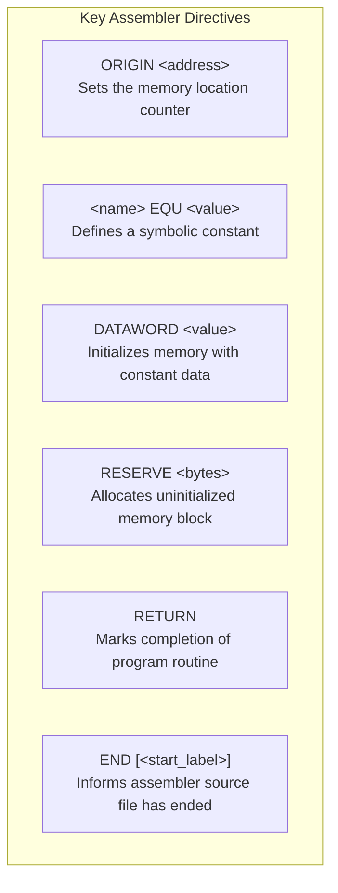
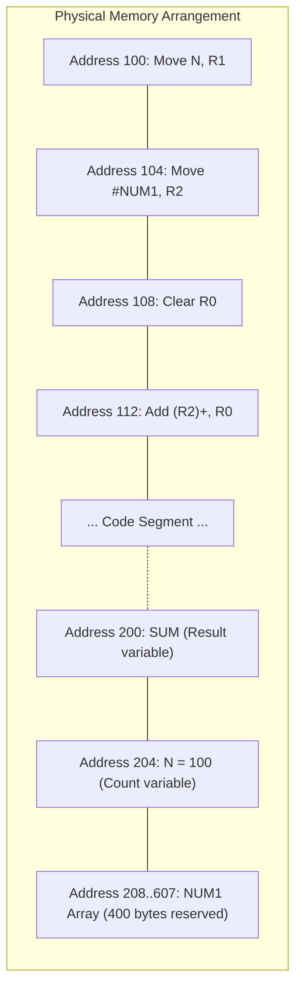
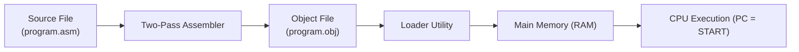
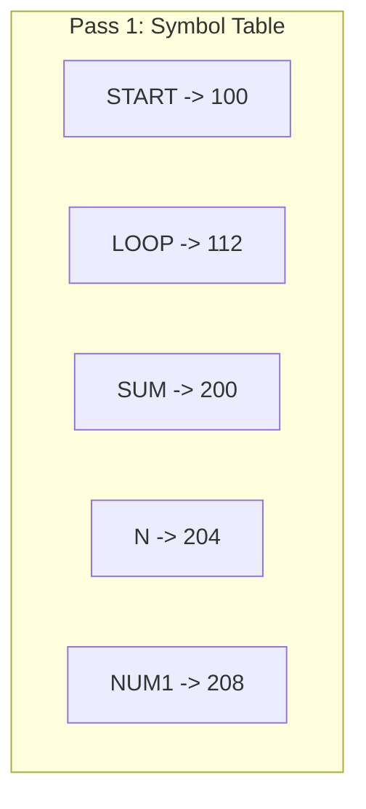

[DLCD Index](../README.md) / [Unit 3: Computer Structure and Organization](Introduction.md)

# L05 - Assembly Language and Program Execution

High-level programming languages like C, Java, and Python allow developers to write algorithms using abstract mathematical expressions and loops. However, the physical processor understands only one thing: **binary machine code**—streams of $0$s and $1$s packed into specific bit fields that toggle control wires.

Writing raw machine code by hand is painfully slow and prone to catastrophic error. To bridge the gap between human readability and physical hardware execution, we use **Assembly Language**.

In assembly language, binary opcodes are replaced with intuitive text abbreviations called **mnemonics**, memory addresses are replaced with symbolic names (labels), and numbers can be written in decimal or hexadecimal. In this lecture, we examine assembly language syntax, assembler directives, the two-pass assembly process, and how programs are loaded into memory for execution.

---

## Assembly Language Syntax

An assembly language program consists of a sequence of text statements. Each statement corresponds either to a single machine instruction or to an instruction for the assembler itself.

A standard assembly instruction statement is divided into four distinct fields:

$$\mathbf{[Label] \quad Operation \quad Operand(s) \quad [Comment]}$$



### 1. Label Field
An optional identifier placed at the very start of a line (often followed by a colon). The assembler assigns the label a numerical value equal to the memory address where the instruction or data item will be stored. Labels allow programmers to jump to target locations (e.g., `LOOP:`, `START:`) without calculating raw numerical memory addresses.

### 2. Operation Field
Specifies the operation to be performed. This can be:
- An **Instruction Mnemonic**: A symbolic name for a hardware machine instruction (e.g., `Move`, `Add`, `Subtract`, `Branch`).
- An **Assembler Directive**: A command to the assembler program (e.g., `ORIGIN`, `EQU`, `DATAWORD`).

### 3. Operand Field
Specifies the data items on which the instruction operates. Depending on the addressing mode, an operand can be:
- A processor register: `R0`, `R1`
- A memory address or symbolic label: `SUM`, `TOTAL`
- An immediate numerical constant: `#100`, `#2FH`

### 4. Comment Field
Begins with a special character (such as a semicolon `;` or slash) and extends to the end of the line. Comments are purely for human documentation and are discarded by the assembler.

### Example Assembly Statements

```assembly
LOOP:   Add     (R2)+, R0       ; Add number pointed to by R2 to R0, then autoincrement R2
        Decrement R1            ; Decrement loop counter
        Branch_gt LOOP          ; If R1 > 0, branch back to label LOOP
        Move    R0, SUM         ; Store final total into memory location SUM
```

---

## Number Notation

Assembly languages support multiple number representations so programmers can write values in the format that best fits the data:
- **Decimal Numbers**: Written directly as standard numbers (e.g., `ADD #93, R1` adds decimal 93).
- **Hexadecimal Numbers**: Indicated by a trailing `H` or prefix `0x` (e.g., `ADD #2BH, R1` or `ADD #0x2B, R1`).
- **Binary Numbers**: Indicated by a trailing `B` or prefix `%` (e.g., `ADD #%1011101, R1`).

The immediate prefix symbol `#` informs the assembler that the value is an **immediate constant operand**, not a memory address!
- `Move 100, R1` $\implies$ Copy the contents of memory address 100 into `R1`.
- `Move #100, R1` $\implies$ Load the actual numerical constant 100 directly into `R1`.

---

## Assembler Directives (Pseudo-Instructions)

Unlike regular machine instructions, which are translated into binary opcodes and executed by the CPU, **Assembler Directives** are commands directed exclusively to the assembler program during the translation process. They generate no machine instructions of their own.

Assembler directives define where code and data are located in memory, allocate storage space, define constants, and mark the end of the source file.



### 1. `ORIGIN`
Tells the assembler the starting physical memory address where the subsequent machine instructions or data items must be placed.
```assembly
        ORIGIN  204     ; Place following instructions starting at byte address 204
```

### 2. `EQU` (Equate)
Associates a symbolic name with a fixed numerical value. It does not allocate memory; it simply acts like a `#define` constant in C.
```assembly
SUM     EQU     200     ; Wherever 'SUM' appears, substitute the value 200
```

### 3. `DATAWORD`
Initializes a word of memory with a specific data value.
```assembly
N       DATAWORD 5      ; Allocate 1 word of memory initialized to the integer 5
```

### 4. `RESERVE`
Allocates an uninitialized block of consecutive memory bytes without writing data into them (e.g., reserving memory for an array or output buffer).
```assembly
ARRAY   RESERVE 400     ; Reserve 400 contiguous bytes of memory
```

### 5. `RETURN` and `END`
- `RETURN`: Identifies the point where execution of a program or routine should terminate (returning control back to the operating system).
- `END`: The physical last line of the source code. It tells the assembler to stop reading the file and optionally specifies the program's starting entry point (e.g., `END START`).

---

## A Complete Program Memory Layout Example

Consider a complete assembly program that adds a list of $n$ numbers:

```assembly
; Memory allocation for data variables
        SUM     EQU     200     ; Define symbolic address for SUM
        ORIGIN  204             ; Place data variables starting at address 204
N       DATAWORD 100            ; Number of elements (N = 100)
NUM1    RESERVE 400             ; Reserve 400 bytes for 100 integers (4 bytes each)

; Code segment
        ORIGIN  100             ; Place instructions starting at address 100
START:  Move    N, R1           ; Load count N into register R1
        Move    #NUM1, R2       ; Load base address of array NUM1 into R2
        Clear   R0              ; Clear accumulator register R0

LOOP:   Add     (R2)+, R0       ; Add element pointed to by R2, advance pointer
        Decrement R1            ; Decrement remaining count
        Branch_gt LOOP          ; If R1 > 0, repeat loop

        Move    R0, SUM         ; Store final sum into location 200
        RETURN                  ; Return control to OS
        END     START           ; End of program; execution begins at START
```



---

## Assembly and Execution of Programs

How does an ASCII text file containing assembly statements get converted into electrons flowing through CPU registers?

The transformation follows a three-stage pipeline:



### The Two-Pass Assembler
Because instructions can branch forward to labels that have not yet been defined in the file (forward references), assemblers scan the source file in **two sequential passes**:

1. **Pass 1: Symbol Table Construction**:
   - The assembler maintains a **Location Counter (LC)** initialized by `ORIGIN` directives.
   - It reads every statement line-by-line.
   - Whenever it encounters a label in the label field, it records the label and the current value of LC into an internal database called the **Symbol Table**.
   - It increments LC by the byte length of each instruction or data reservation.
   - At the end of Pass 1, every symbolic label is mapped to a concrete physical address!

2. **Pass 2: Machine Code Generation**:
   - The assembler scans the source file a second time.
   - It translates each mnemonic into its binary machine opcode.
   - It looks up every label used in operand fields in the Symbol Table and substitutes the actual numerical address or relative offset.
   - It outputs the completed binary instructions into an **Object File** on disk.



### The Loader Program
The object file created by the assembler resides on secondary storage (disk/SSD). To execute:
1. An operating system utility called the **Loader** reads the object program header.
2. The header tells the loader the starting memory address (`ORIGIN`) and total length of the program.
3. The loader copies the machine code bytes into the designated memory locations in RAM.
4. Finally, the loader places the program's starting address (`START = 100`) into the processor's **Program Counter (PC)**.
5. The CPU begins executing the first instruction, and the program runs.

---

## Basic Input/Output in Assembly

Computers must communicate with user peripherals like keyboards and display screens. In basic I/O programming, keyboard and display interfaces provide two memory-mapped registers:
- `DATAIN` / `DATAOUT`: Hold the ASCII character being read or sent.
- `STATUS`: Contains hardware flags indicating readiness:
  - $\text{SIN} = 1$: New character is available in `DATAIN`.
  - $\text{SOUT} = 1$: Display is ready to accept a new character in `DATAOUT`.

### Polling Loop in Assembly: Reading a Character
```assembly
READ:   TestBit #3, STATUS      ; Test SIN flag (bit 3)
        Branch_zero READ        ; Loop until character arrives (busy-waiting)
        Move    DATAIN, R0      ; Fetch character into register R0
```

This simple loop is called **Programmed I/O** (or polling). While functional, it wastes millions of CPU cycles waiting for slow humans. In the next lecture, we examine hardware interrupts to eliminate this inefficiency.

---

## Key Takeaways

- Assembly language uses mnemonic operation codes, symbolic labels, and user-defined names to make machine-level programming human-readable.
- An assembly statement comprises four fields: optional Label, Operation (mnemonic or directive), Operands, and Comments.
- Assembler directives (`ORIGIN`, `EQU`, `DATAWORD`, `RESERVE`, `END`) are instructions for the assembler tool, not machine instructions executed by the CPU.
- Assemblers operate in two passes: Pass 1 builds the Symbol Table mapping labels to memory addresses; Pass 2 translates mnemonics and substitutes addresses to generate the binary Object File.
- The Loader copies the object file from disk into RAM and sets the Program Counter to the entry label to initiate execution.

---

Now that we know how instructions are written, translated, and organized in memory, we need to examine how the CPU communicates with external hardware devices. In the next lecture, we explore [**Input-Output Organization, Polling, and Interrupts**](L06%20-%20Input-Output%20Organization,%20Polling,%20and%20Interrupts.md).
