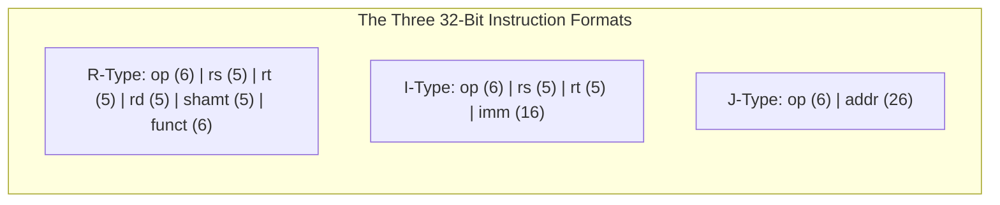
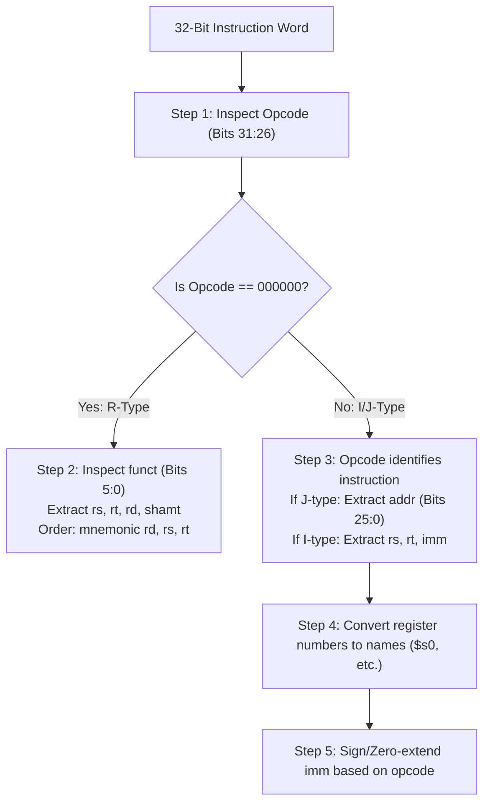
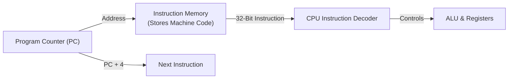

[DLCD Index](../README.md) / [Unit 3: Architecture, Memory, and MIPS Assembly](Introduction.md)

# L05 - MIPS Machine Language and Instruction Formats

In the previous lecture, we wrote human-readable assembly instructions like `add $s0, $s1, $s2` and `lw $t0, 8($s3)`. But a CPU contains no English text decoders. The silicon fetch unit reads strictly 32-bit binary words consisting of high and low voltages.

How does the assembler convert symbolic text into binary patterns, and how does the processor hardware decode those bits to configure its ALU, registers, and multiplexers?

In this lecture, we examine **MIPS Machine Language**. We analyze the three standardized 32-bit instruction formats—**R-Type (Register)**, **I-Type (Immediate)**, and **J-Type (Jump)**—and step through the exact algorithms used to encode assembly statements into hexadecimal words and decode arbitrary bit patterns back into assembly instructions.

---

## The Three Standard MIPS Instruction Formats

Guided by Design Principle 1 (*Simplicity Favors Regularity*), every MIPS instruction is **exactly 32 bits wide**. Rather than creating dozens of arbitrary layouts, MIPS defines just three instruction formats that share identical field positions:



Notice the regularity:
- The first 6 bits (bits 31:26) are **always the opcode (`op`)**.
- The second field (bits 25:21) is **always the first source register (`rs`)** in both R-type and I-type formats.
- The third field (bits 20:16) is **always register `rt`** in both R-type and I-type formats.

---

## 1. R-Type (Register) Instructions

The **R-Type format** is used for computational operations where all operands reside in internal registers (such as `add`, `sub`, `and`, `or`, `nor`, `slt`, and bit shifts).

### Bit Field Breakdown

| Field Name | Bits | Field Width | Description / Architectural Meaning |
|:---|:---:|:---:|:---|
| **`op`** | 31:26 | 6 bits | **Opcode**: Always **`000000`** ($0$) for all R-type instructions. |
| **`rs`** | 25:21 | 5 bits | **Source Register 1**: The first operand register ($0 – 31$). |
| **`rt`** | 20:16 | 5 bits | **Source Register 2**: The second operand register ($0 – 31$). |
| **`rd`** | 15:11 | 5 bits | **Destination Register**: The register that receives the ALU result ($0 – 31$). |
| **`shamt`** | 10:6 | 5 bits | **Shift Amount**: Specifies shift distance ($0 – 31$) for shift instructions; `0` otherwise. |
| **`funct`** | 5:0 | 6 bits | **Function Code**: Tells the ALU the exact operation to execute. |

### The Assembly vs. Machine Code Ordering Trap
Notice an essential detail:
- In assembly language: `add rd, rs, rt` (destination comes **first**).
- In binary machine code: `op | rs | rt | rd | shamt | funct` (destination `rd` is the **third** register field).
The assembler automatically swaps these register numbers into their proper hardware bit positions!

### Common R-Type Function Codes (`op = 000000_2`)

| Instruction | Assembly Syntax | `funct` (Decimal) | `funct` (Binary) |
|:---|:---|:---:|:---:|
| `add` | `add rd, rs, rt` | 32 | `100000` |
| `sub` | `sub rd, rs, rt` | 34 | `100010` |
| `and` | `and rd, rs, rt` | 36 | `100100` |
| `or` | `or rd, rs, rt` | 37 | `100101` |
| `nor` | `nor rd, rs, rt` | 39 | `100111` |
| `slt` | `slt rd, rs, rt` | 42 | `101010` |
| `sll` | `sll rd, rt, shamt` | 0 | `000000` |
| `srl` | `srl rd, rt, shamt` | 2 | `000010` |

### Walkthrough: Encoding an R-Type Instruction
Translate the assembly statement into 32-bit machine code:
```assembly
add $t0, $s4, $s5
```
1. **Identify Instruction and Format**: `add` is an R-type instruction $\implies \text{op} = 000000_2$, $\text{funct} = 100000_2$ ($32_{10}$).
2. **Translate Register Names to Numbers**:
   - Destination `$t0` is register 8 $\implies \text{rd} = 8 = 01000_2$.
   - Source 1 `$s4` is register 20 $\implies \text{rs} = 20 = 10100_2$.
   - Source 2 `$s5` is register 21 $\implies \text{rt} = 21 = 10101_2$.
3. **Shift Amount**: Not a shift instruction $\implies \text{shamt} = 00000_2$.
4. **Assemble the 32-Bit Binary String**:
   - `op`: `000000`
   - `rs`: `10100`
   - `rt`: `10101`
   - `rd`: `01000`
   - `shamt`: `00000`
   - `funct`: `100000`
   - Concatenated: `000000 10100 10101 01000 00000 100000`
5. **Convert to Hexadecimal**:
   - Group into 4-bit nibbles: `0000 0010 1001 0101 0100 0000 0010 0000`
   - Hex value: **`0x02954020`**

---

## 2. I-Type (Immediate) Instructions

The **I-Type format** is used for instructions that require a numerical constant or memory offset, including immediate arithmetic (`addi`), memory transfers (`lw`, `sw`), and conditional branches (`beq`, `bne`).

### Bit Field Breakdown

| Field Name | Bits | Field Width | Description / Architectural Meaning |
|:---|:---:|:---:|:---|
| **`op`** | 31:26 | 6 bits | **Opcode**: Uniquely identifies the instruction (non-zero). |
| **`rs`** | 25:21 | 5 bits | **Source / Base Register**: The register operand ($0 – 31$). |
| **`rt`** | 20:16 | 5 bits | **Target Register**: Destination for `addi` and `lw`; source data for `sw`. |
| **`imm`** | 15:0 | 16 bits | **Immediate Value**: 16-bit constant or address offset. |

### Common I-Type Opcodes

| Instruction | Assembly Syntax | `op` (Decimal) | `op` (Binary) | Role of `rt` |
|:---|:---|:---:|:---:|:---|
| `addi` | `addi rt, rs, imm` | 8 | `001000` | **Destination** register ($rt \leftarrow rs + \text{imm}$) |
| `andi` | `andi rt, rs, imm` | 12 | `001100` | **Destination** register |
| `ori` | `ori rt, rs, imm` | 13 | `001101` | **Destination** register |
| `lw` | `lw rt, imm(rs)` | 35 | `100011` | **Destination** register ($rt \leftarrow \text{Mem}[rs + \text{imm}]$) |
| `sw` | `sw rt, imm(rs)` | 43 | `101011` | **Source** register ($\text{Mem}[rs + \text{imm}] \leftarrow rt$) |
| `beq` | `beq rs, rt, imm` | 4 | `000100` | Comparison operand |
| `bne` | `bne rs, rt, imm` | 5 | `000101` | Comparison operand |

### Sign Extension vs. Zero Extension
The immediate field has only 16 bits, but the ALU operates on 32-bit registers. How does the processor expand 16 bits into 32 bits?
- **Sign Extension (for `addi`, `lw`, `sw`, `beq`, `bne`)**:
  The most significant bit of the immediate ($\text{imm}_{15}$) represents the sign. The hardware replicates bit 15 across all upper 16 bits:
  - If $\text{imm}_{15} = 0$ (positive), the upper 16 bits become `0x0000`.
  - If $\text{imm}_{15} = 1$ (negative), the upper 16 bits become `0xFFFF`.
- **Zero Extension (for logical immediates: `andi`, `ori`, `xori`)**:
  Bitwise logic operates on bit patterns, not arithmetic magnitudes. The hardware always fills the upper 16 bits with zeros (`0x0000`), regardless of $\text{imm}_{15}$.

### Loading 32-Bit Constants: `lui` and `ori`
What if a program needs a 32-bit constant, like `0xFEDCBA98`? Because an instruction is only 32 bits, no single instruction can hold a 32-bit immediate!
MIPS solves this using a two-instruction idiom:
1. **`lui` (Load Upper Immediate)**: Loads a 16-bit constant into the **upper 16 bits** of a register, clearing the lower 16 bits to zero.
2. **`ori` (OR Immediate)**: Performs a zero-extended bitwise OR of the **lower 16 bits**.

```assembly
lui $s0, 0xFEDC         # $s0 = 0xFEDC0000
ori $s0, $s0, 0xBA98    # $s0 = 0xFEDCBA98
```

### Walkthrough: Encoding an I-Type Instruction
Translate into machine code:
```assembly
lw $s3, -24($s4)
```
1. **Identify Opcode**: `lw` has opcode $35 = 100011_2$.
2. **Identify Registers**:
   - Base register `$s4` is register 20 $\implies \text{rs} = 20 = 10100_2$.
   - Destination register `$s3` is register 19 $\implies \text{rt} = 19 = 10011_2$.
3. **Encode Immediate**: Offset is $-24$.
   - $+24_{10} = 0000\ 0000\ 0001\ 1000_2$.
   - Two's complement negation: invert and add 1 $\implies 1111\ 1111\ 1110\ 1000_2$ (`0xFFE8`).
4. **Assemble Binary Word**:
   - `op`: `100011`
   - `rs`: `10100`
   - `rt`: `10011`
   - `imm`: `1111111111101000`
   - Concatenated: `100011 10100 10011 1111111111101000`
5. **Convert to Hexadecimal**:
   - Nibbles: `1000 1110 1001 0011 1111 1111 1110 1000`
   - Hex value: **`0x8E93FFE8`**

---

## 3. J-Type (Jump) Instructions

The **J-Type format** is used for unconditional jumps (`j` and `jal` - jump and link).

### Bit Field Breakdown

| Field Name | Bits | Field Width | Description / Architectural Meaning |
|:---|:---:|:---:|:---|
| **`op`** | 31:26 | 6 bits | **Opcode**: `000010` ($2$) for `j`; `000011` ($3$) for `jal`. |
| **`addr`** | 25:0 | 26 bits | **Target Address**: 26-bit word address of the jump target. |

Because all MIPS instructions are word-aligned (multiples of 4), the target byte address always ends in `00`. The architecture drops the lowest two zero bits, packing a 28-bit byte range into a 26-bit field!

---

## Systematic Machine Code Decoding Strategy

How does a processor or debugger decode an unknown 32-bit binary pattern into human-readable assembly? Follow this deterministic 5-step algorithm:



### Decoding Walkthrough: `0x2237FFF1`
Let's decode the hexadecimal machine code `0x2237FFF1`:

1. **Convert Hexadecimal to 32-Bit Binary**:
   `0010 0010 0011 0111 1111 1111 1111 0001`
2. **Inspect Opcode (Bits 31:26)**:
   - Bits 31:26 = `001000` ($8_{10}$).
   - Since opcode $\ne 0$, this is **not** an R-type instruction!
   - An opcode of $8$ corresponds to **`addi`** (I-type).
3. **Partition into I-Type Fields**:
   - `op` (6 bits): `001000` (`addi`)
   - `rs` (5 bits): `10001` ($17_{10}$) $\implies$ register **`$s1`**
   - `rt` (5 bits): `10111` ($23_{10}$) $\implies$ register **`$s7`**
   - `imm` (16 bits): `1111 1111 1111 0001`
4. **Interpret Immediate**:
   - `addi` uses **sign extension**. Bit 15 is $1$, so this is a negative number.
   - Taking the 2's complement of `1111 1111 1111 0001`:
     - Invert: `0000 0000 0000 1110` ($14$)
     - Add 1: $14 + 1 = 15 \implies \mathbf{-15_{10}}$.
5. **Reconstruct Assembly Statement**:
   - Format: `addi rt, rs, imm`
   - Reconstructed code: **`addi $s7, $s1, -15`**

---

## The Stored-Program Concept

The ultimate power of modern computing lies in the **Stored-Program Concept**, formulated by John von Neumann and Alan Turing:



1. Programs are not physically hardwired into circuits; they are compiled into strings of machine code words stored in memory.
2. The **Program Counter (PC)** is an internal 32-bit register holding the memory address of the current instruction.
3. On every clock cycle:
   - The CPU fetches the 32-bit word at `Mem[PC]`.
   - The PC increments automatically by 4 bytes ($\text{PC} \leftarrow \text{PC} + 4$) to point to the next sequential instruction.
   - The fetched machine code word is decoded into control signals that execute across the datapath.
4. Program execution is completely linear unless a **branch** or **jump** instruction overrides the PC to point elsewhere!

---

## Key Takeaways

- All MIPS instructions are exactly 32 bits wide, split across three formats: R-Type, I-Type, and J-Type.
- **R-Type** (`op=0`): `op(6) | rs(5) | rt(5) | rd(5) | shamt(5) | funct(6)`. The `funct` field determines the exact ALU operation. Assembly lists `rd` first, but machine code places `rd` third.
- **I-Type**: `op(6) | rs(5) | rt(5) | imm(16)`. Used for `addi`, `lw`, `sw`, `beq`. `addi`/`lw`/`sw` use sign extension; logical immediates (`andi`/`ori`) use zero extension.
- 32-bit constants are loaded using the two-instruction sequence: `lui` (load upper 16 bits) followed by `ori` (OR lower 16 bits).
- **J-Type**: `op(6) | addr(26)`. Used for unconditional jumps (`j`).
- Decoding strategy: always read the 6-bit opcode first; if 0, inspect `funct`; otherwise decode I/J format directly.
- The Stored-Program concept stores binary instructions in memory alongside data; the Program Counter (PC) sequences instruction execution by advancing by 4 bytes per cycle.

---

Now that we can translate arithmetic and memory instructions into binary, how do we implement control flow—`if-else` branches, `while` loops, and bitwise logic? In the next lecture, [L06 - MIPS Programming - Conditionals, Loops, and Logical Instructions](L06%20-%20MIPS%20Programming%20-%20Conditionals%2C%20Loops%2C%20and%20Logical%20Instructions.md), we explore conditional execution, comparison operations, and loop compilation.
