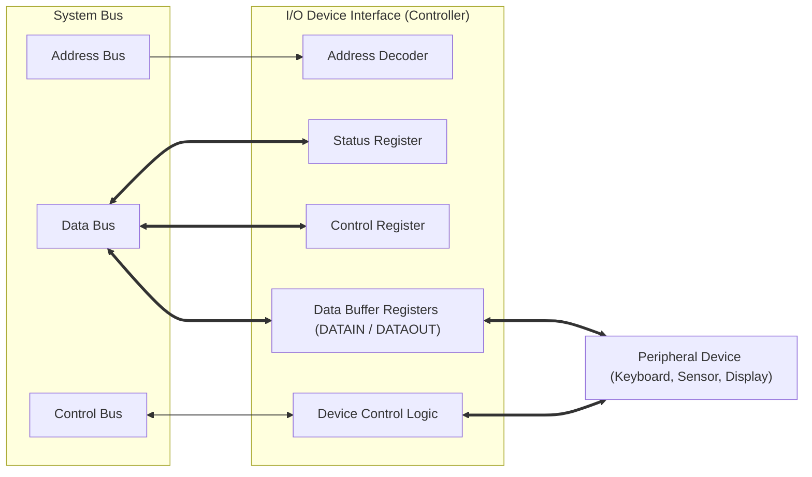
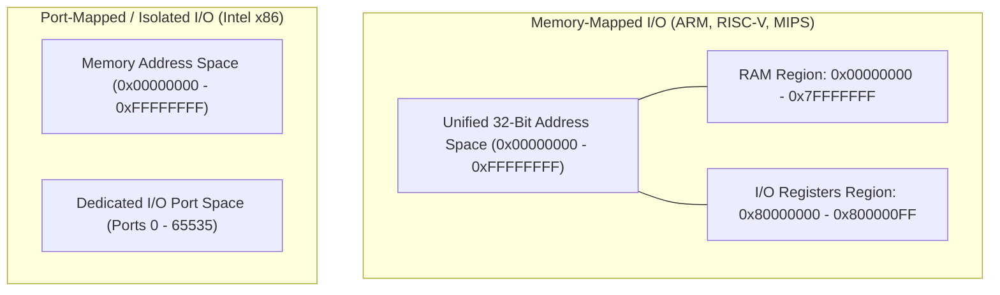

[DLCD Index](../README.md) / [Unit 3: Computer Structure and Organization](Introduction.md)

# L06 - Input-Output Organization and Accessing I/O Devices

A Central Processing Unit running at 3 GHz can execute billions of instructions per second. But a human typing on a keyboard generates at most a few keystrokes per second, and a mechanical printer prints only a few lines per minute.

Connecting a high-speed CPU directly to external peripherals without an intermediary would be impossible: the electronic signal levels, word widths, clock rates, and data formats are wildly mismatched.

To reconcile these differences, computers use **I/O Device Interfaces (Controllers)**. In this lecture, we examine the internal register architecture of I/O interfaces, contrast **Memory-Mapped I/O against I/O-Mapped (Port-Mapped) I/O**, and analyze the software mechanics and CPU bottlenecks of **Programmed (Polling) I/O**.

---

## The I/O Communication Challenge

Why can't an input device—like a keyboard or temperature sensor—connect directly to the system data bus?

1. **Speed Disparity**: The processor operates in fractions of a nanosecond, while peripheral hardware operates in milliseconds or microseconds. The CPU cannot halt its internal pipelines waiting for an external device.
2. **Signal & Protocol Mismatch**: System buses transfer parallel words (32 or 64 bits) using standardized high-speed CMOS voltage levels. Peripherals use serial streams (USB, RS-232), analog voltages, or wireless electromagnetic waves.
3. **Data Buffering**: External data arrives asynchronously. If the CPU is busy servicing a critical calculation when a network packet arrives, the data will be lost unless temporarily held in a hardware buffer.

The solution is an **I/O Interface**: a dedicated silicon chip sitting between the system bus and the peripheral device.



---

## Internal Architecture of an I/O Interface

Every I/O interface chip contains an address decoder and **three primary hardware registers**:

### 1. Data Registers (DATAIN / DATAOUT)
- **DATAIN**: A buffer register that latches data arriving from an input device (e.g., the ASCII code of a pressed key). The CPU reads from this register.
- **DATAOUT**: A buffer register that holds data written by the CPU waiting to be transmitted to an output device (e.g., a pixel byte for a display).

### 2. Status Register
A read-only register containing individual flag bits that report the immediate physical condition of the peripheral:
- **Ready / Valid Bit ($R_{\text{in}}$ or $K_{\text{ready}}$)**: Set to `1` by the interface when a complete data byte has been captured in `DATAIN` and is ready for the CPU to read. Automatically cleared to `0` once the CPU reads the data.
- **Transmitter Empty Bit ($R_{\text{out}}$ or $D_{\text{ready}}$)**: Set to `1` when `DATAOUT` is empty and ready to accept the next byte from the CPU. Set to `0` while the interface is transmitting.
- **Error Flags**: Parity error, frame error, overrun error (new data arrived before previous data was read).

### 3. Control Register
A write-only register whose bits configure the operational mode of the interface:
- Interrupt Enable bits ($\text{IE}$).
- Baud rate and clock divider settings for serial interfaces.
- Operational mode selections (half-duplex vs. full-duplex, parity type).

---

## Memory-Mapped I/O vs. Port-Mapped I/O

How does the CPU actually address and communicate with these I/O registers?

Two competing architectural philosophies govern hardware addressing:



---

### 1. Memory-Mapped I/O (MMIO)

In **Memory-Mapped I/O**, I/O device registers are assigned regular memory addresses within the computer's standard physical memory map.

- **Unified Address Space**: The CPU sees no distinction between a RAM location and a hardware keyboard register. Address `0x1000` might be RAM, while address `0x80000000` is the keyboard status register.
- **Single Bus Architecture**: The processor uses the standard **Memory Read** and **Memory Write** control signals. No dedicated I/O bus or special control lines are required.
- **Universal Instruction Set**: Any CPU instruction that touches memory (`LDR`, `STR`, `MOV`, `ADD`, `TEST`) can operate directly on hardware peripheral registers!
  ```assembly
  LDR   R1, =0x80000000   ; R1 points to Keyboard Status Register
  LDR   R2, [R1]          ; Read status directly into R2
  ```
- **Architectures**: Modern ARM (Cortex-M, Cortex-A), Apple Silicon, RISC-V, MIPS, PowerPC, and Motorola 68000.

---

### 2. I/O-Mapped (Port-Mapped / Isolated) I/O

In **I/O-Mapped I/O**, I/O devices do not exist inside memory space. They reside in a completely separate, isolated **I/O Port Address Space** (historically 64 KB, containing $65,536$ individual port addresses).

- **Dedicated Control Lines**: The system bus provides distinct control signals:
  - $\overline{\text{MEMR}}$ (Memory Read) and $\overline{\text{MEMW}}$ (Memory Write) for RAM.
  - $\overline{\text{IOR}}$ (I/O Read) and $\overline{\text{IOW}}$ (I/O Write) for peripheral ports.
  *(Alternatively, an $M/\overline{\text{IO}}$ pin indicates whether the current address is memory or port space).*
- **Specialized Assembly Instructions**: Regular memory instructions cannot access ports. The CPU must use dedicated input/output instructions:
  $$\mathbf{\text{IN } \text{Accumulator}, \text{Port\_Address}}$$
  $$\mathbf{\text{OUT } \text{Port\_Address}, \text{Accumulator}}$$
  ```assembly
  IN    AL, 0x60          ; Read byte from keyboard port 0x60 into AL register
  OUT   0x64, AL          ; Write byte from AL to command port 0x64
  ```
- **Architectures**: Intel x86 (8086 through modern Core i9/Xeon processors support port I/O for legacy PC peripherals).

---

### Comparative Evaluation

| Feature | Memory-Mapped I/O (MMIO) | I/O-Mapped (Port-Mapped) I/O |
| :---: | :---: | :---: |
| **Address Space** | Shared with primary RAM | Completely isolated I/O port space |
| **Bus Control Signals** | Standard $\text{MEMR} / \text{MEMW}$ | Dedicated $\text{IOR} / \text{IOW}$ or $M/\overline{\text{IO}}$ line |
| **CPU Instructions** | All standard memory instructions (`LDR`, `STR`, `MOV`) | Restricted strictly to `IN` and `OUT` |
| **Hardware Complexity** | Simple CPU bus interface; no special pins | Extra CPU pins and decoding logic for I/O lines |
| **RAM Space Penalty** | Consumes portions of address space | Zero loss of RAM address capacity |
| **Modern Adoption** | **Universal standard** (ARM, RISC-V, PCIe devices) | Legacy x86 maintenance |

---

## Programmed I/O (Polling)

Now that we know where device registers live, how does software actually transfer data?

The simplest data transfer technique is **Programmed I/O**, also called **Polling**. In programmed I/O, the CPU executes a continuous software loop that repeatedly reads the device's status register until the Ready flag turns to `1`.

---

### Input Routine: Reading from a Keyboard

Suppose a keyboard interface has:
- `KBD_STATUS` at address `0x4000` (Bit 0 is $K_{\text{ready}}$: `1` when key is pressed).
- `KBD_DATA` at address `0x4004` (Holds 8-bit ASCII character).

Let's write the assembly polling routine:

```assembly
READ_CHAR:
        LDR     R1, =0x4000     ; R1 points to KBD_STATUS
POLL_LOOP:
        LDRB    R2, [R1]        ; Read status byte into R2
        TST     R2, #0x01       ; Test Bit 0 (Is K_ready == 1?)
        BEQ     POLL_LOOP       ; If 0 (no key pressed), poll again!
        
        LDR     R1, =0x4004     ; Key is pressed! Point to KBD_DATA
        LDRB    R0, [R1]        ; Read ASCII character into R0
        ; Hardware automatically clears K_ready back to 0 upon read
```

---

### Output Routine: Writing to a Display

Now suppose a serial terminal display interface has:
- `DISP_STATUS` at address `0x5000` (Bit 0 is $D_{\text{ready}}$: `1` when display buffer is empty).
- `DISP_DATA` at address `0x5004` (Destination for outgoing ASCII character).

```assembly
WRITE_CHAR:
        LDR     R1, =0x5000     ; R1 points to DISP_STATUS
WAIT_DISP:
        LDRB    R2, [R1]        ; Read display status
        TST     R2, #0x01       ; Is transmitter buffer empty (D_ready == 1)?
        BEQ     WAIT_DISP       ; If 0 (display busy), spin and wait!

        LDR     R1, =0x5004     ; Display ready! Point to DISP_DATA
        STRB    R0, [R1]        ; Write character from R0 to display
        ; Hardware automatically clears D_ready back to 0 while transmitting
```

---

## The Fatal Flaw of Polling: Busy-Waiting

While Programmed I/O is trivial to implement, it has a devastating flaw: **Busy-Waiting (Spin-Waiting)**.

Think about what the CPU is physically doing during the `POLL_LOOP`:
1. Fetch `LDRB R2, [R1]`
2. Fetch `TST R2, #0x01`
3. Fetch `BEQ POLL_LOOP`
4. Repeat 3 billion times per second!

A fast typist presses a key every 200 milliseconds ($0.2\text{ seconds}$). During that 0.2-second pause, a 3 GHz CPU wastes **600 million clock cycles** executing a useless three-instruction spin loop!

The processor is 100% pegged, burning battery power and generating heat, completely unable to render graphics, play background music, or process network traffic.

To build responsive, efficient computing systems, we cannot have the CPU constantly asking the hardware: *"Are you ready yet? Are you ready yet?"*

We need a mechanism where the CPU ignores the peripheral completely, works on other useful tasks, and the peripheral **alerts the CPU asynchronously** only when data actually arrives.

This mechanism is the **Hardware Interrupt**.

---

## Key Takeaways

- An **I/O Device Interface (Controller)** bridges the electrical, speed, and format gap between the high-speed system bus and slow external peripherals.
- Every interface contains **Data Registers** (buffering input/output words), a **Status Register** (reporting Ready and Error flags), and a **Control Register** (configuring operational parameters).
- In **Memory-Mapped I/O (MMIO)**, device registers share physical addresses with main RAM, allowing any standard CPU instruction (`LDR`, `STR`) to manipulate hardware directly.
- In **Port-Mapped (Isolated) I/O**, devices reside in a separate I/O port address space accessed exclusively via dedicated `IN` and `OUT` assembly instructions.
- **Programmed I/O (Polling)** repeatedly queries the device's status register in a software loop.
- Polling suffers from **busy-waiting**, wasting millions of clock cycles and demanding the introduction of interrupt-driven I/O.

---

To liberate the processor from the tyranny of busy-waiting loops, computers rely on asynchronous hardware notifications. In the next lecture, we dissect [**Interrupts and Interrupt Handling**](L07%20-%20Interrupts%20and%20Interrupt%20Handling.md), analyzing Interrupt Service Routines, context preservation, vectored interrupts, and priority daisy chaining.
