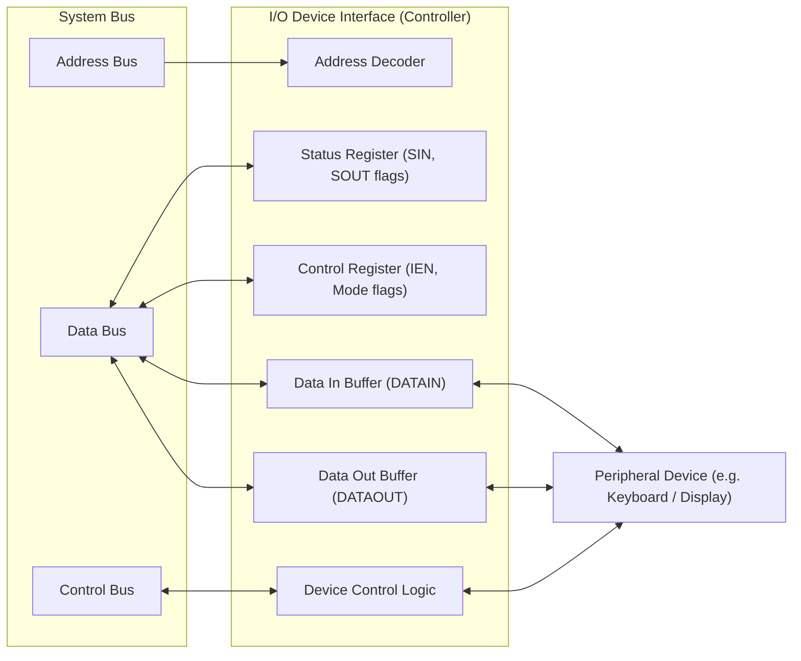
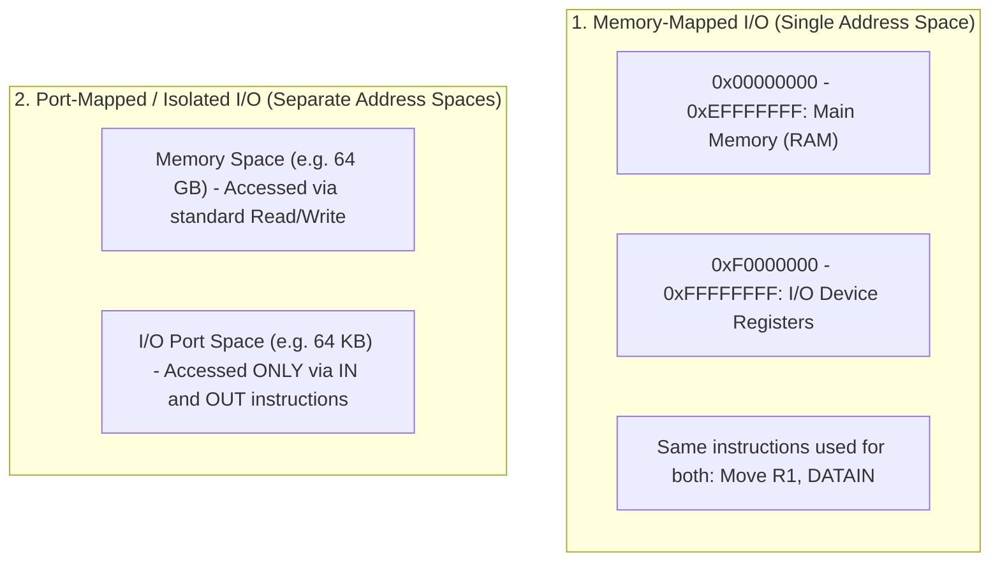
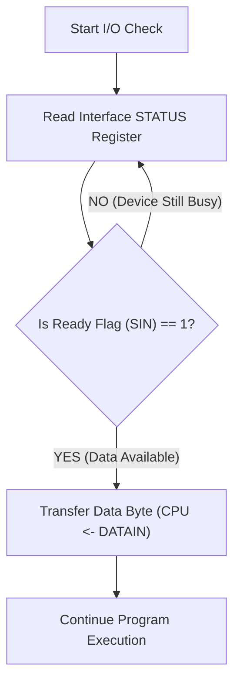
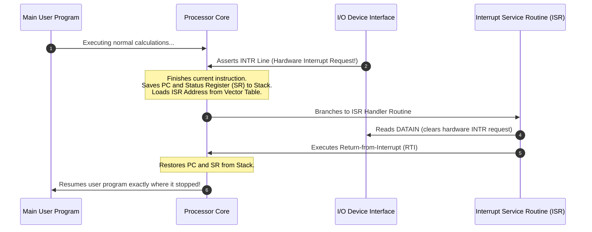
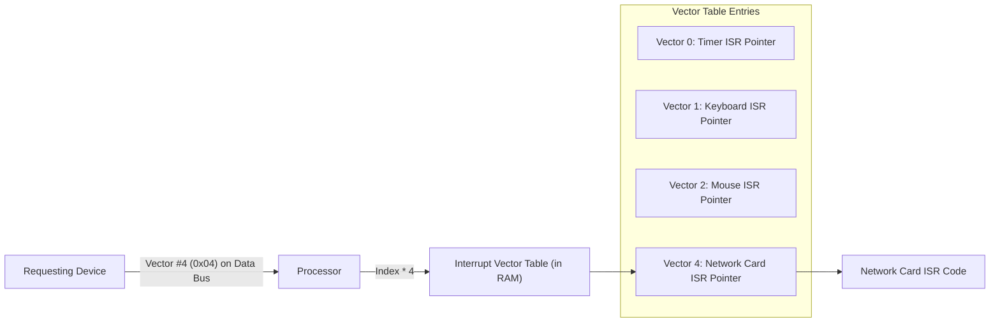
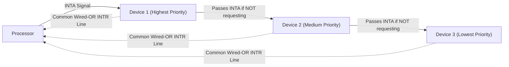

[DLCD Index](../README.md) / [Unit 3: Computer Structure and Organization](Introduction.md)

# L06 - Input-Output Organization, Polling, and Interrupts

A computer that cannot interact with the external world is useless. It must accept input data from keyboards, mice, network cards, and sensors, and deliver results to displays, speakers, and robotic actuators.

However, connecting peripheral devices directly to a high-speed central processor presents an immense physical challenge:
1. **Speed Mismatch**: A modern CPU executes billions of cycles per second (gigahertz), while human typing happens at a few characters per second, and mechanical devices respond in milliseconds.
2. **Data Format Mismatch**: Different peripherals use widely varying word sizes, serial vs. parallel signaling, and electrical voltage standards.

To bridge this gap, every peripheral device connects to the computer bus through a dedicated hardware adapter: an **I/O Interface**. In this lecture, we examine how the CPU communicates with these interfaces, analyze the limitations of Programmed I/O (polling), and explore how **Hardware Interrupts** liberate the processor from busy-waiting.

---

## Internal Architecture of an I/O Interface

An **I/O Interface** (or device controller) is a specialized circuit that sits between the system bus and a peripheral device. It translates processor bus commands into device-specific control signals and buffers data transfers.

Every standard I/O interface contains four internal addressable registers:



1. **Data In Register (`DATAIN`)**: Holds incoming data received from the external peripheral until the CPU reads it.
2. **Data Out Register (`DATAOUT`)**: Holds data written by the CPU until the peripheral is ready to transmit or display it.
3. **Status Register**: Contains read-only hardware status flags that inform the CPU of device readiness:
   - **`SIN` (Input Status Flag)**: Set to `1` when a new character arrives in `DATAIN`. Automatically cleared to `0` when the CPU reads `DATAIN`.
   - **`SOUT` (Output Status Flag)**: Set to `1` when the display buffer is empty and ready to accept the next character. Automatically cleared to `0` when the CPU writes data to `DATAOUT`.
4. **Control Register**: Holds configuration bits written by the processor (e.g., enabling interrupts via an **`IEN`** bit, setting baud rates, or triggering hardware self-tests).

---

## Memory-Mapped I/O vs. Port-Mapped I/O

How does the processor address these interface registers? Computer architectures use two primary addressing strategies:



### 1. Memory-Mapped I/O (Standard in ARM, RISC-V, MIPS)
In **Memory-Mapped I/O**, device registers are assigned specific physical addresses within the computer's single unified memory address space. 

- The processor uses the exact same memory instructions (`Move`, `Add`, `Load`, `Store`) to communicate with hardware peripherals as it uses to access RAM!
- For example, if address `0xFFFF0004` is assigned to `DATAIN`, reading from that memory location reads a character from the keyboard:
  ```assembly
  Move    0xFFFF0004, R0    ; Read keyboard character into R0
  ```
- **Advantage**: Extreme architectural elegance. Every addressing mode (indirect, indexed, autoincrement) and arithmetic instruction can be used directly on I/O ports.
- **Cost**: A small portion of memory address space is reserved for I/O and cannot be used for physical RAM.

### 2. Port-Mapped (Isolated) I/O (Legacy x86)
In **Port-Mapped I/O**, I/O device registers reside in an entirely separate address space (the I/O port space).
- Memory and I/O share the same address bus wires, but the control bus includes an additional signal line ($\text{M}/\overline{\text{IO}}$) indicating whether the current transaction targets memory or I/O.
- The CPU requires dedicated specialized assembly instructions (e.g., `IN` and `OUT` in x86):
  ```assembly
  IN      AL, 0x60          ; Read byte from I/O port 0x60
  OUT     0x64, AL          ; Write byte to I/O port 0x64
  ```

---

## Programmed I/O (Polling) and the Busy-Waiting Problem

In **Programmed I/O**, all data transfers are executed under the direct, continuous control of the processor running a software loop.

To read a stream of characters from a keyboard, the CPU executes a **Polling Loop**:

```assembly
READ:   TestBit #3, STATUS      ; Test the SIN ready flag (bit 3)
        Branch_zero READ        ; If SIN == 0, jump back and test again!
        Move    DATAIN, R1      ; SIN == 1! Character arrived; read it into R1
```



### The Fatal Flaw: The Busy-Waiting Bottleneck
Think about what happens while the user is typing:
- A human typist takes $200\text{ ms}$ ($0.2\text{ seconds}$) between keystrokes.
- A $2\text{ GHz}$ CPU executes $400,000,000$ clock cycles in that single $200\text{ ms}$ interval!
- While waiting, the CPU executes the two-instruction polling loop over $100\text{ million}$ times, burning electrical power and doing zero useful work.

To achieve high computational efficiency, the CPU must be allowed to perform useful calculations and be notified **only when the I/O device is actually ready**. We need **Hardware Interrupts**.

---

## Hardware Interrupts and the Interrupt Lifecycle

A **Hardware Interrupt** is an asynchronous electrical signal asserted by an I/O device over a dedicated control bus line called the **Interrupt Request Line ($\text{INTR}$)**. 

Instead of the CPU constantly asking: *"Are you ready yet?"*, the CPU ignores the device and executes application programs. When the peripheral finishes an operation or receives a byte, it pulls the $\text{INTR}$ line High.

The processor checks the state of the $\text{INTR}$ line at the end of every instruction execution cycle:



### The Step-by-Step Interrupt Lifecycle:
1. **Interrupt Request**: The device sets its status flag ($\text{SIN}=1$) and asserts the $\text{INTR}$ pin.
2. **Instruction Boundary Check**: The CPU finishes executing its currently running instruction (interrupts are never serviced mid-instruction).
3. **Context Preservation**: The processor automatically pushes the **Program Counter (PC)** and the **Processor Status Register (SR / Flags)** onto the supervisor stack so it can return later without corruption.
4. **Interrupt Acknowledgment**: The CPU sends an **Interrupt Acknowledge ($\text{INTA}$)** signal over the control bus and disables further interrupts to prevent re-entrant chaos.
5. **Branch to Handler**: The CPU loads the starting address of the **Interrupt Service Routine (ISR)** into the PC.
6. **Service Execution**: The ISR reads the incoming data byte, stores it in an operating system buffer, and clears the device's interrupt condition.
7. **Return from Interrupt**: The ISR concludes with a special **Return-from-Interrupt ($\text{RTI}$)** instruction. The CPU pops the saved SR and PC off the stack and resumes the interrupted user application as if nothing ever happened.

---

## Identifying the Interrupting Device: Vectored Interrupts

In a computer with dozens of connected devices (keyboard, mouse, network card, disk, timer), how does the processor know *which* device pulled the shared $\text{INTR}$ line?

### Method 1: Polling the Interfaces (Software Identification)
The ISR branches to a generic routine that sequentially reads the STATUS registers of all devices:
- Is device 1 requesting? No.
- Is device 2 requesting? Yes $\to$ jump to device 2 handler.
While simple, software polling adds significant **interrupt latency** when many devices are present.

### Method 2: Vectored Interrupts (Hardware Identification)
Modern processors use **Vectored Interrupts**:
1. When the CPU acknowledges the interrupt by asserting $\text{INTA}$, the requesting device interface places an 8-bit or 16-bit binary **Interrupt Vector code** directly onto the data bus wires.
2. This vector serves as an index into the **Interrupt Vector Table (IVT)**—an array of function pointers stored in low memory.
3. The processor reads the vector, looks up the corresponding ISR pointer in the IVT, and branches directly to the correct handler in hardware without a single polling read!



---

## Handling Multiple Simultaneous Interrupts: Priority Schemes

What happens if the keyboard and the network card assert interrupts at the exact same clock tick? The CPU must arbitrate between them based on **priority**.

A hard real-time timer or disk controller has higher priority than a keyboard, because delaying disk reads causes buffer overrun and lost data, whereas a 1-millisecond delay in keyboard processing is completely imperceptible to a human.

### The Daisy Chaining Priority Scheme
**Daisy Chaining** is an elegant hardware priority arbitration scheme that requires zero centralized controllers:



1. All devices share a single open-collector/open-drain $\text{INTR}$ line connected to the CPU.
2. When the CPU responds with an Interrupt Acknowledge ($\text{INTA}$), the $\text{INTA}$ signal is routed **serially through the devices in order of physical priority**.
3. **If Device 1 requested the interrupt**: It captures the $\text{INTA}$ signal, blocks it from passing down the wire, and drives its vector onto the bus.
4. **If Device 1 did not request the interrupt**: It passes $\text{INTA}$ through to Device 2.
5. The device closest to the CPU has absolute priority!

---

## Key Takeaways

- I/O interfaces bridge speed and formatting mismatches between high-speed processors and external peripherals using `DATAIN`, `DATAOUT`, `STATUS`, and `CONTROL` registers.
- Memory-Mapped I/O assigns device registers addresses in the main memory space, enabling standard memory instructions (`Move`, `Add`) to access hardware.
- Programmed I/O (polling) locks the CPU in a busy-waiting loop, wasting hundreds of millions of clock cycles checking status flags.
- Hardware interrupts eliminate busy-waiting: the peripheral asserts an $\text{INTR}$ line, prompting the CPU to save its context (`PC` and `SR`) and execute an Interrupt Service Routine (ISR).
- Vectored interrupts allow devices to supply their own vector code over the data bus, directing the CPU directly to the correct ISR via the Interrupt Vector Table.
- Daisy chaining enforces hardware priority by routing the $\text{INTA}$ signal serially through devices, giving the closest device first right of service.

---

While interrupts eliminate busy-waiting for small transfers, transferring millions of bytes (such as reading a file from disk) one byte per interrupt would overwhelm the CPU with interrupt overhead. In the next lecture, we examine [**Direct Memory Access and Standard IO Interfaces**](L07%20-%20Direct%20Memory%20Access%20and%20Standard%20IO%20Interfaces.md) to automate bulk transfers.
