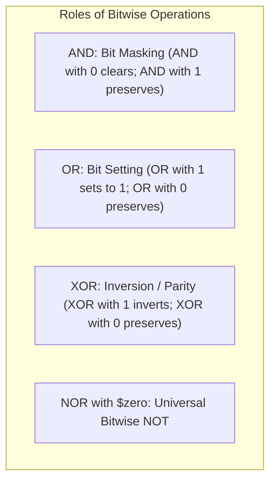
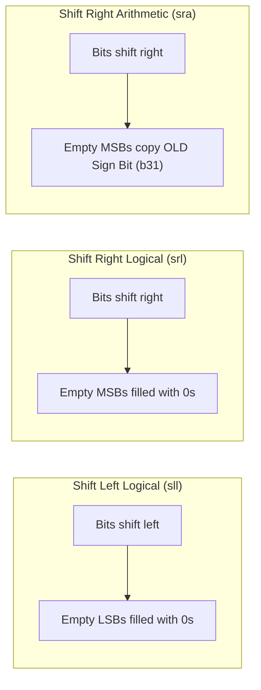
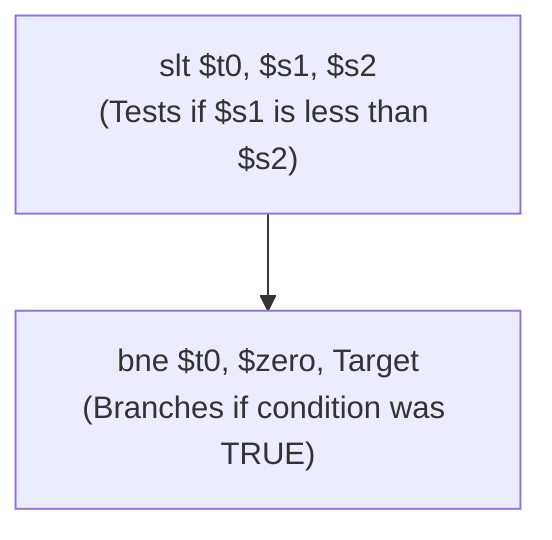
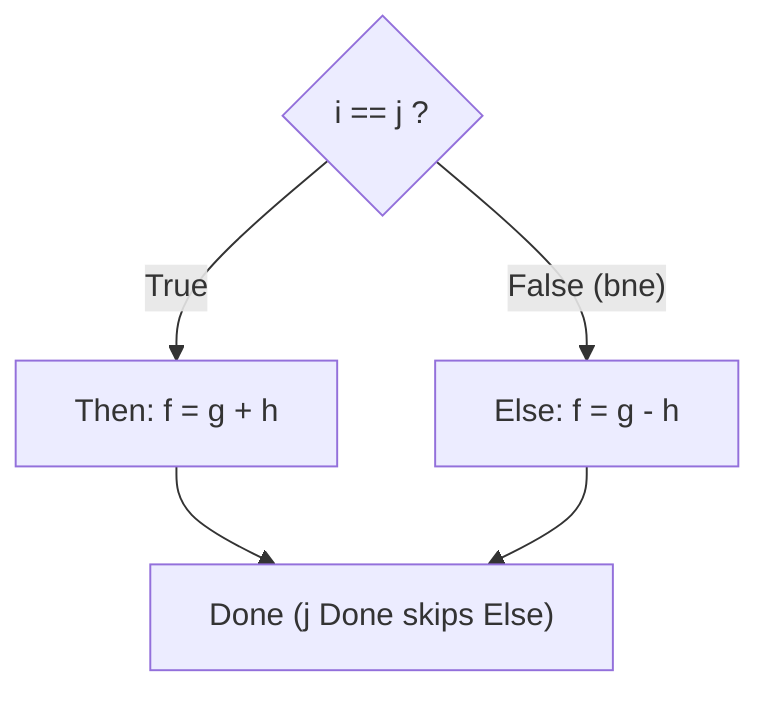
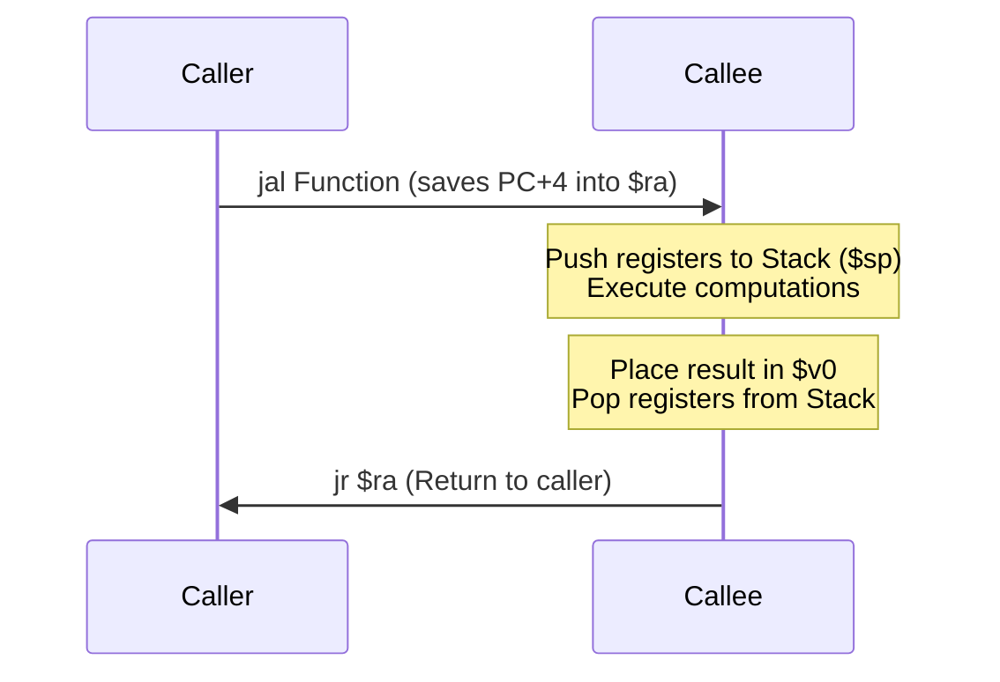

[DLCD Index](../README.md) / [Unit 3: Architecture, Memory, and MIPS Assembly](Introduction.md)

# L06 - MIPS Programming - Conditionals, Loops, and Logical Instructions

Linear execution is trivial: a processor simply fetches instruction after instruction as the Program Counter increments by 4. But software derives its real power from **decision-making**—executing code conditionally (`if-else`), repeating algorithmic steps in loops (`while`, `for`), manipulating bitfields, and invoking subroutines.

In this lecture, we examine how high-level programming constructs are translated into MIPS assembly language. We explore bitwise logic (`and`, `or`, `xor`, `nor`), logical and arithmetic shifts (`sll`, `srl`, `sra`), conditional branches (`beq`, `bne`), relational comparisons (`slt`, `slti`), and procedure calling conventions using the stack.

---

## Bitwise Logical Instructions

Digital systems constantly manipulate individual bits: clearing flags, testing status bits, and packing multiple fields into a single 32-bit register.

MIPS provides four fundamental R-type bitwise operations that operate bit-by-bit across two 32-bit source registers:

| Instruction | Assembly Syntax | Operation | Common Architectural Purpose |
|:---|:---|:---|:---|
| **AND** | `and rd, rs, rt` | $rd = rs \ \& \ rt$ | **Masking**: Clearing unwanted bits to `0` while preserving others |
| **OR** | `or rd, rs, rt` | $rd = rs \ \| \ rt$ | **Merging**: Setting specific bits to `1` or combining bit fields |
| **XOR** | `xor rd, rs, rt` | $rd = rs \oplus rt$ | **Difference Detection**: Testing which bits differ; bit toggling |
| **NOR** | `nor rd, rs, rt` | $rd = \overline{rs \ \| \ rt}$ | **Inversion**: NOT logic |



### Synthesizing Bitwise NOT
Notice that MIPS does not have a dedicated `not` instruction. Why?
By DeMorgan's laws and the identity law, NOR with zero is:

$$\overline{A + 0} = \overline{A}$$

Therefore, to invert all 32 bits of register `$s1` into `$s0`, we simply write:
```assembly
nor $s0, $s1, $zero     # $s0 = ~($s1 | 0) = NOT($s1)
```

### Immediate Logical Instructions (`andi`, `ori`, `xori`)
MIPS provides I-type logical instructions to operate directly with 16-bit constants.
**Critical Rule**: Logical immediates are always **zero-extended** to 32 bits (unlike `addi` which is sign-extended), ensuring that the upper 16 bits of the register are unaffected during bitmasking.

Why is there no `nori` instruction? Because any inverted immediate mask can be built in two clean instructions using `ori` followed by `nor with $zero`.

---

## Shift Instructions: Logical vs. Arithmetic

MIPS provides three core shift instructions that shift the bits in a register left or right by up to 31 positions:

| Instruction | Syntax | Type | Shift Direction | Bits Shifted In | Mathematical Equivalent |
|:---|:---|:---:|:---:|:---:|:---|
| **`sll`** | `sll rd, rt, shamt` | Logical | **Left** ($\ll$) | **Zeros (`0`)** | Multiply by $2^{\text{shamt}}$ (unsigned/signed) |
| **`srl`** | `srl rd, rt, shamt` | Logical | **Right** ($\gg$) | **Zeros (`0`)** | Divide unsigned integer by $2^{\text{shamt}}$ |
| **`sra`** | `sra rd, rt, shamt` | Arithmetic | **Right** ($\ggg$) | **Sign Bit ($b_{31}$)** | Divide signed 2's complement by $2^{\text{shamt}}$ |



### The Vital Difference Between `srl` and `sra`
Consider the 8-bit signed negative number $-16_{10} = 11110000_2$ shifted right by 2 positions:
- **`srl` (Logical Right Shift)**: Fills the top 2 bits with $0$s:
  $$00111100_2 = +60_{10} \quad \text{(Sign is destroyed!)}$$
- **`sra` (Arithmetic Right Shift)**: Replicates the sign bit ($1$):
  $$11111100_2 = -4_{10} \quad (-16 \div 2^2 = -4, \text{Exactly correct!})$$

For variable shift distances where the shift amount is stored in a register rather than a static constant, MIPS provides **`sllv`**, **`srlv`**, and **`srav`** (where the lower 5 bits of register `rs` supply the shift distance).

---

## Conditional Branching: `beq` and `bne`

To make decisions, a processor must inspect data and branch to an alternative instruction address if a condition is met. MIPS provides two fundamental conditional branch instructions:
- **`beq rs, rt, Label` (Branch if Equal)**: If $\text{Contents}(rs) == \text{Contents}(rt)$, the processor branches to `Label`.
- **`bne rs, rt, Label` (Branch if Not Equal)**: If $\text{Contents}(rs) \ne \text{Contents}(rt)$, the processor branches to `Label`.

If the condition is FALSE, the processor takes the "fall-through" path, executing $\text{PC} + 4$ normally.

---

## Relational Comparisons: Set Less Than (`slt`)

`beq` and `bne` test for equality, but how do we implement inequality conditions like `if (a < b)`?
MIPS decouples comparison from branching using **`slt` (Set Less Than)**:

$$\mathbf{\text{slt}} \quad \mathbf{\text{rd}}, \quad \mathbf{\text{rs}}, \quad \mathbf{\text{rt}}$$

- If $rs < rt$, the destination register is set to **`1`** ($rd = 1$).
- If $rs \ge rt$, the destination register is cleared to **`0`** ($rd = 0$).



MIPS provides four comparison variants:
1. **`slt rd, rs, rt`**: Signed register comparison.
2. **`slti rt, rs, imm`**: Signed comparison against a 16-bit sign-extended immediate.
3. **`sltu rd, rs, rt`**: Unsigned register comparison (treats operands as positive magnitudes).
4. **`sltiu rt, rs, imm`**: Unsigned immediate comparison.

---

## Compiling High-Level Conditional Constructs

Let's examine how compilers translate C control structures into MIPS assembly.

### 1. The `if-then-else` Statement
Consider the C code:
```c
if (i == j)
    f = g + h;
else
    f = g - h;
```
Assume $f, g, h, i, j$ reside in `$s0, $s1, $s2, $s3, $s4`.

**The Inversion Trick**: In high-level code, we write the condition to enter the `if` block. In assembly, it is more efficient to branch to the `else` block if the condition is **FALSE**:

```assembly
        bne $s3, $s4, Else      # If i != j, branch to Else
        add $s0, $s1, $s2       # Then part: f = g + h
        j   Done                # Skip over Else block
Else:   sub $s0, $s1, $s2       # Else part: f = g - h
Done:   # Execution continues...
```

Notice the vital role of **`j Done`**: without that unconditional jump, execution would fall directly into the `Else` block after finishing the `Then` block!



---

## Compiling Loops: `while` and `for`

### 2. The `while` Loop
Consider calculating powers of two using a `while` loop:
```c
// Assume save[i] array base in $s6, k in $s5, i in $s3
while (save[i] == k)
    i += 1;
```

In MIPS assembly:
```assembly
Loop:   sll $t1, $s3, 2         # $t1 = i * 4 (byte offset)
        add $t1, $t1, $s6       # $t1 = base address + offset = &save[i]
        lw  $t0, 0($t1)         # $t0 = save[i]
        bne $t0, $s5, Exit      # If save[i] != k, exit loop
        addi $s3, $s3, 1        # i = i + 1
        j   Loop                # Repeat loop
Exit:   # Loop finished
```

Notice the pointer calculation: before loading from an integer array, index `i` is multiplied by 4 using a logical left shift of 2 (`sll $t1, $s3, 2`)!

### 3. The `for` Loop
A standard `for` loop follows the canonical sequence: **Initialization $\to$ Condition Check $\to$ Loop Body $\to$ Increment $\to$ Repeat**.
```c
int sum = 0;
for (int i = 0; i < 10; i++)
    sum += i;
```

```assembly
        add  $s0, $zero, $zero  # sum = 0 ($s0)
        add  $s1, $zero, $zero  # i = 0 ($s1)
        addi $t0, $zero, 10     # Loop bound = 10
ForLoop:
        slt  $t1, $s1, $t0      # $t1 = (i < 10) ? 1 : 0
        beq  $t1, $zero, ForEnd # If i >= 10, exit loop
        add  $s0, $s0, $s1      # sum = sum + i
        addi $s1, $s1, 1        # i++
        j    ForLoop            # Repeat
ForEnd:
```

---

## Functions and the Procedure Call Stack

When software calls a function (`foo()`), the processor must:
1. Pass input arguments to the callee.
2. Transfer control to the callee function code.
3. Allocate local memory for callee variables.
4. Execute the function.
5. Return the result to the caller and restore execution to the instruction immediately following the call.



### The `jal` and `jr` Instructions
- **`jal FunctionLabel` (Jump and Link)**:
  Saves the return address ($\text{PC} + 4$) into register **`$ra`** (`$31`), and jumps unconditionally to `FunctionLabel`.
- **`jr $ra` (Jump Register)**:
  Copies the address stored in `$ra` back into the Program Counter, resuming caller execution.

### The Stack and the Stack Pointer (`$sp`)
If function `A` calls function `B`, and function `B` calls function `C`, register `$ra` would be overwritten and corrupted!
To prevent this, functions save their return addresses and preserved registers (`$s0-$s7`) onto **the Stack**.

- The MIPS stack resides in high memory and **grows downward** toward lower addresses.
- Register **`$sp` (`$29`)** holds the memory address of the top of the stack.

#### Pushing onto the Stack:
To allocate 8 bytes (2 words) and save registers `$ra` and `$s0`:
```assembly
addi $sp, $sp, -8        # Decrement stack pointer by 8 bytes
sw   $ra, 4($sp)         # Save return address
sw   $s0, 0($sp)         # Save preserved register $s0
```

#### Popping from the Stack:
Before returning, the callee restores the registers and frees the stack space:
```assembly
lw   $s0, 0($sp)         # Restore $s0
lw   $ra, 4($sp)         # Restore $ra
addi $sp, $sp, 8         # Deallocate 8 bytes (increment $sp)
jr   $ra                 # Return to caller
```

---

## Key Takeaways

- Bitwise logical instructions (`and`, `or`, `xor`, `nor`) operate bit-by-bit; bitwise NOT is implemented as `nor rd, rs, $zero`.
- Immediate logical instructions (`andi`, `ori`, `xori`) zero-extend their 16-bit constants.
- Shifts include `sll` (fills with 0s; multiplies by $2^n$), `srl` (fills with 0s; unsigned divide), and `sra` (replicates sign bit; signed 2's complement divide).
- Conditional branching uses `beq` and `bne`. Inequality comparisons are performed using `slt`/`slti`, setting a register to 1 if $rs < rt$.
- Compilers implement `if-else` blocks by inverting branch conditions and using unconditional jumps (`j Done`) to bypass alternate blocks.
- In array indexing, index registers must be shifted left by 2 (`sll $t0, $i, 2`) to convert word indices into byte offsets.
- Functions are invoked using `jal` (storing return address in `$ra`) and returned via `jr $ra`. The stack pointer (`$sp`) grows downward to preserve registers and return addresses across nested calls.

---

In all our branch and jump examples, we used symbolic labels like `Loop` and `Exit`. But how does hardware calculate the actual numerical target address in memory? In the next lecture, [L07 - MIPS Addressing Modes](L07%20-%20MIPS%20Addressing%20Modes.md), we explore the five fundamental addressing modes of MIPS.
