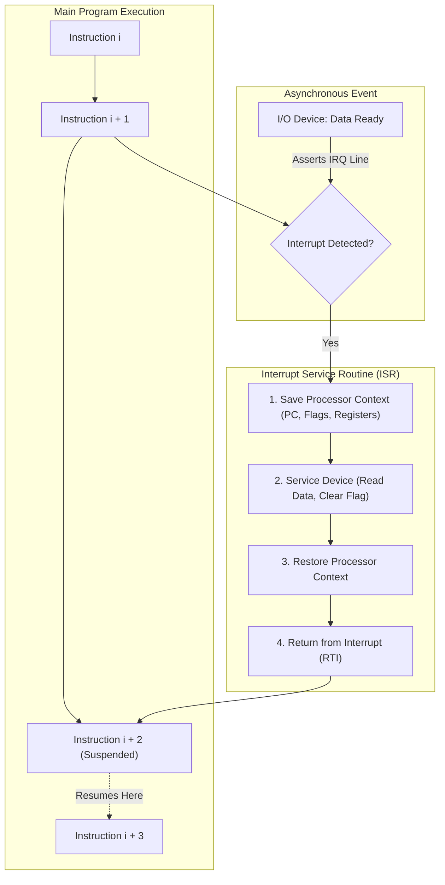
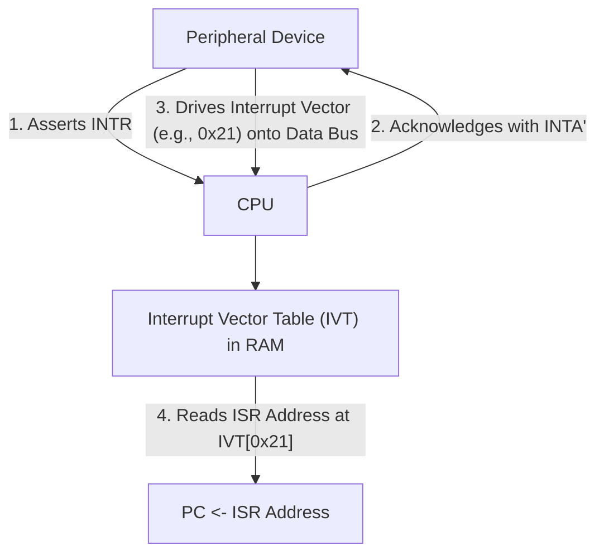
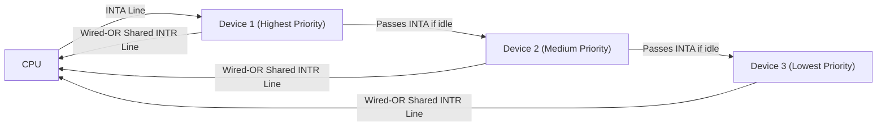
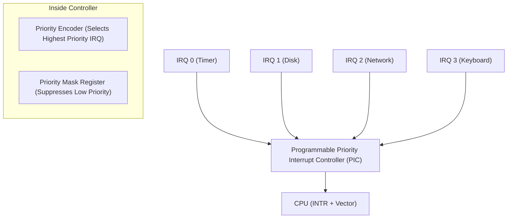
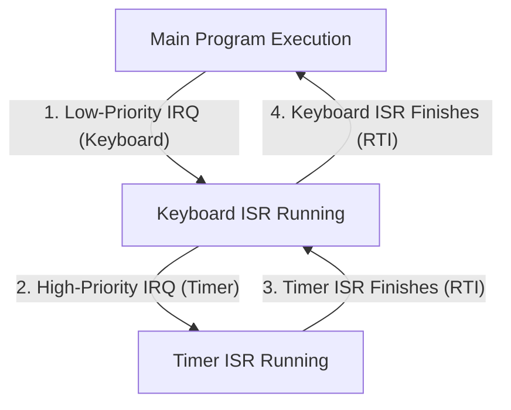

[DLCD Index](../README.md) / [Unit 3: Computer Structure and Organization](Introduction.md)

# L07 - Interrupts and Interrupt Handling

In the previous lecture, we discovered the fatal limitation of Programmed I/O: the CPU wastes millions of clock cycles in busy-waiting polling loops, unable to perform useful work while waiting for slow external hardware.

To achieve maximum computational throughput, modern computers operate on an event-driven model: the CPU executes user applications at full speed, completely ignoring peripheral devices. When a keyboard key is pressed, a network packet arrives, or a disk transfer completes, the external hardware alerts the processor by asserting an electrical signal line called an **Interrupt Request (IRQ)**.

In this lecture, we examine the **hardware interrupt lifecycle**, analyze **context preservation**, dissect **vectored interrupts and vector tables**, and evaluate multi-device priority arbitration using **Daisy Chaining** and **Priority Interrupt Controllers**.

---

## What is a Hardware Interrupt?

An **Interrupt** is an asynchronous signal sent by hardware to the processor, requesting immediate service. 

When an interrupt arrives, the processor temporarily suspends its currently executing program, executes a dedicated piece of software called an **Interrupt Service Routine (ISR)** (or **Interrupt Handler**) to process the event, and then seamlessly resumes the suspended program exactly where it left off, with zero data loss.



Think of an interrupt like a telephone call while you are studying. You don't walk to the front door every five seconds to see if someone is there (polling). You study in peace. When the phone rings (interrupt), you place a bookmark in your book (save PC), answer the call (execute ISR), and return to the exact paragraph you were reading (restore PC).

---

## The End-to-End Interrupt Lifecycle

The processor handles an interrupt through a rigorous 7-stage hardware-software handshake:

1. **Device Assertion**: The peripheral interface asserts an **Interrupt Request ($\text{INTR}$ / $\text{IRQ}$)** line on the system control bus.
2. **Instruction Completion**: The CPU **does not stop in the middle of executing an instruction**. It completes the current instruction ($i+1$) to ensure all internal pipeline stages settle into a clean, well-defined architectural state.
3. **Context Preservation (State Saving)**: Before branching away, the CPU must preserve its current operating state so it can return safely. The hardware automatically pushes the **Program Counter (PC)** and the **Processor Status Register (PSR / Flags)** onto the system stack:
   $$\text{Push(PSR)}$$
   $$\text{Push(PC)}$$
   *(Any general-purpose registers modified by the ISR are saved onto the stack at the start of the handler).*
4. **Interrupt Masking**: The CPU automatically sets an **Interrupt Disable** bit in its status register to prevent the same interrupt from firing recursively and blowing out the stack.
5. **Branch to ISR**: The CPU loads the memory address of the device's Interrupt Service Routine into the Program Counter ($\text{PC} \leftarrow \text{ISR Address}$).
6. **Execution of the ISR**: The handler executes:
   - Reads the incoming data byte from `DATAIN` (which automatically clears the hardware interrupt condition in the device).
   - Places the data into an operating system buffer.
7. **Return from Interrupt (`RTI` / `IRET`)**: The handler concludes with a special instruction:
   - Restores the saved flags register from the stack.
   - Pops the saved return address back into the Program Counter.
   - Re-enables interrupts.
   - Execution resumes in the main program with zero disruption.

---

## Interrupt Latency

In real-time systems (such as automotive braking controllers, medical equipment, and aerospace flight computers), the time delay between when a physical event occurs and when the CPU starts executing the handler is critical.

This delay is called **Interrupt Latency**:
$$\mathbf{t_{\text{latency}} = t_{\text{complete}} + t_{\text{save}} + t_{\text{lookup}}}$$

where:
- $t_{\text{complete}}$: The time required for the CPU to finish its currently running machine instruction (longest for multi-cycle instructions like integer division).
- $t_{\text{save}}$: The time required to push the PC, flags, and registers onto the stack in RAM.
- $t_{\text{lookup}}$: The time required to identify the interrupting device and locate its ISR address.

Minimizing interrupt latency is a primary goal of processor architects.

---

## Identifying the Interrupting Device

In a typical computer, dozens of peripherals (keyboard, timer, mouse, GPU, disk drive) share interrupt capabilities. When an IRQ line goes active, how does the CPU determine **which specific device** requested service?

Two primary mechanisms exist:

---

### 1. Polled Interrupts (Software Identification)
- All I/O devices connect their interrupt lines together to a single, shared CPU interrupt pin using an **open-collector (wired-OR)** bus line.
- When an interrupt occurs, the CPU jumps to a **single generic interrupt handler**.
- The handler software executes a series of status checks, polling each device's status register one-by-one:
  ```assembly
  GENERIC_ISR:
          LDRB  R0, [KBD_STATUS]
          TST   R0, #0x80         ; Did keyboard cause interrupt?
          BNE   SERVICE_KEYBOARD
          
          LDRB  R0, [TIMER_STATUS]
          TST   R0, #0x80         ; Did timer cause interrupt?
          BNE   SERVICE_TIMER
          ...
  ```
- **Evaluation**: Extremely slow. If device 15 fired, the CPU wastes cycles checking devices 1 through 14 first. Polled interrupts significantly degrade interrupt latency.

---

### 2. Vectored Interrupts (Hardware Identification)

In **Vectored Interrupts**, the interrupting device **directly identifies itself** to the processor over the data bus during a specialized hardware handshake.



#### The Hardware Handshake:
1. The device asserts the $\text{INTR}$ line.
2. The CPU acknowledges by asserting the active-low **$\overline{\text{INTA}}$ (Interrupt Acknowledge)** control signal.
3. Upon receiving $\overline{\text{INTA}}$, the interrupting device places an 8-bit binary number called an **Interrupt Vector** (e.g., `0x21`) onto the system data bus lines.
4. The CPU reads the vector from the bus.

#### The Interrupt Vector Table (IVT)
The **Interrupt Vector Table (IVT)** is a dedicated array of memory pointers located at a fixed base address in RAM (typically starting at address `0x00000000`).

Each entry in the table holds the starting address of an ISR:
$$\mathbf{\text{ISR Address} = \text{Memory}[\text{IVT\_BASE} + (\text{Vector} \times 4)]}$$

The CPU multiplies the vector by 4 (the pointer size), reads the 32-bit ISR address from the table, and loads it directly into the PC! The entire device identification and branch takes only a few clock cycles.

---

## Handling Multiple Simultaneous Interrupts: Priority Schemes

What happens if the disk controller, the keyboard, and the internal hardware timer all assert interrupts at the exact same nanosecond?

The system must resolve the conflict using **Priority Arbitration**:
- High-priority devices (system timer, power failure sensor, hard disk) must be serviced immediately.
- Low-priority devices (keyboard, mouse) can safely wait.

Two primary hardware architectures establish interrupt priority:

---

### Method 1: Daisy Chaining (Hardware Serial Priority)

**Daisy Chaining** connects all peripheral interfaces in a physical serial chain along the **$\text{INTA}$ (Interrupt Acknowledge)** line.



Let's trace how the daisy chain arbitrates conflicts:
1. All devices share a single wired-OR $\text{INTR}$ line. If one or more devices want service, $\text{INTR}$ drops low.
2. The CPU asserts the $\text{INTA}$ signal, sending a high logic pulse to **Device 1** (the device physically closest to the CPU).
3. **If Device 1 requested the interrupt**:
   - Device 1 **blocks the $\text{INTA}$ signal** from propagating further down the wire.
   - Device 1 places its interrupt vector onto the data bus and claims service.
   - Devices 2 and 3 never see the $\text{INTA}$ pulse!
4. **If Device 1 did NOT request an interrupt**:
   - Device 1 passes the $\text{INTA}$ pulse through to Device 2.
   - Device 2 inspects whether it requested service. If so, it blocks the pulse and drives the bus; if not, it forwards $\text{INTA}$ to Device 3.

Physical proximity to the CPU dictates absolute priority: **Device 1 > Device 2 > Device 3**.

---

### Method 2: Priority Interrupt Controllers (PIC / NVIC)

Modern multi-core processors do not use physical daisy chains. They use dedicated silicon blocks called **Priority Interrupt Controllers** (such as the ARM **NVIC (Nested Vectored Interrupt Controller)** or the Intel **APIC (Advanced Programmable Interrupt Controller)**).



The PIC contains:
- An internal **Priority Encoder** (the exact combinational circuit we designed in Unit 1, Lecture 10!).
- A **Priority Mask Register**: Software can dynamically program priority levels and mask (ignore) lower-priority interrupts during time-critical calculations.

---

## Nested Interrupts

Can an ongoing Interrupt Service Routine itself be interrupted?

Yes. If the CPU is halfway through servicing a low-priority keyboard interrupt, and the system clock timer fires or a disk buffer signals data overrun, the system must support **Nested Interrupts**:



In a nested system:
- When a lower-priority ISR begins, it re-enables the master interrupt flag, but sets the controller mask to block equal or lower-priority interrupts.
- If a higher-priority interrupt arrives, the CPU suspends the current ISR, pushes its context onto the stack, and branches to the higher-priority ISR.
- Once the high-priority ISR completes, execution returns cleanly to resume the lower-priority ISR.

---

## Key Takeaways

- An **Interrupt** is an asynchronous hardware signal that frees the CPU from polling busy-waiting loops, transforming computer operation into an efficient event-driven model.
- Upon receiving an interrupt, the CPU finishes the current instruction, pushes the **PC and Processor Flags** onto the stack, and branches to the **Interrupt Service Routine (ISR)**.
- **Interrupt Latency** measures the physical time from the IRQ assertion to the execution of the first instruction in the ISR.
- In **Vectored Interrupts**, the interrupting device delivers an **Interrupt Vector** to the CPU during the $\text{INTA}$ cycle, allowing the processor to index the **Interrupt Vector Table (IVT)** and jump directly to the handler in hardware.
- Multi-device conflicts are resolved through **Daisy Chaining** (serial hardware priority) or **Priority Interrupt Controllers (PIC)** using internal priority encoders.
- **Nested Interrupts** allow high-priority critical handlers to pre-empt lower-priority routines using the processor stack.

---

Interrupt-driven I/O is ideal for low-to-medium-speed peripherals like keyboards, sensors, and serial ports. But what happens when a disk drive or network card needs to transfer a 500-megabyte video file into RAM? Forcing the CPU to execute an interrupt for every single byte would crush the processor. In the next lecture, we examine [**Direct Memory Access and Standard IO Interfaces**](L08%20-%20Direct%20Memory%20Access%20and%20Standard%20IO%20Interfaces.md), bypassing the CPU entirely for high-speed bulk data transfers.
