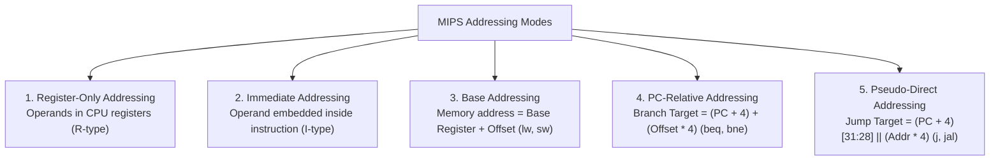
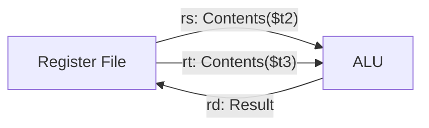
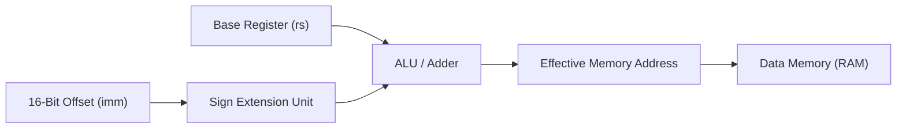
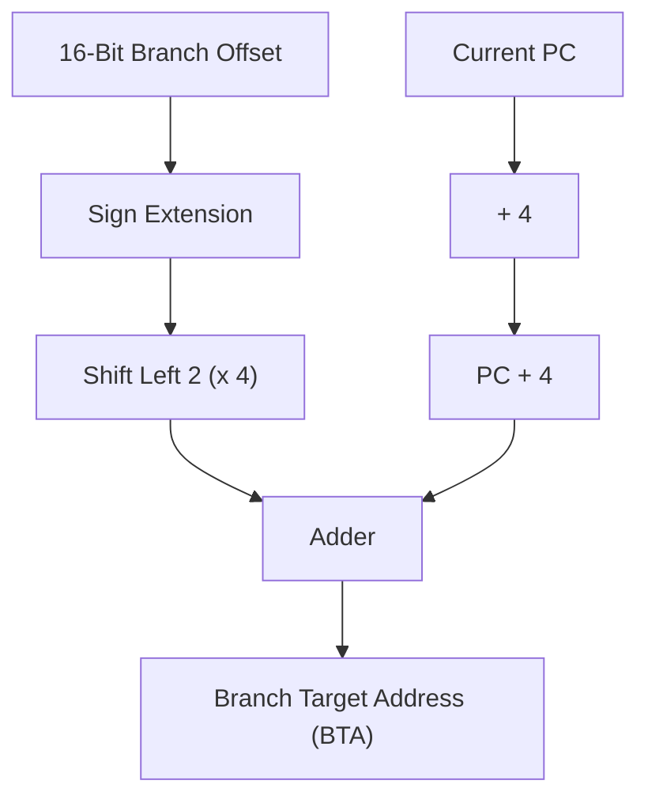
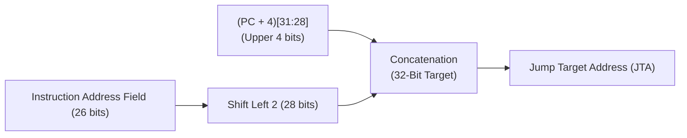

[DLCD Index](../README.md) / [Unit 3: Architecture, Memory, and MIPS Assembly](Introduction.md)

# L07 - MIPS Addressing Modes

In previous lectures, we saw that instructions operate on registers, immediates, and memory words, and redirect execution using branches and jumps. But how does the processor hardware actually locate each operand, and how does it compute the exact numerical memory address to fetch or jump to?

The mechanism used by an instruction to specify the location of its operands or target address is called its **Addressing Mode**.

In this lecture, we examine the **five fundamental addressing modes of the MIPS architecture**: Register-Only, Immediate, Base (Displacement), PC-Relative, and Pseudo-Direct. We derive the mathematical formulas governing each mode and trace step-by-step target address calculations for real assembly programs.

---

## The Five MIPS Addressing Modes at a Glance

Guided by Design Principle 1 (*Simplicity Favors Regularity*), MIPS defines only five orthogonal addressing modes:



---

## 1. Register-Only Addressing

In **Register-Only Addressing**, all operands reside entirely within internal CPU registers.

$$\text{Operand} = \text{Contents}(R_i)$$

- **Instruction Type**: All R-type arithmetic and logical instructions (`add`, `sub`, `and`, `or`, `nor`, `slt`).
- **Memory Access**: Zero memory access. Operands are read directly from the register file into the ALU, and the result is written back into the register file on the clock edge.
- **Performance**: The fastest addressing mode in the architecture (sub-nanosecond execution).



Example:
```assembly
add $s0, $t2, $t3       # $s0 = $t2 + $t3
```

---

## 2. Immediate Addressing

In **Immediate Addressing**, one operand is a constant value embedded directly within the 16-bit `imm` field of the instruction itself.

$$\text{Operand} = \text{Immediate Value in Instruction}$$

- **Instruction Type**: I-type computational instructions (`addi`, `andi`, `ori`, `xori`, `slti`, `lui`).
- **Memory Access**: Zero data memory access. The constant is fetched alongside the instruction itself from instruction memory, avoiding costly data bus cycles.
- **Extension**:
  - Arithmetic operations (`addi`, `slti`): Sign-extended to 32 bits.
  - Logical operations (`andi`, `ori`): Zero-extended to 32 bits.

```assembly
addi $s0, $s0, 10       # $s0 = $s0 + 10
ori  $t3, $t7, 0x00FF   # $t3 = $t7 | 0x000000FF (zero-extended)
```

---

## 3. Base (Displacement) Addressing

In **Base Addressing**, the operand resides in **Data Memory**. The effective 32-bit memory address is calculated dynamically by adding a 16-bit sign-extended displacement offset to the contents of a base register:

$$\text{Effective Address} = \text{Contents}(\text{Base Register } rs) + \text{Sign-Extend}(\text{Offset})$$

- **Instruction Type**: Load and store instructions (`lw`, `sw`, `lb`, `lbu`, `sb`).
- **Hardware Mechanics**: The ALU takes the 32-bit value from register $rs$, sign-extends the 16-bit offset from the instruction word, and adds them together to produce the memory address presented to the data cache/RAM.



Example:
```assembly
lw $t0, 8($sp)          # Address = $sp + 8; Load word into $t0
sw $s1, -16($s4)        # Address = $s4 + (-16); Store word from $s1
```

---

## 4. PC-Relative Addressing: Conditional Branch Targets

In **PC-Relative Addressing**, the destination address of a conditional branch (`beq`, `bne`) is calculated relative to the **Program Counter (PC)**.

$$\text{Branch Target Address (BTA)} = (\text{PC} + 4) + (\text{Sign-Extended Offset} \times 4)$$

Let's dissect every piece of this foundational formula:

1. **Why $\text{PC} + 4$?**
   When the processor fetches an instruction, the PC is automatically incremented by 4 bytes to point to the next sequential instruction. By the time the branch instruction is decoded in the pipeline, the PC already holds $\text{PC} + 4$!
2. **Why $\text{Offset} \times 4$?**
   Because all MIPS instructions are word-aligned (multiples of 4 bytes), the lowest two bits of any valid instruction address are always `00`. Storing two useless zeros inside the 16-bit immediate would waste 2 bits of addressable range!
   By omitting the two zeros, the 16-bit immediate field represents the **number of instructions (words)** to jump, rather than bytes. The hardware shifts the offset left by 2 bits ($\times 4$), effectively granting an 18-bit signed byte range ($\pm 128\text{ KB}$ around $\text{PC} + 4$).
3. **Forward and Backward Branching**:
   Because the offset is a signed 2's complement number:
   - A **positive offset** branches forward in code (e.g., skipping an `else` block).
   - A **negative offset** branches backward in code (e.g., looping back to the top of a `while` loop).



### Complete Traced Branch Calculation Walkthrough
Consider the following assembly fragment:

| Memory Address | Assembly Instruction |
|:---:|:---|
| **`0x00000010`** | `beq $t0, $zero, Else` |
| `0x00000014` | `addi $v0, $zero, 1` |
| `0x00000018` | `addi $sp, $sp, 8` |
| `0x0000001C` | `jr $ra` |
| **`0x00000020`** | `Else: addi $a0, $a0, -1` |

Let's calculate the exact immediate value encoded inside `beq $t0, $zero, Else`:
1. The branch instruction sits at $\text{PC} = 0\text{x}00000010$.
2. The incremented $\text{PC} + 4 = 0\text{x}00000014$.
3. The branch target (`Else`) sits at target address $0\text{x}00000020$.
4. Calculate the byte distance:
   $$\text{Byte Distance} = \text{Target} - (\text{PC} + 4) = 0\text{x}00000020 - 0\text{x}00000014 = 0\text{x}0000000\text{C} = 12_{10}\text{ bytes}$$
5. Convert byte distance to word (instruction) count:
   $$\text{Offset} = \frac{\text{Byte Distance}}{4} = \frac{12}{4} = \mathbf{3}$$
6. Machine Code Representation:
   - `op` (`beq`): `000100` ($4$)
   - `rs` (`$t0`): `01000` ($8$)
   - `rt` (`$zero`): `00000` ($0$)
   - `imm`: `0000000000000011` ($3$)
   - Machine instruction: `beq $t0, $0, 3`

The offset is $3$ because the target sits exactly 3 instructions beyond $\text{PC} + 4$!

---

## 5. Pseudo-Direct Addressing: Unconditional Jump Targets

In **Pseudo-Direct Addressing**, used by unconditional jumps (`j`, `jal`), the target address is constructed by combining bits from the instruction with the upper bits of the Program Counter.

$$\text{Jump Target Address (JTA)} = (\text{PC} + 4)_{31:28} \;\parallel\; (\text{Address Field}_{25:0} \ll 2)$$



### Why is it called "Pseudo-Direct"?
In a truly *direct* addressing mode, the instruction would store the complete 32-bit memory address. But in a 32-bit architecture where the entire instruction word is only 32 bits, storing a 32-bit address is physically impossible because we still need 6 bits for the opcode (`op`)!

The MIPS architects made a brilliant compromise:
1. Since instructions are word-aligned, the lowest two bits of the target address are always `00`. Omit them from the instruction word. This turns 28 bits of address range into a 26-bit field (`addr`).
2. The remaining top 4 bits are borrowed from the current **$\text{PC} + 4$**!
3. The hardware concatenates:
   - **Bits 31:28** from $\text{PC} + 4$ (4 bits).
   - **Bits 27:2** from the instruction `addr` field (26 bits).
   - **Bits 1:0** as hardwired `00` (2 bits).
   - Total: $4 + 26 + 2 = 32\text{ bits}$.

### Reach of a Pseudo-Direct Jump
Because the top 4 bits are supplied by $\text{PC} + 4$, a `j` or `jal` instruction can jump to any word within its current **$256\text{ MB}$ address boundary** ($2^{28}\text{ bytes}$).
If a program needs to jump across the entire 4 GB address space (e.g., calling an arbitrary operating system dynamically linked library), it uses **`jr rs` (Jump Register)**, which loads a full 32-bit target directly from a register!

### Complete Traced Jump Calculation Walkthrough
Consider a jump instruction:
```assembly
0x0040005C      j sum
...
0x004000A0  sum: add $v0, $a0, $a1
```
1. Jump instruction is located at $\text{PC} = 0\text{x}0040005\text{C}$.
2. Next sequential address $\text{PC} + 4 = 0\text{x}00400060$.
   - Upper 4 bits of $\text{PC} + 4$: in binary, $0\text{x}0\dots$ has bits 31:28 equal to `0000`.
3. Target address is `sum` $= 0\text{x}004000\text{A}0$.
   - Binary of target: `0000 0000 0100 0000 0000 0000 1010 0000`
4. Discard upper 4 bits (`0000`) and lowest 2 bits (`00`):
   - Remaining 26 bits: `0000 0100 0000 0000 0000 1010 00`
   - Hexadecimal of 26-bit field: `0x0100028`
5. Machine Code Formation:
   - `op` (`j`): `000010` ($2$)
   - `addr`: `00000100000000000000101000`
   - Concatenated: `000010 000001000000000000101000`
   - Grouping: `0000 1000 0001 0000 0000 0000 0010 1000`
   - Final machine code: **`0x08100028`**

---

## Comparison Matrix of All MIPS Addressing Modes

| Addressing Mode | Used By | Formula for Operand or Address | Memory Access Type |
|:---|:---|:---|:---:|
| **Register-Only** | R-type (`add`, `sub`, `slt`) | $\text{Operand} = \text{Contents}(R_i)$ | None (Register file only) |
| **Immediate** | I-type (`addi`, `andi`, `ori`) | $\text{Operand} = \text{Sign/Zero-Extend}(\text{imm}_{15:0})$ | None (Embedded in instruction) |
| **Base (Displacement)** | I-type (`lw`, `sw`) | $\text{Addr} = \text{Contents}(rs) + \text{Sign-Extend}(\text{imm})$ | Data Memory Read/Write |
| **PC-Relative** | I-type (`beq`, `bne`) | $\text{BTA} = (\text{PC} + 4) + (\text{Sign-Extend}(\text{imm}) \times 4)$ | Control Flow (Instruction Memory) |
| **Pseudo-Direct** | J-type (`j`, `jal`) | $\text{JTA} = (\text{PC} + 4)_{31:28} \parallel (\text{addr}_{25:0} \ll 2)$ | Control Flow (Instruction Memory) |

---

## Key Takeaways

- MIPS defines five orthogonal addressing modes: Register-Only, Immediate, Base, PC-Relative, and Pseudo-Direct.
- Register-Only addressing operates strictly within the CPU register file; Immediate addressing embeds constants directly inside the instruction word.
- Base addressing calculates effective memory addresses as $\text{Contents}(rs) + \text{Sign-Extended Offset}$, enabling array and structure indexing.
- PC-Relative addressing calculates branch targets as $(\text{PC} + 4) + (\text{Offset} \times 4)$. The offset represents the signed count of instructions relative to $\text{PC} + 4$.
- Pseudo-Direct addressing builds 32-bit jump targets by concatenating the upper 4 bits of $\text{PC} + 4$, the 26-bit address field, and two trailing zeros (`00`), allowing jumps within a 256 MB memory segment.
- Jumps requiring an arbitrary 32-bit target across the entire 4 GB address space use `jr rs` (Register Addressing).

---

Now that we understand how single instructions manipulate registers, memory, and control flow, what are the performance boundaries of computer systems? In the next lecture, [L08 - Parallelism and Performance Limits](L08%20-%20Parallelism%20and%20Performance%20Limits.md), we explore hardware parallelism (ILP, SIMD, multicore) and analyze the iron mathematical law that limits speedup: Amdahl's Law.
