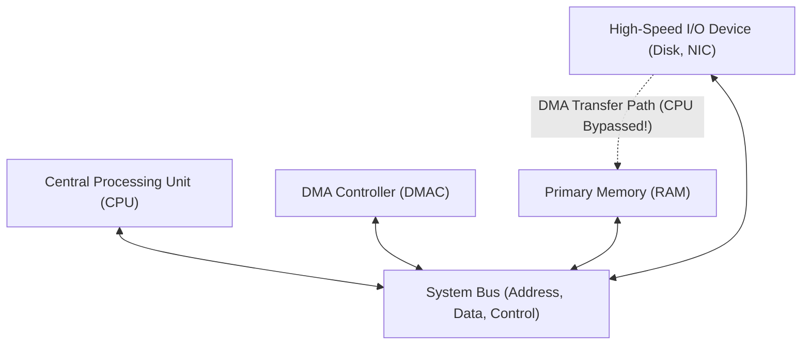
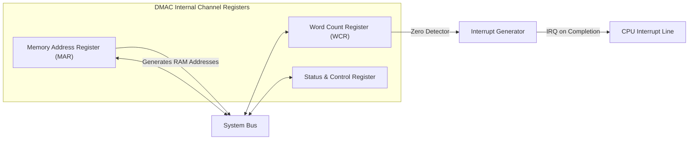
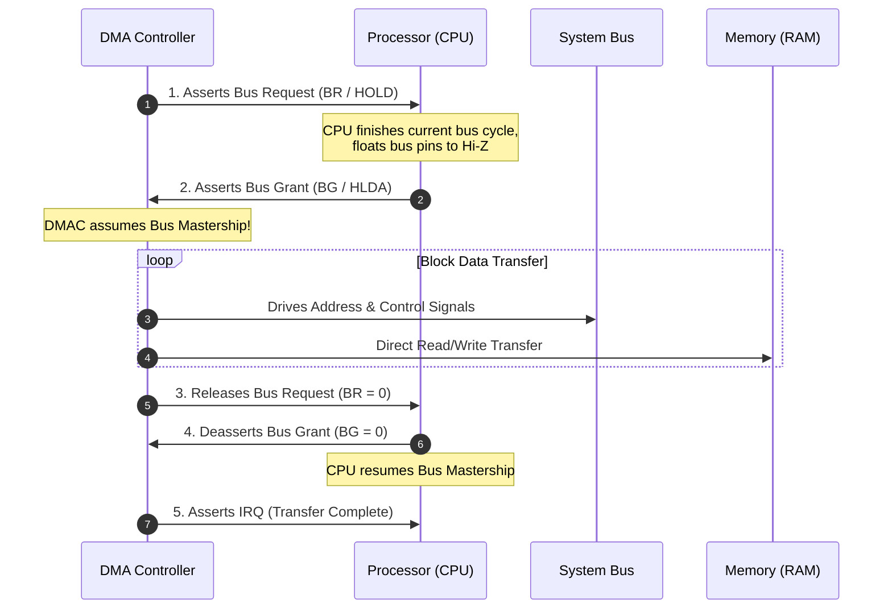

[DLCD Index](../README.md) / [Unit 3: Computer Structure and Organization](Introduction.md)

# L08 - Direct Memory Access and Standard I/O Interfaces

In Lecture 7, we saw how hardware interrupts liberate the processor from the wasteful spin-loops of polling. Interrupt-driven I/O is the perfect solution for low-bandwidth devices like keyboards, mice, and temperature sensors.

Now consider high-bandwidth devices: an NVMe Solid-State Drive reading a 4-gigabyte movie, a Gigabit Ethernet interface streaming video packets, or a graphics card rendering textures. 

If we attempted to transfer 4 gigabytes using interrupt-driven I/O, the CPU would be forced to execute an interrupt service routine for every single word. The processor would spend 100% of its clock cycles pushing registers, reading bytes into accumulators, writing bytes into memory, and popping registers—completely paralyzing user applications.

To transfer bulk data at wire speed without choking the CPU, computer systems use **Direct Memory Access (DMA)**. In this lecture, we examine the DMA architecture, trace bus arbitration handshakes, compare burst mode against cycle stealing, and analyze standard interconnect buses including **PCIe** and **USB**.

---

## The Bulk Data Transfer Bottleneck

Let's do the arithmetic to see why CPU-mediated I/O fails for bulk data:

Suppose a network card receives data at 1 gigabit per second ($\approx 125\text{ Megabytes per second}$).
If the CPU transfers each 4-byte word via interrupt-driven software:
1. Context switch into ISR: 15 cycles.
2. Load word from I/O register into CPU: 2 cycles.
3. Store word from CPU into RAM buffer: 2 cycles.
4. Increment buffer pointer & decrement counter: 2 cycles.
5. Check if block finished: 2 cycles.
6. Context switch return (`RTI`): 12 cycles.

Total time per 4-byte word $\approx \mathbf{35\text{ clock cycles}}$!
To transfer 125 MB ($31.25\text{ million words}$), the CPU must execute:
$$31.25 \times 10^6 \times 35 \approx \mathbf{1.09\text{ Billion clock cycles per second!}}$$

A 2 GHz processor would waste over **55% of its entire computational capacity** merely copying bytes between two physical wires!

The processor is acting as an expensive, over-qualified bucket brigade. We need a way to connect the I/O device **directly to memory**.

---

## Direct Memory Access (DMA)

**Direct Memory Access (DMA)** is a hardware technique where a specialized co-processor—the **DMA Controller (DMAC)**—takes temporary control of the system bus and transfers data blocks **directly between the peripheral device and primary RAM**, completely bypassing the CPU execution core.

### The CPU's Role in DMA: Delegation
The CPU does not participate in the word-by-word transfer. It acts purely as a manager delegating a task:
1. The CPU initializes the DMA Controller by writing four parameters to its internal registers:
   - **Source Address**: Starting address of the data buffer.
   - **Destination Address**: Target memory address.
   - **Word Count**: Number of words to transfer.
   - **Control Command**: Direction (Read from device to RAM, or Write from RAM to device).
2. The CPU issues a **"Start DMA"** command.
3. The CPU immediately resumes running user programs (rendering graphics, compiling code, calculating math).
4. The DMA Controller executes the entire multi-megabyte transfer across the bus autonomously.
5. When the word count drops to zero, the DMA Controller asserts a **single hardware interrupt** to notify the CPU that the transfer is complete!

---

## Internal Architecture of a DMA Controller

A DMA Controller contains an address decoder, interrupt generation logic, and three core registers for each hardware channel:

- **Memory Address Register (MAR)**: Holds the memory address of the next word to be read or written in RAM. After every successful word transfer, the DMAC automatically increments (or decrements) this register.
- **Word Count Register (WCR)**: Initialized with the total number of words to be transferred. After every word transfer, the DMAC decrements this register by 1. When the WCR decrements to zero, an internal zero-detect circuit fires an interrupt request to the CPU.
- **Status & Control Register**: Holds the transfer direction bit, mode bits (burst vs. cycle stealing), and device status flags.

---

## Bus Arbitration: Becoming the Bus Master

At any given nanosecond, only one device can drive voltages onto the shared system bus. That controlling device is called the **Bus Master**.

Normally, the CPU is the default bus master. When the DMA Controller needs to transfer data, it must formally request bus mastership through a hardware handshake called **Bus Arbitration**:

1. **Bus Request ($\text{BR}$ / $\text{HOLD}$)**: The DMAC asserts this line, asking the CPU to yield the bus.
2. **Bus Grant ($\text{BG}$ / $\text{HLDA}$)**: The CPU completes its current bus access, disconnects its address, data, and control lines by placing their output drivers into a **High-Impedance (Hi-Z / Tri-state)** mode, and asserts Bus Grant.
3. **Data Transfer**: The DMAC becomes the active Bus Master. It drives the address bus lines directly to select RAM rows and coordinates data transfers with the peripheral.
4. **Bus Release**: Once finished, the DMAC releases $\text{BR}$, the CPU deasserts $\text{BG}$, and the CPU reclaims bus mastership.

---

## DMA Transfer Modes

How does the DMA Controller share bus bandwidth with the CPU during a transfer? 
Three operational modes exist:

### 1. Burst Mode (Block Transfer)
- Once the DMAC acquires the bus, it **holds the bus continuously** until the entire block of data (e.g., all 4,096 bytes of a disk sector) is transferred.
- **Advantage**: Maximum possible transfer rate; zero bus arbitration overhead between individual words.
- **Disadvantage**: The CPU is completely locked out of primary memory for the entire duration of the burst! (The CPU can only execute instructions that are already cached in its on-chip L1 cache).

### 2. Cycle Stealing Mode
- The DMAC transfers **exactly one word**, and then immediately releases the bus back to the CPU for one or more cycles.
- It "steals" an occasional memory cycle from the CPU.
- **Advantage**: The CPU is never locked out for extended periods; user programs continue running smoothly.
- **Disadvantage**: Higher arbitration overhead; the overall block transfer takes longer to complete.

### 3. Transparent Mode (Hidden DMA)
- The DMAC transfers data **only during clock cycles when the CPU is performing internal operations** (such as an ALU multiply or register-to-register shift) that do not require the external memory bus.
- **Advantage**: Zero impact on CPU execution speed—the transfer is completely invisible (transparent) to the CPU!
- **Disadvantage**: Highly complex control hardware required to track CPU micro-operations.

---

## Standard I/O Interconnect Buses

In early computing, every manufacturer used proprietary bus slots. Today, standardized interconnect buses ensure that any graphics card, SSD, keyboard, or camera can plug into any computer on Earth.

Two modern standards dominate computing:

---

### 1. PCI Express (PCIe)

Historically, the **PCI (Peripheral Component Interconnect)** bus was a shared, parallel 32-bit or 64-bit bus running at 33 or 66 MHz. However, parallel buses suffer from **clock skew** (bits on different copper traces arrive at slightly different times at high frequencies).

Modern computers replaced parallel PCI with **PCIe (PCI Express)**:
- **Serial Point-to-Point Architecture**: Instead of a shared bus where all devices fight for bandwidth, every PCIe device connects to the CPU or chipset switch via a dedicated point-to-point link.
- **Lanes**: A link is composed of one or more full-duplex serial **Lanes** (labeled $\times 1, \times 4, \times 8, \times 16$). Each lane consists of two pairs of differential wires (one pair to transmit, one pair to receive).
- **Packetized Data**: Data is transmitted as serialized packets, similar to the Internet protocol.
- **Bandwidth**: PCIe 5.0 delivers **$\approx 4\text{ Gigabytes per second per lane}$**. A standard $\times 16$ graphics slot provides an astonishing **$\approx 64\text{ GB/s}$** of bidirectional bandwidth, ideal for GPUs and NVMe solid-state drives.

---

### 2. Universal Serial Bus (USB)

Before USB, connecting an external mouse, printer, scanner, or modem required an assortment of incompatible serial and parallel ports (RS-232, IEEE 1284, PS/2).

In 1996, the industry introduced **USB (Universal Serial Bus)**:
- **Tiered Star Topology**: A single host controller connects to a tree of USB hubs, supporting up to 127 devices on a single bus.
- **Hot-Pluggable & Plug-and-Play**: Devices can be attached or removed while the computer is running. The host controller automatically detects new hardware, queries its configuration descriptors, and loads the appropriate device driver.
- **Differential Signaling**: Data is transmitted over a twisted pair of copper wires labeled $D+$ and $D-$, providing extraordinary immunity to electromagnetic noise.
- **Evolution**:
  - USB 1.1: 12 Mbps
  - USB 2.0 (High-Speed): 480 Mbps
  - USB 3.2 (SuperSpeed): 5 to 20 Gbps
  - USB4 / Thunderbolt: 40 to 80 Gbps (capable of tunneling PCIe packets and driving dual 4K video displays across a single USB-C cable).

---

## Key Takeaways

- Transferring bulk data via CPU-mediated interrupts creates a massive bottleneck, wasting up to 35 clock cycles per word and paralyzing the processor.
- **Direct Memory Access (DMA)** delegates bulk block transfers to a dedicated controller, routing data **directly between I/O devices and RAM** without CPU intervention.
- The CPU initializes the DMA Controller with Source Address, Destination Address, Word Count, and Direction, then immediately resumes executing user programs until the DMAC fires a completion interrupt.
- In **Bus Arbitration**, the DMAC asserts Bus Request ($\text{BR}$), and the CPU yields the bus by placing its bus drivers into High-Impedance (Hi-Z) mode and asserting Bus Grant ($\text{BG}$).
- **Burst Mode** transfers entire blocks continuously but locks out the CPU; **Cycle Stealing Mode** interleaves single-word transfers with CPU cycles to prevent bus starvation.
- **PCIe** uses high-speed, point-to-point packetized serial lanes ($\times 1$ to $\times 16$) to eliminate parallel clock skew, delivering tens of gigabytes per second to GPUs and NVMe drives.
- **USB** provides hot-pluggable, tiered-star peripheral connectivity using noise-immune differential serial signaling.

---

Both CPU execution and DMA transfers converge on a single critical resource: **Primary RAM**. How is primary memory internally organized? How do microscopic capacitor cells store bits, and why do dynamic memories require refresh circuitry? In the final lecture of Unit 3, we analyze [**Semiconductor RAM Memories**](L09%20-%20Semiconductor%20RAM%20Memories.md), contrasting SRAM with DRAM and exploring multi-bank memory hierarchies.
