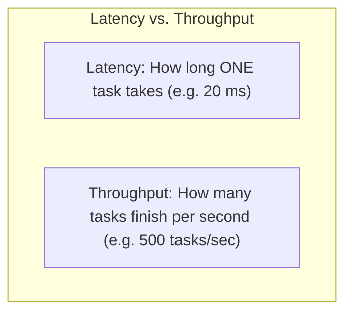
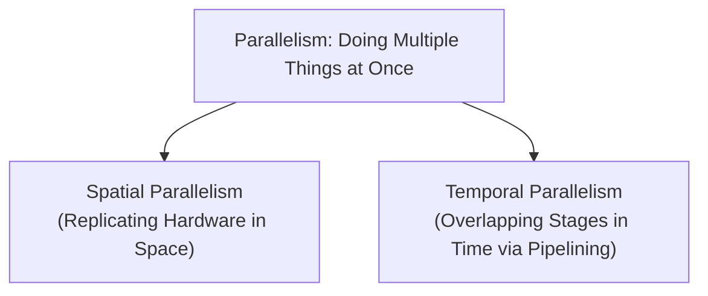
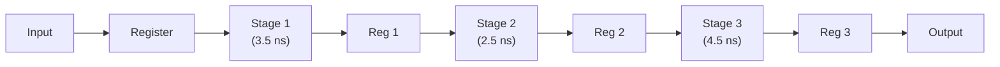
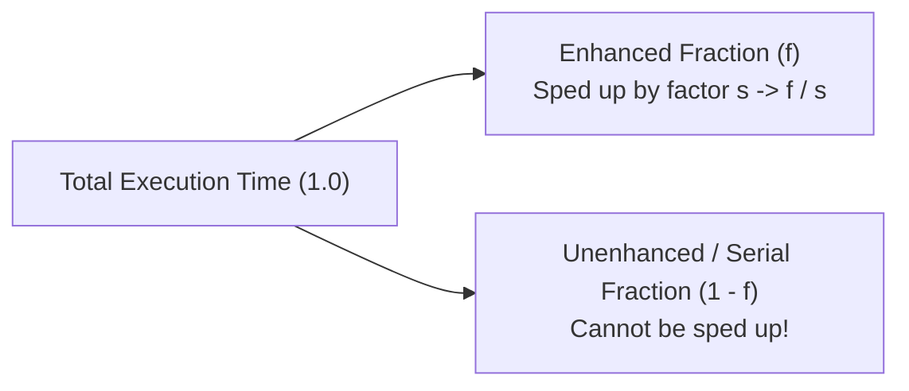

[DLCD Index](../README.md) / [Unit 3: Architecture, Memory, and MIPS Assembly](Introduction.md)

# L08 - Parallelism and Performance Limits

For decades, the computer industry relied on a simple formula to make software run faster: shrink transistors and crank up the clock frequency. In the 1990s, CPU clock speeds soared from 25 MHz to 1 GHz, then rapidly pushed toward 3 GHz. But around 2005, this effortless scaling crashed into an immovable physical barrier known as the **Power Wall**.

Because dynamic power consumption scales quadratically with voltage and linearly with clock frequency ($P = \alpha C V^2 f$), running chips at 5 or 10 GHz would cause silicon to melt. To deliver higher computational performance without incinerating processors, computer architecture underwent the biggest paradigm shift in its history: **the transition to parallelism**.

In this lecture, we define the fundamental metrics of latency and throughput, contrast **spatial** and **temporal** parallelism, analyze the trade-offs of pipelining, and explore the mathematical boundaries of hardware acceleration governed by **Amdahl's Law**.

---

## Performance Metrics: Latency vs. Throughput

Before we can analyze parallel architectures, we must rigorously distinguish between the two metrics that define computational speed:

- **Latency (Execution Time)**: The time required for a single task (often called a *token*) to travel from start to finish.
  $$\text{Latency} = \text{Time per Task}$$
  *(Measured in seconds, nanoseconds, or clock cycles).*
- **Throughput (Bandwidth)**: The number of completed tasks the system produces per unit of time.
  $$\text{Throughput} = \frac{\text{Number of Completed Tasks}}{\text{Total Time}}$$
  *(Measured in tasks/second, frames/second, or Instructions Per Second - IPS).*

In a non-parallel, single-threaded system where each task must finish completely before the next begins, throughput is simply the mathematical reciprocal of latency:

$$\text{Throughput}_{\text{serial}} = \frac{1}{\text{Latency}}$$

### The Cookie Baking Analogy (Harris & Harris)
To make this tangible, consider Ben Bitdiddle baking trays of cookies:
- Rolling out cookie dough takes **5 minutes**.
- Baking the tray in the oven takes **15 minutes**.
- Total time to produce one tray (Latency) = $5 + 15 = \mathbf{20\text{ minutes}}$ ($\frac{1}{3}\text{ hour}$).

If Ben is working completely serially—never touching dough for tray 2 until tray 1 is out of the oven:
- Each tray takes 20 minutes.
- In one hour (60 minutes), he produces:
  $$\text{Throughput} = \frac{60\text{ min}}{20\text{ min/tray}} = \mathbf{3\text{ trays per hour}}$$

Notice what happens: even though the kitchen has both a counter and an oven, the oven sits completely empty and idle for 5 minutes during rolling, and the counter sits completely empty and idle for 15 minutes during baking!

---

## The Two Faces of Parallelism: Spatial vs. Temporal

How can Ben increase his cookie throughput? He has two fundamental architectural choices:

### 1. Spatial Parallelism (Hardware Replication)
Ben hires a second chef and buys a second oven. Both chefs roll dough simultaneously and bake in separate ovens.
- **Hardware Cost**: Doubles (2 ovens, 2 chefs, twice the kitchen footprint).
- **Latency**: Each tray still takes 20 minutes to produce.
- **Throughput**: Two trays are produced every 20 minutes $\implies \mathbf{6\text{ trays per hour}}$ (Doubled throughput!).

In computer engineering, **Spatial Parallelism** means duplicating physical execution units:
- **Multi-core Processors**: Placing 8, 16, or 64 independent CPU cores on the same silicon die.
- **Superscalar Processors**: Including multiple ALUs inside a single core to execute multiple independent instructions per clock cycle.
- **Graphics Processing Units (GPUs)**: Deploying thousands of small SIMD arithmetic cores in parallel.

### 2. Temporal Parallelism (Pipelining)
What if Ben cannot afford a second oven? He can use **Temporal Parallelism** by overlapping the rolling and baking stages of consecutive trays:
- While Tray 1 is baking in the oven (15 min), Ben immediately starts rolling Tray 2 on the counter (5 min).
- As soon as Tray 1 finishes and exits the oven, Tray 2 is already prepared and enters the oven immediately!

In computer engineering, **Temporal Parallelism** is **Pipelining**: partitioning a complex digital calculation into sequential stages separated by clocked registers, so that multiple instructions occupy different stages of the circuit simultaneously.

---

## Quantitative Timing Analysis of Pipelining

Consider a combinational circuit with a total delay of $10.5\text{ ns}$. If implemented as a single unpipelined block:
- $\text{Latency} = 10.5\text{ ns}$
- $\text{Clock Period } T_c = 10.5\text{ ns}$
- $\text{Throughput} = \frac{1}{10.5\text{ ns}} \approx 95\text{ MHz}$

Now, let's insert pipeline registers to divide the circuit into a **3-stage pipeline**:
- Stage 1 delay = $3.5\text{ ns}$
- Stage 2 delay = $2.5\text{ ns}$
- Stage 3 delay = $4.5\text{ ns}$

### 1. Determining Clock Cycle Time ($T_c$)
In a synchronous pipeline, all registers share the same clock. The clock period must be long enough to accommodate the **slowest pipeline stage** (the bottleneck stage):

$$T_c = \max(\text{Stage}_1, \text{Stage}_2, \text{Stage}_3) = \max(3.5\text{ ns}, 2.5\text{ ns}, 4.5\text{ ns}) = \mathbf{4.5\text{ ns}}$$

### 2. Calculating Latency
An instruction must travel through all 3 stages. Since each stage takes one clock cycle ($4.5\text{ ns}$):

$$\text{Latency} = N_{\text{stages}} \times T_c = 3 \times 4.5\text{ ns} = \mathbf{13.5\text{ ns}}$$

Notice an alarming fact: **pipelining increased the latency from $10.5\text{ ns}$ to $13.5\text{ ns}$!** Why? Because fast stages ($2.5\text{ ns}$) must wait idle for the clock period ($4.5\text{ ns}$) dictated by the slowest stage.

### 3. Calculating Throughput
Once the pipeline is filled, **one completed instruction exits Stage 3 on every single clock cycle**:

$$\text{Throughput} = \frac{1}{T_c} = \frac{1}{4.5 \times 10^{-9}\text{ s}} \approx \mathbf{222\text{ MHz}}$$

Throughput surged from $95\text{ MHz}$ to $222\text{ MHz}$—a **$2.33\times$ speedup**! Pipelining trades a minor increase in single-instruction latency for a massive increase in continuous system throughput.

---

## Pipeline Hazards

In an ideal world, an $N$-stage pipeline provides an $N\times$ throughput speedup. But in real processors, instructions depend on one another, creating conditions called **pipeline hazards** that force the processor to insert idle cycles (**bubbles or stalls**):

1. **Structural Hazards**: Two instructions demand the same physical hardware resource simultaneously (e.g., trying to read data memory and fetch an instruction from a single-port memory).
2. **Data Hazards**: An instruction needs the result of a preceding instruction that is still traveling down the pipeline and has not yet written back to the register file (Read-After-Write - RAW hazard).
3. **Control Hazards**: The processor fetches instructions following a conditional branch before the branch condition and target address have been computed.

---

## Amdahl's Law: The Iron Limit of Speedup

Engineers are often tempted to spend enormous effort accelerating a specific hardware block (e.g., building an ultra-fast vector floating-point unit). But how much does optimizing that single component improve the **overall performance** of the computer?

In 1967, computer architect Gene Amdahl formulated **Amdahl's Law**:

> The performance improvement to be gained from using some faster mode of execution is strictly limited by the fraction of the time the faster mode can be used.

### Mathematical Derivation of Amdahl's Law
Let an application have an original total execution time of $T_{\text{old}} = 1$.
- Let $f$ be the **fraction of execution time** that can be accelerated.
- Let $(1 - f)$ be the remaining **unenhanced fraction** that must run serially.
- Let $s$ be the **speedup factor** applied to the enhanced portion ($s > 1$).

The new execution time $T_{\text{new}}$ is:

$$T_{\text{new}} = (1 - f) + \frac{f}{s}$$

The overall system speedup $S_{\text{overall}}$ is defined as:

$$S_{\text{overall}} = \frac{T_{\text{old}}}{T_{\text{new}}} = \frac{1}{(1 - f) + \frac{f}{s}}$$

### The Theoretical Speedup Limit
What happens if we make the enhanced fraction infinitely fast ($s \to \infty$)?
The term $\frac{f}{s}$ approaches zero:

$$S_{\max} = \lim_{s \to \infty} \left[ \frac{1}{(1 - f) + \frac{f}{s}} \right] = \mathbf{\frac{1}{1 - f}}$$

Look at the profound implication: **the overall speedup is strictly bounded by the unenhanced fraction $(1 - f)$!**

---

## Amdahl's Law Case Studies

### Case 1: The Multi-Core Trap
Suppose an algorithm is 80% parallelizable ($f = 0.80$), but 20% of its runtime consists of inherently sequential initialization and file I/O ($1 - f = 0.20$).
How much speedup can a 64-core processor deliver?

$$S_{64} = \frac{1}{(1 - 0.80) + \frac{0.80}{64}} = \frac{1}{0.20 + 0.0125} = \frac{1}{0.2125} \approx \mathbf{4.71\times}$$

Even with **64 physical processor cores**, the overall system is only $4.71\times$ faster!
Even if you bought an infinitely powerful supercomputer with one million cores ($s = \infty$):

$$S_{\max} = \frac{1}{1 - 0.80} = \frac{1}{0.20} = \mathbf{5.0\times}$$

The 20% sequential portion acts as an anchor that prevents the program from ever running more than 5 times faster.

### Case 2: Optimizing the Common Case
Suppose floating-point arithmetic accounts for 10% of execution time ($f = 0.10$). An engineer proposes spending \$2 million to redesign the floating-point unit to be $10\times$ faster ($s = 10$).
Is it worth it?

$$S_{\text{overall}} = \frac{1}{(1 - 0.10) + \frac{0.10}{10}} = \frac{1}{0.90 + 0.01} = \frac{1}{0.91} \approx \mathbf{1.098\times}$$

The overall system is only **9.8% faster** despite a massive engineering expenditure!
This demonstrates Design Principle 2: **Make the Common Case Fast**. Spending resources accelerating a task that only accounts for 10% of runtime yields negligible system-wide benefits.

---

## Key Takeaways

- Power constraints ($P = \alpha C V^2 f$) ended the era of pure clock frequency scaling, forcing the transition to parallel architectures.
- Latency is the time for a single task to complete; Throughput is the number of tasks completed per unit time. Parallelism primarily improves throughput.
- Spatial parallelism replicates hardware units (multicore, superscalar, GPU arrays); Temporal parallelism overlaps execution stages over time (pipelining).
- Pipelining divides combinational logic into stages separated by registers. The clock cycle time is dictated by the slowest stage ($T_c = \max(\text{delays})$). Pipelining multiplies throughput while slightly increasing latency.
- Pipeline efficiency is degraded by data hazards, control hazards, and structural hazards.
- Amdahl's Law states that overall system speedup is governed by $S = \frac{1}{(1 - f) + \frac{f}{s}}$.
- As acceleration approaches infinity ($s \to \infty$), speedup saturates at $\frac{1}{1 - f}$, proving that the serial fraction of an application establishes a hard ceiling on parallel performance.

---

With instruction formats, addressing modes, and architectural performance limits firmly established, how do university exams test this knowledge? In the final lecture of Unit 3, [L09 - Architecture and Assembly Practice Problems](L09%20-%20Architecture%20and%20Assembly%20Practice%20Problems.md), we work through five comprehensive textbook and past-exam walkthrough problems.
