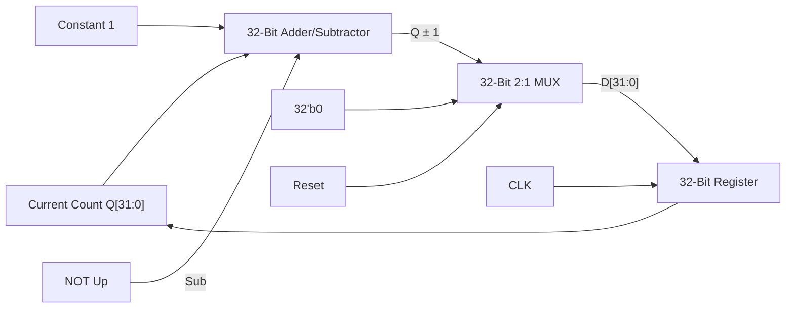
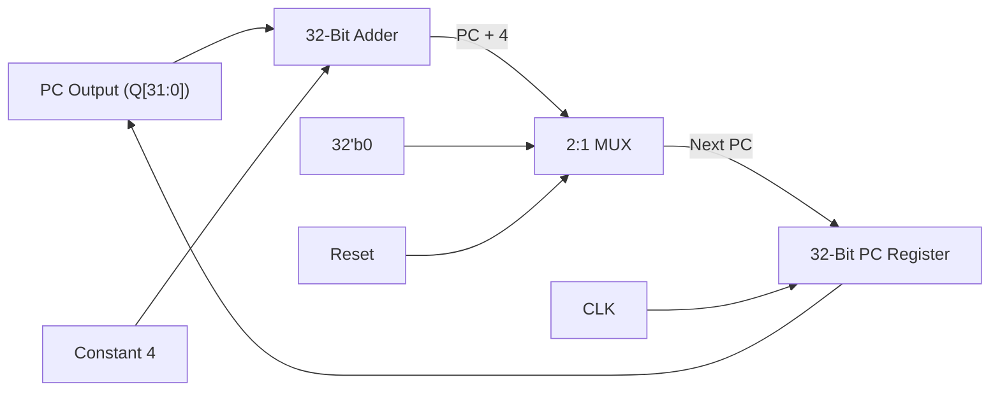

[DLCD Index](../README.md) / [Unit 3: Architecture, Memory, and MIPS Assembly](Introduction.md)

# L09 - Architecture and Assembly Practice Problems

In this final lecture of Unit 3, we bring together all the theoretical concepts we have studied—synchronous sequential building blocks, ROM memory logic, byte addressing, endianness, MIPS machine code encoding, and branch calculations—by solving comprehensive, step-by-step practice problems from the prescribed textbook (*Digital Design and Computer Architecture* by David Money Harris & Sarah L. Harris) and university coursework examinations.

---

## Problem 1: 32-Bit Synchronous Up/Down Counter Design (Exercise 5.43)

### Problem Specification
Design a 32-bit synchronous Up/Down counter. The circuit has inputs `CLK`, `Reset`, and `Up`, and produces a 32-bit output $Q[31:0]$.
- When $\text{Reset} = 1$, the outputs are forced to all zeros ($Q = 0$).
- When $\text{Reset} = 0$ and $\text{Up} = 1$, the counter increments: $Q^+ = Q + 1$.
- When $\text{Reset} = 0$ and $\text{Up} = 0$, the counter decrements: $Q^+ = Q - 1$.
- The reset signal is **synchronous** (it updates the counter on the rising clock edge).

### Design and Hardware Synthesis
The formal mathematical next-state recurrence is:

$$Q^+ = \begin{cases} 
0 & \text{if } \text{Reset} = 1 \\
Q + 1 & \text{if } \text{Reset} = 0 \text{ and } \text{Up} = 1 \\
Q - 1 & \text{if } \text{Reset} = 0 \text{ and } \text{Up} = 0 
\end{cases}$$

To synthesize this circuit using modular digital building blocks:
1. **Arithmetic Core**: We use a 32-bit **Adder/Subtractor**. Operand $A$ is connected to the current count $Q[31:0]$. Operand $B$ is hardwired to the constant $1$. The control line $\text{Sub}$ is driven by $\overline{\text{Up}}$:
   - When $\text{Up} = 1$ ($\text{Sub} = 0$), the unit computes $Q + 1$.
   - When $\text{Up} = 0$ ($\text{Sub} = 1$), the unit computes $Q - 1$.
2. **Synchronous Reset Logic**: We place a 32-bit 2:1 multiplexer before the register input $D$:
   - The select line of the MUX is driven by `Reset`.
   - Input 0 of the MUX receives the output of the adder/subtractor ($Q \pm 1$).
   - Input 1 of the MUX receives a 32-bit constant zero ($0\text{x}00000000$).
3. **State Register**: A 32-bit clocked register stores the count.



On every rising clock edge, if `Reset` is high, the register swallows $0$; otherwise, it swallows $Q+1$ or $Q-1$ depending on `Up`.

---

## Problem 2: The Program Counter Incrementer (Exercise 5.44)

### Problem Specification
Design a 32-bit counter that adds 4 at each clock edge. The counter has `CLK` and synchronous `Reset` inputs. Upon reset, the output is initialized to all zeros.

### Analysis and Circuit Diagram
This circuit is the exact hardware incrementer used by the **Program Counter (PC)** in a MIPS microprocessor! Because every instruction is 4 bytes wide, the PC must advance by 4 bytes on every clock cycle.

- State equation: $Q^+ = Q + 4$ (when $\text{Reset} = 0$).
- Hardware required:
  - One 32-bit register.
  - One 32-bit adder with operand $B$ hardwired to the constant $4$ ($0\text{x}00000004$).
  - One 32-bit 2:1 MUX controlled by `Reset` selecting between $0$ and $Q + 4$.



---

## Problem 3: Implementing Combinational Logic with ROM Arrays (Exercise 5.51)

### Problem Specification
Implement the three Boolean functions $X, Y, Z$ of four input variables $A, B, C, D$ using a single **$16 \times 3$ Read-Only Memory (ROM)**. Represent the programmed contents using both a data table and **dot notation**.

### Given Truth Table

| Row ($i$) | Address ($A B C D$) | Output $X$ | Output $Y$ | Output $Z$ | Stored ROM Word ($XYZ$) |
|:---:|:---:|:---:|:---:|:---:|:---:|
| 0 | `0000` | 1 | 0 | 0 | **`100`** |
| 1 | `0001` | 1 | 0 | 1 | **`101`** |
| 2 | `0010` | 1 | 0 | 1 | **`101`** |
| 3 | `0011` | 1 | 0 | 1 | **`101`** |
| 4 | `0100` | 0 | 0 | 1 | **`001`** |
| 5 | `0101` | 0 | 1 | 1 | **`011`** |
| 6 | `0110` | 0 | 0 | 1 | **`001`** |
| 7 | `0111` | 0 | 1 | 1 | **`011`** |
| 8 | `1000` | 0 | 0 | 1 | **`001`** |
| 9 | `1001` | 0 | 0 | 1 | **`001`** |
| 10 | `1010` | 1 | 0 | 1 | **`101`** |
| 11 | `1011` | 0 | 0 | 1 | **`001`** |
| 12 | `1100` | 1 | 1 | 1 | **`111`** |
| 13 | `1101` | 1 | 1 | 1 | **`111`** |
| 14 | `1110` | 1 | 1 | 1 | **`111`** |
| 15 | `1111` | 1 | 1 | 1 | **`111`** |

### Dot Notation Matrix
In ROM dot notation, a solid dot ($\bullet$) represents an intact diode or pull-down transistor that programs a stored **`1`** at the intersection of a wordline row and a bitline column:

| Address ($A B C D$) | Line $X$ | Line $Y$ | Line $Z$ |
|:---:|:---:|:---:|:---:|
| `0000` | $\bullet$ | | |
| `0001` | $\bullet$ | | $\bullet$ |
| `0010` | $\bullet$ | | $\bullet$ |
| `0011` | $\bullet$ | | $\bullet$ |
| `0100` | | | $\bullet$ |
| `0101` | | $\bullet$ | $\bullet$ |
| `0110` | | | $\bullet$ |
| `0111` | | $\bullet$ | $\bullet$ |
| `1000` | | | $\bullet$ |
| `1001` | | | $\bullet$ |
| `1010` | $\bullet$ | | $\bullet$ |
| `1011` | | | $\bullet$ |
| `1100` | $\bullet$ | $\bullet$ | $\bullet$ |
| `1101` | $\bullet$ | $\bullet$ | $\bullet$ |
| `1110` | $\bullet$ | $\bullet$ | $\bullet$ |
| `1111` | $\bullet$ | $\bullet$ | $\bullet$ |

---

## Problem 4: Byte Addressing and Endianness Calculations (Exercises 6.3 & 6.4)

### Problem Specification
Consider the storage of the 32-bit hexadecimal word **`0xFF223344`** in a byte-addressable memory:
- **Part A**: Word is stored at **memory word 42**.
- **Part B**: Word is stored at **memory word 15**.
For each part, determine:
1. The starting byte address of the word in decimal and hexadecimal.
2. The exact four byte addresses spanned by the word.
3. The byte layout across memory addresses in both **Big-Endian** and **Little-Endian** systems.

### Solution for Part A: Memory Word 42
1. **Starting Byte Address**:
   Since each word is 4 bytes wide:
   $$\text{Byte Address} = \text{Word Number} \times 4 = 42 \times 4 = \mathbf{168_{10}}$$
   Convert $168_{10}$ to hexadecimal:
   $$168 = 10 \times 16 + 8 \implies \mathbf{0\text{xA8}}$$
2. **Byte Addresses Spanned**:
   Starting at $0\text{xA8}$, the 4 consecutive byte addresses are:
   $$\mathbf{0\text{xA8}, \quad 0\text{xA9}, \quad 0\text{xAA}, \quad 0\text{xAB}}$$
3. **Partitioning Word Bytes**:
   Word = `0xFF223344`
   - Byte 3 (Most Significant Byte - MSB) = `0xFF`
   - Byte 2 = `0x22`
   - Byte 1 = `0x33`
   - Byte 0 (Least Significant Byte - LSB) = `0x44`
4. **Endian Storage Layout**:
   - **Big-Endian (MSB at Lowest Address)**:
     - `0xA8`: **`0xFF`** (MSB)
     - `0xA9`: **`0x22`**
     - `0xAA`: **`0x33`**
     - `0xAB`: **`0x44`** (LSB)
   - **Little-Endian (LSB at Lowest Address)**:
     - `0xA8`: **`0x44`** (LSB)
     - `0xA9`: **`0x33`**
     - `0xAA`: **`0x22`**
     - `0xAB`: **`0xFF`** (MSB)

### Solution for Part B: Memory Word 15
1. **Starting Byte Address**:
   $$\text{Byte Address} = 15 \times 4 = \mathbf{60_{10}} = \mathbf{0\text{x3C}}$$
2. **Byte Addresses Spanned**:
   $$\mathbf{0\text{x3C}, \quad 0\text{x3D}, \quad 0\text{x3E}, \quad 0\text{x3F}}$$
3. **Endian Storage Layout**:
   - **Big-Endian**: `3C: 0xFF`, `3D: 0x22`, `3E: 0x33`, `3F: 0x44`
   - **Little-Endian**: `3C: 0x44`, `3D: 0x33`, `3E: 0x22`, `3F: 0xFF`

---

## Problem 5: Array Address Calculation and Tracing

### Problem Specification
An integer array `scores` of 100 elements begins at base address `0x10007000`. The address of `scores[0]` is stored in register `$s0`.
Trace the following MIPS assembly snippet and determine:
1. What memory address is accessed by the load instruction?
2. Which array element (`scores[k]`) does this address correspond to?

```assembly
sll  $t0, $s1, 2
add  $t1, $s0, $t0
lw   $t2, 0($t1)
```
Assume register `$s1` initially holds the integer value `6`.

### Step-by-Step Solution
1. **Trace `sll $t0, $s1, 2`**:
   - Shifting left by 2 positions is equivalent to multiplying by $2^2 = 4$:
     $$\text{Contents}(\$t0) = 6 \times 4 = 24_{10} = 0\text{x}00000018$$
   - This converts the element index ($6$) into its byte offset ($24\text{ bytes}$).
2. **Trace `add $t1, $s0, $t0`**:
   - Adds the byte offset to the base address:
     $$\text{Contents}(\$t1) = 0\text{x}10007000 + 0\text{x}00000018 = \mathbf{0\text{x}10007018}$$
3. **Trace `lw $t2, 0($t1)`**:
   - The effective address accessed is $\text{Contents}(\$t1) + 0 = \mathbf{0\text{x}10007018}$.
4. **Identify Array Element**:
   - Since each word is 4 bytes:
     $$\text{Index } k = \frac{\text{Address} - \text{Base Address}}{4} = \frac{0\text{x}18}{4} = \frac{24}{4} = \mathbf{6}$$
   - The instruction loads array element **`scores[6]`**!

---

## Key Takeaways

- Synchronous counters use 2:1 multiplexers to choose between count updates ($Q \pm 1$) and synchronous clear ($0$).
- The MIPS Program Counter (PC) incrementer is a specialized 32-bit counter with an adder input hardwired to constant $4$.
- A $2^N \times M$ ROM can implement any set of $M$ combinational functions of $N$ variables; dot notation indicates active $1$ bits.
- To convert a word number to its byte address in byte-addressable memory, multiply the word number by 4 ($W \times 4$).
- Big-Endian stores the most significant byte (MSB) at the lowest memory address; Little-Endian stores the least significant byte (LSB) at the lowest address.
- In MIPS assembly array indexing, an integer index $i$ must always be scaled by 4 using `sll $reg, $i, 2` to obtain the correct byte address.

---

We have completed Unit 3! We understand the instruction set architecture, the assembly language, the machine code formats, and the memory systems. But how do we actually build the physical hardware engine inside the CPU that executes these instructions? In the final unit of the course, starting with [Unit 4 / L01 - Microarchitecture Fundamentals and Performance Analysis](../Unit%204/L01%20-%20Microarchitecture%20Fundamentals%20and%20Performance%20Analysis.md), we build the Single-Cycle, Multi-Cycle, and Pipelined MIPS processors from scratch!
