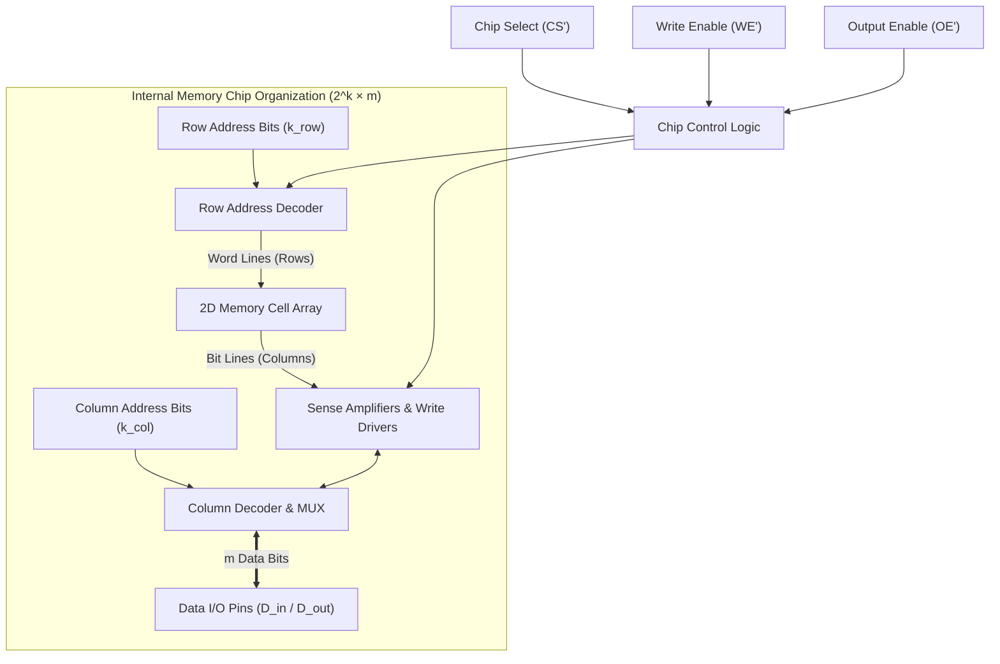
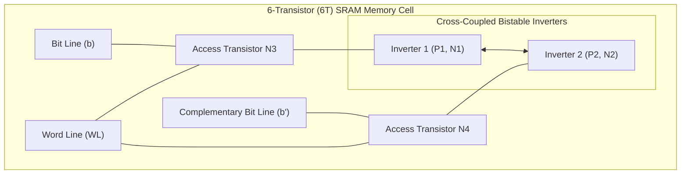
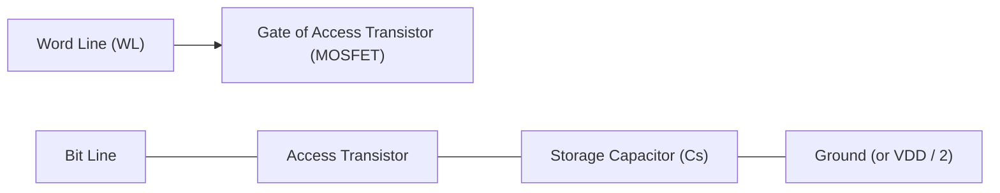
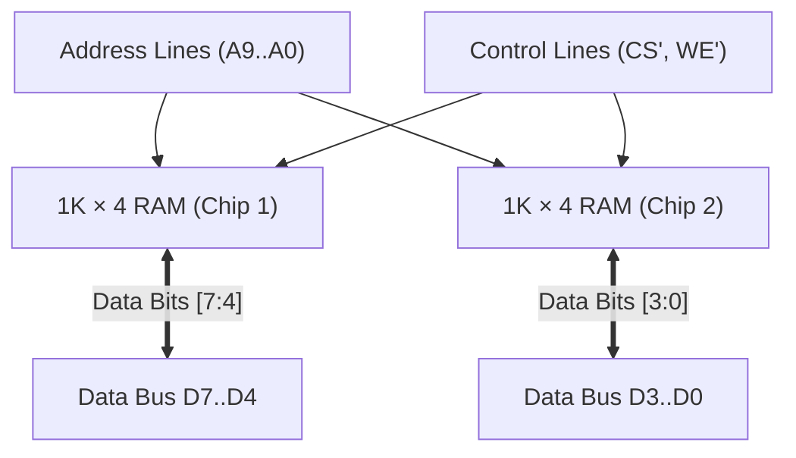
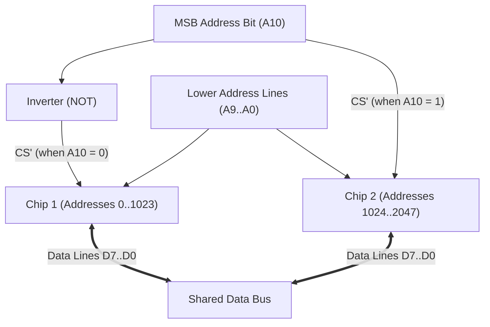
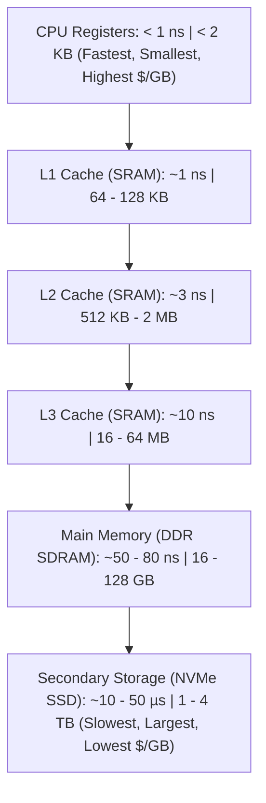
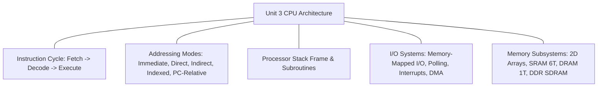

[DLCD Index](../README.md) / [Unit 3: Computer Structure and Organization](Introduction.md)

# L09 - Semiconductor RAM Memories

In the preceding lectures of Unit 3, we examined how processors execute instructions, evaluate addressing modes, and communicate with peripheral devices across buses. But every single instruction fetched by the CPU and every data block moved by DMA resides in **Semiconductor Random Access Memory (RAM)**.

What does RAM look like beneath the plastic packaging? How does silicon store a bit of charge, how do memory decoders select words among billions of cells, and why does main memory require constant "refreshing" to keep its data from evaporating?

In this final lecture of Unit 3, we dissect the internal 2D array organization of memory chips, contrast the **6T Static RAM (SRAM)** cell against the **1T Dynamic RAM (DRAM)** cell, trace **DDR SDRAM** architectures, and examine how memory chips are cascaded to expand word width and address capacity.

---

## Internal Organization of Memory Chips

A semiconductor memory chip is not laid out as a single long linear strip of bits. If you had an 8-megabit memory and organized it as a single line, you would need an 8,388,608-output address decoder—an impossible tangle of wiring!

Instead, memory cells are arranged as a compact **2-Dimensional Matrix (Array)** of horizontal **Word Lines (Rows)** and vertical **Bit Lines (Columns)**:



Let's trace how a memory access works:
1. **Address Splitting**: The total $k$ address bits are split into two halves: **Row Address bits** ($k_{\text{row}}$) and **Column Address bits** ($k_{\text{col}}$).
2. **Row Activation**: The **Row Address Decoder** decodes the row bits and activates exactly **one horizontal Word Line**. This simultaneously connects every memory cell in that entire row to its respective vertical bit lines.
3. **Column Selection**: The **Column Address Decoder** controls an internal multiplexer that selects $m$ specific bit lines out of the active row, routing them to the external data bus pins.

### Memory Control Lines
- **$\overline{\text{CS}}$ (Chip Select / Chip Enable)**: Activates the memory chip. When high (`1`), the chip is disabled, and its data pins are placed into High-Impedance (Hi-Z) mode to allow multiple chips to share the data bus.
- **$\overline{\text{WE}}$ (Write Enable)**: Dictates operation: `0` for Write (store data into RAM); `1` for Read (retrieve data from RAM).
- **$\overline{\text{OE}}$ (Output Enable)**: Connects the internal read sense amplifiers to the external data output pins during read cycles.

---

## Static RAM (SRAM)

In **Static RAM (SRAM)**, each bit is stored inside a cross-coupled bistable latch. As long as electrical power is supplied, the cell retains its stored state indefinitely—it never loses data and never needs refreshing.

The industry-standard SRAM cell uses **six transistors (the 6T SRAM Cell)**:



### The 6T Cell Mechanics:
- Four transistors form two cross-coupled CMOS inverters that maintain a bistable `0` or `1` voltage through positive feedback.
- Two n-channel transistors ($N_3, N_4$) act as **Access Switches** controlled by the horizontal **Word Line (WL)**.
- **Read Operation**:
  1. Both bit lines ($b$ and $\overline{b}$) are pre-charged to $V_{\text{DD}} / 2$.
  2. The Word Line goes High ($WL = 1$), turning on access transistors $N_3$ and $N_4$.
  3. The internal latch slightly pulls one bit line down toward $0\text{V}$ while leaving the other high.
  4. High-speed differential **Sense Amplifiers** detect this minute voltage difference (a few millivolts) and rapidly amplify it to a full logic `1` or `0`.
- **Write Operation**:
  1. The external write drivers strongly force $b = 1$ and $\overline{b} = 0$ (or vice versa).
  2. The Word Line goes High, overpowering the internal inverters and flipping the latch into the new state.

### SRAM Trade-Offs:
- **Advantages**: Ultra-fast access times (sub-nanosecond to $2\text{ ns}$), simple interfacing, no refresh cycles.
- **Disadvantages**: Large physical silicon area (6 transistors per single bit of data), high static power leakage, expensive per gigabyte.
- **Primary Usage**: **On-chip CPU Caches (L1, L2, L3 caches)** and high-speed embedded register files.

---

## Dynamic RAM (DRAM)

While SRAM is fast, using 6 transistors for every bit severely limits how much memory you can pack onto a chip. In 1968, Robert Dennard at IBM invented **Dynamic RAM (DRAM)**, reducing the memory cell to its absolute physical minimum:

> **The 1T DRAM Cell consists of exactly ONE transistor and ONE tiny capacitor ($C_s \approx 30\text{ femtofarads}$).**



### The 1T Cell Mechanics:
- **Writing**: The Word Line turns on the transistor. To write a `1`, the bit line charges the capacitor to $V_{\text{DD}}$; to write a `0`, the bit line discharges the capacitor to ground ($0\text{V}$).
- **Reading (Destructive Read!)**:
  The bit line is pre-charged to $V_{\text{DD}} / 2$. When the transistor opens, the tiny charge stored in capacitor $C_s$ shares charge with the bit line capacitance, causing a microscopic voltage perturbation ($\approx 50\text{ mV}$).
  *Notice something critical*: Reading the cell **discharges the capacitor**! If left alone, the stored bit is destroyed.
  Therefore, every DRAM read operation is immediately followed by a **Precharge / Rewrite phase**: the sense amplifier detects the bit, drives the bit line to full rail voltage ($V_{\text{DD}}$ or $0\text{V}$), and writes the original charge back into the capacitor!

---

### The Dynamic Problem: The DRAM Refresh Cycle

Silicon is not a perfect insulator. Sub-threshold leakage currents continuously bleed electrons off the microscopic storage capacitor:
- A charged DRAM capacitor loses its charge within a few tens of milliseconds!
- If left unassisted, all data in memory will completely evaporate.

To prevent data corruption, DRAM requires a dedicated **Refresh Controller**:

> **DRAM Refresh**: The memory controller must periodically access every single row in the DRAM array (typically once every **64 milliseconds**). Activating a row causes its sense amplifiers to read the charge and rewrite it back to full voltage, restoring the bits.

While the refresh controller operates transparently in the background, refresh cycles temporarily block CPU accesses, consuming $\approx 1\text{ to } 3\%$ of total DRAM bandwidth.

---

### SRAM vs. DRAM Comparison

| Feature | Static RAM (SRAM) | Dynamic RAM (DRAM) |
| :---: | :---: | :---: |
| **Cell Construction** | 6 Transistors (6T bistable latch) | 1 Transistor + 1 Capacitor (1T-1C) |
| **Silicon Density** | Low (large footprint per bit) | **Extremely High** (10× denser than SRAM) |
| **Cost per Gigabyte** | Expensive | Very Inexpensive |
| **Access Latency** | **$0.5 - 2.5\text{ ns}$** (Blazing fast) | **$10 - 50\text{ ns}$** (Slower) |
| **Refresh Needed?** | **No** (Retains state statically) | **Yes** (Must refresh every 64 ms) |
| **Read Cycle** | Non-destructive | **Destructive** (Requires automatic rewrite) |
| **Primary Usage** | CPU L1, L2, L3 Caches | Primary Main Memory (System RAM) |

---

## Synchronous DRAM (SDRAM) and DDR Architecture

In early computers, DRAM was **Asynchronous**: the CPU asserted row and column address strobes ($\overline{\text{RAS}}$ and $\overline{\text{CAS}}$), and had to wait an unpredictable analog duration for data to settle.

Modern computers use **SDRAM (Synchronous DRAM)**, where all memory operations are strictly synchronized to the system master clock.

### Double Data Rate (DDR) Architectures
In standard single-data-rate SDRAM, data is transferred once per clock cycle (on the rising clock edge).

To double memory bandwidth without doubling the clock frequency, the industry introduced **DDR (Double Data Rate) SDRAM**:
> **DDR transfers data on BOTH the rising edge AND the falling edge of the clock signal!**

```
Clock:       ___|‾‾‾‾|____|‾‾‾‾|____|‾‾‾‾|____
                ^    ^    ^    ^    ^    ^
Transfers:     D0   D1   D2   D3   D4   D5   (Two Transfers Per Clock Cycle!)
```

### The DDR Evolution: Prefetch Buffering
How does a DRAM chip feed data to the bus twice per clock cycle if the internal capacitor cells are relatively slow?

It uses **Prefetch Buffering**: the internal memory core reads multiple words in parallel and serializes them onto the high-speed bus:
- **DDR1**: 2-bit prefetch (reads 2 words internally, outputs 2 words per clock cycle).
- **DDR2**: 4-bit prefetch.
- **DDR3**: 8-bit prefetch.
- **DDR4**: 8-bit prefetch with independent Bank Groups.
- **DDR5**: 16-bit prefetch, dual 32-bit sub-channels, and on-die Error Correction Coding (ECC), achieving bus transfer rates exceeding **6,400 MegaTransfers per second (MT/s)**.

---

## Memory Expansion: Combining Memory Chips

In practical system design, you are often provided with small, modular memory chips and must combine them to build a larger memory subsystem.

Memory expansion takes two forms:

---

### 1. Expanding Word Length (Increasing Data Width)
Suppose you need a **$1\text{K} \times 8$ memory** (1,024 words of 8 bits each), but you only have **$1\text{K} \times 4$ memory chips**.

- **Analysis**: Both the desired memory and the chips have the same number of words ($1\text{K} = 1,024$, requiring 10 address lines: $A_9..A_0$). But the chips provide only 4 data bits, while the CPU requires 8 data bits.
- **Design**:
  - Connect all 10 address lines ($A_9..A_0$) in parallel to **both** chips.
  - Connect the Chip Select ($\overline{\text{CS}}$) and Write Enable ($\overline{\text{WE}}$) lines in parallel to both chips.
  - Connect Chip 1's data pins to data bus lines $D_7..D_4$ (Upper Nibble).
  - Connect Chip 2's data pins to data bus lines $D_3..D_0$ (Lower Nibble).



When an address is placed on the bus, both chips activate simultaneously, each supplying 4 bits to form the complete 8-bit byte.

---

### 2. Expanding Address Capacity (Increasing Word Count)
Now suppose you need a **$2\text{K} \times 8$ memory** (2,048 words of 8 bits each), but you only have **$1\text{K} \times 8$ memory chips**.

- **Analysis**: The data width (8 bits) already matches. But you need $2\text{K} = 2,048$ words, which requires **11 address lines** ($A_{10}..A_0$). Each chip has only 10 address pins ($A_9..A_0$).
- **Design**:
  - Connect the lower 10 address lines ($A_9..A_0$) in parallel to both chips.
  - Connect the 8 data bus lines ($D_7..D_0$) in parallel to both chips.
  - Use the most significant address bit (**$A_{10}$**) to select which chip is active:
    - Route $\overline{A_{10}}$ to the Chip Select ($\overline{\text{CS}}$) of Chip 1 (selected when $A_{10} = 0$, mapping addresses `0` to `1023`).
    - Route $A_{10}$ to the Chip Select ($\overline{\text{CS}}$) of Chip 2 (selected when $A_{10} = 1$, mapping addresses `1024` to `2047`).



---

## The Computer Memory Hierarchy

No single memory technology satisfies all needs: SRAM is fast but too small and expensive; DRAM is vast and cheap but too slow; SSDs are massive and non-volatile but orders of magnitude slower than the CPU clock.

Computer systems organize memory into a multi-tiered **Memory Hierarchy**:



By exploiting the **Principle of Locality** (Temporal and Spatial Locality), hardware keeps the data currently needed by the CPU in the fast upper caches, providing the illusion of a memory system that has the **speed of SRAM** with the **vast capacity and low cost of DRAM**.

---

## Unit 3 Summary: The Complete System Architecture

With semiconductor memory complete, we have assembled the entire macro-architecture of a computer:



We understand how a computer represents data, coordinates bus transactions, executes assembly instructions, services peripherals via interrupts, delegates bulk transfers via DMA, and accesses RAM arrays.

---

## Key Takeaways

- Memory chips are internally arranged as **2D Arrays** of rows (Word lines) and columns (Bit lines), controlled by row decoders, column multiplexers, and $\overline{\text{CS}}, \overline{\text{WE}}, \overline{\text{OE}}$ control lines.
- **SRAM** uses a **6-Transistor (6T)** bistable latch. It is ultra-fast ($< 2\text{ ns}$) and static (no refresh needed), but large and power-hungry, making it the choice for CPU caches.
- **DRAM** uses a **1-Transistor, 1-Capacitor (1T-1C)** cell. It is extraordinarily dense and cheap, but has destructive reads and requires **periodic refresh cycles every 64 ms** to prevent charge leakage.
- **DDR SDRAM** transfers data on **both clock edges** (rising and falling) and uses prefetch buffers to deliver gigabytes per second of memory bandwidth.
- Memory modules expand **word size** by wiring address lines in parallel and splitting data lines, and expand **address capacity** by decoding higher-order address bits to drive Chip Select ($\overline{\text{CS}}$) lines.
- The **Memory Hierarchy** bridges the speed-capacity gap by combining CPU registers, multi-level SRAM caches, dynamic RAM, and secondary storage.

---

We understand how instructions are fetched and how data flows across the CPU. But what happens *inside* the execution core when an instruction commands `MUL` or `DIV`? How does an ALU multiply signed numbers at hardware speed, how does it handle IEEE 754 floating-point decimals, and how does the Control Unit generate micro-timing signals to execute instructions?

We now enter our final conceptual territory: **Unit 4: Computer Arithmetic and Processing Unit / Control Unit Design**. Begin by reading the [**Unit 4 Introduction and Roadmap**](../Unit%204/Introduction.md), and then dive into [**L01 - Multiplication of Positive Numbers**](../Unit%204/L01%20-%20Multiplication%20of%20Positive%20Numbers.md).
