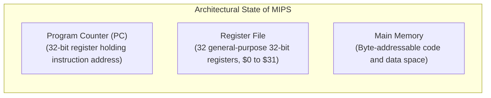
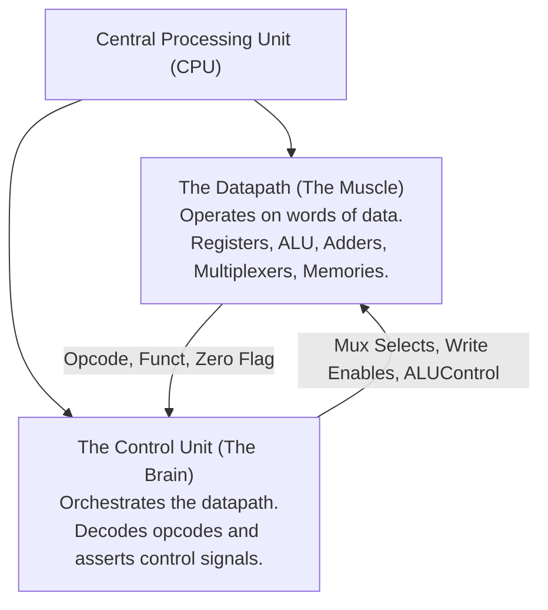
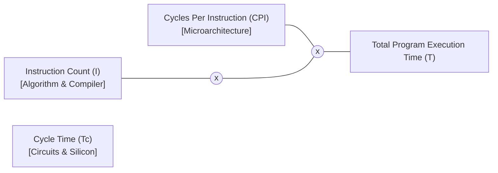
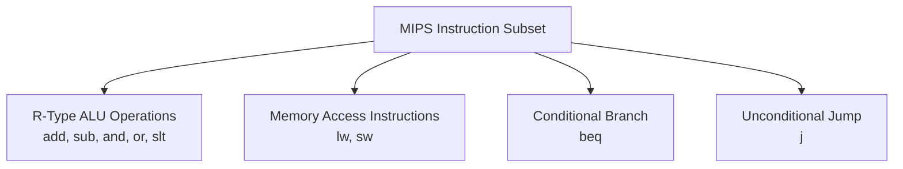

[DLCD Index](../README.md) / [Unit 4: Microarchitecture - Single-Cycle, Multi-Cycle, and Pipelined Processors](Introduction.md)

# L01 - Microarchitecture Fundamentals and Performance Analysis

In Unit 3, we studied the MIPS Instruction Set Architecture (ISA)—the contract between programmer and hardware. But an ISA is just a paper specification; it does not dictate how electrons flow through silicon. An architect could build a computer where every instruction takes one long clock cycle, or five short clock cycles, or an overlapped pipeline.

The specific hardware implementation of an architecture is its **Microarchitecture**.

In this lecture, we examine the formal division between **Datapath** and **Control**, define the **Architectural State** that hardware must maintain, analyze the **Iron Law of Processor Performance**, and introduce the representative subset of MIPS instructions we will synthesize throughout Unit 4.

---

## Architectural State: The Soul of the Machine

What defines the state of a running program at any instant in time? If you were to pause a computer, save its memory to disk, and restore it on another machine tomorrow, what data must be preserved?

The collection of storage elements visible to the programmer is called the **Architectural State**:

Every single MIPS instruction alters this architectural state:
- An arithmetic instruction (`add $s0, $s1, $s2`) updates one register in the Register File and advances the PC by 4.
- A store instruction (`sw $t0, 8($s3)`) updates 4 bytes in Memory and advances the PC by 4.
- A branch instruction (`beq $s0, $s1, Target`) updates the PC register with a new branch target address if the condition is met.

If a hardware implementation correctly updates the architectural state for every instruction according to the ISA manual, it is a valid microarchitecture—regardless of whether it uses one cycle, ten cycles, or deep pipelining!

---

## Datapath and Control: The Two Halves of a CPU

Inside any CPU core, hardware is cleanly partitioned into two collaborating subsystems:

1. **The Datapath (The Muscle)**: The network of functional units and buses that store, route, and operate on 32-bit words of data. It contains the Program Counter, Register File, ALU, Sign-Extension units, Adders, and Data Memory.
2. **The Control Unit (The Brain)**: The combinational logic or finite state machine that decodes the opcode and function fields of fetched instructions. It produces the binary control signals (Multiplexer selects, Register Write Enables, Memory Write Enables, ALU operations) that configure the datapath to execute each instruction.

---

## Three Microarchitectures for MIPS

To understand the engineering trade-offs of processor design, Harris & Harris examine three distinct microarchitectures that implement the exact same MIPS ISA:

### 1. The Single-Cycle Microarchitecture
- **Principle**: Executes an entire instruction in **one single, long clock cycle**.
- **Datapath**: Uses separate instruction memory and data memory. Each hardware block is used at most once per instruction.
- **Advantage**: Conceptually simple; $\text{CPI} = 1.0$.
- **Disadvantage**: The clock cycle must be stretched long enough to accommodate the slowest possible instruction (`lw`), penalizing faster instructions like `add` and `beq`.

### 2. The Multi-Cycle Microarchitecture
- **Principle**: Breaks each instruction into a series of **multiple shorter clock cycles** (e.g., 3 to 5 cycles per instruction).
- **Datapath**: Reuses a single shared memory and a single shared ALU across multiple cycles, using non-architectural internal registers (`IR`, `MDR`, `A`, `B`, `ALUOut`) to hold intermediate results.
- **Advantage**: Saves silicon area through hardware reuse; faster instructions finish in fewer cycles than complex instructions.
- **Disadvantage**: Higher CPI ($\approx 4.0$); requires complex Finite State Machine control.

### 3. The Pipelined Microarchitecture
- **Principle**: Partitions the datapath into **five discrete stages** (Fetch, Decode, Execute, Memory, Writeback).
- **Datapath**: Executes five different instructions simultaneously in parallel across overlapped stages.
- **Advantage**: Clock cycle time is short (the delay of a single stage); ideal throughput approaches **one instruction per clock cycle** ($\text{CPI} \approx 1.0$).
- **Disadvantage**: Susceptible to structural, data, and control hazards that require forwarding networks and stall logic.

---

## The Iron Law of Processor Performance

How do we quantitatively compare these three microarchitectures?
The total wall-clock execution time required to run a software program is governed by the **Iron Law of Processor Performance**:

$$\text{Execution Time} = \text{Instructions} \times \left( \frac{\text{Clock Cycles}}{\text{Instruction}} \right) \times \left( \frac{\text{Seconds}}{\text{Clock Cycle}} \right)$$

$$T = I \times \text{CPI} \times T_c = \frac{I \times \text{CPI}}{f}$$

Let us examine the three fundamental variables:
- **Instruction Count ($I$)**: The total number of dynamic instructions executed by the program. Determined by the algorithm, high-level programming language, compiler optimization, and the ISA.
- **Cycles Per Instruction ($\text{CPI}$)**: The average number of clock cycles required to execute an instruction. Determined by the microarchitecture and instruction mix.
  - Its reciprocal is **Instructions Per Cycle ($\text{IPC} = 1 / \text{CPI}$)**.
- **Clock Cycle Time ($T_c$)**: The duration of one clock cycle (the reciprocal of clock frequency: $T_c = 1 / f$). Determined by the critical path delay through combinational silicon and transistor technology.

### The Architectural Tug-of-War
Notice the fundamental tension in processor design:
- Reducing $\text{CPI}$ often lengthens $T_c$ (as in single-cycle design).
- Shortening $T_c$ by adding pipeline stages often increases $\text{CPI}$ due to hazard stalls and branch penalties.
- Increasing instruction expressiveness (like CISC) reduces $I$, but increases both $\text{CPI}$ and $T_c$ due to complex decoding.
A great computer architect optimizes the **product of all three terms ($I \times \text{CPI} \times T_c$)**, never just one in isolation.

---

## The MIPS Architectural Instruction Subset

To design complete, working datapaths without getting bogged down in dozens of redundant instructions, we focus on a representative **9-instruction subset** of MIPS that covers every fundamental datapath behavior:

1. **R-Type Computational Operations**: `add`, `sub`, `and`, `or`, `slt`.
   - Exercise the register file read ports, the 32-bit ALU, and the register writeback port.
2. **Memory Transfer Operations**: `lw` (Load Word) and `sw` (Store Word).
   - Exercise immediate sign extension, base-offset address addition, and Data Memory read/write.
3. **Conditional Branching**: `beq` (Branch if Equal).
   - Exercises the ALU subtraction zero-detector, branch target adder ($\text{PC} + 4 + \text{offset} \times 4$), and PC update multiplexer.
4. **Unconditional Jumps**: `j` (Jump).
   - Exercises pseudo-direct target concatenation ($(\text{PC}+4)_{31:28} \parallel \text{addr} \times 4$) and unconditional PC override.

Once our hardware executes these 9 instructions, supporting the remaining 100+ instructions in the full MIPS ISA requires only minor tweaks to the ALU decoder and multiplexers!

---

## Key Takeaways

- Architectural State consists of the Program Counter (PC), 32 general-purpose registers, and Main Memory. An instruction is valid if it updates this state correctly.
- A CPU consists of a Datapath (functional units operating on data words) and a Control Unit (decoding opcodes and generating control signals).
- Single-cycle processors execute instructions in one long clock cycle ($\text{CPI} = 1$); Multi-cycle processors break instructions into multiple shorter cycles ($\text{CPI} \approx 4$); Pipelined processors overlap instructions ($\text{CPI} \approx 1$ with high clock frequency).
- The Iron Law of Processor Performance: $\text{Execution Time} = I \times \text{CPI} \times T_c$.
- Modern high-performance architecture is an optimization balancing instruction count ($I$), cycles per instruction ($\text{CPI}$), and clock period ($T_c$).
- A representative 9-instruction subset (`add, sub, and, or, slt, lw, sw, beq, j`) exercises every fundamental datapath and control mechanism in a MIPS microprocessor.

---

Now that we have established the architectural baseline and performance metrics, let us construct our first processor! In the next lecture, [L02 - Single-Cycle MIPS Datapath Design](L02%20-%20Single-Cycle%20MIPS%20Datapath%20Design.md), we build the complete Single-Cycle MIPS datapath step by step.
